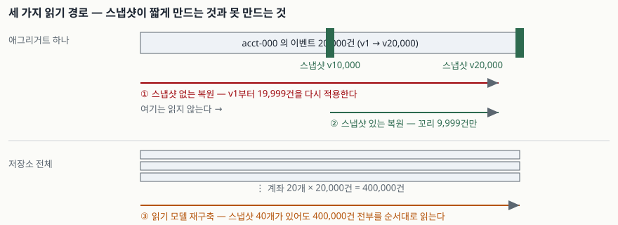

## 들어가며

주문 상태가 왜 그렇게 됐는지 추적할 수 없다는 불만이 몇 번 쌓이면, 팀은 "변경 이력을 전부
남기자"는 결론에 닿는다. 이벤트 소싱은 그 요구에 정확히 맞는 패턴이라 도입이 쉽게 결정된다.
그 다음 반년 동안 벌어지는 일은 대개 비슷하다. 주문 하나를 띄우는 데 걸리는 시간이 조금씩
늘고, 누군가 "스냅샷을 넣으면 된다"고 말하고, 스냅샷을 넣은 뒤에도 야간 배치가 느려지는
현상은 그대로 남는다. 늘어나는 비용이 한 종류가 아니기 때문이다. 어떤 비용이 스냅샷으로
줄고 어떤 비용이 안 줄어드는지를 40만 건짜리 저장소를 만들어 직접 쟀다.

## 개념

- **이벤트 소싱(event sourcing)**: 현재 상태 대신 그 상태에 이르기까지 일어난 **행위의 순서**를
  추가 전용(append-only) 저장소에 남기는 방식이다. 저장소가 기록의 원본이 된다.
- **재수화(rehydration)**: 한 엔티티의 이벤트 스트림을 처음부터 다시 적용해 현재 상태를
  만들어 내는 과정이다. Azure 아키텍처 센터의 패턴 문서가 이 이름을 쓴다.
- **스냅샷(snapshot)**: *N*건마다 그 시점의 상태를 직렬화해 따로 저장해 둔 것이다. 복원할 때
  가장 최근 스냅샷을 읽고 **그 뒤에 일어난 이벤트만** 적용한다.
- **구체화 뷰(materialized view) / 읽기 모델**: 질의에 맞춰 만들어 둔 읽기 전용 투영이다.
  이벤트를 다시 훑어 언제든 다시 만들 수 있다.

## 구조

읽기 경로가 하나가 아니라는 것이 이 글의 출발점이다. 스냅샷이 짧게 만드는 경로와 그렇지
않은 경로가 따로 있다.



> **출처**: [Azure Architecture Center — Event Sourcing pattern, "Problems and considerations" 중 Entity state re-creation 및 Versioning events 항목](https://learn.microsoft.com/en-us/azure/architecture/patterns/event-sourcing#problems-and-considerations)

## 동작 원리

복원 비용은 **적용할 이벤트 수 × 이벤트 하나의 처리 비용**이다. 두 번째 항이 일정하면 총비용은
이벤트 수에 비례한다. 즉 **엔티티가 오래 살아 있을수록 그 엔티티를 띄우는 비용이 비례해 늘어난다.**
주문처럼 수명이 짧은 엔티티는 문제가 안 되지만, 계좌·재고·구독처럼 몇 년을 사는 엔티티에서는
스트림이 수만 건으로 자란다.

스냅샷은 이 곱셈의 첫 항에 **상한**을 건다. *N*건마다 스냅샷을 두면 적용할 이벤트는 많아야
*N*−1건이다. 상수가 되는 것이 아니라 상한이 *N*으로 바뀌는 것이고, 평균은 대략 *N*/2다.

읽기 모델 재구축은 성격이 다르다. 입력이 "어느 엔티티의 현재 상태"가 아니라 **"모든 이벤트의
순서"**다. 스냅샷은 엔티티 단위로 만든 것이라 이 경로에서는 읽히지도 않는다.

## 실습 예제

전체 소스: [`code/`](code/) · 돌린 기록은 [`code/output.txt`](code/output.txt)에 있다.

계좌 20개에 각각 2만 건, 모두 40만 건을 인메모리 SQLite에 넣고 쟀다.

### 복원 비용은 이벤트 수에 비례한다

```text
  적용 이벤트 수   복원 시간(ms)   이벤트당(마이크로초)   잔액
           2,500             3.3                  1.335   250,000
           5,000             6.5                  1.302   500,000
          10,000            12.8                  1.276   1,000,000
          20,000            26.6                  1.330   2,000,000
```

이벤트당 비용이 1.28~1.34마이크로초로 거의 움직이지 않는다. 그래서 총 복원 시간이 이벤트 수를
그대로 따라간다. 여덟 배가 되면 여덟 배다.

### 스냅샷은 복원을 상수로 만들지 않는다

1만 건마다 스냅샷을 둔 뒤 복원 지점을 옮겨 가며 쟀다.

```text
  복원 지점 버전   복원 시간(ms)   스냅샷 뒤로 적용한 이벤트 수
          10,001             0.0                             1
          12,500             3.3                         2,500
          15,000             6.6                         5,000
          19,999            13.1                         9,999

  최악의 지점(19,999)  스냅샷 없음 26.7ms → 있음 13.3ms (2.0배)
```

**스냅샷 직후는 거의 공짜지만 다음 스냅샷 직전은 여전히 1만 건에 가깝다.** 2만 건짜리
애그리거트에 1만 건 간격 스냅샷을 두면 최악의 경우가 절반이 될 뿐이다. 2.0배라는 숫자는
"스냅샷을 넣으면 빨라진다"는 기대보다 훨씬 소박하다. 이득은 `스트림 길이 ÷ 스냅샷 간격`에
비례하므로, 20만 건짜리 스트림이라면 같은 간격에서 20배가 된다. **간격을 정하기 전에
스트림이 얼마나 길어질지를 먼저 봐야 한다는 뜻이다.**

### 읽기 모델 재구축은 스냅샷이 줄여 주지 않는다

```text
  저장소 전체 이벤트  400,000건
  보관 중인 스냅샷    40개
  재구축이 읽은 이벤트 400,000건  (= 전체의 100%)
  살아난 계좌 수      20개
```

스냅샷 40개가 있어도 읽은 건수가 한 건도 줄지 않는다. 야간 배치가 느려지는 현상이 스냅샷
도입 뒤에도 그대로인 이유가 이것이다. 재구축 비용을 줄이려면 스냅샷이 아니라 **투영 단위의
체크포인트**(어디까지 반영했는지 기록해 두고 그 뒤부터 이어 읽는 것)가 필요하다.

### 업캐스터는 한 번 생기면 지워지지 않는다

이벤트 스키마가 v1에서 v2로 바뀐 계좌를 하나 만들었다. v1은 금액을 `amount_str` 문자열에,
v2는 `amount` 정수에 담는다.

```text
  acct-legacy 의 이벤트 (v1 2건 + v2 1건)
    v1  version=1  {"amount_str": "500"}
    v1  version=2  {"amount_str": "200"}
    v2  version=3  {"amount": 300}

  업캐스터 없이 복원: KeyError 'amount' — 옛 이벤트를 해석하지 못한다
  업캐스터를 끼운 복원: 잔액 600 (500 - 200 + 300 = 600 과 일치)
```

이벤트는 불변이라 v1 레코드는 **지워지지 않는다.** 따라서 v1을 아는 변환 코드도 그 이벤트가
저장소에 남아 있는 한 계속 유지해야 한다. 스키마를 세 번 바꾸면 업캐스터가 세 개 쌓이고,
그 셋을 전부 통과시키는 비용이 복원할 때마다 붙는다. 이것이 복원 비용의 **두 번째 항**,
즉 이벤트 하나의 처리 비용을 조용히 올리는 경로다.

### 측정의 잡음

```text
  1절의 20,000건 복원을 맨 끝에서 다시 재면  71.2ms
```

같은 일을 같은 프로세스 안에서 다시 쟀는데 26.6ms가 71.2ms로 나왔다. 이 환경(하이브리드
CPU를 쓰는 윈도우 노트북)에서는 프로세스가 느린 코어로 옮겨 가면 2.7배까지 벌어진다.
그래서 **위 수치들은 자릿수만 보고, 결론은 구조적 사실에서만 끌어냈다.** 이벤트당 비용이
일정하다는 것, 스냅샷이 꼬리 길이를 제한한다는 것, 재구축이 전부를 읽는다는 것 셋이다.

## 실무에서 주의할 점

- **스냅샷 간격은 스트림 길이를 보고 정한다.** 간격 *N*은 복원 비용의 상한을 정하는 값이지
  성능을 켜는 스위치가 아니다. 스트림이 짧으면 스냅샷을 만드는 비용과 보관 비용만 늘고
  이득이 거의 없다. 위 측정에서 2만 건짜리 스트림에 1만 건 간격을 두니 2.0배에 그쳤다.
- **스냅샷은 진실의 원본이 아니다.** 원본은 이벤트 스트림이고 스냅샷은 언제든 다시 만들 수
  있는 캐시다. 애그리거트의 적용 로직에 버그가 있었다면 **스냅샷에 그 버그가 굳어 있으므로**
  고친 뒤 전부 다시 만들어야 한다. 스냅샷에 스키마 버전을 같이 남겨 두지 않으면 이때 어느
  것을 버려야 하는지 알 수 없다.
- **투영 재구축 시간을 운영 지표로 잡아 둔다.** 이 값은 이벤트 총량을 따라 단조 증가하고
  스냅샷으로 줄지 않는다. "장애가 나면 읽기 모델을 다시 만들면 된다"는 복구 계획은
  재구축이 몇 시간짜리가 되는 순간 계획이 아니게 된다. 저장소가 커지기 전에 재어 둔다.
- **스키마 변경 전략을 처음에 정한다.** 관용적 역직렬화(모르는 필드 무시), 이벤트 버저닝,
  업캐스팅, 그리고 최후 수단인 제자리 마이그레이션 중 무엇을 쓸지를 정해 두지 않으면
  첫 변경 때 제자리 마이그레이션으로 기운다. 그건 불변성을 깨서 감사 추적을 무너뜨린다.
- **개인정보는 이벤트 밖에 둔다.** 추가 전용 저장소는 삭제 요구와 정면으로 부딪힌다.
  식별자만 이벤트에 남기고 실제 값은 밖에 두거나, 분리할 수 없으면 주체별 키로 암호화해
  두고 키를 지우는 방식을 쓴다. 이벤트를 직접 지우면 스트림이 깨진다.
- **전부에 적용하지 않는다.** 결제 원장이나 주문 처리처럼 이력 자체가 요구사항인 곳에만
  쓰고, 사용자 프로필이나 설정 같은 곳은 그냥 CRUD로 둔다.

## 정리

- 복원 비용은 `적용 이벤트 수 × 이벤트당 처리 비용`이고, 측정에서 두 번째 항은 1.3마이크로초
  근처로 일정했다. 그래서 총비용이 이벤트 수에 비례한다.
- 스냅샷은 첫 항에 상한을 걸 뿐이다. 간격 *N*이면 최악 *N*−1건, 평균 *N*/2건이다.
  2만 건 스트림에 1만 건 간격은 2.0배밖에 안 됐다.
- 읽기 모델 재구축은 스냅샷 40개가 있어도 40만 건 전부를 읽었다. 이 경로에는
  투영별 체크포인트가 필요하다.
- 업캐스터는 그 버전의 이벤트가 저장소에 남아 있는 한 지워지지 않는다. 스키마를 바꿀수록
  이벤트당 처리 비용이 올라간다.

## 참고 자료

- [Azure Architecture Center — Event Sourcing pattern](https://learn.microsoft.com/en-us/azure/architecture/patterns/event-sourcing)
- [Azure Architecture Center — CQRS pattern](https://learn.microsoft.com/en-us/azure/architecture/patterns/cqrs)
- [Azure Architecture Center — Materialized View pattern](https://learn.microsoft.com/en-us/azure/architecture/patterns/materialized-view)
- [SQLite — Query Planner](https://www.sqlite.org/optoverview.html)
