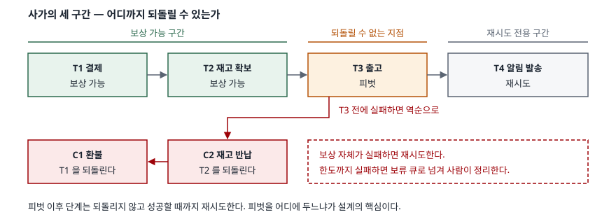

## 들어가며

주문 처리를 결제·재고·배송 세 서비스로 쪼개고 나면 곧 이런 주문이 생긴다.
결제는 승인됐는데 배송은 안 잡혔고, 고객 화면에는 "처리 중"만 떠 있다.
DB가 하나였을 때는 `ROLLBACK` 한 줄로 끝나던 일이다.

여기서 보통 하는 일은 `try/except` 안에 취소 호출을 역순으로 넣는 것이다.
배송 예약이 실패하면 재고를 반납하고 환불을 건다. 로컬에서 돌려 보면 잘 돈다.
그런데 운영에 올리면 **취소 호출 자체가 실패하는 경우**가 나온다. 그때 할 수 있는
일이 마땅치 않아서 보통은 `logger.error(...)` 한 줄을 찍고 넘어간다.

그 로그가 한 달에 수십 건 쌓인 뒤에야 문제가 드러난다. 돈은 빠져나갔는데 재고는
돌아온 주문, 재고는 그대로인데 환불만 된 주문이 섞여 있고, 어느 쪽이 몇 건인지
세는 쿼리조차 없다. 보상은 "실패하면 되돌린다"는 한 줄로 끝나는 일이 아니다.

## 개념

사가는 **하나의 긴 트랜잭션을 로컬 트랜잭션의 순서열로 쪼개고, 각 단계마다
그것을 의미적으로 되돌리는 보상 트랜잭션을 함께 정의하는 방식**이다. 1987년
Garcia-Molina와 Salem의 논문이 이름과 틀을 제시했고, 지금 마이크로서비스에서
쓰는 형태도 같은 구조다.

핵심은 **되돌림의 성격이 다르다**는 것이다. DB의 롤백은 커밋 전 상태를
물리적으로 복원한다. 보상은 그럴 수 없다. 각 단계가 이미 **커밋해 버렸기**
때문이다. 그래서 보상은 "없던 일로 만들기"가 아니라 **반대 방향의 새 트랜잭션**이다.
결제를 취소하는 것이 아니라 환불을 하고, 재고 차감을 지우는 것이 아니라 재고를
되돌려 넣는다.

이 차이에서 어려움이 전부 파생된다. 보상이 새 트랜잭션이라면 보상도 실패할 수
있고, 보상이 돌기 전에 남이 중간 상태를 읽을 수 있고, 보상 메시지가 두 번
배달될 수도 있다.

## 구조

단계들은 전부 같은 성격이 아니다. 공식 문서는 셋으로 가른다.
**보상 가능(compensable)**, **피벗(pivot)**, **재시도 전용(retryable)** 이다.



> **출처**: [Saga design pattern — Key concepts in the Saga pattern (Azure Architecture Center)](https://learn.microsoft.com/en-us/azure/architecture/patterns/saga)

피벗은 **되돌릴 수 없는 지점**이다. 실제로 상자가 창고를 떠났다면 그 뒤로는
보상이 없고, 남은 단계는 성공할 때까지 재시도하는 수밖에 없다. 설계에서 가장
먼저 정할 것이 "피벗을 어디에 둘 것인가"인 이유다. 피벗을 앞으로 당길수록
되돌릴 수 있는 범위가 줄고, 뒤로 미룰수록 되돌려야 할 단계가 늘어난다.

## 동작 원리

실패가 났을 때 사가는 **수행이 끝난 단계들을 역순으로** 보상한다. 순서가 중요하다.
재고를 먼저 반납하고 환불하면 중간에 멈췄을 때 "물건도 있고 돈도 뺏긴" 상태가
남는다. 역순이면 중간에 멈춰도 고객에게 불리한 쪽이 먼저 해소된다.

실무에서 가장 자주 틀리는 자리는 **타임아웃의 해석**이다. 요청을 보냈는데 응답이
없으면 그것은 "실패했다"가 아니라 **"모른다"**다. 상대 서비스는 이미 처리했을 수
있다. 그러면 그 단계는 보상 대상에서 빼면 안 된다. 아래 예제가 타임아웃난 단계를
수행 목록에 넣고 보상하는 이유다.

```python
if step.name == fail_step:
    store.record(f"[실패] {step.name}: 응답 없음 (타임아웃)")
    # 타임아웃은 '안 됐다'가 아니라 '모른다'다. 동작은 이미 반영됐으므로
    # 이 단계까지 포함해 되돌려야 한다.
    done.append(step)
    return compensate(store, order_id, done, failing, idempotent_compensation)
```

이 선택 때문에 보상이 **두 번 도는 일이 정상 경로가 된다.** 상대가 처리하지
않았는데 보상을 받을 수도 있고, 보상 메시지가 재전송돼 같은 보상이 두 번 도착할
수도 있다. 그래서 보상은 **멱등**해야 한다.

## 실습 예제

세 단계(결제 → 재고 확보 → 배송 예약)를 돌리면서 실패 지점을 바꿔 가며 상태를 본다.
난수를 쓰지 않으므로 몇 번을 돌려도 같은 출력이 나온다.
전체 소스: [`code/saga.py`](code/saga.py) · 돌린 기록: [`code/output.txt`](code/output.txt)

마지막 단계가 타임아웃나면 역순 보상으로 시작 상태까지 되돌아온다.

```text
      결제    -30,000  → 잔액  70,000 · 재고 3 · 배송 0건
      재고확보 -1       → 잔액  70,000 · 재고 2 · 배송 0건
      배송예약 ORD-2   → 잔액  70,000 · 재고 2 · 배송 1건
      [실패] 배송 예약: 응답 없음 (타임아웃)
      배송취소 ORD-2   → 잔액  70,000 · 재고 2 · 배송 0건
      재고반납 +1       → 잔액  70,000 · 재고 3 · 배송 0건
      환불    +30,000  → 잔액 100,000 · 재고 3 · 배송 0건
```

여기까지는 교과서다. 보상 쪽이 응답하지 않기 시작하면 달라진다.

```text
      배송취소 ORD-4   → 잔액  70,000 · 재고 2 · 배송 0건
      재고반납 +1       → 잔액  70,000 · 재고 3 · 배송 0건
      [보상 실패] 결제 1차 시도 — 서비스 무응답
      [보상 실패] 결제 2차 시도 — 서비스 무응답
      [보상 실패] 결제 3차 시도 — 서비스 무응답
      [보류] 결제 보상을 3회 모두 실패 — 사람이 처리할 큐로
  최종: 잔액  70,000 · 재고 3 · 배송 0건  ← 재고는 돌아왔는데 돈은 안 돌아왔다
```

**재고 3개는 그대로인데 잔액은 70,000원이다.** 고객 돈만 사라진 상태다.
이것이 사가의 바닥이다. 아무리 잘 짜도 보상이 끝내 실패하는 경우는 남고,
그때 시스템이 할 수 있는 일은 **그 사실을 잃어버리지 않는 것**뿐이다.
예제가 보류 큐로 넘기는 이유다.

중복 배달은 또 다른 방향으로 무너진다. 같은 보상이 두 번 도착했을 때
멱등하지 않으면 이렇게 된다.

```text
  ─ 같은 보상 메시지가 중복 배달됐다고 하자
      재고반납 +1       → 잔액 100,000 · 재고 4 · 배송 0건
      환불    +30,000  → 잔액 130,000 · 재고 4 · 배송 0건
  최종: 잔액 130,000 · 재고 4 · 배송 0건  ← 재고와 잔액이 시작값을 넘었다
```

처음에 3개였던 재고가 4개가 되고 10만 원이던 잔액이 13만 원이 됐다.
**없던 물건과 없던 돈이 생겼다.** 보상이 실패하는 것보다 이쪽이 나쁘다.
실패는 보류 큐에 남기라도 하지만, 이건 아무 데도 기록이 남지 않은 채
숫자만 틀린다. 처리한 키를 기억하게 하면 같은 중복 배달이 상태를 건드리지 않는다.

```text
      재고반납 건너뜀 (이미 처리된 키 ORD-6)
      환불    건너뜀 (이미 처리된 키 ORD-6)
  최종: 잔액 100,000 · 재고 3 · 배송 0건  ← 시작 상태 그대로
```

마지막으로, 보상이 완벽하게 돌아도 **그 사이에 남이 본 것은 되돌릴 수 없다.**

```text
      재고확보 -1       → 잔액  70,000 · 재고 2 · 배송 0건
  ─ 여기서 다른 손님이 재고를 묻는다 → 2개
  ─ ORD-7 은 곧 실패해 재고를 반납할 것이지만, 지금 답은 그 사실을 모른다
```

사가는 각 단계를 커밋하므로 **중간 상태가 커밋된 상태로 외부에 노출된다.**
공식 문서가 더티 리드·분실 갱신·반복 불가능한 읽기를 사가의 데이터 이상으로
따로 정리해 둔 것이 이 때문이다.

## 실무에서 주의할 점

- **보상은 반드시 멱등하게 만든다.** 메시지 중복 배달과 타임아웃 재시도가
  합쳐지면 같은 보상이 두 번 도는 것은 예외가 아니라 일상이다. 주문 ID 같은
  자연 키로 처리 여부를 기록하고, 이미 처리한 키면 조용히 건너뛴다.
- **타임아웃난 단계를 보상 대상에서 빼지 않는다.** 응답이 없다는 것은 실패가
  아니라 모른다는 것이다. 멱등한 보상이 있으면 "일단 되돌린다"가 안전하고,
  멱등하지 않으면 그 순간 위의 중복 배달 문제로 바뀐다.
- **보상 실패를 로그로 끝내지 않는다.** 재시도 한도를 두고, 한도를 넘으면
  사람이 볼 수 있는 보류 큐로 보낸다. 큐에 쌓인 건수가 곧 "지금 데이터가
  얼마나 어긋나 있는가"이므로 이 값은 대시보드에 올라가야 한다.
- **피벗을 의식적으로 고른다.** 실제 출고·외부 송금·메일 발송처럼 되돌릴 수
  없는 작업은 뒤로 몰고, 그 앞까지만 보상 가능하게 둔다. 피벗 이후 단계는
  보상이 아니라 **성공할 때까지 재시도**로 다룬다.
- **격리가 없다는 것을 전제로 설계한다.** 중간 상태를 남이 읽는다. 공식 문서가
  드는 대응책은 의미적 잠금(처리 중 표시), 교환 가능한 갱신, 비관적 관점
  (갱신을 재시도 구간으로 미루기), 값 재확인, 버전 파일이다. 아무것도 안 하면
  "곧 취소될 주문 때문에 다른 손님이 품절을 보는" 상황이 그대로 남는다.
- **역순 보상의 순서를 바꾸지 않는다.** 고객에게 불리한 상태(돈은 빠졌는데
  물건은 없는)가 먼저 해소되도록 정렬한다. 중간에 멈추는 경우가 반드시 생기므로
  "어디서 멈춰도 덜 나쁜 순서"가 설계 대상이다.

## 정리

- 보상은 롤백이 아니라 **반대 방향의 새 트랜잭션**이다. 이미 커밋된 것을
  의미적으로 상쇄할 뿐이다.
- 그래서 보상도 실패한다. 재시도 한도와 **보류 큐**가 없으면 어긋난 데이터가
  조용히 쌓인다.
- 타임아웃은 실패가 아니라 모름이다. 보상 대상에 넣어야 하고, 그러려면 보상이
  **멱등**해야 한다. 멱등하지 않은 보상의 중복 배달은 없던 재고와 돈을 만든다.
- 단계는 보상 가능·피벗·재시도 전용 **세 구간**으로 갈린다. 피벗 위치가 설계의
  중심이다.
- 사가에는 격리가 없다. 중간 상태가 외부에 보이는 것을 전제로 대응책을 고른다.

## 참고 자료

- [Hector Garcia-Molina, Kenneth Salem, "SAGAS", Princeton Technical Report TR-070-87 (1987-01)](https://www.cs.princeton.edu/research/techreps/598)
- [Saga design pattern — Azure Architecture Center](https://learn.microsoft.com/en-us/azure/architecture/patterns/saga)
- [Idempotent Consumer pattern — Azure Architecture Center](https://learn.microsoft.com/en-us/azure/architecture/patterns/idempotent-consumer)
