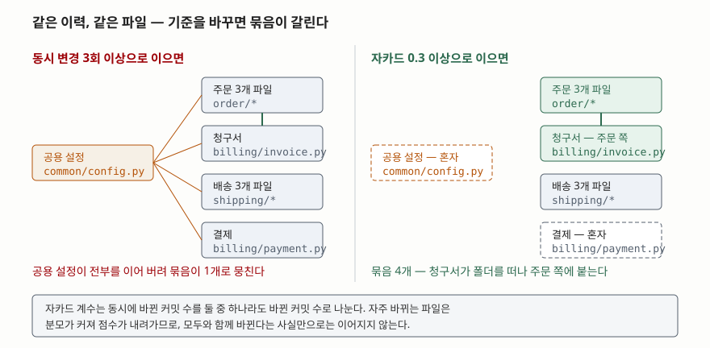

## 들어가며

서비스를 쪼개자는 이야기가 나오면 회의실 화이트보드에 제일 먼저 그려지는 것은
폴더 트리다. `order`, `shipping`, `billing` 이 나란히 있으니 셋으로 나누면
되겠다는 결론이 20분 만에 난다.

그런데 쪼개고 나면 배포 때마다 둘을 같이 올려야 하는 일이 생긴다. 주문 쪽 필드
하나를 고쳤는데 청구 서비스가 깨지고, 롤백도 둘을 함께 해야 한다. 쪼개기 전에는
한 커밋이던 변경이 이제 두 저장소에 걸친 두 개의 PR과 배포 순서 협의가 된다.
나누는 비용은 한 번 치르는 것이 아니라 **배포할 때마다 치른다.**

문제는 폴더 이름이 **사람이 처음에 생각한 경계**일 뿐이라는 데 있다. 코드가
실제로 어떻게 묶여 왔는지는 다른 곳에 기록돼 있다. 커밋 이력이다. **한 커밋에
함께 들어간 파일들은 하나의 변경 이유를 공유한다.** 이력을 몇 년치 쌓아 두고
보면, 설계 문서에 없는 경계가 거기 그려져 있다.

## 개념

함께 바뀌는 관계를 **논리적 결합(logical coupling)** 이라고 부른다. 코드에
`import` 가 없어도, 호출 관계가 없어도, 같은 이유로 늘 함께 고쳐지는 파일들은
사실상 묶여 있다는 관점이다. 소프트웨어 저장소 이력에서 이 관계를 뽑아내는
접근은 1998년 Gall 등의 논문에서 제안됐고, 20개 릴리스 분량의 대형 교환기
시스템 이력에서 모듈 간 의존과 변경 패턴을 찾아냈다.

정적 분석과 비교하면 서로 보는 것이 다르다.

| | 정적 분석 (import·호출 그래프) | 커밋 이력 (논리적 결합) |
|---|---|---|
| 근거 | 코드에 적힌 참조 | 실제로 함께 바뀐 기록 |
| 잡아내는 것 | 컴파일러가 아는 의존 | 공유 상수, 암묵적 규약, 같은 요구사항 |
| 놓치는 것 | 코드에 안 적힌 결합 | 한 번도 고친 적 없는 안정된 의존 |

쪼갤 경계를 고를 때 필요한 것은 두 번째다. **배포 비용을 만드는 것은 "같이 바뀌는
것"이지 "서로 부르는 것"이 아니기 때문이다.** 서로 호출해도 각자 안정돼 있으면
나눠도 비용이 거의 없고, 호출하지 않아도 늘 함께 고쳐지면 나누는 순간 비용이 생긴다.

## 구조

측정은 간단하다. 커밋마다 바뀐 파일 집합을 모으고, 파일 쌍이 몇 번 함께 들어갔는지
센 뒤, 일정 기준을 넘는 쌍을 선으로 잇는다. 이어진 덩어리가 묶음 후보다.

이때 **무엇을 기준으로 삼느냐가 결과를 통째로 바꾼다.**



> **출처**: 수치는 이 글의 실행 기록 [`code/output.txt`](code/output.txt) 2~4절. 논리적 결합을 이력에서 찾는 접근은 [Gall, Hajek, Jazayeri — Detection of Logical Coupling Based on Product Release History, ICSM 1998](https://doi.org/10.1109/ICSM.1998.738508)

왼쪽은 동시 변경 **횟수**로 이은 결과다. 설정 파일 하나가 모든 모듈과 함께
바뀌면서 전부를 이어 버렸다. 오른쪽은 같은 이력을 **자카드 계수**로 이은 결과다.
자주 바뀌는 파일은 분모가 커져 점수가 내려가므로 설정 파일이 떨어져 나가고,
세 덩어리가 드러난다.

## 동작 원리

두 기준의 차이는 식 하나다. 파일 A와 B가 함께 바뀐 커밋 수를 `both` 라고 하자.

- **동시 변경 횟수**: `both` 를 그대로 쓴다
- **자카드 계수**: `both / (A가 바뀐 커밋 수 + B가 바뀐 커밋 수 - both)`

분모는 **둘 중 하나라도 바뀐 커밋 수**, 즉 합집합이다. 설정 파일처럼 혼자서도
자주 바뀌는 파일은 분모가 커져 점수가 내려간다. 반대로 둘 다 드물게 바뀌는데
바뀔 때마다 같이 바뀌면 점수가 1에 가까워진다. **"몇 번 같이 바뀌었나" 대신
"바뀔 때 같이 바뀔 확률이 얼마나 되나"를 재는 것이다.**

묶는 방법은 연결 요소다. 기준을 넘는 쌍을 간선으로 두고, 이어진 정점들을 한
묶음으로 모은다. 이 방식은 간단한 대신 **한 간선만 있어도 두 덩어리가 합쳐진다.**
설정 파일이 왼쪽 그림에서 전부를 뭉쳐 버린 것이 그 성질 때문이다.

## 실습 예제

전체 소스: [`code/`](code/) · 실행 기록: [`code/output.txt`](code/output.txt)

예제는 임시 폴더에 **진짜 git 저장소를 만들고** 정해 둔 26개 커밋을 쌓은 뒤
`git log --name-only` 를 읽는다. 이력은 가상이지만 집계와 군집화는 실제로 돌린
결과다. 파일은 아홉 개이고, 폴더는 `order` · `shipping` · `billing` · `common` 네 갈래다.

먼저 파일별 변경 횟수가 이렇게 나온다.

```text
  파일별 변경 횟수
    billing/invoice.py         7
    billing/payment.py         5
    common/config.py          13
    order/api.py               7
    order/model.py             5
    order/service.py          10
    shipping/api.py            6
    shipping/service.py        8
    shipping/tracking.py       5
```

`common/config.py` 가 26개 커밋 중 13개에 들어 있다. 절반이다. 동시 변경 상위
쌍을 보면 이 파일이 어떤 일을 하는지 드러난다.

```text
  파일 쌍                                                     동시     자카드
  billing/invoice.py + order/service.py                     5   0.417
  order/api.py + order/service.py                           5   0.417
  shipping/api.py + shipping/service.py                     5   0.556
  shipping/service.py + shipping/tracking.py                5   0.625
  billing/invoice.py + common/config.py                     4   0.250
  billing/payment.py + common/config.py                     4   0.286
  common/config.py + order/service.py                       4   0.211
```

설정 파일이 낀 쌍은 동시 변경이 4회로 적지 않은데 자카드는 0.21~0.29로 낮다.
13번 바뀌는 동안 상대와 같이 바뀐 것은 네 번뿐이기 때문이다.

동시 변경 횟수로 묶으면 이렇게 된다.

```text
  동시 변경 3회 이상 — 묶음 1개
  묶음 1: billing/invoice.py, billing/payment.py, common/config.py, order/api.py,
          order/model.py, order/service.py, shipping/api.py, shipping/service.py,
          shipping/tracking.py
```

아홉 개가 전부 한 덩어리다. 기준을 4회로 올려도 두 덩어리로 갈릴 뿐이고, 그
둘도 설정 파일이 어느 한쪽에 붙어 있다. 자카드로 바꾸면 결과가 달라진다.

```text
  자카드 0.3 이상 — 묶음 4개
  묶음 1: billing/invoice.py, order/api.py, order/model.py, order/service.py
  묶음 2: billing/payment.py
  묶음 3: common/config.py
  묶음 4: shipping/api.py, shipping/service.py, shipping/tracking.py
```

**여기서 예상과 달랐던 것은 `billing` 폴더가 갈라졌다는 점이다.**
`billing/invoice.py` 가 같은 폴더의 `billing/payment.py` 가 아니라 `order` 쪽에
붙었다. 숫자를 보면 이유가 분명하다. 청구서와 주문 서비스가 같이 바뀐 커밋이
5회(자카드 0.417)인 반면, 청구서와 결제는 2회(0.2)다. 주문을 고칠 때마다 청구서를
고쳐 왔다는 뜻이고, **이 둘을 다른 서비스로 가르면 배포가 늘 짝을 이루게 된다.**

기준을 0.4로 올려도 묶음은 그대로 4개였다. `order/model.py` 와 `order/service.py`
사이는 0.364로 끊기지만, `order/api.py` 를 거쳐 여전히 이어지기 때문이다.
묶음이 기준값에 민감하지 않다는 것은 그 경계가 어느 정도 버틴다는 신호다.

## 실무에서 주의할 점

- **모두와 함께 바뀌는 파일을 먼저 골라낸다.** 예제의 설정 파일 자리에 실제
  저장소에서는 의존성 잠금 파일, 빌드 설정, 다국어 리소스 번들, 공용 상수 파일이
  온다. 이것들은 결합의 증거가 아니라 **측정을 가리는 잡음**이다. 자카드 같은
  정규화된 지표를 쓰거나, 변경 횟수 상위 몇 개를 아예 빼고 재는 편이 낫다.
- **대량 변경 커밋을 걸러 낸다.** 포매터를 한 번 돌리거나 라이선스 헤더를
  일괄로 붙인 커밋은 수백 개 파일을 한 번에 묶는다. 한 커밋이 건드린 파일 수에
  상한을 두고 그보다 큰 커밋은 집계에서 빼는 것이 보통이다.
- **파일이 옮겨 다닌 이력을 따라간다.** 폴더 구조를 리팩터링했으면 같은 파일이
  이름이 다르다는 이유로 둘로 세어진다. `git log --follow` 나 이름 변경 추적을
  켜지 않으면 경계가 역사 이전과 이후로 쪼개진다.
- **구간을 잘라 두 번 재 본다.** 3년치를 통으로 재면 2년 전에 끝난 결합이
  지금의 결합처럼 보인다. 최근 6개월과 그 이전을 따로 재서 **달라진 쌍이 있는지**
  보면, 경계가 이미 움직이고 있는지 알 수 있다.
- **결과는 가설이지 결론이 아니다.** 함께 바뀌었다는 사실은 이유를 말해 주지
  않는다. 진짜 도메인 결합일 수도 있고, 두 파일을 같은 사람이 맡고 있었을 뿐일
  수도 있다. 묶음을 뽑은 다음에는 그 묶음에 해당하는 커밋 메시지를 실제로 읽어
  보고, 왜 함께 바뀌었는지 설명이 되는지를 확인한다.

## 정리

- 쪼갤 경계를 정할 때 보아야 할 것은 호출 관계가 아니라 **함께 바뀌어 온 기록**이다.
- 동시 변경 횟수만 세면 자주 바뀌는 공용 파일이 전부를 이어 하나로 뭉친다.
- 자카드 계수는 합집합으로 나누므로 그런 파일이 떨어져 나가고 덩어리가 드러난다.
- 예제에서는 `billing` 폴더가 갈라져 청구서가 주문 쪽에 붙었다. 폴더 이름이 곧
  경계가 아니라는 것이 숫자로 나온 셈이다.
- 나온 묶음은 가설이다. 해당 커밋들을 읽어 이유가 설명되는지 확인한 뒤에 쓴다.

## 참고 자료

- [Gall, Hajek, Jazayeri — Detection of Logical Coupling Based on Product Release History, ICSM 1998](https://doi.org/10.1109/ICSM.1998.738508)
- [git — git-log Documentation (`--name-only`, `--follow`)](https://git-scm.com/docs/git-log)
- [Martin Fowler — MonolithFirst](https://martinfowler.com/bliki/MonolithFirst.html)
