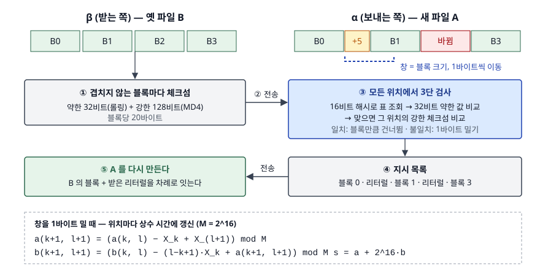

## 들어가며

어제 받아 둔 수백 MB짜리 로그 묶음이나 데이터 덤프가 오늘 조금 바뀌었다. 바뀐 곳은 몇 줄뿐인데 다시 내려받으면 파일 전체가 다시 온다. 그래서 파일을 일정 크기로 잘라 조각마다 해시를 비교하고 다른 조각만 받는 방법을 떠올린다. 그런데 파일 **앞쪽에 한 줄만 끼어들어도** 그 뒤 조각의 경계가 전부 밀린다. 이 글의 실험에서는 5바이트 삽입 하나로 조각 339개 중 338개가 "다르다"고 판정됐고, 결국 원본보다 많은 바이트를 보냈다. rsync 는 이 문제를 조각 경계를 고정하지 않는 방법으로 푼다.

## 개념

rsync 알고리즘은 Andrew Tridgell 과 Paul Mackerras 가 기술 보고서 "The rsync algorithm" 으로 정리했다. 두 컴퓨터가 각자 파일을 갖고 있다. α 는 새 파일 A 를, β 는 옛 파일 B 를 갖고 있고, 목표는 β 에 A 를 만드는 것이다. 보고서는 이를 다섯 단계로 적는다.

1. β 가 B 를 겹치지 않는 S 바이트 블록으로 나눈다(마지막 블록은 짧을 수 있다)
2. 블록마다 **약한 32비트 롤링 체크섬**과 **강한 128비트 MD4 체크섬**을 계산한다
3. β 가 이 체크섬들을 α 에 보낸다
4. α 가 A 의 **모든 오프셋**에서 S 바이트 창을 보며 두 체크섬이 다 맞는 B 블록을 한 번의 훑기로 찾는다
5. α 가 "B 의 몇 번 블록" 또는 "리터럴 바이트"로 이뤄진 지시를 보내고, β 가 그대로 A 를 만든다

핵심은 4단계의 **모든 오프셋**이다. B 쪽 블록 경계는 고정이지만 A 쪽에서는 경계를 1바이트씩 밀며 찾으므로, 앞에 무엇이 끼어들어도 뒤 블록을 다시 찾는다. 모든 위치에서 해시를 새로 계산하면 위치마다 S 바이트를 다 읽어야 한다. 그래서 1바이트 밀 때 값을 상수 시간에 갱신할 수 있는 **롤링 체크섬**이 필요하다.

## 구조



> **출처**: [The rsync algorithm §The rsync algorithm](https://rsync.samba.org/tech_report/node2.html)(5단계), [§Rolling checksum](https://rsync.samba.org/tech_report/node3.html)(a·b·s 정의와 점화식), [§Checksum searching](https://rsync.samba.org/tech_report/node4.html)(3단 검사)

## 동작 원리

보고서의 약한 체크섬은 Mark Adler 의 adler-32 에서 착안한 것으로, 창 `X_k … X_l` 에 대해 두 합을 쓴다.

- `a(k,l)` — 바이트 값의 합 mod M
- `b(k,l)` — 바이트마다 창 끝까지 남은 거리 `(l−i+1)` 을 곱한 가중합 mod M
- `s(k,l) = a + 2^16·b`, 모듈러 M 은 2^16

창을 한 칸 밀면 `a` 는 빠지는 바이트를 빼고 들어오는 바이트를 더하면 된다. `b` 는 남은 바이트들의 가중치가 모두 1씩 줄어드는데, 줄어든 양의 합이 곧 새 `a` 이므로 `b − (창 길이)·X_k + a(새)` 가 된다. 위치마다 덧셈·뺄셈 몇 번이다.

약한 체크섬은 빠른 대신 잘 겹친다. 그래서 보고서는 검색을 3단으로 나눈다. 32비트 값의 16비트 해시로 2^16 칸 표를 찾고, 그 칸의 정렬된 목록에서 32비트 값이 같은 항목을 찾고, 그때만 현재 위치의 강한 체크섬을 계산해 비교한다. 강한 체크섬 계산이라는 비싼 일은 약한 값이 맞았을 때만 한다. 일치하면 블록 끝으로 건너뛰고, 아니면 1바이트 민다.

## 실습 예제

전체 소스: [`code/rolling_delta.py`](code/rolling_delta.py) · 수행 기록: [`code/output.txt`](code/output.txt)

SQL 키워드 14개를 시드 고정 난수로 4만 개 이어 붙인 237,643바이트 파일을 B 로 삼았다. A 는 B 에 네 가지를 바꿨다 — 1,000번째에 5바이트 삽입, 100,000번째 300바이트를 난수로 교체, 150,000번째 50바이트 삭제, 끝에 140바이트 추가. 강한 체크섬은 MD4 대신 MD5 를 썼다. 이 환경의 `hashlib` 은 MD4 를 지원하지 않았다(`unsupported hash type md4`).

보내는 총량은 `서명(블록 수 × 20바이트) + 리터럴 바이트 + 일치 블록 수 × 4바이트` 로 셌다. 블록당 20바이트는 보고서의 결과 절이 적은 크기(약한 4 + MD4 16)이고, 블록 번호 4바이트는 **이 예제의 가정**이다.

**① 점화식 검산.** 블록 700바이트로 첫 5,000개 위치에서 점화식으로 갱신한 `(a, b)` 와 정의식으로 직접 계산한 값을 비교했다. 다른 위치는 0개였다.

**② 앞에 5바이트가 끼어든 파일 — 블록 700바이트.**

```text
  서명: 블록 339개 × 20바이트 = 6,780바이트
  방식        | 리터럴 바이트 | 일치 블록 | 보내는 총량 | A 대비
  고정 위치     |      237,038 |        1 |    243,822 | 102.6%
  롤링        |        3,238 |      335 |     11,358 |   4.8%
  파일 전체   |      237,738 |        0 |    237,738 | 100.0%
```

같은 번호 블록끼리만 비교한 고정 위치 방식은 삽입 앞쪽 블록 하나만 찾았다. 1,000번째 이후는 경계가 5바이트씩 밀려 전부 다르다고 나왔고, 서명까지 보내느라 **파일을 통째로 보내는 것보다 많이** 보냈다. 롤링 방식은 A 의 4.8% 만 보냈다.

**③ 다시 만들기.** 롤링 지시로 B 에서 만든 파일은 237,738바이트이고 A 와 SHA-256 이 같았다. 리터럴 덩어리는 4개(705, 1,400, 650, 483바이트)였다. 바꾼 자리가 네 곳이니 덩어리도 네 개다. 덩어리마다 실제로 바뀐 바이트(5·300·0·140)보다 크다. 바뀐 바이트가 걸친 B 블록 하나가 통째로 맞지 않으므로 블록 하나 안팎이 리터럴로 간다. 300바이트 교체 자리가 1,400바이트인 것은 교체 구간이 블록 경계에 걸쳐 두 블록을 깨뜨렸기 때문이다. 마지막 483바이트는 추가한 140바이트에 B 의 마지막 짧은 블록 343바이트가 더해진 것이다. 이 구현은 짧은 마지막 블록을 서명에 넣지 않았다.

**④ 블록 크기별.**

| 블록 | 서명 바이트 | 리터럴 바이트 | 총량 | A 대비 | 약한 일치 | false alarm |
|---|---|---|---|---|---|---|
| 64 | 74,260 | 682 | 89,758 | 37.8% | 3,704 | 0 |
| 256 | 18,560 | 1,450 | 23,702 | 10.0% | 923 | 0 |
| 700 | 6,780 | 3,238 | 11,358 | 4.8% | 335 | 0 |
| 1024 | 4,640 | 3,242 | 8,798 | 3.7% | 229 | 0 |
| 2048 | 2,320 | 6,314 | 9,086 | 3.8% | 113 | 0 |
| 8192 | 580 | 24,746 | 25,430 | 10.7% | 26 | 0 |

(128·512·4096 줄은 수행 기록에 있다.) 블록을 줄이면 리터럴이 줄지만 서명이 블록 수에 비례해 늘고, 키우면 반대다. 이 데이터에서는 1,024바이트가 가장 작았다. 보고서 각주는 500~1,000바이트가 대부분의 용도에 꽤 좋다고 적는다. 바뀐 곳이 많거나 파일이 크면 최솟값 자리는 움직인다.

**⑤ 약한 체크섬은 얼마나 겹치는가.** 위 표에서 false alarm(약한 값은 맞았는데 강한 체크섬이 틀린 경우)은 한 번도 없었다. 그래서 B 의 **모든 창 위치**에서 약한 값을 따로 세 봤다.

```text
  블록 | 창 수 | 서로 다른 내용 | 서로 다른 약한 값 | 내용은 다른데 약한 값이 같은 쌍의 창
    64 | 237,580 | 237,580 | 217,006 | 20,574
   700 | 236,944 | 236,944 | 236,324 | 620
  B 의 바이트 값 범위 32~121 (서로 다른 값 24개)
```

**이번 실험에서 가장 예상과 달랐던 결과다.** 64바이트 창에서는 20,574개 위치(8.7%)가 앞서 나온 다른 내용과 약한 값이 같았다. 32비트라면 2^32 가지 값을 기대하지만, 이 데이터의 바이트는 32~121 사이 24가지뿐이다. 64바이트 창의 `a` 는 최소 64 × 32 = 2,048, 최대 64 × 121 = 7,744 라서 2^16 에 닿지 않고 약 5,700가지 값 안에 갇힌다. 그런데도 탐색 중 false alarm 이 0 이었던 것은 **실제로 약한 값을 검사한 위치가 적어서**다. 롤링 탐색은 일치하면 블록만큼 건너뛰므로, 64바이트에서 검사한 위치는 일치한 3,704곳과 리터럴로 넘어간 682바이트 자리 정도였다. 전체 창 23만 개의 2% 에 못 미친다.

## 실무에서 주의할 점

1. **고정 크기 조각 해시로 증분 전송을 만들지 않는다.** 앞쪽 삽입 하나에 ②처럼 원본보다 많이 보냈다. 경계를 고정하려면 받는 쪽만 고정하고 보내는 쪽은 모든 오프셋을 봐야 한다.
2. **블록 크기는 서명 비용과 리터럴 비용의 저울질이다.** 64바이트에서 서명만 74KB 로 A 의 31% 였다. 바뀐 곳이 적은 큰 파일일수록 블록을 키우는 편이 유리하다.
3. **약한 체크섬만으로 같다고 판정하지 않는다.** ⑤에서 텍스트 데이터는 약한 값이 쉽게 겹쳤다. 강한 체크섬 확인 단계를 빼면 다른 블록을 같은 블록으로 쓰게 된다.
4. **짧은 마지막 블록과 블록 경계에 걸친 변경은 리터럴 비용을 키운다.** ③에서 300바이트 교체가 1,400바이트, 140바이트 추가가 483바이트로 나갔다. 바뀐 바이트 수가 아니라 **깨진 블록 수**가 비용을 정한다.
5. **이 글의 구현은 1998년판 보고서를 따른다.** 현재 rsync 의 체크섬 종류와 블록 크기 결정 방식은 확인하지 않았다. 실제 도구의 동작을 판단할 때는 그 판의 문서를 본다.

## 정리

- rsync 는 받는 쪽 B 만 고정 블록으로 나누고, 보내는 쪽 A 는 모든 오프셋에서 창을 밀며 일치 블록을 찾는다
- 약한 체크섬 `a·b` 는 1바이트 이동을 상수 시간에 갱신하고, 강한 체크섬은 약한 값이 맞을 때만 계산한다
- 5바이트 삽입에 고정 위치 비교는 102.6%, 롤링 비교는 4.8% 를 보냈다
- 블록 크기는 서명과 리터럴의 저울질이다. 이 데이터에서는 1,024바이트가 가장 작았다
- 바이트 범위가 좁은 데이터에서는 약한 체크섬이 쉽게 겹친다. 강한 체크섬 확인이 이를 걸러 낸다

## 참고 자료

- [Tridgell, A., Mackerras, P. The rsync algorithm](https://rsync.samba.org/tech_report/) — 보고서 첫 쪽(목차)
- [The rsync algorithm §The rsync algorithm](https://rsync.samba.org/tech_report/node2.html) — 다섯 단계, 한 번의 왕복
- [The rsync algorithm §Rolling checksum](https://rsync.samba.org/tech_report/node3.html) — `a·b·s` 정의, M = 2^16, 점화식, adler-32 에서 착안
- [The rsync algorithm §Checksum searching](https://rsync.samba.org/tech_report/node4.html) — 16비트 해시 표, 32비트 비교, 강한 체크섬의 3단 검사
- [The rsync algorithm §Results](https://rsync.samba.org/tech_report/node6.html) — 블록당 20바이트(4 + 16), 블록 크기별 실험 표
- [The rsync algorithm — Footnotes](https://rsync.samba.org/tech_report/footnode.html) — 블록 크기 500~1,000바이트 권고
- [Python 3.13 hashlib](https://docs.python.org/3.13/library/hashlib.html) — `hashlib.new` 가 지원하는 알고리즘은 연결된 OpenSSL 에 따른다
