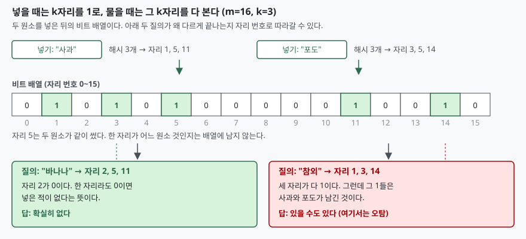

## 들어가며

크롤러를 하나 만들어 돌리면 며칠 안에 같은 문제를 만난다. 이미 방문한 URL을
다시 긁지 않으려면 어딘가에 기록해 둬야 하는데, 파이썬 `set`에 넣어 두면 URL
하나당 100바이트 안팎이 든다. 100만 개면 100MB가 넘고, 1억 개는 아예 올라가지
않는다.

그래서 보통은 URL을 데이터베이스에 넣고 매번 조회한다. 한 건 조회에 1밀리초가
걸린다고 치면, 초당 1,000건을 처리하려던 크롤러가 조회 하나로 그 예산을 다 쓴다.
디스크를 때리지 않고 메모리에서 끝내고 싶은데 메모리가 모자란 상황이다.

블룸 필터는 여기서 거래를 하나 제안한다. **"없다"는 답은 100% 믿어도 되고,
"있다"는 답은 가끔 틀린다.** 대신 메모리를 수십 분의 일로 줄인다. 크롤러라면
"없다"가 믿을 만한 것으로 충분하다 — 없다고 나온 것만 긁으면 되고, 가끔 멀쩡한
URL을 건너뛰는 것은 감수할 수 있다.

이 글은 그 "가끔"이 정확히 몇 번인지를 직접 세어 본다.

## 개념

블룸 필터는 1970년 Burton Bloom이 CACM에 발표한 자료구조다. 구성은 두 가지뿐이다.

- **m비트짜리 비트 배열** — 처음에는 전부 0
- **독립적인 해시 함수 k개** — 각각 원소를 0..m-1 중 한 자리로 보낸다

원소를 넣을 때는 k개 해시가 가리키는 **k자리를 1로 만든다.** 물을 때는 같은
k자리를 보고, **하나라도 0이면 "없다"**, **전부 1이면 "있을 수도 있다"**고 답한다.

여기서 비대칭이 생긴다. 넣은 원소의 k자리는 넣는 순간 전부 1이 됐고 1은 0으로
되돌아가지 않으므로, **거짓 음성은 원리상 나올 수 없다.** 반대로 다른 원소들이
남긴 1들이 우연히 겹치면 넣은 적 없는 원소도 k자리가 다 1일 수 있다. 이것이
**오탐(false positive)** 이다.

## 구조



> **출처**: [B. H. Bloom, "Space/time trade-offs in hash coding with allowable errors", CACM 13(7), 1970, pp. 422–426](https://doi.org/10.1145/362686.362692)

자리 5를 사과와 포도가 같이 쓴 것이 핵심이다. 배열에는 **그 1이 누구 것인지가
남지 않는다.** 원소를 저장하지 않기 때문에 메모리가 줄어드는 것이고, 같은 이유로
삭제도 되지 않는다. 자리 5를 0으로 되돌리면 사과까지 사라진다.

## 동작 원리

오탐률은 식으로 떨어진다. 원소 n개를 넣은 뒤 임의의 한 비트가 여전히 0일 확률은
`(1 - 1/m)^(kn)`이고, m이 충분히 크면 `e^(-kn/m)`에 가깝다. 따라서 한 비트가
1일 확률은 `1 - e^(-kn/m)`이고, k자리가 전부 1일 확률은 그것의 k제곱이다.

```text
오탐률 ≈ (1 - e^(-kn/m))^k
```

여기서 k를 늘리면 두 가지가 동시에 일어난다. 확인해야 할 자리가 늘어 통과하기
어려워지는 반면, 넣을 때 1로 만드는 자리도 늘어 배열이 빨리 찬다. 두 효과가
맞서므로 최적점이 생기고, 그 값은 `k = (m/n)·ln2`다.

m=100,000비트에 n=10,000개를 넣으면 최적 k는 6.93이다. 실제로 그런지 k를 1부터
10까지 바꿔 가며 비멤버 10만 건을 물어봤다.

| k | 이론 오탐률 | 실측 오탐률 | 비트 채움 |
|---:|---:|---:|---:|
| 1 | 9.5163% | 9.4870% | 9.52% |
| 2 | 3.2859% | 3.2920% | 18.12% |
| 3 | 1.7411% | 1.6900% | 25.90% |
| 4 | 1.1813% | 1.2100% | 32.93% |
| 5 | 0.9431% | 0.9220% | 39.27% |
| 6 | 0.8436% | 0.8420% | 45.03% |
| **7** | **0.8194%** | **0.8100%** | **50.25%** |
| 8 | 0.8455% | 0.8310% | 54.99% |
| 9 | 0.9127% | 0.9360% | 59.34% |
| 10 | 1.0186% | 1.0790% | 63.21% |

최저점이 k=7에 있다. 이론값의 최소도 k=7이고, 공식이 준 6.93을 반올림한 값과 같다.

눈여겨볼 것은 오른쪽 끝 칸이다. **최적 k에서 비트 채움이 50.25%다.** 우연이 아니다.
`k = (m/n)·ln2`를 비트가 1일 확률 `1 - e^(-kn/m)`에 넣으면 정확히 `1 - e^(-ln2) = 0.5`가
나온다. 블룸 필터는 **비트 배열이 반쯤 찼을 때 가장 효율적이다.** 운영 중인 필터의
채움 비율만 재도 설정이 맞는지 짐작할 수 있다는 뜻이다.

k를 7로 고정하고 비트 수를 바꾸면 오탐률이 어떻게 움직이는지도 봤다.

| m | m/n | 이론 오탐률 | 실측 오탐률 |
|---:|---:|---:|---:|
| 40,000 | 4.0 | 26.2840% | 26.3110% |
| 60,000 | 6.0 | 7.3410% | 7.3330% |
| 80,000 | 8.0 | 2.2930% | 2.3540% |
| 100,000 | 10.0 | 0.8194% | 0.7880% |
| 140,000 | 14.0 | 0.1460% | 0.1270% |
| 200,000 | 20.0 | 0.0196% | 0.0220% |

m을 5배 늘렸더니 실측 오탐률이 1,000배 넘게 떨어졌다. 원소당 비트 수(m/n)가
**선형으로 늘면 오탐률은 지수로 줄어든다.** 다만 k를 7로 고정했기 때문에
m/n=4 구간은 최적이 아니다. 그 구간의 최적 k는 2~3이고, k=7은 배열을 너무
빨리 채워 손해를 본다.

### 같은 메모리를 집합에 쓰면

줄어드는 양을 숫자로 봤다.

```text
블룸 필터 비트 배열     12,557 바이트 (100,000비트)
같은 원소를 담은 set   524,504 바이트 (문자열 본문 제외)
set 의 문자열 본문     518,890 바이트
합계 대비 비율           1.20%
```

`set`은 해시 테이블 자체로 52만 바이트, 담긴 문자열 본문으로 또 52만 바이트를 쓴다.
블룸 필터는 그 합의 **1.2%**로 같은 질문에 답한다. 대신 0.8%는 틀린다. 그리고
거짓 음성이 하나라도 있는지 넣은 원소 1만 개를 전부 되물어 봤는데, **"없다"고
답한 것은 0개**였다.

## 실습 예제

전체 소스: [`code/`](code/) · 수행 기록: [`code/output.txt`](code/output.txt)

```python
def _positions(self, item: str):
    data = item.encode("utf-8")
    # BLAKE2b 를 두 번 돌려 128바이트를 얻고 8바이트씩 잘라 쓴다.
    # 해시 함수를 k 번 부르는 것과 결과가 같으면서 호출 수가 2로 줄어든다.
    digest = (hashlib.blake2b(data, digest_size=64).digest()
              + hashlib.blake2b(data, digest_size=64,
                                salt=b"\x01" * 8).digest())
    for index in range(self.num_hashes):
        chunk = digest[index * 8:index * 8 + 8]
        yield int.from_bytes(chunk, "little") % self.num_bits
```

해시 k개를 따로 부르는 대신 넓은 다이제스트를 잘라 쓴다. 암호학적 해시의 출력은
자리마다 독립에 가까우므로 결과가 같고, 호출 수가 k에서 2로 줄어 측정이 빨라진다.
실제로 실측값이 이론값에 붙은 것이 이 방식이 쓸 만하다는 방증이기도 하다.

## 실무에서 주의할 점

- **삭제가 안 된다.** 비트를 0으로 되돌리면 그 자리를 공유하던 다른 원소까지
  사라져 거짓 음성이 생긴다. 블룸 필터의 유일한 보장이 깨지는 것이라 가장 비싼
  고장이다. 삭제가 필요하면 카운팅 블룸 필터처럼 자리마다 카운터를 두는 변형을
  쓰거나, 주기적으로 필터를 새로 만든다.
- **n을 먼저 정해야 한다.** 위 식의 모든 변수가 n에 묶여 있다. 넣을 원소가 예상보다
  많아지면 배열이 과하게 차고 오탐률이 설계값을 벗어난다. m/n=10, k=7로 잡은
  필터에 원소를 두 배 넣으면 m/n이 5로 떨어진다. 위 표에서 m/n=6인 자리가 이미
  7.3%이므로, 설계값 0.8%와는 한 자리수가 다른 세계로 넘어간다.
- **"있다"를 믿고 분기하면 안 된다.** 블룸 필터는 **값싼 1차 거름망**이다.
  "없다"면 뒤쪽을 건너뛰고, "있다"면 실제 저장소를 확인해야 한다. 이 확인 단계를
  생략하면 오탐률이 그대로 오류율이 된다.
- **해시가 편향되면 식이 안 맞는다.** 위 식은 해시 출력이 고르게 퍼진다고 가정한다.
  `hash()` 같은 비암호학적 해시나 자리 수가 모자란 해시를 쓰면 실측이 이론보다
  나빠진다. 쓰기 전에 지금처럼 실측과 이론을 나란히 찍어 확인하는 것이 가장 빠르다.
- **채움 비율을 지표로 내보낸다.** 최적 설정에서 50%라는 성질이 있으므로,
  운영 중인 필터의 1인 비트 비율을 재 두면 원소 수 가정이 깨졌는지를 따로 세지
  않고도 알 수 있다.

## 정리

- 블룸 필터는 "없다"를 확실히, "있다"를 확률적으로 답하는 대신 메모리를 줄인다.
  거짓 음성은 원리상 나올 수 없고, 실측에서도 1만 건 중 0건이었다.
- 오탐률은 `(1 - e^(-kn/m))^k`로 근사되고, 측정값이 소수점 둘째 자리까지 붙었다.
- 최적 해시 개수는 `k = (m/n)·ln2`다. m/n=10이면 6.93이고, 실측 최저점도 k=7이었다.
- 최적 k에서 비트 배열은 절반이 찬다. 운영 중인 필터의 채움 비율이 설정 점검 지표가 된다.
- 원소당 비트를 선형으로 늘리면 오탐률은 지수로 떨어진다. m/n을 4에서 20으로
  올리자 26%에서 0.02%가 됐다.
- 같은 원소 1만 개 기준으로 `set` 대비 메모리는 1.2%였다.

## 참고 자료

- [B. H. Bloom, "Space/time trade-offs in hash coding with allowable errors", Communications of the ACM 13(7), 1970, pp. 422–426](https://doi.org/10.1145/362686.362692)
- [A. Broder, M. Mitzenmacher, "Network Applications of Bloom Filters: A Survey", Internet Mathematics 1(4), 2004, pp. 485–509](https://doi.org/10.1080/15427951.2004.10129096)
- [Python 문서 — hashlib.blake2b](https://docs.python.org/3/library/hashlib.html#blake2)
- [Python 문서 — sys.getsizeof](https://docs.python.org/3/library/sys.html#sys.getsizeof)
