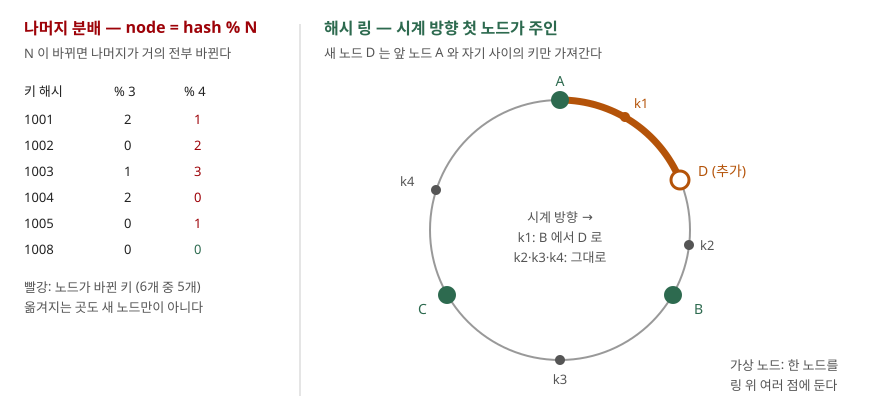

## 들어가며

캐시 서버 세 대에 키를 `hash(key) % 3` 으로 나눠 쓰다가, 트래픽이 늘어 한 대를 더 붙인다. 설정의 3을 4로 바꾸고 배포하자마자 캐시 적중률이 바닥으로 떨어지고 DB 부하가 치솟는다. 서버 한 대를 더했을 뿐인데 거의 모든 키의 주인이 바뀌어, 캐시에 있던 값을 아무도 찾지 못하게 된 것이다. 흔히 택하는 대응은 새벽 시간에 증설하고 캐시가 다시 채워질 때까지 기다리는 것인데, 키 10만 개 기준으로 9만 개가 넘는 키를 다시 원본에서 읽어야 한다.

## 개념

**나머지 분배**는 키의 해시를 노드 수 N 으로 나눈 나머지로 노드를 고른다. 노드 수가 고정이면 단순하고 고르게 나뉜다. 문제는 N 이 바뀔 때다. 나머지는 나누는 수가 바뀌면 거의 다 바뀌므로, 노드를 하나 더하면 키 대부분이 다른 노드로 간다.

**일관 해싱**(consistent hashing)은 Karger 등이 1997년 논문에서 제안했다. 논문은 이 방식의 목표를 **노드가 더해지거나 빠질 때 옮겨야 하는 키의 비율이 부하를 고르게 유지하는 데 필요한 최소량**이 되는 것으로 정한다(4장, smoothness). 노드가 N 개에서 N+1 개가 되면 새 노드가 평균 1/(N+1) 을 맡아야 하므로, 그만큼만 옮기는 것이 최소다.

방법은 노드와 키를 **같은 해시 공간**에 올리는 것이다. 논문은 노드와 키를 각각 [0, 1] 구간의 점으로 보내고 키를 가장 가까운 노드에 배정하며, 노드 하나를 여러 점에 복제해 둔다. Amazon Dynamo 논문은 해시 출력 공간을 원형 "링"으로 두고, 키 위치에서 **시계 방향으로 처음 만나는 노드**를 주인으로 정한다(4.2절). 이 글의 예제는 Dynamo 방식을 따랐다.

## 구조



> **출처**: [DeCandia et al., Dynamo: Amazon's Highly Available Key-value Store (SOSP 2007) §4.2 Partitioning Algorithm, Figure 2](https://www.allthingsdistributed.com/files/amazon-dynamo-sosp2007.pdf) · [Karger et al., Consistent Hashing and Random Trees (STOC 1997) §4.2 Construction](https://www.cs.princeton.edu/courses/archive/fall09/cos518/papers/chash.pdf)

## 동작 원리

링에서 노드 D 를 추가하면 D 의 위치와 그 반시계 방향 앞 노드 A 사이에 있던 키만 주인이 바뀐다. 그 키들의 원래 주인은 D 의 시계 방향 다음 노드 B 였다. 나머지 구간은 시계 방향 첫 노드가 그대로이므로 아무 일도 없다. 옮겨지는 키는 **전부 새 노드로** 가고, 기존 노드끼리 키를 주고받는 일은 없다.

대신 새 문제가 생긴다. 노드 위치가 해시로 정해지므로 노드 사이 간격이 고르지 않다. Dynamo 논문은 기본 방식의 문제를 둘로 든다. 무작위 위치 때문에 데이터와 부하가 고르게 나뉘지 않고, 서버마다 성능이 다른 것을 반영하지 못한다. 해법은 **가상 노드**다. 물리 노드 하나를 링 위 여러 점(토큰)에 둔다. 점이 많아지면 간격의 편차가 평균에 수렴해 부하가 고르게 된다. 성능이 좋은 서버에는 점을 더 주면 된다. Karger 논문의 구성도 노드마다 점을 여러 개 두는 것을 전제로 한다.

## 실습 예제

전체 소스: [`code/`](code/) · 수행 기록: [`code/output.txt`](code/output.txt)

키 `user:0` ~ `user:99999` 를 md5 앞 8바이트로 해시했다. 파이썬 내장 `hash()` 는 실행마다 값이 바뀌므로 쓰지 않았다. 링은 정렬한 점 목록에 `bisect_right` 로 키 위치 다음 점을 찾는다.

```python
def route(self, key_hash):
    i = bisect.bisect_right(self.positions, key_hash)
    return self.owners[i % len(self.owners)]   # 끝을 넘으면 처음으로 — 원형
```

노드 10개에서 11개로 늘렸을 때다. 최대/평균과 변동계수(표준편차 ÷ 평균)는 추가 전 10개 노드의 부하다.

```text
  이상적인 이동 비율 1/11 = 9.09%
  방식              | 이동 키 | 이동 비율 | 새 노드로 | 노드 사이 | 최대/평균 | 변동계수
  나머지 hash % N      |   90708 |    90.71% |      9276 |     81432 |      1.02 |   0.010
  링 가상노드    1       |   15557 |    15.56% |     15557 |         0 |      2.11 |   0.583
  링 가상노드   10       |    9730 |     9.73% |      9730 |         0 |      1.65 |   0.349
  링 가상노드  100       |    8657 |     8.66% |      8657 |         0 |      1.15 |   0.111
  링 가상노드 1000       |    8632 |     8.63% |      8632 |         0 |      1.03 |   0.021
```

나머지 분배는 90.71% 를 옮겼다. 키 하나가 그대로 남으려면 `h % 10` 과 `h % 11` 이 같아야 하는데, 그 확률은 대략 1/11 이므로 나머지 약 10/11 = 90.9% 가 움직인다는 계산과 맞는다. 옮겨진 키 중 새 노드로 간 것은 9,276개뿐이고 **81,432개는 기존 노드끼리 자리를 바꿨다.** 반면 부하는 가장 고르다(최대/평균 1.02).

링은 어느 설정에서도 "노드 사이" 이동이 0이었다. 예상과 달랐던 것은 **점이 1개일 때 새 노드가 가져간 몫**이다. 이상값 9.09% 가 아니라 15.56% 였다. 새 노드가 링에서 넓은 간격에 떨어지면 그 간격 전체를 가져간다. 옮기는 키가 "새 노드 몫뿐"인 것은 맞지만 그 몫의 크기는 운이다. 같은 이유로 추가 전 부하도 가장 바쁜 노드가 평균의 2.11 배였다.

노드 하나(node-03)가 빠질 때 그 키를 누가 받는지도 셌다.

```text
  가상노드   1: 넘겨받은 노드 1개, 가장 많이 받은 노드 10088키 / 전체 10088키, 다른 키 이동 0
  가상노드  10: 넘겨받은 노드 8개, 가장 많이 받은 노드 7441키 / 전체 9982키, 다른 키 이동 0
  가상노드 100: 넘겨받은 노드 9개, 가장 많이 받은 노드 1786키 / 전체 8298키, 다른 키 이동 0
```

점이 1개면 빠진 노드의 키를 시계 방향 이웃 하나가 전부 받는다. 그 이웃의 부하가 순식간에 두 배가 되는 것이다. 두 번째로 예상과 달랐던 것은 **가상 노드 10개에서도 한 이웃이 75%(7,441 / 9,982)를 받았다**는 점이다. node-03 의 점 10개 중 하나가 유난히 넓은 간격을 맡고 있었고, 그 간격이 통째로 한 노드에 넘어갔다. 100개가 되자 가장 많이 받은 노드도 22% 정도로 줄었다. Dynamo 논문이 가상 노드의 장점으로 "빠진 노드의 부하가 남은 노드에 고르게 흩어진다"를 들지만, 점 수가 충분해야 성립한다.

## 실무에서 주의할 점

**첫째, 가상 노드 수를 너무 적게 잡지 않는다.** 이 실험에서 10개는 이동 비율은 이상값에 가까웠지만(9.73%) 부하 최대/평균이 1.65, 장애 시 한 이웃에 75% 가 몰렸다. 100개부터 편차가 눈에 띄게 줄었다. 점 수는 링 크기(노드 10개 × 1000 = 1만 점)와 조회 비용(이진 탐색)에 반영되지만, 조회는 log 로만 늘어난다.

**둘째, 점 이름과 해시 함수를 모든 클라이언트가 똑같이 써야 한다.** 노드 이름에 붙이는 접미사 규칙(`node-03#7`)이나 해시 함수가 하나라도 다르면 같은 키를 다른 노드에서 찾는다. 언어마다 기본 해시가 다르고 파이썬 `hash()` 는 실행마다 바뀌므로, md5 처럼 명세가 고정된 함수를 쓴다.

**셋째, 옮겨지는 키가 적다는 것이지 없다는 것이 아니다.** 노드 추가 시 링에서도 9% 남짓은 원본에서 다시 읽어야 한다. 캐시라면 그만큼 적중률이 떨어지고, 저장소라면 그만큼 데이터를 복사해야 한다. 한꺼번에 여러 노드를 더하면 이동량이 더해진다.

**넷째, 노드 수가 거의 바뀌지 않는다면 나머지 분배도 나쁜 선택이 아니다.** 부하 균형은 이 실험에서 나머지 분배가 가장 좋았다(최대/평균 1.02). 노드 수를 바꿀 일이 드물고 바꿀 때 전체 재배치를 감수할 수 있다면 구현이 단순한 쪽을 택할 수 있다.

## 정리

- `hash % N` 은 N 이 하나만 바뀌어도 키의 약 N/(N+1) 을 옮기고, 대부분은 기존 노드끼리 자리를 바꾼다
- 해시 링은 키 위치에서 시계 방향 첫 노드를 주인으로 정해, 노드 추가 시 새 노드 몫만 옮긴다
- 노드당 점이 1개면 그 몫의 크기가 들쭉날쭉해 이상값 9.09% 대신 15.56% 를 옮기고 부하 편차가 컸다
- 가상 노드를 늘리면 부하와 이동량이 이상값에 수렴하지만, 10개로는 장애 시 한 이웃에 75% 가 몰렸다

## 참고 자료

- [Karger et al., Consistent Hashing and Random Trees: Distributed Caching Protocols for Relieving Hot Spots on the World Wide Web, STOC 1997](https://www.cs.princeton.edu/courses/archive/fall09/cos518/papers/chash.pdf) — §4 Consistent Hashing, §4.2 Construction
- [DeCandia et al., Dynamo: Amazon's Highly Available Key-value Store, SOSP 2007](https://www.allthingsdistributed.com/files/amazon-dynamo-sosp2007.pdf) — §4.2 Partitioning Algorithm
- [Python 3.13 — hashlib](https://docs.python.org/3.13/library/hashlib.html)
- [Python 3.13 — bisect](https://docs.python.org/3.13/library/bisect.html)
- [Python 3.13 — object.__hash__, PYTHONHASHSEED](https://docs.python.org/3.13/reference/datamodel.html#object.__hash__)
