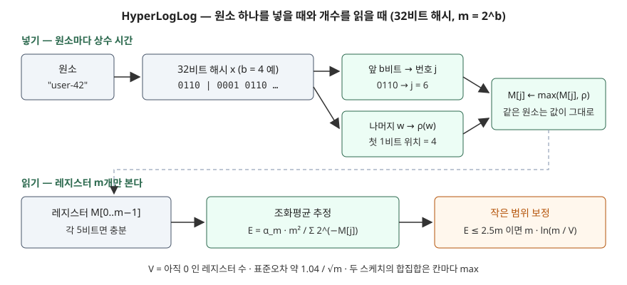

## 들어가며

서비스 대시보드에 "오늘의 순 방문자 수"를 넣어 달라는 요청은 거의 모든 웹 서비스가 한 번은 받는다. 처음에는 방문 로그를 모아 `SELECT COUNT(DISTINCT user_id)` 를 돌리거나, 서버 메모리에 사용자 ID 집합을 들고 새 ID 가 오면 넣는다. 그런데 이 수치가 페이지별·시간대별·국가별로 쪼개지기 시작하면 집합이 수천 개로 늘어난다. 파이썬 `set` 에 키 100만 개를 넣으면 해시 테이블만 32MiB 가 들었다(아래 실측). 같은 크기의 집합이 1,000개면 32GB 다. 정확한 수가 꼭 필요한지 따져 보면 대부분 "2% 안쪽으로 맞으면 된다"는 답이 나온다.

## 개념

**카디널리티**(cardinality)는 중복을 뺀 원소의 개수다. 정확히 세려면 본 원소를 전부 기억해야 하므로 메모리가 원소 수에 비례한다. **HyperLogLog**(HLL)는 원소를 기억하지 않고 **해시값의 비트 모양만 관찰해 개수를 추정**하는 알고리즘이다. Flajolet 등의 2007년 논문은 레지스터 m개를 쓰면 상대 오차(표준오차)가 대략 1.04/√m 이고, m=2048·32비트 해시·5비트 레지스터로 10⁹ 이상의 카디널리티를 약 2% 정확도로, 1.5kB 메모리로 추정할 수 있다고 적는다.

출발점이 되는 관찰은 이렇다. 해시값의 비트가 고르게 섞여 있다면, 맨 앞에 0이 연속 k개 나온 뒤 1이 오는 해시값은 대략 2^(k+1)개 중 하나꼴로 나온다. 그래서 "본 해시값 중 앞쪽 0이 가장 길었던 길이"가 개수의 로그를 대략 알려 준다. 값 하나만 보면 변동이 너무 크므로, 해시값 앞부분으로 원소를 m개 무리로 나눠 무리마다 최댓값을 따로 기록하고 그 평균을 낸다. 논문은 이것을 확률적 평균(stochastic averaging)이라 부르고, 해시 함수 하나로 m번 실험한 효과를 낸다고 설명한다.

LogLog 와 HyperLogLog 는 같은 관찰값을 쓰고 **평균 내는 방법**이 다르다. 논문은 LogLog 가 사실상 기하평균을, HyperLogLog 는 조화평균을 쓰며, 조화평균이 오른쪽으로 길게 늘어진 분포의 영향을 줄여 같은 정확도를 LogLog 메모리의 64%로 낸다고 적는다.

## 구조



> **출처**: [Flajolet·Fusy·Gandouet·Meunier, HyperLogLog: the analysis of a near-optimal cardinality estimation algorithm (AofA 2007) — Fig. 2 The HyperLogLog Algorithm, Fig. 3 The HyperLogLog Program, §4 small/large range corrections](https://algo.inria.fr/flajolet/Publications/FlFuGaMe07.pdf)

## 동작 원리

논문 그림 3의 프로그램은 32비트 해시를 쓰고 m = 2^b (b는 4~16)로 둔다. 예제는 이 프로그램을 그대로 옮겼다.

1. **넣기**: 해시값 x 의 앞 b비트로 레지스터 번호 j 를 정하고, 나머지 비트 w 에서 맨 왼쪽 1의 위치 ρ(w)를 구해 `M[j] = max(M[j], ρ(w))` 로 갱신한다. 논문은 번호를 1부터 세지만 예제는 0부터 센다
2. **읽기**: E = α_m · m² / Σ 2^(−M[j]). 분모는 2^M[j] 들의 조화평균을 만들고, α_m 은 논문이 분석으로 구한 편향 보정 상수다(m=16 은 0.673, m≥128 은 0.7213/(1+1.079/m))
3. **작은 범위 보정**: E ≤ 2.5m 이고 아직 0인 레지스터가 V개 있으면 E* = m · ln(m/V). 원소 n개를 칸 m개에 무작위로 던지면 빈 칸이 약 m·e^(−n/m) 이라는 성질을 거꾸로 푼 식이다
4. **큰 범위 보정**: E 가 2³²/30 을 넘으면 해시 충돌을 감안해 E* = −2³² · ln(1 − E/2³²)

`max` 만 쓰므로 같은 원소를 몇 번 넣어도 레지스터가 바뀌지 않는다. 같은 m·같은 해시로 만든 두 스케치는 칸마다 큰 값을 취하면 합집합의 스케치가 된다.

레지스터 하나에 들어가는 값은 0부터 32−b+1 까지라 5비트면 충분하다고 논문은 적는다. 예제는 단순하게 1바이트씩 `bytearray` 에 담았다.

## 실습 예제

전체 소스: [`code/`](code/) · 수행 기록: [`code/output.txt`](code/output.txt)

**① 집합과 비교.** `user-0` 부터 `user-999999` 까지 100만 개 키를 넣었다.

```text
  실제 고유 수     : 1,000,000
  set 이 쓴 메모리 : 32.0 MiB (set 구조만, 문자열은 이미 있던 것)
  HLL 추정값       : 996,860  (오차 -0.31%)
  HLL 레지스터     : 2,048 바이트 (최댓값 18)
```

`tracemalloc` 으로 잰 set 의 메모리는 해시 테이블만이고 문자열 자체는 뺀 값이다. 그래도 2,048바이트와는 1만 6천 배 차이다. 레지스터 최댓값이 18이라 5비트(최대 31)에 넉넉히 들어간다.

**② m 에 따른 오차.** 키 2만 개를 서로 다른 해시 40벌(blake2b 의 salt 를 바꿈)로 넣고 상대 오차를 모았다.

```text
     m | 이론 1.04/√m | 실측 RMS 오차 | 평균 편향 | ±1σ 안 비율
     16 |      26.00% |       25.15% |  -11.22% |   65.0%
     64 |      13.00% |       11.03% |   -3.28% |   77.5%
    256 |       6.50% |        5.89% |   -0.20% |   75.0%
   1024 |       3.25% |        3.22% |   -0.79% |   65.0%
   4096 |       1.62% |        1.64% |   -0.15% |   77.5%
```

m 을 4배 늘릴 때마다 오차가 절반으로 줄어 1/√m 비례가 그대로 보였다. 논문은 추정값이 대략 정규분포를 따라 ±1σ 안에 약 65%가 든다고 적는데, 40회 실측에서는 65~77.5%였다. 예상과 달랐던 것은 **m=16 의 평균 편향 −11.22%** 다. 40회 평균의 표준오차가 25%/√40 ≈ 4% 이므로 우연으로 보기에는 크다. m=16 은 논문 프로그램이 받는 범위(2⁴~2¹⁶)의 맨 아래이고, 이 글에서는 그 원인을 따로 확인하지 않았다. 실무에서 이렇게 작은 m 을 쓸 일은 드물다.

**③ 작은 범위 보정.** m=2048 에서 n 을 바꿔 가며 보정 전후를 비교했다.

```text
       n | 보정 전 E | 보정 후 E* | 빈 레지스터 V
       0 |     1,476 |          0 |  2,048
     100 |     1,525 |        100 |  1,950
   1,000 |     2,019 |      1,010 |  1,251
   5,000 |     5,101 |      5,121 |    168
  10,000 |     9,875 |      9,875 |     14
```

원소가 하나도 없는데 보정 전 값이 1,476 이다. 레지스터가 전부 0이면 분모가 m 이 되어 E = α_m · m ≈ 0.72m 이 나오기 때문이고, 논문도 n=0 에서 약 0.7m 을 낸다고 짚는다. n=1,000 에서는 보정 전 값이 두 배다. 보정 후에는 빈 레지스터 수만으로 1,010 을 냈다. 보정 기준(2.5m = 5,120) 아래에 있던 n=5,000 은 보정 공식이 쓰였고, 그 위의 10,000 부터는 원래 추정값이 그대로 나간다.

**④ 중복과 합치기.**

```text
  A = user-0..59999       : 60,541 → 같은 키 재입력 후 60,541
  B = user-40000..99999   : 61,352
  A ∪ B (레지스터 최댓값) : 103,241  (실제 100,000)
  A ∩ B (포함-배제로 계산): 18,652  (실제 20,000)
```

같은 키 6만 개를 다시 넣어도 값이 한 자리도 바뀌지 않았다. 합집합은 +3.2% 로 m=2048 의 표준오차(약 2.3%) 근처다. 교집합은 |A| + |B| − |A∪B| 로 구했는데 −6.7% 가 나왔다. 추정값 세 개의 오차가 그대로 더해지는데, 결과값(2만)은 원래 값들보다 훨씬 작아서 상대 오차가 커진 것이다.

## 실무에서 주의할 점

**첫째, 작은 개수에서는 보정이 빠지면 크게 틀린다.** ③에서 보정 전 값은 원소 0개에 1,476, 1,000개에 2,019 였다. 직접 구현하거나 오래된 구현을 쓸 때는 작은 범위 보정이 들어 있는지 확인한다. 시간대별·페이지별로 쪼갠 집계일수록 개수가 작은 칸이 많다.

**둘째, 교집합은 포함-배제로 구하면 오차가 커진다.** 합집합은 레지스터 최댓값으로 정확하게 합쳐지지만 교집합에는 그런 연산이 없다. 교집합이 전체보다 훨씬 작을수록 상대 오차가 커지므로, "두 캠페인을 모두 본 사용자" 같은 지표는 별도 방법을 검토한다.

**셋째, 합치려면 m 과 해시 함수가 같아야 한다.** 레지스터 번호와 ρ 값이 해시에 달려 있으므로, 다른 해시나 다른 b 로 만든 스케치를 칸마다 max 로 합치면 의미 없는 값이 나온다. 스케치를 저장할 때 b 와 해시 종류를 함께 남긴다.

**넷째, 해시의 품질이 곧 정확도다.** 논문은 해시값의 비트가 서로 독립이고 각각 1/2 확률로 나온다고 가정한다. 키를 그대로 정수로 쓰거나 앞 비트가 치우친 해시를 쓰면 레지스터 번호가 몰려 이 가정이 깨진다.

## 정리

- HyperLogLog 는 해시값 앞쪽 0의 최대 길이를 m개 무리로 나눠 기록하고, 그 조화평균으로 고유 개수를 추정한다
- 표준오차는 약 1.04/√m 이고, 실측에서도 m 을 4배 늘릴 때마다 오차가 절반이 됐다
- 100만 개 키를 2,048바이트로 −0.31% 오차로 셌다. 같은 집합의 `set` 은 해시 테이블만 32MiB 였다
- 작은 개수에서는 빈 레지스터 수로 보정해야 하고, 보정이 없으면 원소 0개에도 약 0.72m 을 낸다
- 같은 원소 재입력에는 값이 변하지 않고, 합집합은 칸마다 max 로 구하지만 교집합은 오차가 커진다

## 참고 자료

- [Philippe Flajolet, Éric Fusy, Olivier Gandouet, Frédéric Meunier, HyperLogLog: the analysis of a near-optimal cardinality estimation algorithm, AofA 2007, DMTCS proc. AH](https://algo.inria.fr/flajolet/Publications/FlFuGaMe07.pdf) — Fig. 1 추정기 비교, Fig. 2 알고리즘, Fig. 3 32비트 프로그램, §4 작은·큰 범위 보정과 레지스터 크기
- [Python 3.13 — hashlib, BLAKE2](https://docs.python.org/3.13/library/hashlib.html#blake2)
- [Python 3.13 — tracemalloc](https://docs.python.org/3.13/library/tracemalloc.html)
