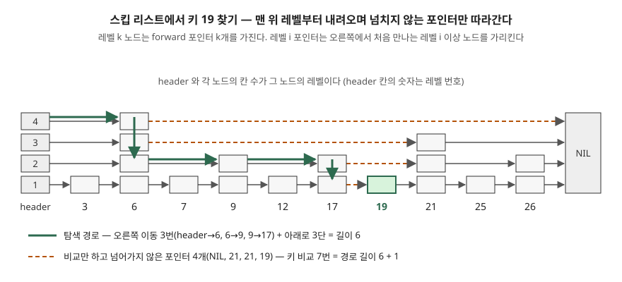

## 들어가며

게임 순위표나 지연 작업 큐처럼 "정렬된 상태를 유지하면서 계속 넣고 빼는" 자료가 필요할 때가 있다. 파이썬이라면 보통 리스트에 `bisect.insort` 로 넣는다. 찾는 위치는 이진 탐색이라 빠르지만, 배열 중간에 끼워 넣으려면 뒤쪽 원소를 한 칸씩 밀어야 한다. 원소가 65,536 개면 한 번 넣을 때 평균 3만 개 넘게 옮기는 셈이다. 균형 트리를 직접 짜면 이 비용은 사라지지만 회전 규칙을 틀리지 않게 구현하기가 어렵다. 스킵 리스트는 연결 리스트에 포인터 몇 개를 더 붙여 이 둘 사이를 메운다.

## 개념

스킵 리스트는 정렬된 연결 리스트의 일부 노드에 **멀리 건너뛰는 포인터**를 더 달아 탐색을 O(log n) 기대 시간으로 줄인 자료구조다. William Pugh 가 1990 년 CACM 에 발표했다.

출발점은 단순하다. 정렬된 연결 리스트에서 두 번째 노드마다 두 칸 앞을 가리키는 포인터를 달면 n/2 + 1 개만 보면 된다. 네 번째 노드마다 네 칸 앞 포인터를 더 달면 n/4 + 2 개로 줄고, 이렇게 2^i 번째마다 2^i 칸 앞 포인터를 달면 log₂ n 까지 내려간다. 다만 이 규칙을 유지하려면 삽입 한 번에 뒤쪽 노드의 포인터 개수를 전부 다시 맞춰야 한다.

Pugh 의 발상은 **규칙 대신 비율만 지키는 것**이다. 노드를 넣을 때 그 노드의 레벨(포인터 개수)을 난수로 정한다. 레벨 i 포인터를 가진 노드 중 비율 p 만 레벨 i+1 포인터도 갖게 하면, p = 1/2 일 때 레벨 분포가 50%·25%·12.5% 로 위 규칙과 같아진다. 한 번 정한 레벨은 바뀌지 않으므로 삽입·삭제는 앞뒤 포인터만 고친다.

| | 균형 트리(AVL 등) | 스킵 리스트 |
|---|---|---|
| 균형을 맞추는 방법 | 삽입·삭제 때 회전으로 조건을 강제 | 삽입 때 레벨을 난수로 정함 |
| 성능 보장 | 최악 시간 | 확률적 기대 시간 |
| 노드에 저장하는 균형 정보 | 높이·색 등 | 없음 |
| 넣는 순서의 영향 | 없음(재배치로 흡수) | 없음(레벨이 키와 무관) |

## 구조



> **출처**: [Pugh, Skip Lists: A Probabilistic Alternative to Balanced Trees, CACM 33(6) 1990 — Figure 1 Linked lists with additional pointers, Figure 2 Skip list search algorithm](https://15721.courses.cs.cmu.edu/spring2018/papers/08-oltpindexes1/pugh-skiplists-cacm1990.pdf)

레벨 i 포인터는 2^(i−1) 칸 앞이 아니라 **오른쪽에서 처음 만나는 레벨 i 이상 노드**를 가리킨다. 리스트 끝은 NIL 이라는 노드로 닫는데, 논문은 NIL 에 어떤 키보다 큰 키를 준다. 그래서 탐색 루프에 "끝에 닿았는가" 검사가 따로 없다. 예제 코드는 `math.inf` 를 NIL 의 키로 썼다.

## 동작 원리

**탐색.** header 의 가장 높은 레벨에서 출발해, 다음 노드의 키가 찾는 키보다 작으면 오른쪽으로 가고 아니면 한 단 내려간다. 레벨 1 에서 더 갈 수 없으면 바로 다음 노드가 찾는 키이거나, 그 키가 없는 것이다. 도식에서 19 를 찾을 때 오른쪽으로 3번, 아래로 3번 움직였다.

**삽입.** 탐색과 똑같이 내려가면서 레벨마다 마지막으로 머문 노드를 `update[i]` 에 적어 둔다. 새 노드의 레벨을 정한 뒤 그 레벨까지만 `update[i]` 의 포인터를 새 노드로 돌린다. 삭제도 같은 `update` 로 포인터를 건너뛰게 고친다.

```python
def random_level(self):
    level = 1
    while self.rng.random() < self.p and level < self.max_level:
        level += 1
    return level

def search(self, key):
    x = self.header
    for i in range(self.level - 1, -1, -1):
        while x.forward[i].key < key:   # NIL 의 키가 inf 라 끝 검사가 없다
            x = x.forward[i]
    x = x.forward[0]
    return x.key == key
```

**기대 비용.** 논문은 탐색 경로를 거꾸로, 아래에서 왼쪽 위로 따라가며 분석한다. 어느 노드에서든 한 단 올라갈 확률이 p 이므로 k 단을 오르는 기대 길이는 k/p 다. 여기에 맨 윗단에서의 이동과 L(n) 위로 더 오르는 몫을 더해 **기대 경로 길이 ≤ L(n)/p + 1/(1−p)** 를 얻는다. L(n) = log₁/ₚ n 이다. 키 비교 횟수는 경로 길이 + 1 이다.

## 실습 예제

전체 소스: [`code/`](code/) · 수행 기록: [`code/output.txt`](code/output.txt)

논문의 의사 코드를 그대로 옮기고, MaxLevel 은 논문 권고대로 L(N) 으로 두었다. 0 부터 65,535 까지 키를 무작위 순서로 넣은 뒤 모든 키를 한 번씩 찾아 경로 길이를 모았다. 난수 시드는 고정했다.

**레벨 분포는 p^(k−1)(1−p) 를 따랐다.** p = 1/2 에서 레벨 1 이 0.5020, 레벨 2 가 0.2481, 레벨 3 이 0.1259 였다. 노드당 포인터 수도 1/(1−p) 와 소수 셋째 자리까지 같았다.

```text
  p      | 포인터/노드 | 1/(1-p) | 최고 레벨 | 평균 경로 | 최장 경로 | 상한 L(n)/p+1/(1-p) | 검산
  1/2    |       2.000 |   2.000 |        16 |     31.94 |        60 |               34.00 | True
  1/e    |       1.582 |   1.582 |        12 |     28.13 |        73 |               31.73 | True
  1/4    |       1.335 |   1.333 |         8 |     28.64 |        76 |               33.33 | True
  1/8    |       1.143 |   1.143 |         6 |     36.81 |       128 |               43.81 | True
  1/16   |       1.068 |   1.067 |         4 |     50.80 |       170 |               65.07 | True
```

평균 경로는 다섯 p 모두 상한 아래였다. `검산` 칸은 65,536 번의 탐색 모두에서 "키 비교 횟수 = 경로 길이 + 1" 이 성립했다는 뜻이다.

**p = 1/4 가 p = 1/2 보다 짧았다.** 이 글에서 예상과 다른 결과다. 논문 Table 1 은 두 값의 탐색 시간을 똑같이 1 로 적는다.

```text
  p      | 논문 Table 1 L(n)/p 비 | 실측 평균 경로 비 | 최장/평균
  1/2    |                   1.00 |              1.00 |      1.88
  1/e    |                   0.94 |              0.88 |      2.60
  1/4    |                   1.00 |              0.90 |      2.65
  1/8    |                   1.33 |              1.15 |      3.48
  1/16   |                   2.00 |              1.59 |      3.35
```

Table 1 은 상한의 앞항 L(n)/p 만 나눈 값이다. 실측은 모든 p 에서 그 비보다 작았고, 포인터를 1/3 덜 쓰는 p = 1/4 가 경로도 10% 짧았다. 대신 **최장/평균 칸이 p 가 작을수록 커졌다.** 논문이 "p 를 줄이면 실행 시간의 변동이 커진다"고 적은 것이 이 칸이다.

**키를 오름차순으로 넣어도 모양이 무너지지 않았다.** 정렬된 순서로 넣으면 이진 탐색 트리는 한쪽으로 기운 리스트가 되지만, 스킵 리스트의 레벨은 키와 무관하게 정해진다.

```text
  넣은 순서 | 최고 레벨 | 평균 경로 | 최장 경로
  무작위      |        16 |     31.94 |        60
  오름차순     |        16 |     29.89 |        56
```

**MaxLevel 을 32 로 풀자 상한을 넘었다.** 두 번째로 예상과 다른 결과다.

```text
  p    | MaxLevel | 최고 레벨 | 평균 경로 | 최장 경로
  1/2  |     L(n) |        16 |     31.94 |        60
  1/2  |       32 |        19 |     34.70 |        61
```

L(65,536) = 16 인데 최고 레벨이 19 까지 올라갔고, 모든 탐색이 그 3단을 더 내려오느라 평균이 상한 34.00 을 넘었다. 상한은 **난수 전체에 대한 기대값**이고, 한 번 만든 리스트 안의 모든 탐색은 같은 레벨 배치를 공유한다. 논문도 같은 자료구조에서 연속한 연산의 성능은 독립이 아니라고 적는다. MaxLevel 을 L(N) 으로 두는 권고가 이 몇 단을 잘라 낸다.

## 실무에서 주의할 점

**첫째, MaxLevel 은 원소 수 상한 N 으로 정한다.** 논문은 MaxLevel = L(N) 을 권하고 p = 1/2 면 2^16 개까지 16 이면 된다고 적는다. 너무 작으면 위 레벨이 붐벼 경로가 길어지고, 너무 크면 위 실험처럼 드물게 높은 노드 하나가 모든 탐색에 단을 더한다. LevelDB 의 `db/skiplist.h` 는 `kMaxHeight = 12`, 분기 계수 `kBranching = 4`(p = 1/4)로 둔다.

**둘째, p 는 1/4 가 기본, 응답 시간의 흔들림이 문제면 1/2 다.** 논문의 권고가 그렇고 실측도 같은 방향이었다. Redis `server.h` 도 `ZSKIPLIST_P 0.25`, `ZSKIPLIST_MAXLEVEL 32` 를 쓴다. 1/p 가 2 의 거듭제곱이면 난수 비트 몇 개로 레벨을 정할 수 있다는 점도 논문이 든 이유다.

**셋째, 레벨 배치가 밖으로 새면 최악 경우를 만들 수 있다.** 논문은 공격자가 노드 레벨을 알면 레벨 1 이 아닌 노드만 골라 지워 최악 시간을 만들 수 있다고 적는다. 난수 생성기를 예측 가능하게 두지 않는다.

**넷째, 비교 횟수는 균형 트리보다 많다.** 논문의 측정에서 정수 키 탐색은 비재귀 AVL 트리보다 조금 느렸고, 삽입·삭제는 더 빨랐다. 키 비교가 비싼 자료(긴 문자열, 복합 키)면 이 차이가 커진다. 참고로 Redis unstable 브랜치(2026-11-08 확인)의 `t_zset.c` 머리 주석은 큰 정렬 집합을 이제 B+ 트리로 저장하고 스킵 리스트는 집합 연산의 임시 구조로만 쓴다고 적는다.

## 정리

- 스킵 리스트는 정렬 연결 리스트에 난수로 정한 개수만큼 건너뛰는 포인터를 단 자료구조다
- 레벨 i 노드 중 비율 p 만 레벨 i+1 을 가지며, 기대 탐색 경로는 L(n)/p + 1/(1−p) 이하다
- 실측에서 p = 1/4 는 p = 1/2 보다 포인터 1/3 을 덜 쓰고 경로도 10% 짧았지만, 최장/평균 비가 1.88 에서 2.65 로 커졌다
- 넣는 순서와 무관하게 모양이 같고, MaxLevel 을 L(N) 으로 묶지 않으면 한 리스트의 평균 경로가 기대 상한을 넘을 수 있다

## 참고 자료

- [Pugh, W., Skip Lists: A Probabilistic Alternative to Balanced Trees, Communications of the ACM 33(6), 1990](https://15721.courses.cs.cmu.edu/spring2018/papers/08-oltpindexes1/pugh-skiplists-cacm1990.pdf) — Figure 1·2·4·5, Choosing a Random Level, Determining MaxLevel, Analysis of expected search cost, Choosing p, Table 1·2
- [LevelDB `db/skiplist.h`](https://github.com/google/leveldb/blob/main/db/skiplist.h) — `kMaxHeight`, `RandomHeight()`
- [Redis `src/server.h`](https://github.com/redis/redis/blob/unstable/src/server.h) — `ZSKIPLIST_MAXLEVEL`, `ZSKIPLIST_P`
- [Redis `src/t_zset.c`](https://github.com/redis/redis/blob/unstable/src/t_zset.c) — Pugh 알고리즘을 고친 세 가지와 현재 쓰임
- [Python 문서 — bisect](https://docs.python.org/3/library/bisect.html) — `insort` 의 삽입 단계가 O(n) 이라는 설명
