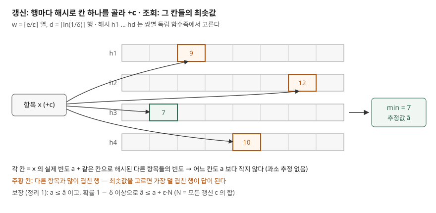

## 들어가며

API 게이트웨이에서 "지난 한 시간 동안 가장 많이 호출한 클라이언트"를 보여 달라는 요청은 흔하다. 처음에는 클라이언트 ID 를 키로 하는 해시 맵에 횟수를 더한다. 그런데 키가 IP·URL·사용자 조합으로 늘면 고유 키가 수천만 개가 되고, 시간대별로 맵을 따로 두면 그 배수가 된다. 아래 실측에서 고유 키 6만 4천 개짜리 파이썬 `Counter` 하나가 2.5MiB 를 썼다. 정작 보고 싶은 것은 상위 몇십 개의 대략적인 횟수인데, 이를 위해 한 번 왔다 간 키 수만 개까지 정확히 기억하고 있는 셈이다.

## 개념

**Count-Min Sketch**(CM 스케치)는 항목별 빈도를 **고정된 크기의 2차원 카운터 배열**로 추정하는 자료구조다. Cormode 와 Muthukrishnan 이 2004년 LATIN 에서 발표하고 2005년 Journal of Algorithms 에 실었다. 이름은 점 질의에 답하는 두 동작, 먼저 **세고**(count) 그다음 **최솟값**(min)을 고르는 것에서 왔다고 논문 3절이 적는다.

정확한 카운터와 무엇이 다른가는 세 가지로 정리된다.

| | 정확한 해시 맵 | Count-Min Sketch |
|---|---|---|
| 메모리 | 고유 항목 수에 비례 | ε, δ 로 정한 w × d 카운터로 고정 |
| 결과 | 정확 | 과대 추정만 한다 (작게 나오는 일이 없다) |
| 오차 크기 | 없음 | 확률 1 − δ 로 ε × (전체 갱신 합 N) 이하 |

논문은 기존 스케치들의 공간이 1/ε² 에 비례했던 것을 1/ε 로 줄였고, 해시 함수도 강한 독립성 대신 **쌍별 독립**(pairwise independent)이면 충분하다는 점을 기여로 든다.

## 구조



> **출처**: [Cormode & Muthukrishnan, An Improved Data Stream Summary: The Count-Min Sketch and its Applications, J. Algorithms 55(1) 2005 — §3 Count-Min Sketches(Data Structure, Update Procedure, Fig. 1), §4.1 Point Query(Theorem 1)](https://www.cs.tufts.edu/~nr/cs257/archive/graham-cormode/count-min.pdf)

## 동작 원리

논문 3절의 구성은 다음 세 단계다.

1. **크기 정하기**: 허용 오차 ε 와 실패 확률 δ 를 받아 폭 w = ⌈e/ε⌉, 깊이 d = ⌈ln(1/δ)⌉ 로 정하고 w × d 카운터를 0 으로 둔다. 행마다 해시 함수 h_j 하나를 쌍별 독립 함수족에서 무작위로 고른다
2. **갱신**: 항목 i 에 c 가 더해지면 모든 행 j 에서 `count[j][h_j(i)] += c`
3. **점 질의**: 추정값은 `min_j count[j][h_j(i)]`

왜 작게 나오는 일이 없는가는 구조에서 바로 나온다. 어느 칸이든 i 자신의 빈도에 **같은 칸으로 해시된 다른 항목의 빈도가 더해진 값**이므로 실제 빈도보다 작을 수 없다. 단, 이는 갱신 값이 음수가 아닐 때의 이야기다. 논문의 정리 1 도 비음수 경우에 대해 세운 것이다.

얼마나 크게 나오는가는 확률로 묶인다. 한 행에서 다른 항목 k 가 i 와 같은 칸에 떨어질 확률은 쌍별 독립성 덕에 1/w ≤ ε/e 이고, 그래서 한 행의 덧붙은 값의 기댓값은 εN/e 이하가 된다. 마르코프 부등식으로 한 행이 εN 을 넘을 확률은 1/e 미만이고, d 개 행이 **모두** 넘어야 최솟값이 넘으므로 그 확률은 e^(−d) ≤ δ 다. 이것이 정리 1 의 보장이다.

```text
a_i ≤ â_i,  그리고 확률 1 − δ 이상으로  â_i ≤ a_i + ε·N
```

논문은 e 를 밑으로 쓴 이유도 밝힌다. 일반적으로 w = b/ε, d = log_b(1/δ) 로 같은 보장을 얻을 수 있는데, 전체 카운터 수 w·d 를 최소로 만드는 밑이 b = e 라는 것이다.

## 실습 예제

전체 소스: [`code/`](code/) · 수행 기록: [`code/output.txt`](code/output.txt)

논문 구성을 그대로 옮겼다. 해시는 행마다 정수 두 개 (a, b) 로 정하는 `((a·x + b) mod p) mod w` 를 썼다(p = 2^61 − 1). 논문은 해시 함수 하나를 두 워드로 저장할 수 있는 쌍별 독립 함수를 Motwani·Raghavan 의 교재에서 가져다 쓴다고 적는다. 스트림은 항목 10만 종에서 지수 1.1 의 Zipf 분포로 100만 건을 뽑았다(시드 고정).

```python
def update(self, item, count=1):
    for row, col in zip(self.table, self._columns(item)):
        row[col] += count

def estimate(self, item):
    return min(row[col] for row, col in zip(self.table, self._columns(item)))
```

**① 보장은 지켜졌고, 실제 오차는 상한보다 훨씬 작았다.** ε = δ = 0.01 이면 w = 272, d = 5, 카운터 1,360개다.

```text
  항목 64,720개 · N = 1,000,000 · 상한 eps*N = 10,000
  과소 추정 0건 · 상한 초과 0건 (0.000%)
  오차 중앙값 1,315 · 90% 1,586 · 99% 1,972 · 최대 3,613
```

최대 오차가 상한의 36% 였다. 상한은 마르코프 부등식이라는 느슨한 도구로 얻은 것이라 실제 분포는 그보다 한참 안쪽에 있다. 기댓값 쪽 상한인 εN/e ≈ 3,679 와 비교하면 중앙값 1,315 는 그 1/3 쯤이다. 행 하나의 덧붙은 값의 기댓값이 그 정도이고, 다섯 행 중 최솟값을 고르니 더 작아진다.

**② 오차는 빈도와 상관없이 거의 같다.** 이것이 가장 중요한 결과다.

```text
  실제 빈도       항목 수   평균 오차   평균 상대 오차
  10,000 이상           10     1,148.6          5.9%
  1,000~9,999         76     1,245.1         66.7%
  100~999            615     1,214.5        657.4%
  10~99            5,526     1,313.5       7516.0%
  1~9             58,493     1,338.3      88270.8%
```

평균 오차는 어느 구간이나 1,150~1,340 이다. 오차가 항목 자신의 빈도가 아니라 **전체 N 에 비례하는 덧셈 오차**이기 때문이다. 그래서 상위 10개 항목은 상대 오차 5.9% 로 쓸 만하지만, 빈도 10 미만인 항목 5만 8천 개는 추정값이 실제의 수백 배다. 논문도 εN 보장은 N 에 비해 큰 값에 대해서만 상대 오차로 바꿔 읽을 수 있다고 적는다.

**③ 쏠림이 없으면 쓸 수 없다.** 같은 100만 건을 10만 종에 균등하게 뿌리면 항목당 평균 10회다.

```text
  오차 중앙값 3,597 · 90% 3,646 · 99% 3,684 · 최대 3,756
  항목 0: 실제 8 -> 추정 3,529
  항목 1: 실제 10 -> 추정 3,677
```

보장(상한 10,000)은 여전히 지켜지지만, 칸마다 평균 N/w ≈ 3,676 건이 쌓여 모든 추정값이 3,600 안팎으로 뭉개진다. 칸 하나에 쌓이는 평균은 Zipf 스트림도 같은데 오차가 세 배 가까이 차이 나는 것은 **최솟값** 때문이다. 쏠린 스트림에서는 빈도의 대부분이 상위 몇 항목이 떨어진 소수의 칸에 몰리고 나머지 칸은 평균보다 훨씬 덜 찬다. 다섯 행 중 하나라도 그런 칸이면 최솟값이 작아진다. 균등 분포에서는 모든 칸이 평균 가까이 차므로 최솟값도 평균 가까이에 머문다.

**④ 같은 메모리를 어떻게 나누는가.** 카운터 1,360개를 w × d 로 나눠 봤다.

```text
    w x d    평균 오차   99% 오차    최대 오차
  1360 x 1       732.0      7,687    134,741
   680 x 2       597.2      1,727    134,930
   272 x 5     1,196.2      2,123      6,012
   136 x 10    2,321.9      3,476      4,613
    68 x 20    4,228.7      6,771      8,347
```

행이 하나뿐이면 평균은 좋지만 최대 오차가 13만이다. 어떤 항목이 최상위 빈도 항목과 같은 칸에 떨어지면 피할 길이 없다. 행을 늘리면 그런 불운이 모든 행에서 겹칠 확률이 줄어 최대 오차가 떨어지지만, 폭이 좁아져 칸마다 쌓이는 양이 늘고 평균이 오른다. d 는 **최악의 경우를 막는 손잡이**, w 는 **평균 오차를 줄이는 손잡이**다.

**⑤ 빈도 상위 항목 찾기.** 전체의 1% 를 넘는 항목을 ε = 0.002(1360 × 5)로 찾았다. 실제 10개를 모두 찾았고 잘못 보고한 항목은 없었다. 논문 정리 6 은 φN 을 넘는 항목은 반드시 보고되고, 확률 1 − δ 로 (φ − ε)N 미만인 항목은 보고되지 않는다고 보장한다. 그래서 ε 를 φ 와 같게 잡으면 하한이 0 이 되어 보장이 사라진다. ε 는 φ 보다 충분히 작게 잡는다.

**⑥ 메모리.** tracemalloc 으로 잰 값은 `Counter` 2,569 KiB, 272 × 5 스케치 53.9 KiB 였다. 스케치 크기는 항목 종류가 1,000만이 되어도 그대로다.

## 실무에서 주의할 점

**첫째, 드문 항목의 추정값은 믿지 않는다.** 오차는 εN 수준으로 모든 항목에 비슷하게 붙는다. 빈도가 εN 에 비해 큰 항목만 의미가 있다. "이 IP 가 몇 번 왔나"를 모든 IP 에 대해 묻는 용도에는 맞지 않는다.

**둘째, ε 는 φ 보다 작게, δ 는 질의 횟수를 생각해 잡는다.** 정리 1 의 δ 는 질의 하나당 실패 확률이다. 항목 수만 개를 한꺼번에 검사하면 몇 개쯤은 상한을 넘을 수 있다. 논문의 heavy hitters 증명도 질의 전체에 합집합 상한을 걸기 위해 δ 를 줄여 잡는다.

**셋째, 해시 함수를 행마다 독립으로 고른다.** 모든 행에 같은 해시를 쓰면 한 행에서 부딪친 두 항목이 모든 행에서 부딪쳐 최솟값을 고르는 의미가 없어진다. 시드만 바꾼 같은 해시를 쓰더라도 행마다 매개변수가 달라야 한다.

**넷째, 빈도가 음수가 될 수 있으면 보장이 바뀐다.** 정리 1 은 비음수 경우에 대한 것이다. 논문은 항목 빈도가 음수가 될 수 있는 일반 경우를 4.1절 뒷부분에서 따로 다루는데, 이때는 최솟값 대신 **중앙값**으로 답하고 정리 2 의 보장은 확률 3/4 로 오차가 ±3εN 이내라는 양방향 오차로 약해진다.

**다섯째, 합치기는 쉽지만 같은 해시를 공유해야 한다.** 논문 도입부는 스케치가 입력의 선형 함수라 여러 곳에 흩어진 데이터에도 맞는다고 적는다. 같은 해시를 쓴 두 CM 스케치는 칸끼리 더하면 합친 스트림의 스케치가 된다. 서버마다 스케치를 두고 모을 때 해시 매개변수를 같은 값으로 맞춰야 하는 이유다.

## 정리

- CM 스케치는 w = ⌈e/ε⌉, d = ⌈ln(1/δ)⌉ 의 카운터 배열에 행마다 칸 하나씩 더하고, 조회 때 최솟값을 고른다
- 결과는 과대 추정만 하며, 확률 1 − δ 로 오차가 εN 이하다. 실측 최대 오차는 상한의 36% 였다
- 오차는 빈도와 무관하게 비슷한 덧셈 오차라, 쏠린 분포의 상위 항목에서만 쓸 만하다
- d 는 최악의 경우를, w 는 평균 오차를 줄인다. heavy hitters 를 찾을 때는 ε 를 φ 보다 작게 잡는다

## 참고 자료

- [Graham Cormode, S. Muthukrishnan, An Improved Data Stream Summary: The Count-Min Sketch and its Applications, Journal of Algorithms 55(1):58–75, 2005](https://www.cs.tufts.edu/~nr/cs257/archive/graham-cormode/count-min.pdf) — §3 자료구조·갱신, §4.1 점 질의와 Theorem 1, §5.2 Heavy Hitters 와 Theorem 6, §6 기존 스케치와의 비교. 링크는 Tufts 대학 강의 자료실에 올라 있는 저자 원고다
- [Cormode 의 논문 목록 — CM Sketch (J. Algorithms)](https://www.cs.ox.ac.uk/people/graham.cormode/pubs/html/CormodeMuthukrishnan04CMJalg.html)
- [Python 3.13 — tracemalloc](https://docs.python.org/3.13/library/tracemalloc.html) — 메모리 측정
