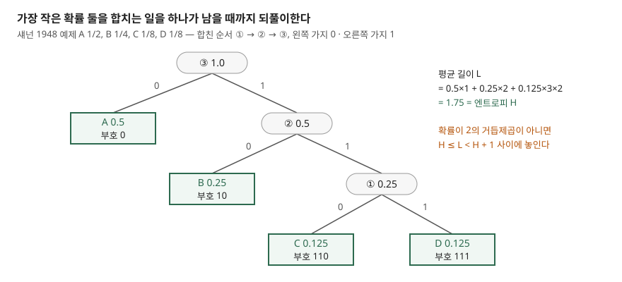

## 들어가며

로그 파일을 압축해 보관하다 보면 압축률이 파일마다 크게 갈린다. 같은 서비스의 로그인데 어떤 날은 10분의 1로 줄고 어떤 날은 절반밖에 안 준다. 이때 흔히 압축 레벨을 1부터 9까지 바꿔 가며 다시 돌려 보는데, 레벨을 올려도 몇 퍼센트 차이에 그치는 경우가 많다. 압축률을 정하는 것은 레벨이 아니라 **데이터가 가진 정보량**이고, 그 하한이 엔트로피다. 허프만 부호를 직접 만들어 보면 그 하한이 어디에 있고, gzip·zlib 이 쓰는 DEFLATE 가 왜 그 하한을 "넘어서는" 것처럼 보이는지가 숫자로 드러난다.

## 개념

**엔트로피**는 기호가 서로 독립으로 어떤 확률 분포에서 나올 때 기호 하나에 평균 몇 비트가 필요한지의 하한이다. 섀넌은 1948년 논문의 무잡음 채널 기본 정리(Theorem 9)에서 원천의 엔트로피 H 보다 적은 비트로는 평균적으로 보낼 수 없다는 것을 보였다.

**허프만 부호**는 기호마다 따로 부호어를 붙이는 방식 가운데 평균 길이가 가장 짧은 접두어 없는 부호다. MIT 6.02 강의 노트는 그 평균 길이 L 이 H ≤ L < H + 1 을 만족한다고 정리한다. 이 부등식의 오른쪽 "+1" 이 허프만의 한계다. 부호어는 정수 비트라서, 확률이 0.95 인 기호도 최소 1비트를 써야 한다.

**DEFLATE**(RFC 1951)는 gzip·zlib 이 쓰는 형식으로, 앞서 나온 반복을 거리·길이 쌍으로 바꾸는 LZ77 과 허프만 부호를 결합한다. 허프만은 기호를 하나씩만 보고, LZ77 은 앞에 무엇이 나왔는지를 본다. 이 차이가 실험 결과를 가른다.

## 구조



> **출처**: 합치기 절차는 [MIT 6.02 Lecture Notes Ch.3 §3.2 Huffman Codes](https://ocw.mit.edu/courses/6-02-introduction-to-eecs-ii-digital-communication-systems-fall-2012/resources/mit6_02f12_chap03/), 확률과 부호는 [Shannon (1948) §9 The Fundamental Theorem for a Noiseless Channel](https://people.math.harvard.edu/~ctm/home/text/others/shannon/entropy/entropy.pdf)의 예제(PDF 18쪽). 트리 모양은 `code/huffman_vs_zlib.py` 1절 출력과 맞춰 그렸다.

## 동작 원리

**트리 만들기.** MIT 노트가 적은 절차는 세 단계다. 기호와 확률을 집합에 넣고, 확률이 가장 작은 둘을 꺼내 합친 새 노드를 다시 넣고, 하나가 남을 때까지 되풀이한다. 합쳐질 때마다 그 아래 잎은 한 단계 깊어지므로, 예제 코드는 트리를 따로 만들지 않고 잎마다 "몇 번 합쳐졌는가"만 센다. 그것이 곧 부호 길이다. 최솟값 둘을 꺼내는 일은 `heapq` 가 맡는다.

**길이만 있으면 부호가 정해진다.** RFC 1951 의 허프만 절(§3.2.2)은 DEFLATE 의 허프만 부호에 규칙 두 개를 더한다. 같은 길이의 부호는 기호 순서대로 연속된 값을 갖고, 짧은 부호가 긴 부호보다 사전순으로 앞선다. 그러면 기호별 길이만 알아도 부호를 다시 만들 수 있어, 압축 파일에는 부호표 대신 길이 목록만 담는다. RFC 의 예제를 그대로 넣어 봤다.

```text
== 3) RFC 1951 예제 — 길이 (3,3,3,3,3,2,4,4) 로 부호 만들기 ==
  A=010  B=011  C=100  D=101  E=110  F=00  G=1110  H=1111
```

RFC 에 적힌 부호와 여덟 개 모두 같았다. 섀넌 예제에 같은 절차를 쓰면 0, 10, 110, 111 이 나오는데, 이것도 섀넌이 논문에 적은 부호와 같다.

## 실습 예제

전체 소스: [`code/`](code/) · 수행 기록: [`code/output.txt`](code/output.txt)

**확률이 2의 거듭제곱이면 하한에 닿는다.** 섀넌 예제는 1/2, 1/4, 1/8, 1/8 이라 log₂(1/p) 가 전부 정수다.

```text
  엔트로피 H = 1.7500  평균 길이 L = 1.7500
```

**치우친 원천에서는 1비트에 묶인다.** 이 실험에서 가장 차이가 큰 결과였다. a 가 0.95, b 가 0.05 인 이진 원천의 엔트로피는 0.2864 비트인데, 허프만은 a 에 0, b 에 1 을 줄 수밖에 없어 1.0000 비트다. 하한의 3.5배다. MIT 노트가 제시한 해법대로 기호 K 개를 하나로 묶어 부호화했다.

```text
  K | 잎 수 | 기호당 L | L - H  | 한계 H + 1/K
  1 |     2 | 1.0000   | 0.7136 | 1.2864
  2 |     4 | 0.5737   | 0.2874 | 0.7864
  3 |     8 | 0.4332   | 0.1469 | 0.6197
  4 |    16 | 0.3672   | 0.0808 | 0.5364
```

차이가 0.71 → 0.29 → 0.15 → 0.08 로 줄었고, 모두 노트의 한계 H + 1/K 안에 들었다. 대가는 잎 수다. 2^K 로 늘어나므로 바이트 단위 기호(256종)를 넷씩 묶으면 잎이 2^32 개가 된다.

**문맥을 보면 하한을 "넘는다".** 파이썬에 들어 있는 *The Zen of Python* 856바이트로 세 입력을 만들었다. 원문, 원문을 20번 이어 붙인 것, 같은 글자를 고정 시드로 섞은 것이다. 세 입력은 글자 빈도가 같으므로 0차 엔트로피(기호를 독립으로 볼 때의 엔트로피)도 같다.

| 입력 | 바이트 | H(0차) | 허프만 | DEFLATE | DEFLATE 허프만만 |
|---|---|---|---|---|---|
| 원문 1회 | 856 | 4.4851 | 4.5199 | 4.1028 | 4.9252 |
| 원문 20회 반복 | 17,120 | 4.4851 | 4.5199 | 0.2617 | 4.5603 |
| 같은 글자를 섞은 것 | 856 | 4.4851 | 4.5199 | 5.1776 | 4.9252 |

(단위는 기호당 비트. 출력의 4절을 옮겼다.) 허프만은 세 입력에서 4.5199 로 같다. 빈도만 보기 때문이다. DEFLATE 는 원문에서 이미 0차 엔트로피 아래로 내려갔고, 20번 반복하면 0.26 비트가 됐다. 두 번째부터는 "앞의 856바이트를 그대로 복사"라는 거리·길이 쌍으로 표현되기 때문이다. 엔트로피 하한을 깬 것이 아니라, 기호가 독립이라는 0차 모델의 가정이 틀린 것이다.

**예상과 달랐던 것은 섞은 입력이다.** 글자를 섞어 반복을 없애자 DEFLATE 는 5.18 비트로, LZ77 을 끄고 허프만만 쓴 `Z_HUFFMAN_ONLY` 4.93 비트보다 컸다. 반복이 없는 데이터에서는 LZ77 단계가 이득 없이 비용만 더한 셈이다. 블록 내부를 풀어 보지는 않았으므로 어떤 짧은 일치가 비용을 늘렸는지는 확인하지 않았다.

`Z_HUFFMAN_ONLY` 와 직접 만든 허프만의 차이(856바이트에서 0.41 비트, 17,120바이트에서 0.04 비트)는 DEFLATE 가 블록마다 싣는 길이 목록과 머리의 몫이다. 데이터가 길수록 이 고정 비용이 기호마다 나뉘어 작아진다.

## 실무에서 주의할 점

**첫째, 반복이 없는 데이터에 DEFLATE 를 걸면 오히려 커질 수 있다.** 섞은 입력에서 DEFLATE 결과가 허프만만 쓴 경우보다 컸다. 이미 압축된 파일처럼 반복이 사라진 데이터를 다시 압축하는 경우가 여기에 가깝지만, 이 글에서 그런 파일을 따로 재지는 않았다.

**둘째, 작은 데이터에는 고정 비용이 크다.** 856바이트에서 길이 목록과 머리가 기호당 0.4 비트를 차지했다. 수백 바이트짜리 메시지를 하나씩 압축하면 이 몫이 두드러진다. 같은 종류의 메시지를 모아서 압축하거나, 파이썬 `zlib.compressobj` 의 `zdict` 처럼 미리 정한 사전을 넘기는 방법이 있다.

**셋째, 치우친 분포에는 허프만 단독이 맞지 않는다.** 한 기호가 압도적이면 1비트 하한에 묶인다. 2절처럼 기호를 묶거나, 반복을 거리·길이로 바꾸는 LZ77 단계를 앞에 둔다. 묶기는 잎 수가 2^K 로 늘어나는 대가가 있다.

**넷째, 0차 엔트로피로 압축률을 예측하지 않는다.** 원문 856바이트의 0차 엔트로피는 4.49 비트였지만 DEFLATE 는 4.10 비트였다. 반복이 많은 로그는 0차 엔트로피보다 훨씬 작아진다. 실제 표본을 압축해 보는 것이 빠르다.

## 정리

- 허프만은 가장 작은 확률 둘을 합치는 일을 되풀이해 만들고, 기호별 부호 중 평균 길이가 최소다
- 평균 길이는 H ≤ L < H + 1 이며, 확률이 2의 거듭제곱이면 하한에 닿는다
- p=0.95 이진 원천은 엔트로피 0.29 비트인데 허프만은 1 비트였고, K 개씩 묶으면 H + 1/K 로 다가갔다
- DEFLATE 는 LZ77 로 문맥을 봐서 0차 엔트로피 아래로 내려가지만, 반복이 없는 입력에서는 허프만만 쓴 것보다 컸다

## 참고 자료

- [RFC 1951 — DEFLATE Compressed Data Format Specification version 1.3, §3.2.2 Use of Huffman coding in the "deflate" format](https://www.rfc-editor.org/rfc/rfc1951.html#page-7) — 부호 규칙 두 개, 길이에서 부호를 만드는 세 단계와 예제
- [MIT 6.02 (Fall 2012) Lecture Notes Ch.3 — Compression Algorithms: Huffman and LZW](https://ocw.mit.edu/courses/6-02-introduction-to-eecs-ii-digital-communication-systems-fall-2012/resources/mit6_02f12_chap03/) — §3.2 합치기 절차, H ≤ L < H + 1, 기호 묶기의 H + 1/K, §3.3 문맥에 따라 확률이 바뀌는 문제
- [C. E. Shannon, A Mathematical Theory of Communication, Bell System Technical Journal (1948)](https://people.math.harvard.edu/~ctm/home/text/others/shannon/entropy/entropy.pdf) — §9 Theorem 9, 1/2·1/4·1/8·1/8 예제
- [D. A. Huffman, A Method for the Construction of Minimum-Redundancy Codes, Proc. IRE 40(9), 1952](http://compression.ru/download/articles/huff/huffman_1952_minimum-redundancy-codes.pdf) — 원 논문 (스캔본이라 본문은 MIT 노트로 확인했다)
- [Python 3.13 — zlib.compressobj](https://docs.python.org/3.13/library/zlib.html#zlib.compressobj) — `wbits` 음수(머리 없는 DEFLATE), `strategy`, `zdict`
