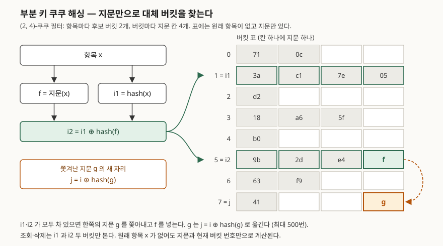

## 들어가며

세션 차단 목록이나 캐시 앞단의 "이 키가 있을 수 있는가" 검사에 블룸 필터를 붙여 쓰다 보면, 언젠가
**항목을 빼야 하는** 날이 온다. 차단이 풀린 사용자, 만료된 키, 지워진 행이다. 블룸 필터는 비트를
내리면 다른 항목이 함께 쓰는 비트까지 내려가므로 지울 수 없다. 그래서 보통은 남은 항목 전체로 필터를
주기적으로 다시 만든다. 항목이 1,000만 개면 지울 것이 하나여도 1,000만 번 해시를 다시 돌린다.

쿠쿠 필터는 원래 항목 대신 짧은 **지문**을 해시 표에 넣어 이 문제를 푼다. 지문을 넣은 자리를 다시
찾을 수 있으니 그 지문 하나만 빼면 된다. 대가는 두 가지다. 표를 끝까지 채울 수 없고, 지우는 방법을
잘못 쓰면 "없다"는 답까지 틀리기 시작한다. 이 글은 두 대가를 직접 잰다.

## 개념

쿠쿠 필터는 Fan, Andersen, Kaminsky, Mitzenmacher가 CoNEXT 2014에서 발표한 근사 집합 자료구조다.
"있다"는 가끔 틀리고 "없다"는 틀리지 않는 점은 블룸 필터와 같다. 다른 점은 구조다.

| | 블룸 필터 | 쿠쿠 필터 |
|---|---|---|
| 저장 단위 | 비트 배열의 비트 k개 | 버킷의 칸 하나에 지문 하나 |
| 조회 | 비트 k개를 본다 | 버킷 2개(칸 2b개)를 본다 |
| 삭제 | 안 된다 | 지문 한 벌을 뺀다 |
| 가득 참 | 없다. 오탐률이 계속 오른다 | 있다. 어느 순간 삽입이 실패한다 |

해시 표 쪽 이름은 **쿠쿠 해싱**에서 왔다. 항목마다 후보 자리가 둘 있고, 둘 다 차 있으면 이미 있던
항목을 쫓아내 그 항목의 다른 자리로 보낸다. 문제는 표에 원래 항목이 없다는 것이다. 쫓겨난 지문의
"다른 자리"를 원래 항목 없이 계산해야 한다.

## 구조



> **출처**: [Fan et al., Cuckoo Filter: Practically Better Than Bloom, CoNEXT 2014](https://www.cs.cmu.edu/~dga/papers/cuckoo-conext2014.pdf) §3.1 Insert(Algorithm 1, Eq. 1·2), §3.2 Lookup(Algorithm 2), §5.1 Optimal Bucket Size((2, 4)-쿠쿠 필터)

## 동작 원리

논문은 이것을 **부분 키 쿠쿠 해싱**(partial-key cuckoo hashing)이라 부른다. 두 후보 버킷을
`i1 = hash(x)`, `i2 = i1 ⊕ hash(f)`로 정한다(§3.1 식 1). XOR은 두 번 하면 원래대로 돌아오므로, 지금
있는 버킷이 i1이든 i2든 `j = i ⊕ hash(f)` 하나로 반대편을 구한다(식 2). 삽입은 표 안의 정보만 쓰고
원래 항목을 다시 읽지 않는다.

지문을 해시한 뒤 XOR하는 데는 이유가 있다. `i ⊕ f`를 그대로 쓰면 8비트 지문은 버킷 번호의 아래
8비트만 바꾸므로, 쫓겨난 지문이 가까운 256개 버킷 안에서만 돌게 된다고 논문은 설명한다.

삽입은 두 버킷에 빈 칸이 있으면 넣고, 없으면 무작위로 지문 하나를 쫓아낸다. 이것을 최대
**MaxNumKicks**번(논문 실험은 500번) 되풀이하고 그래도 자리가 없으면 표가 찼다고 보고 실패를
돌려준다. 조회는 두 버킷에 같은 지문이 있는지만 보고, 삭제는 둘 중 한 곳에서 같은 지문을 하나 뺀다.

오탐률의 상한은 비회원 조회가 칸 2b개와 비교하므로 `1 − (1 − 1/2^f)^2b ≈ 2b/2^f`다(§5.1 식 5).
버킷이 클수록 표를 더 채울 수 있지만 같은 오탐률을 지키려면 지문이 길어져야 한다.

## 실습 예제

`hashlib.blake2b`로 해시하고, 쫓아내기의 무작위 선택은 시드를 고정했다. 전체 칸 수를 16,384로 두고
버킷 크기만 바꿨다. 전체 소스: [`code/`](code/) · 돌린 기록: [`code/output.txt`](code/output.txt)

**1. 버킷 크기별로 첫 삽입 실패 때까지 채운다** (f=12, 5회).

```text
   b | 버킷 수 | 최소   | 평균   | 최대
   1 |  16384 | 0.5164 | 0.5321 | 0.5471
   2 |   8192 | 0.8760 | 0.8806 | 0.8835
   4 |   4096 | 0.9620 | 0.9667 | 0.9698
   8 |   2048 | 0.9915 | 0.9923 | 0.9932
```

논문은 b=1, 2, 4, 8에서 50%, 84%, 95%, 98%를 적는다(§5.1). 이 실험은 그보다 1~4%p 높았다. 논문
Figure 2는 버킷 2^15개 이상의 표에서 10회 중 **최솟값**을 적었고, 이 실험은 칸 16,384개짜리 작은 표다.
조건이 달라 숫자를 그대로 맞대지 않는다. 버킷 하나의 칸이 늘수록 벽이 뒤로 물러나는 모양은 같다.

**2. 지문 길이별 오탐률** (b=4, 실패 직전까지 채움, 비회원 200,000건).

```text
   f | 적재율 | 측정 오탐률 | 상한 2b/2^f | 적재율 x 2b/2^f | bits/item = f/α
   4 | 0.9592 |    0.401835 |    0.500000 |        0.479584 | 4.17
   8 | 0.9720 |    0.029925 |    0.031250 |        0.030376 | 8.23
  12 | 0.9686 |    0.001815 |    0.001953 |        0.001892 | 12.39
```

f가 2비트 늘 때마다 오탐률이 4분의 1이 된다. 측정값은 상한 2b/2^f에 적재율을 곱한 값에 가깝다. 칸이
덜 찬 만큼 비교할 지문이 적기 때문이다.

**3. 같은 메모리의 블룸 필터.** 항목 수와 총 비트 수를 맞추고 블룸 쪽은 최적 k를 썼다.

```text
  필터           | n      | 총 비트 | bits/item | k | 측정 오탐률
  쿠쿠 b=4 f=8   |  15926 |  131072 |      8.23 | - | 0.029925
  블룸           |  15926 |  131072 |      8.23 | 6 | 0.018985
  쿠쿠 b=4 f=12  |  15869 |  196608 |     12.39 | - | 0.001815
  블룸           |  15869 |  196608 |     12.39 | 9 | 0.002425
```

**항목당 8비트에서는 블룸이, 12비트에서는 쿠쿠가 이겼다.** 논문 Table 2의 항목당 비트 수는 블룸이
1.44·log₂(1/ε), 쿠쿠가 (log₂(1/ε) + 3)/α다. α=95.5%를 넣고 둘을 같게 두면 log₂(1/ε) ≈ 8, 즉
ε ≈ 0.4%다. 그보다 낮은 오탐률을 원하면 쿠쿠 쪽이 적은 메모리를 쓴다. 측정한 역전도 3%와 0.2% 사이에서 일어났다.

**4. 넣은 것을 지운다** (b=4, f=8, 8,000개 넣고 4,000개 지움).

```text
  지운 4,000개 중 delete() 가 True: 4000
  남긴 4,000개 중 contains() 가 False(거짓 음성): 0
  지운 4,000개 중 아직 '있다'로 나오는 것: 22
  비회원 오탐률: 삭제 전 0.01595 -> 삭제 후 0.00781 (적재율 0.2441)
```

남긴 항목은 하나도 사라지지 않았고, 오탐률은 적재율을 따라 절반으로 내려갔다. 지운 항목 22개가 아직
"있다"로 나오는 것은 오탐이다. 같은 버킷에 같은 지문을 가진 다른 회원이 남아 있다.

## 실무에서 주의할 점

**1. 넣지 않은 항목을 지우면 "없다"가 틀리기 시작한다.** 4번 상태에서 비회원 100,000개를 조회해 "있다"로
나온 것을 지웠다.

```text
  비회원 100,000개 중 '있다'로 나온 것: 769
  그것들을 delete(): True 704건 -> 남긴 회원 중 거짓 음성 699건
```

**남긴 회원 4,000개 중 699개(17%)가 "없다"로 바뀌었다.** 오탐이 난 비회원은 어떤 회원과 버킷·지문이
같으므로, 그 지문을 빼면 회원의 지문이 빠진다. 논문도 삭제하려면 그 항목을 먼저 넣었어야 한다고 적는다
(§3.3). "지우기 전에 `contains()`로 확인"은 이것을 막지 못한다. 오탐은 `contains()`가 True를 주는 경우다.
원본 저장소에서 존재를 확인한 항목만 필터에서 지운다.

**2. 같은 항목은 2b번까지만 들어간다.**

```text
  O O O O O O O O X X  (성공 8회, 두 버킷의 지문 수 4·4, 필터 전체 8개)
```

같은 항목은 같은 두 버킷으로만 가므로 b=4면 8번째에서 두 버킷이 다 찬다(논문 §3.1). 이벤트를 중복으로
넣는 스트림에 붙이면 표가 비어 있어도 삽입이 실패한다. 삽입 전에 원본에서 중복을 거르거나, 삭제가 필요
없으면 같은 지문을 두 번 넣지 않는다.

**3. 지문을 해시하지 않으면 표가 덜 찬다.**

```text
   f | 해시함 평균 적재율 | 해시 안 함 평균 적재율
   4 |             0.9594 | 0.6590
   8 |             0.9686 | 0.9094
  12 |             0.9667 | 0.9661
```

`i ⊕ f`로 구하면 4비트 지문은 이웃 16개 버킷 안에서만 자리를 바꿔 66%에서 막혔다. 지문이 길어지면 차이가
줄어든다. 직접 구현할 때 이 해시를 아끼면 안 된다.

**4. 용량을 넘기면 실패를 돌려준다.** 블룸 필터는 넘쳐도 오탐률만 오르지만 쿠쿠 필터는 `insert()`가
False를 돌려준다. 이 구현은 그때 손에 든 지문 하나를 버리는데, 쫓아내기를 거쳤으므로 그 지문은
앞서 들어간 **다른 항목**의 것일 수 있다. 실패 한 번이 이미 들어 있던 항목의 거짓 음성으로 이어진다. 예상 항목 수를
b=4 기준 적재율 95% 아래로 잡고, 실패하면 더 큰 표로 옮기는 경로를 미리 둔다.

## 정리

- 쿠쿠 필터는 지문을 2개 후보 버킷에 넣고, `i ⊕ hash(f)`로 원래 항목 없이 반대편 버킷을 구한다.
- b=4면 이 실험에서 96.7%까지 찼다. 오탐률은 2b/2^f에 적재율을 곱한 값을 따라갔다.
- 같은 메모리에서 항목당 8비트는 블룸, 12비트는 쿠쿠가 오탐이 적었다. 논문 식의 역전점은 ε ≈ 0.4%다.
- 삭제는 넣은 항목에만 쓴다. 오탐 항목을 지우자 남은 회원의 17%가 "없다"로 바뀌었다.
- 같은 항목은 2b번까지만 들어가고, 표가 차면 삽입이 실패한다.

## 참고 자료

- [Fan, B., Andersen, D. G., Kaminsky, M., Mitzenmacher, M. D., Cuckoo Filter: Practically Better Than Bloom, CoNEXT 2014](https://www.cs.cmu.edu/~dga/papers/cuckoo-conext2014.pdf) — §3 Algorithm 1~3, §4 Figure 2, §5.1 식 4~7, Table 2
- [블룸 필터를 직접 만들어 오탐률 수식과 맞춰 보기](../2026-11-03-bloom-filter-false-positive-rate/index.md) — 같은 저장소의 블룸 필터 실측
