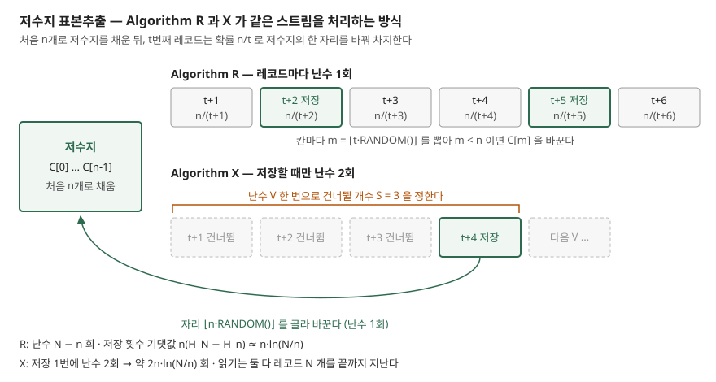

## 들어가며

장애 원인을 찾으려고 하루치 접근 로그에서 "아무 요청이나 1,000줄만 골라 보고 싶다"는 순간이 있다. 보통은 `wc -l` 로 줄 수를 세고, 그 범위에서 줄 번호 1,000개를 뽑은 뒤 파일을 다시 읽어 그 줄들을 꺼낸다. 로그가 수십 GB 면 같은 파일을 두 번 끝까지 읽는 셈이고, 카프카 토픽이나 소켓처럼 다시 읽을 수 없는 흐름이면 이 방법은 아예 쓸 수 없다. 그렇다고 전부 메모리에 올려 `random.sample` 을 부르면 메모리가 모자란다. 한 번만 읽고, n 개만 들고 있으면서, 끝까지 읽었을 때 모든 줄이 같은 확률로 뽑혀 있게 하는 방법이 저수지 표본추출이다.

## 개념

**저수지 표본추출**(reservoir sampling)은 전체 개수 N 을 모르는 레코드 흐름을 한 번 순서대로 읽으면서, 크기 n 의 무작위 표본(비복원)을 만드는 방법이다. 이름의 저수지는 표본 후보를 담아 두는 크기 n 의 배열이다.

Vitter 의 1985년 논문은 이 문제를 정리하고 몇 가지 알고리즘을 비교했다. 논문의 정의로는 처음 n 개를 저수지에 넣고, 나머지를 차례로 처리하며 레코드는 처리되는 순간에만 저수지에 들어갈 수 있고, **레코드 하나를 처리한 뒤마다 저수지가 지금까지 본 레코드의 무작위 표본**이어야 한다. 그리고 한 번 읽기로 이 문제를 푸는 모든 알고리즘은 이런 저수지 알고리즘의 한 형태라는 것을 정리로 보였다(Theorem 1).

N 을 미리 알면 줄 번호를 먼저 뽑으면 된다. N 을 모른다는 조건 하나가 "지금까지 본 것 중의 표본"을 매 순간 유지하는 방식을 강제한다.

## 구조



> **출처**: [Vitter, "Random Sampling with a Reservoir", ACM TOMS 11(1), 1985 — §2 Reservoir Algorithms and Algorithm R, §3 Our Framework, §4 Algorithms X and Y](https://doi.org/10.1145/3147.3165)

R 은 레코드마다 난수를 하나 뽑아 넣을지 정한다. X 는 다음에 넣을 레코드까지 **몇 개를 건너뛸지**를 난수 하나로 한 번에 정하고, 넣을 자리를 고를 때 난수를 하나 더 쓴다.

## 동작 원리

**Algorithm R.** 논문은 이 방법을 Alan Waterman 의 것으로 소개한다. t 개를 처리한 시점의 저수지가 처음 t 개의 무작위 표본이라고 하자. t+1 번째 레코드가 크기 n 표본에 들 확률은 n/(t+1) 이므로 그 확률로 후보가 되고, 밀려날 후보는 n 개 중 무작위로 고른다. 그러면 저수지는 처음 t+1 개의 무작위 표본이 된다. 코드로는 `m = ⌊t·RANDOM()⌋` 을 뽑아 `m < n` 이면 `C[m]` 을 바꾸는 한 줄이다. 확률 판정과 자리 고르기를 난수 하나로 같이 한다.

저수지에 들어가는 횟수의 기댓값은 다음과 같다(식 2.2).

$$n(H_N - H_n) \approx n \ln\frac{N}{n}$$

H_k 는 1 + 1/2 + … + 1/k 다. 레코드는 N 개인데 저수지가 바뀌는 횟수는 로그로만 는다. 그런데 R 은 바뀌지 않는 레코드에도 난수를 뽑으므로 난수 호출은 N − n 번이다.

**Algorithm X.** 논문은 "다음 저장까지 건너뛸 레코드 수" S(n, t) 를 확률 변수로 두고, 그 분포에서 S 를 직접 뽑는다(§3). 균일 난수 V 를 하나 뽑은 뒤, 레코드 t+1, t+2, … 가 연달아 뽑히지 않을 확률을 차례로 곱해 가다가 그 값이 V 이하가 되는 첫 자리에서 멈춘다(식 4.1). 곱은 앞의 값에 `num/t` 꼴 하나를 곱하면 되므로 한 칸에 상수 시간이다. 그 자리의 레코드를 넣고, 자리를 고르는 데 난수를 하나 더 쓴다. 저장 1번에 난수 2번이므로 전체 호출은 약 2n·ln(N/n) 이다(Table I).

X 도 레코드를 하나씩 세며 지나가므로 CPU 시간은 여전히 O(N) 이다. 줄어드는 것은 난수 호출과 판정 횟수다. 논문은 n = 1 이면 S 의 기댓값이 무한대라 X 를 쓰지 말라고 적었고, 건너뛰기를 거부 표본추출로 계산해 O(n(1 + log(N/n))) 에 끝내는 Algorithm Z 를 본론으로 제시한다.

## 실습 예제

전체 소스: [`code/reservoir.py`](code/reservoir.py) · 수행 기록: [`code/output.txt`](code/output.txt)

X 는 논문 §8 코드의 앞부분(Algorithm X 로 처리하는 구간)을 그대로 옮겼다.

```python
def algorithm_x(stream, n, rng):
    it = iter(stream)
    reservoir = list(islice(it, n))
    replaced = 0
    t = n
    num = 0  # 항상 t - n
    while True:
        v = rng.random()
        skip = 0
        t += 1
        num += 1
        quot = num / t  # 이번 레코드가 뽑히지 않을 확률
        while quot > v:
            skip += 1
            t += 1
            num += 1
            quot = quot * num / t
        for _ in islice(it, skip):
            pass
        record = next(it, None)
        if record is None:
            return reservoir, replaced
        reservoir[int(n * rng.random())] = record
        replaced += 1
```

**① 균일한가.** 원소 0~19 에서 5개 뽑기를 10만 번 반복했다. 원소마다 기대 횟수는 25,000 이다. 함께 돌린 세 번째 줄은 R 에서 `int(t * random())` 대신 `randint(0, t)` 를 쓴 판이다. `randint` 는 양 끝을 포함하므로 t+1 가지 중에서 뽑는다.

```text
  알고리즘            | 0번 원소 | 9번 원소 | 19번 원소 |  최소  |  최대  | 카이제곱
  R                  |   24,898 |   24,937 |    24,789 | 24,760 | 25,200 |      11.4
  X                  |   24,953 |   25,224 |    24,690 | 24,690 | 25,224 |      14.7
  R, randint(0,t) 실수 |   28,625 |   23,681 |    23,640 | 23,639 | 28,744 |    3324.1
```

R 과 X 의 카이제곱 통계량은 11.4, 14.7 로, 균일할 때의 기댓값인 자유도 19 근처다. 경계를 한 칸 틀린 판은 3,324 다. 받아들일 확률이 n/t 가 아니라 n/(t+1) 이 되어 뒤에 오는 레코드가 덜 들어가고, 처음 저수지를 채운 0번 원소가 28,625 번으로 기대보다 14% 더 남았다. **한 글자 차이가 결과를 크게 바꾸는데 코드는 멀쩡히 돌아간다.** 이번 실습에서 가장 눈에 띈 결과다.

**② 난수 호출 수.** n = 100 으로 고정하고 N 을 10배씩 늘렸다.

```text
        N    | R 호출      | X 호출  | X 의 호출/저장 | 2n·ln(N/n)
        1,000 |         900 |     447 |          2.004 |        461
       10,000 |       9,900 |     953 |          2.002 |        921
      100,000 |      99,900 |   1,419 |          2.001 |      1,382
    1,000,000 |     999,900 |   1,853 |          2.001 |      1,842
   10,000,000 |   9,999,900 |   2,261 |          2.001 |      2,303
```

R 은 정확히 N − n 번이다. X 는 N 이 10배 될 때마다 400~500번씩 늘어 로그로 자랐고, 저장 1번당 호출이 2.00 에 붙었다. 2.00 보다 조금 큰 것은 끝을 지나치며 V 를 한 번 더 뽑기 때문이다.

**③ 저수지에 넣은 횟수.** 시드 20개 평균을 식 2.2 와 비교했다.

```text
        N    | 공식 n(H_N-H_n) | R 평균    | X 평균    | n·ln(N/n)
        1,000 |           229.8 |     227.8 |     228.2 |     230.3
       10,000 |           460.0 |     463.1 |     459.9 |     460.5
      100,000 |           690.3 |     693.8 |     694.5 |     690.8
    1,000,000 |           920.5 |     925.4 |     921.5 |     921.0
```

1백만 건을 읽어도 저수지는 920번 남짓 바뀐다. R 과 X 는 같은 분포에서 뽑으므로 넣은 횟수도 같은 값 근처에 모인다.

**④ 걸린 시간.** 1천만 건, 3회 중 최소다. 측정값은 환경에 따라 흔들린다.

```text
  R: 3.26 초
  X: 1.55 초
  -- 비교 기준: 같은 스트림을 읽기만 할 때
  읽기만: 0.18 초
```

**예상보다 X 의 이득이 작았다.** 난수 호출은 4,000배 넘게 줄었는데 시간은 2배 줄었다. X 도 건너뛰는 레코드마다 `quot` 를 곱하는 파이썬 반복을 한 번씩 돌기 때문이다. 논문이 FORTRAN 으로 잰 값은 R 이 약 160N, X 가 약 40N 마이크로초로 4배 차이였다. 인터프리터에서는 난수 호출보다 반복 자체의 비용이 커서 차이가 줄어든다.

## 실무에서 주의할 점

1. **경계 한 칸이 표본을 기울인다.** ①의 `randint(0, t)` 는 테스트가 통과하고 결과도 그럴듯해 보인다. 저수지 코드를 고치거나 다른 언어로 옮기면 작은 모집단으로 수만 번 돌려 원소별 빈도를 세는 검사를 같이 둔다. 파이썬의 `randint(a, b)` 는 b 를 포함하고 `int(t * random())` 은 t 를 포함하지 않는다. 옮겨 쓰는 난수 함수가 끝값을 포함하는지 문서로 확인한다.
2. **저수지는 "지금까지"의 표본이다.** 언제 멈춰도 그때까지 본 것의 균일 표본이라는 것이 장점이지만, 시간대별로 고르게 뽑힌다는 뜻은 아니다. 요청이 몰린 시간대가 표본에도 그 비율로 들어간다. 시간대별 표본이 필요하면 구간마다 저수지를 따로 둔다.
3. **X 의 이득은 건너뛰는 비용에서 갈린다.** ④처럼 레코드를 하나씩 읽어야 하는 흐름에서는 판정을 덜 할 뿐이다. 고정 길이 레코드 파일처럼 S 개를 한 번에 건너뛸 수 있으면 읽기 자체가 줄어든다. 논문도 디스크의 임의 접근과 테이프 빨리 감기로 I/O 를 줄이는 것을 전제로 CPU 시간을 비교했다.
4. **n 이 작거나 N 이 아주 크면 X 를 그대로 쓰지 않는다.** n = 1 이면 X 는 쓰면 안 되고(§4), t 가 커질수록 건너뛰기를 순차 탐색으로 계산하는 비용이 커진다. 논문의 구현은 t 가 n 의 22배를 넘으면 Algorithm Z 의 거부 표본추출로 넘어간다(§6, §8).
5. **재현이 필요하면 시드를 고정하고 기록한다.** 표본으로 장애를 분석했다면 같은 표본을 다시 만들 수 있어야 한다. 이 글의 수치도 시드 `20261109` 로 다시 나온다.

## 정리

- 저수지 표본추출은 N 을 모르는 흐름을 한 번만 읽고 n 개만 들고서 균일한 비복원 표본을 만든다
- R 은 t 번째 레코드를 확률 n/t 로 넣는다. 난수를 N − n 번 쓴다
- X 는 건너뛸 개수를 난수 하나로 정해 저장마다 난수 2번, 합계 약 2n·ln(N/n) 번을 쓴다. 저장 횟수는 둘 다 n(H_N − H_n)
- 실측에서 둘 다 균일했고, `randint(0, t)` 한 글자 실수는 카이제곱 3,324 로 표본을 기울였다

## 참고 자료

- [Jeffrey S. Vitter, "Random Sampling with a Reservoir", ACM Transactions on Mathematical Software 11(1):37–57, 1985](https://doi.org/10.1145/3147.3165) — §2 Algorithm R 과 식 2.1·2.2, §3 Theorem 1 과 S(n, t), §4 Algorithm X, §8 구현, Table I
- [같은 논문의 PDF 사본 — University of Maryland 강의 자료 (제3자 사본)](https://www.cs.umd.edu/~samir/498/vitter.pdf) — 위 절 번호로 찾아볼 수 있다
- [Python 3.13 — random 모듈](https://docs.python.org/3.13/library/random.html#random.randint) — `randint(a, b)` 가 양 끝을 포함한다는 정의
