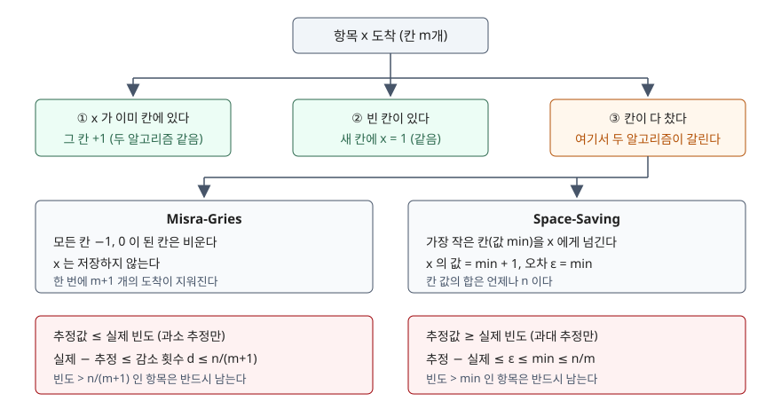

<!-- related:start -->
> **같은 기능을 다른 환경에서 다룬 글** (`frequency-estimation`)
> - [Count-Min Sketch — 고정 메모리로 빈도를 세고 과대 추정의 상한을 보장하는 법](../2026-11-08-count-min-sketch-frequency-error-bound/index.md) — Python 3.13.5, Windows 11
<!-- related:end -->

## 들어가며

로그 수집기에서 "지금 가장 많이 들어오는 URL 상위 20개"를 대시보드에 띄우는 일은 흔하다. 처음에는 URL 을 키로 하는 해시 맵에 횟수를 더하고, 주기마다 정렬해 위에서 20개를 자른다. 그런데 고유 URL 이 쿼리 문자열까지 붙어 수백만 개가 되면 맵이 그만큼 커지고, 정렬도 매번 수백만 개를 한다. 보고 싶은 것은 20개인데 한 번 왔다 간 키 수백만 개를 기억하는 비용을 치르는 셈이다. [Count-Min Sketch](../2026-11-08-count-min-sketch-frequency-error-bound/index.md)는 메모리를 고정하지만 키를 주고 물어야 횟수를 답하는 구조라, 어떤 키가 상위인지는 따로 기억해야 한다. 키 자체를 칸 몇 개에만 두는 방법이 있다.

## 개념

**빈발 항목 문제**(heavy hitters, frequent items)는 길이 n 인 스트림에서 전체의 일정 비율 이상 나온 항목을 찾는 문제다. Cormode·Hadjieleftheriou(2008)는 이 문제의 알고리즘을 세 갈래로 나누고, 그중 **카운터 기반** 알고리즘을 "항목과 카운터 쌍을 몇 개 두고 새 항목이 올 때 간단한 규칙을 적용한다"는 한 틀로 묶는다. 이 글은 그 틀에 드는 두 가지를 다룬다.

| | Misra-Gries (1982) | Space-Saving (2005) |
|---|---|---|
| 칸이 다 찼을 때 | 모든 칸을 1씩 줄인다 | 가장 작은 칸을 빼앗는다 |
| 추정 방향 | 실제보다 작거나 같다 | 실제보다 크거나 같다 |
| 칸 m개일 때 오차 상한 | n/(m+1) | min ≤ n/m |
| 항목별로 따로 아는 것 | 없음 | 물려받은 오차 ε |

Misra-Gries 는 1982년에 발표됐고, 2002년에 같은 알고리즘이 두 번 다시 발견됐다고 Cormode 는 적는다. 그래서 "Frequent" 라는 이름으로도 불린다. Space-Saving 은 Metwally·Agrawal·El Abbadi 가 광고 클릭 스트림을 다루려고 제안했다.

## 구조



> **출처**: [Cormode & Hadjieleftheriou, Finding Frequent Items in Data Streams, PVLDB 1(2) 2008 — §3.1 Counter-based Algorithms, Figure 1 (Algorithm 3.1 FREQUENT, Algorithm 3.3 SPACESAVING)](https://www.vldb.org/pvldb/vol1/1454225.pdf) · [Metwally, Agrawal, El Abbadi, UCSB TR 2005-23 — Figure 1 The Space-Saving Algorithm, §3.2 Lemma 1~3·Theorem 1](https://www.cs.ucsb.edu/research/tech-reports/2005-23)

## 동작 원리

두 알고리즘 모두 칸에 이미 있는 항목이면 1을 더하고, 빈 칸이 있으면 새 항목을 1로 넣는다. 다른 것은 칸이 다 찼을 때뿐이다.

**Misra-Gries** 는 칸 m개를 전부 1씩 줄이고 새 항목은 버린다. 이 한 번의 감소로 스트림 도착 m+1 개(칸 m개의 1씩과 버린 새 항목 1개)가 기록에서 지워진다. 감소를 d 번 했다면 `n = 칸 값의 합 + (m+1)·d` 가 성립하고, 칸 값의 합이 0 이상이므로 `d ≤ n/(m+1)` 이다. 어떤 항목이든 감소 한 번에 많아야 1만큼 덜 세어지므로, 실제 빈도와 추정값의 차이는 d 를 넘지 않는다. 빈도가 n/(m+1) 보다 큰 항목은 d 번 깎여도 0 이 되지 않으니 반드시 칸에 남는다.

**Space-Saving** 은 값이 가장 작은 칸(값 min)을 새 항목에 넘기고 그 값에 1을 더한다. 새 항목이 실제로는 1번 왔을 수도, min+1 번 왔을 수도 있으니 일단 큰 쪽으로 쳐 두고, 물려받은 min 을 그 항목의 오차 ε 로 적는다. 칸에서 지워지는 값이 없으니 칸 값의 합은 언제나 n 이고(Lemma 1), 그래서 가장 작은 칸은 `n/m` 이하다(Lemma 2). 모든 항목의 과대 추정은 ε ≤ min 이고(Lemma 3), 빈도가 min 보다 큰 항목은 쫓겨날 수 없다(Theorem 1).

정리하면 Misra-Gries 는 **아는 만큼만 센다**, Space-Saving 은 **모르는 만큼 의심해서 더 센다.** 그리고 Space-Saving 은 ε 를 들고 있어 `값 − ε` 로 하한까지 준다.

## 실습 예제

전체 소스: [`code/heavy_hitters.py`](code/heavy_hitters.py) · 수행 기록: [`code/output.txt`](code/output.txt)

항목 1,000개에 지수 1.1 의 Zipf 가중치를 주고 시드 42 로 10만 건을 뽑았다. 정확한 빈도는 `collections.Counter` 로 따로 셌다.

**① 칸 49개.**

```text
== Zipf s=1.1: n=100,000, 고유 항목 1,000, 칸 m=49 ==
  MG 상한 n/(m+1) = 2,000.0 · 감소 단계 d = 1,297
  SS 상한 n/m     = 2,040.8 · 현재 min = 1,330
  검산 MG: 칸 합 35,150 + (m+1)*d 64,850 = 100,000
  검산 SS: 칸 합 100,000 (Lemma 1: = n)
  MG 최대 과소 1,297 · 과대 0건
  SS 최대 과대 1,317 · 과소 0건
  실제 빈도 > n/(m+1) 항목 7개 — MG 보유 7 · SS 보유 7
  상위 8개 (실제 순위)
    항목  | 실제   | MG     | SS     | SS-eps
    k0001 | 18,089 | 16,792 | 18,089 | 18,089
    k0002 |  8,268 |  6,971 |  8,268 |  8,268
    k0003 |  5,287 |  3,990 |  5,287 |  5,287
    ...
    k0008 |  1,823 |    527 |  1,824 |  1,823
```

두 검산식이 모두 10만으로 맞았다. 상위 7개는 Space-Saving 이 거의 정확했고(`SS-eps` 가 실제와 같거나 2 작다), Misra-Gries 는 **모든 상위 항목을 정확히 1,297 씩 작게** 셌다. 최대 과소 추정이 감소 횟수 d 와 같은 값이다. 상위 항목은 한 번도 칸을 잃지 않았으니 감소 1,297 번에 전부 한 번씩 깎인 것이다. 상한 2,000 보다 꽤 작은 것은 쏠림이 강해서 칸 합 35,150 이 남았기 때문이다.

**② 칸 9개.** 칸을 줄이면 이야기가 달라진다.

```text
  MG 상한 n/(m+1) = 10,000.0 · 감소 단계 d = 9,100
  SS 상한 n/m     = 11,111.1 · 현재 min = 10,238
    항목  | 실제   | MG     | SS     | SS-eps
    k0001 | 18,089 |  8,989 | 18,089 | 18,089
    k0002 |  8,268 |      5 | 10,241 |     13
    k0003 |  5,287 |      0 |      0 |      0
    ...
    k0007 |  2,141 |      1 | 10,239 |      1
```

보장 대상(빈도 > 10,000)은 k0001 하나이고 두 알고리즘 모두 그것을 잡았다. 그런데 Space-Saving 의 값만 보고 순위를 매기면 **실제 7위 k0007(2,141)이 10,239 로 2위 k0002 와 나란히 오른다.** 3~6위는 칸에 아예 없다. 값 대부분이 물려받은 ε 이고, `SS-eps` 로 보면 1 과 13 이라 믿을 근거가 없다는 것이 드러난다. **이번 실습에서 가장 예상과 달랐던 자리다.** "상위 m 개를 그대로 보여 주면 된다"는 생각은 칸이 넉넉할 때만 맞는다.

**③ 균등 분포.** 쏠림이 없으면 Misra-Gries 는 칸 합 50 만 남기고 사실상 비고, Space-Saving 은 아무 항목이나 2,041 로 들고 있었다. 최대 과대 추정 1,963 은 상한 2,040.8 에 바싹 붙었다. 보장 대상이 0 개이니 둘 다 틀린 것은 아니다.

**④ 두 알고리즘의 관계.** 칸 수가 같은 Space-Saving 에서 min 을 빼면 Misra-Gries 와 맞지 않았다. 그런데 Space-Saving 에 **칸을 하나 더** 주고 같은 계산을 하자 세 스트림 모두 1,000 개 항목 전부가 일치했다.

```text
  관찰: SS(m+1) 값 - min 과 MG(m) 값이 다른 항목 0개 (SS(m+1) min = 9,100, MG d = 9,100)
  관찰: SS(m+1) 값 - min 과 MG(m) 값이 다른 항목 0개 (SS(m+1) min = 1,297, MG d = 1,297)
  관찰: SS(m+1) 값 - min 과 MG(m) 값이 다른 항목 0개 (SS(m+1) min = 1,999, MG d = 1,999)
```

Space-Saving(m+1) 의 min 이 Misra-Gries(m) 의 감소 횟수 d 와 같았다. Misra-Gries 가 모든 칸을 1 씩 줄이는 것과, Space-Saving 이 바닥(min)을 1 올리는 것이 같은 일을 다른 기준점에서 적은 것으로 읽힌다. 이 실험의 세 스트림에서 관찰한 결과이고 이 글에서 증명하지는 않았다.

**⑤ 끝에 새 항목이 몰리면.** `hot` 3,000 번과 서로 다른 항목 6,000 개를 섞은 뒤 새 항목 9 개를 붙이고 칸 10 개로 돌렸다.

```text
    항목   | 실제  | SS    | eps   | SS-eps | MG
    hot     | 3,000 | 3,000 |     0 |  3,000 | 2,400
    late3   |     1 |   668 |   667 |      1 | 1
    ...
    late2   |     1 |   667 |   666 |      1 | 1
```

한 번씩 온 늦은 항목 9 개가 Space-Saving 의 나머지 칸을 전부 차지하고 각각 667~668 로 찍혔다. ε 를 같이 보지 않으면 `hot` 다음 상위 9 개로 읽힌다.

## 실무에서 주의할 점

1. **Space-Saving 의 값을 그대로 순위로 쓰지 않는다.** ②·⑤처럼 칸이 모자라거나 새 항목이 막 들어왔으면 값의 대부분이 ε 다. 화면에 띄울 때는 `값 − ε > 기준` 인 항목만 "확실한 상위"로 표시하고, 나머지는 후보로 구분한다. Metwally 의 원 보고서도 보장 여부를 `count − ε` 로 판정한다.
2. **칸 수는 보고 싶은 순위가 아니라 빈도 기준으로 정한다.** 상위 20 개를 보고 싶어 칸을 20 개 두면 보장되는 것은 "전체의 1/20 을 넘는 항목"뿐이다. 실제 20 위가 전체의 0.5% 라면 칸은 200 개 이상 있어야 그 항목이 보장 범위에 든다.
3. **Misra-Gries 의 값은 하한, 정확한 빈도가 필요하면 두 번째 패스를 한다.** 모든 상위 항목이 d 만큼 작게 나온다. 후보만 뽑고 그 후보의 실제 횟수는 원본을 한 번 더 읽어 센다. Cormode 는 이 계열의 시작인 다수결(Majority) 알고리즘도 저장된 항목이 정말 과반인지 확인하려면 두 번째 패스가 필요하다고 적는다.
4. **최솟값 찾기가 비용의 대부분이다.** 이 예제는 칸이 다 찼을 때마다 `min()` 으로 m 개를 훑는다. 칸이 수천 개면 힙이나 Metwally 의 Stream-Summary(같은 값을 가진 칸을 한 버킷에 묶어 최솟값을 상수 시간에 찾는 구조)를 쓴다. Misra-Gries 의 "전부 1 씩 줄이기"도 그대로 구현하면 m 번 연산이다.

## 정리

- 두 알고리즘은 칸 m 개로 빈발 항목을 찾고, 칸이 다 찼을 때만 다르게 움직인다
- Misra-Gries 는 과소 추정만 하고 오차는 감소 횟수 d ≤ n/(m+1), Space-Saving 은 과대 추정만 하고 오차는 ε ≤ min ≤ n/m 이다
- 실측에서 Misra-Gries 의 최대 오차는 d 와 같았고, Space-Saving(m+1) − min 은 Misra-Gries(m) 와 항목 전부가 같았다
- 보장은 빈도가 상한을 넘는 항목에만 있다. 그 아래 순위는 Space-Saving 의 `값 − ε` 로 걸러 봐야 한다

## 참고 자료

- [Cormode & Hadjieleftheriou, Finding Frequent Items in Data Streams, PVLDB 1(2) 2008](https://www.vldb.org/pvldb/vol1/1454225.pdf) — §3.1 Counter-based Algorithms 의 FREQUENT(Misra-Gries)·LOSSY COUNTING·SPACESAVING 의사코드(Figure 1)와 오차 설명, Misra-Gries 가 2002년에 재발견됐다는 경위
- [Metwally, Agrawal, El Abbadi, Efficient Computation of Frequent and Top-k Elements in Data Streams, UCSB Technical Report 2005-23](https://www.cs.ucsb.edu/research/tech-reports/2005-23) — Figure 1 Space-Saving 알고리즘, §3.2 Lemma 1(칸 합 = N)·Lemma 2(min ≤ ⌊N/m⌋)·Lemma 3(0 ≤ ε ≤ min)·Theorem 1, Stream-Summary 구조
- J. Misra, D. Gries, Finding Repeated Elements, Science of Computer Programming 2(2), 1982 — 원 논문. 이 글은 원문을 직접 읽지 못했고 Cormode(2008)의 설명을 따랐다
