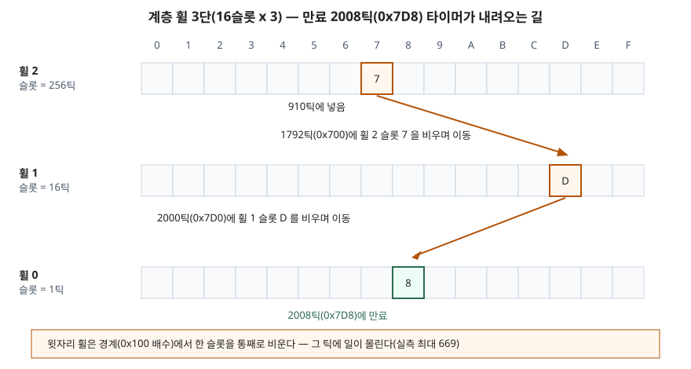

## 들어가며

서버를 만들다 보면 연결마다 타임아웃을 건다. 30초 동안 요청이 없으면 끊고, 재전송 타이머가 끝나면 다시 보내고, 세션이 만료되면 지운다. 처음에는 연결 목록을 들고 매초 전체를 훑으며 남은 시간을 1씩 줄이는 방식으로 짠다. 연결이 1만 개면 매초 1만 번을 건드리는데, 그중 실제로 만료되는 것은 몇 개뿐이다. 그래서 다음 단계로 만료 시각 순 힙을 쓰는데, 이번에는 대부분의 타이머가 만료 전에 꺼진다는 사실이 걸린다. 응답이 오면 재전송 타이머는 필요 없어지지만, 힙 한가운데 있는 항목을 빼려면 위치를 찾아야 한다. 타이머 휠은 이 두 비용을 모두 상수로 만드는 자료구조다.

## 개념

Varghese 와 Lauck 은 1987년 논문에서 타이머 모듈을 네 가지 동작으로 나눴다. 타이머를 거는 **START_TIMER**, 끄는 **STOP_TIMER**, 시계가 한 번 뛸 때마다 만료를 확인하는 **PER_TICK_BOOKKEEPING**, 만료된 타이머의 동작을 실행하는 **EXPIRY_PROCESSING** 이다. 방식마다 이 네 동작 중 어디에 일을 몰아 두는지가 다르다.

| 논문 분류 | 구조 | START | STOP | 틱마다 | 제약 |
|---|---|---|---|---|---|
| Scheme 1 | 타이머마다 남은 시간 기록 | O(1) | O(1) | 모든 타이머를 줄인다 | 없음 |
| Scheme 3 | 트리·힙 같은 우선순위 큐 | O(log n) | 구조에 따라 다름 | 맨 앞만 본다 | 없음 |
| Scheme 4 | 단순 타이밍 휠 | O(1) | O(1) | O(1) | 길이 < MaxInterval (슬롯 수) |
| Scheme 6 | 해시 휠(정렬 안 한 목록) | O(1) | O(1) | 평균 n/TableSize | 없음 |
| Scheme 7 | 계층 휠 | O(m), m = 휠 수 | O(1) | 평균 O(1) | 휠 수 x 슬롯 수로 범위가 정해진다 |

**타이밍 휠**은 시계 바늘이 도는 원형 배열이다. 지금 시각을 가리키는 바늘이 한 틱에 한 칸씩 돌고, j 틱 뒤에 끝날 타이머는 바늘에서 j 칸 앞 슬롯의 목록에 넣는다. 정렬을 하지 않고, 바늘이 도착한 슬롯의 목록만 처리하면 된다. 슬롯 위치를 기억해 두고 목록을 양방향 연결로 두면 끄는 것도 바로 된다.

## 구조

단순 휠은 가장 긴 타이머만큼 슬롯이 필요하다. 논문은 32비트 타이머를 이렇게 만들려면 2의 32제곱 개의 칸이 필요해 정당화하기 어렵다고 적고, 두 가지 확장을 낸다. 하나는 길이를 슬롯 수로 나눈 나머지로 슬롯을 정하고 몫(남은 바퀴 수)을 같이 저장하는 **해시 휠**(Scheme 6)이다. 다른 하나는 자릿수마다 휠을 하나씩 두는 **계층 휠**(Scheme 7)이다. 논문의 예는 일·시·분·초 휠로, 100일까지를 864만 칸이 아니라 100 + 24 + 60 + 60 = 244 칸으로 담는다.

아래는 이번 예제의 계층 휠(16슬롯 휠 3개)에서 한 타이머가 실제로 지나간 길이다.



> **출처**: [Varghese·Lauck, Hashed and Hierarchical Timing Wheels (SOSP 1987) §6.2 Extension 2: Exploiting Hierarchy, Scheme 7 · Figure 10·11](http://www.cs.columbia.edu/~nahum/w6998/papers/sosp87-timing-wheels.pdf)

## 동작 원리

**해시 휠**은 슬롯을 `(지금 + 길이) mod 슬롯 수` 로, 남은 바퀴 수를 `(길이 - 1) // 슬롯 수` 로 정한다. 바늘이 슬롯에 오면 그 목록의 항목을 하나씩 보며 남은 바퀴가 0 이면 만료, 아니면 1 을 줄인다. 논문은 살아 있는 타이머가 슬롯 수만큼의 틱마다 한 번씩 감소되므로 **틱당 평균 일이 n/TableSize** 라고 계산한다. 해시가 고르게 퍼지는지는 평균이 아니라 틱 사이의 들쭉날쭉함만 바꾼다고 적는다.

**계층 휠**은 만료 시각과 지금 시각을 자릿수로 비교해, 처음 값이 갈리는 자릿수의 휠에 넣는다. 위 도식의 타이머는 910틱(0x38E)에 걸렸고 만료가 2008틱(0x7D8)이다. 셋째 자리가 3 과 7 로 갈리므로 휠 2 의 슬롯 7 에 들어간다. 바늘이 0x700(1792틱)을 지나면 휠 2 의 슬롯 7 을 통째로 비우며 각 항목을 다시 자리 잡게 하고, 이 타이머는 둘째 자리 D 를 따라 휠 1 의 슬롯 D 로 간다. 0x7D0(2000틱)에 휠 0 의 슬롯 8 로 내려가고, 8틱 뒤 만료된다. 논문은 이 이동을 기수 정렬에 비유하고, 한 타이머가 옮겨지는 횟수는 휠 수 m 을 넘지 않는다고 적는다.

## 실습 예제

전체 소스: [`code/timing_wheels.py`](code/timing_wheels.py) · 수행 기록: [`code/output.txt`](code/output.txt)

타이머 1만 개를 처음 2,000틱 동안 고르게 걸고, 길이는 1~3,000틱에서 고르게 뽑았다. 30% 는 만료 전 임의의 시각에 끈다(실제로 꺼진 것은 3,012개). 시간 대신 **타이머 항목을 건드린 횟수**를 센다. 힙은 비교 횟수와 꺼낸 항목 수, 휠은 슬롯에서 본 항목 수(만료·바퀴 감소·아래 휠로 이동)다.

```text
방식                  슬롯 |   START 평균   최대 | STOP |     틱당 일 평균    최대 |     일 합계
Scheme 3 힙           0 |       1.99   12 |    1 |       25.61   171 |  128,039
Scheme 4 단순 휠     4096 |       1.00    1 |    1 |        1.40    10 |    6,988
Scheme 6 해시 휠      256 |       1.00    1 |    1 |       10.68    40 |   53,421
Scheme 7 계층 휠       48 |       1.05    3 |    1 |        4.13   669 |   20,652

네 방식의 만료 기록(틱, 타이머)이 모두 같은가: True
만료된 타이머 수: 6988
```

네 구현이 같은 6,988개 타이머를 같은 틱에 만료시켰다. 구현이 맞다는 확인을 먼저 하고 숫자를 본다.

**① 힙은 START 가 싸고, 일이 틱 쪽에 쌓인다.** 논문 분류로는 힙의 START 가 O(log n) 인데, 실제 비교 횟수는 평균 1.99 회였다. 최대는 12 회로 log₂ n 근처다. 새 항목이 대개 바닥 근처에 머물러 위로 거의 올라가지 않았다. 대신 틱마다 꺼낼 때 아래로 내려가며 비교하는 일이 평균 25.61, 합계 128,039 로 단순 휠의 18배였다. 끈 타이머를 표시만 해 두고 꺼낼 때 버리는 지연 삭제라서, 꺼진 3,012개도 결국 꺼내는 비용을 치렀다.

**② 해시 휠의 평균은 논문 식을 따른다.** 슬롯 수만 바꿔 같은 부하를 돌렸다.

```text
  슬롯    64 | 틱당 일 평균  40.66 최대  112 | 평균 대기 타이머 n  2557.2 → n/TableSize  39.96
  슬롯   256 | 틱당 일 평균  10.68 최대   40 | 평균 대기 타이머 n  2557.2 → n/TableSize   9.99
  슬롯  1024 | 틱당 일 평균   3.15 최대   17 | 평균 대기 타이머 n  2557.2 → n/TableSize   2.50
```

슬롯을 4배로 늘릴 때마다 틱당 일이 약 4분의 1로 줄었다. 측정값은 세 경우 모두 n/TableSize 보다 0.65~0.70 많았고, 이 차이는 슬롯 수와 거의 무관했다. 식이 말하는 "슬롯 수에 반비례"는 그대로 나왔다.

**③ 계층 휠은 평균이 낮고 최대가 크다.** 이번 실습에서 가장 예상과 달랐던 결과다. 틱당 평균 4.13 은 해시 휠(256슬롯)의 10.68 보다 낮은데, 최대는 669 로 해시 휠의 40 보다 16배 컸다. 일이 몰린 틱을 뽑아 보면 전부 0x100 의 배수다.

```text
   2048틱   669  0x800
   2304틱   610  0x900
   2560틱   627  0xa00
   2816틱   595  0xb00
```

256틱마다 휠 2 의 슬롯 하나가 통째로 비워지면서, 그 안의 수백 개 타이머가 한 틱 안에 휠 1 이나 휠 0 으로 옮겨진다. 논문은 평균 비용을 비교해 "긴 타이머·적은 메모리에서는 계층 휠의 틱당 평균이 낫다"고 결론 내리는데, 이 실측은 그 평균이 **경계 틱에 몰아서 치르는 비용**이라는 것을 보여 준다. 실시간성이 중요한 곳에서는 평균보다 이 최대가 문제가 된다.

## 실무에서 주의할 점

1. **꺼지는 타이머가 많으면 힙의 지연 삭제가 쓰레기를 쌓는다.** 이번 부하에서 꺼진 3,012개도 힙에 남아 있다가 만료 시각에 꺼내졌다. 재전송·유휴 타이머처럼 대부분 꺼지는 타이머라면 STOP 이 O(1) 이고 바로 자리를 비우는 휠 쪽이 맞는다.
2. **해시 휠은 슬롯 수를 대기 타이머 수에 맞춘다.** 틱당 평균이 n/TableSize 이므로, 평균 대기 수가 2,557 일 때 슬롯 1,024 에서 3.15 까지 내려갔다. 슬롯 하나가 빈 목록 하나뿐이라 메모리 부담이 작다.
3. **계층 휠은 경계 틱의 몰림을 따로 본다.** 평균이 좋아도 0x100 배수 틱에 600건 넘게 처리했다. 한 틱 처리 시간에 상한이 있는 곳이라면 휠마다 슬롯 수를 늘려 한 슬롯에 담기는 양을 줄이거나, 해시 휠을 쓴다.
4. **정밀도를 낮춰도 되면 이동을 없앨 수 있다.** 논문은 윗자리 휠에서 바로 만료시키고 아래로 옮기지 않는 변형을 들고, 그 대가로 최대 50% 의 정밀도 손실을 적는다. 1분 30초 타이머를 1분으로 반올림하는 식이다. 세션 만료처럼 몇 초 늦어도 되는 타이머에 맞는다.
5. **단순 휠은 길이 상한을 반드시 검사한다.** 슬롯 수보다 긴 타이머를 넣으면 한 바퀴 일찍 만료된다. 예제는 `assert` 로 막았다.

## 정리

- 타이머 모듈은 START·STOP·틱 처리·만료 처리 네 동작으로 나뉘고, 방식마다 일을 어디에 몰아 두는지가 다르다
- 해시 휠은 START·STOP 이 상수이고 틱당 평균 일이 n/TableSize 다. 실측도 슬롯 수에 반비례했다
- 계층 휠은 적은 칸으로 넓은 범위를 담고 평균도 낮지만, 윗자리 휠이 넘어가는 틱에 일이 몰린다(실측 최대 669)
- 힙은 START 비교가 평균 2회 남짓으로 싸고, 일이 틱 쪽과 지연 삭제로 옮겨 간다

## 참고 자료

- [George Varghese, Tony Lauck — Hashed and Hierarchical Timing Wheels: Data Structures for the Efficient Implementation of a Timer Facility (SOSP 1987)](http://www.cs.columbia.edu/~nahum/w6998/papers/sosp87-timing-wheels.pdf) — 네 동작의 정의(§2), Scheme 3 트리 기반(§4.1.1), Scheme 4 단순 휠(§5), Scheme 5·6 해시 휠과 n/TableSize(§6.1), Scheme 7 계층 휠과 244 칸 예시·정밀도 손실 변형(§6.2)
- [Python 3.13 — heapq](https://docs.python.org/3.13/library/heapq.html) — 예제의 힙 구현
