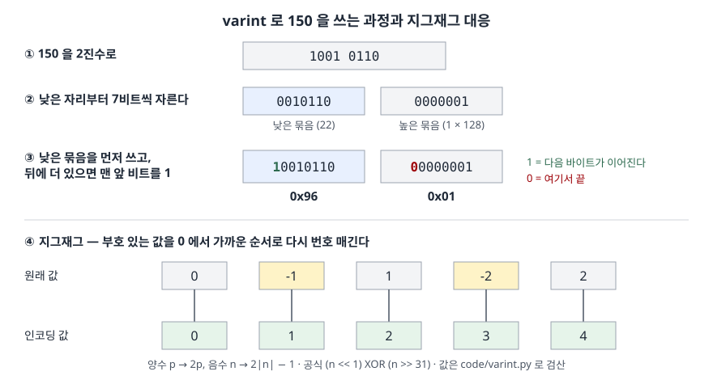

## 들어가며

서비스 사이 메시지를 JSON 에서 Protocol Buffers 로 바꾸고 나서 페이로드 크기를 재 보면 대부분 필드는 줄었는데 몇몇 메시지가 예상보다 크게 나올 때가 있다. 들여다보면 `int64` 로 선언한 "증감량" 필드에 `-1` 같은 작은 음수가 들어 있다. 이때 흔히 하는 일은 필드를 하나씩 지워 가며 크기를 다시 재는 것인데, 필드가 20개면 20번을 다시 직렬화해야 원인을 찾는다. 원인은 정수를 바이트로 바꾸는 규칙 하나다. `-1` 은 이 규칙으로 10바이트가 되고, 같은 값을 `sint64` 로 선언하면 1바이트가 된다.

## 개념

**varint**(가변 길이 정수)는 작은 수를 적은 바이트로, 큰 수를 많은 바이트로 쓰는 정수 인코딩이다. 고정 길이 정수는 값이 1 이든 40억이든 늘 4바이트(32비트)나 8바이트(64비트)를 쓴다. 실제 데이터에 나오는 정수는 개수·길이·식별자처럼 작은 값이 많아서, 값 크기에 맞춰 길이를 바꾸면 전체 크기가 줄어든다.

Protocol Buffers 인코딩 명세의 varint 는 **base-128** 방식이다. 한 바이트의 낮은 7비트에 값을 담고, 최상위 비트(MSB)는 **이어짐 비트**로 쓴다. 1 이면 다음 바이트가 같은 수의 일부이고, 0 이면 그 바이트에서 끝난다. 7비트 묶음은 **낮은 자리부터** 쓴다. 부호 없는 64비트 값을 1~10바이트로 표현한다.

음수가 문제다. 명세는 `int32`·`int64` 필드의 음수를 **2의 보수**(음수를 나타내는 표준 이진 표기)로 바꿔 64비트 부호 없는 값처럼 쓴다. `-1` 의 2의 보수는 64비트가 전부 1 이라 가장 큰 수와 같고, 그래서 10바이트가 다 쓰인다. 이를 피하려고 `sint32`·`sint64` 필드는 **지그재그** 변환을 먼저 한다. 0, -1, 1, -2, 2 … 를 0, 1, 2, 3, 4 … 로 대응시켜 절댓값이 작은 수를 작은 부호 없는 수로 만든 뒤 varint 로 쓴다.

## 구조



> **출처**: [Protocol Buffers — Encoding §Base 128 Varints](https://protobuf.dev/programming-guides/encoding/#varints)(150 예제), [같은 문서 §Signed Integers](https://protobuf.dev/programming-guides/encoding/#signed-ints)(지그재그 공식과 대응표). 그림의 값은 `code/varint.py` 로 검산했다.

## 동작 원리

**인코딩.** 값의 낮은 7비트를 떼어 바이트로 만들고, 남은 값이 0 이 아니면 그 바이트의 MSB 를 1 로 세운다. 남은 값을 7비트 오른쪽으로 밀고 반복한다. 150 은 2진수 `1001 0110` 이므로 낮은 7비트 `0010110`(22)이 먼저 나가며 MSB 1 이 붙어 `0x96`, 남은 `1` 이 MSB 0 으로 `0x01` 이 된다. 디코딩은 거꾸로 MSB 를 떼고 7비트씩 왼쪽으로 밀어 더한다. 길이 필드가 따로 없어도 MSB 만 보고 경계를 안다.

**바이트 수.** n 바이트 varint 는 7n 비트를 담는다. 그래서 2^7, 2^14, 2^21, 2^28 … 에서 한 바이트씩 늘어난다. 64비트 값의 최댓값은 9바이트(63비트)에 다 안 들어가 10바이트째에 1비트가 넘어간다.

**지그재그.** 명세의 32비트 공식은 `(n << 1) ^ (n >> 31)` 이다. `n >> 31` 은 산술 시프트라 양수면 모든 비트가 0, 음수면 모든 비트가 1 이다. 양수는 2배가 되고(`p → 2p`), 음수는 2배한 뒤 모든 비트가 뒤집혀 `2|n| − 1` 이 된다. 되돌릴 때는 `(z >> 1) ^ -(z & 1)` 로 마지막 비트를 부호로 쓴다. 대가는 양수 쪽이다. 지그재그는 양수를 2배로 만들므로, 음수가 없는 필드에서는 varint 경계를 한 칸 일찍 넘는다.

## 실습 예제

전체 소스: [`code/varint.py`](code/varint.py) · 수행 기록: [`code/output.txt`](code/output.txt)

protobuf 라이브러리 없이 표준 라이브러리로 구현하고, 명세의 예제 값으로 검산했다.

**[1]·[2] 명세 예제와 음수.**

```text
[1] 명세 예제 검산
     1 -> 01     다시 읽으면 1 (1바이트)
   150 -> 96 01  다시 읽으면 150 (2바이트)

[2] 음수를 int64 처럼(2의 보수) 넣으면
     -1 -> 10바이트  ff ff ff ff ff ff ff ff ff 01
     -2 -> 10바이트  fe ff ff ff ff ff ff ff ff 01
   -150 -> 10바이트  ea fe ff ff ff ff ff ff ff 01
```

150 은 명세와 같은 `96 01` 이 나왔다. 음수는 크기와 상관없이 전부 10바이트다. 앞 9바이트는 MSB 가 1 이고, 마지막 바이트에 64번째 비트 하나가 `01` 로 남는다.

**[3] 지그재그.** 대응표는 명세의 표(0→0, -1→1, 1→2, -2→3, 0x7fffffff→0xfffffffe, -0x80000000→0xffffffff)와 같았고, 되돌린 값도 전부 원래 값과 같았다. 지그재그 후 `-1` 은 `01`, `-2` 는 `03`, `-150` 은 `ab 02` 로 1~2바이트였다.

**[4] 바이트 수 경계.**

| 값 | 바이트 |
|---|---|
| 127 / 128 | 1 / 2 |
| 16,383 / 16,384 | 2 / 3 |
| 2^28 − 1 / 2^28 | 4 / 5 |
| 2^56 − 1 / 2^56 | 8 / 9 |
| 2^63 / 2^64 − 1 | 10 / 10 |

2^28 부터 varint 가 5바이트가 되어 고정 4바이트보다 커진다. 2^56 부터는 9바이트로 고정 8바이트보다 커진다. 명세의 스칼라 타입 표가 `fixed32` 를 "값이 자주 2^28 보다 크면 uint32 보다 효율적", `fixed64` 를 2^56 기준으로 적는 이유가 이 경계다.

**[5] 값 분포별 평균 바이트** (각 1만 개, 시드 고정).

| 분포 | int64 varint | 지그재그 varint | fixed32 | fixed64 |
|---|---|---|---|---|
| 작은 개수 0~100 | 1.000 | **1.367** | 4 | 8 |
| 부호 있는 증감 -50~50 | **5.381** | 1.000 | 4 | 8 |
| uint32 균등 0~2^32−1 | **4.934** | 4.966 | 4 | 8 |
| 밀리초 시각 약 1.76×10^12 | 6.000 | 6.000 | — | 8 |

예상과 달랐던 결과가 두 개다. 첫째, **음수가 없는 값에 지그재그를 쓰면 오히려 커졌다.** 0~100 중 64 이상인 값은 2배가 되어 128 을 넘고 2바이트가 된다. 평균이 1.000 에서 1.367 로 37% 늘었다. 둘째, **균등 분포 uint32 는 varint 가 고정 길이보다 컸다.** 0~2^32−1 에서 2^28 이상인 값이 전체의 15/16 이라 대부분 5바이트가 된다. 해시값·난수 식별자처럼 값이 고르게 퍼진 필드는 varint 가 손해다. 증감 필드는 절반이 음수라 int64 varint 평균이 5.38바이트였고, 지그재그로 1.00바이트가 됐다.

**[6] 정렬된 시각의 차이값.**

```text
[6] 밀리초 시각 10000개를 정렬해 저장
  그대로 varint            :   60000바이트
  차이값 + 지그재그 varint :   23811바이트
  최대 차이값              : 87365
  섞인 순서의 차이값 — 음수 4981개
    지그재그 varint        :   39758바이트
    int64 varint (그대로)  :   69640바이트
  섞인 순서 바이트열(39758바이트)을 읽어 복원 일치: True
```

밀리초 시각은 값 자체가 커서 늘 6바이트다. 정렬한 뒤 앞 값과의 차이만 쓰면 차이가 최대 87,365 라 대부분 2~3바이트가 되어 60,000 이 23,811바이트로 줄었다. 순서가 섞이면 차이값의 절반이 음수다. 이때 int64 varint 는 69,640바이트로 차이를 안 쓴 경우보다도 컸고, 지그재그를 쓰면 39,758바이트였다. 이어 붙인 바이트열을 처음부터 읽어 원래 순서를 그대로 되살렸다. 길이 정보 없이 MSB 만으로 경계가 나뉜다는 것이 확인된다.

## 실무에서 주의할 점

1. **음수가 들어갈 수 있는 정수 필드는 `sint32`·`sint64` 로 선언한다.** 명세의 스칼라 타입 표도 `int32`·`int64` 가 음수 인코딩에 비효율적이니 음수가 나올 것 같으면 `sint` 를 쓰라고 적는다. [5]의 증감 필드는 5.38바이트와 1.00바이트로 갈렸다.
2. **음수가 없는 필드에 습관적으로 `sint` 를 쓰지 않는다.** [5]의 0~100 값처럼 양수만 있으면 지그재그가 값을 2배로 만들어 바이트 경계를 일찍 넘는다. 개수·길이·나이처럼 음수가 의미 없는 값은 `uint` 계열이 맞다.
3. **고르게 퍼진 큰 값은 고정 길이가 작다.** 해시값·난수 ID·IPv4 주소처럼 값이 범위 전체에 퍼져 있으면 varint 가 평균 5바이트 가까이 쓴다. 2^28·2^56 경계를 기준으로 `fixed32`·`fixed64` 를 고른다. 고정 길이는 길이 계산 없이 바로 읽힌다는 장점도 있다.
4. **필드 타입은 나중에 바꾸기 어렵다.** `int64` 와 `sint64` 는 같은 varint 로 실리지만 값의 해석이 다르다. 이미 배포된 메시지의 필드 타입을 바꾸면 기존 데이터가 다른 값으로 읽힌다. 처음 정할 때 값의 부호와 분포를 확인한다.
5. **차이값 저장은 순서가 보장될 때 효과가 크다.** [6]처럼 정렬된 시각은 60% 줄었지만, 섞인 순서에서는 지그재그를 써도 34% 에 그쳤다. 시계열·정렬된 ID 목록에 쓰고, 순서가 섞이는 데이터에서는 이득을 다시 잰다.

## 정리

- varint 는 7비트 묶음을 낮은 자리부터 쓰고 MSB 로 이어짐을 표시한다. 2^7k 마다 한 바이트씩 늘어 1~10바이트를 쓴다
- `int32`·`int64` 의 음수는 64비트 2의 보수로 실려 크기와 상관없이 10바이트가 된다
- 지그재그는 `p → 2p`, `n → 2|n| − 1` 로 대응시켜 작은 음수를 1바이트로 만들지만, 양수만 있는 값은 오히려 키운다
- 2^28·2^56 이상이 많은 필드는 `fixed32`·`fixed64` 가 더 작다
- 정렬된 큰 값은 차이값 + 지그재그로 줄인다

## 참고 자료

- [Protocol Buffers — Encoding §Base 128 Varints](https://protobuf.dev/programming-guides/encoding/#varints) — varint 의 7비트 묶음·이어짐 비트·바이트 순서와 150 예제
- [Protocol Buffers — Encoding §Signed Integers](https://protobuf.dev/programming-guides/encoding/#signed-ints) — 음수 int32·int64 가 10바이트를 쓰는 이유, 지그재그 공식과 대응표
- [Protocol Buffers — Encoding §Non-varint Numbers](https://protobuf.dev/programming-guides/encoding/#non-varints) — fixed32·fixed64 가 늘 4·8바이트라는 규칙
- [Protocol Buffers — Language Guide (proto3) §Scalar Value Types](https://protobuf.dev/programming-guides/proto3/#scalar) — int·sint·fixed 타입별 설명(음수에 sint 를 쓰라는 권고, 2^28·2^56 기준)
