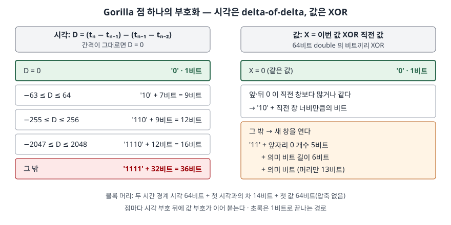

## 들어가며

서버 지표를 직접 모아 보면 처음에는 `(시각, 값)` 을 그대로 표에 쌓는다. 시각 8바이트와 double 8바이트로 점 하나가 16바이트이고, 1분마다 찍는 지표 하나가 하루 1,440점, 23,040바이트다. 지표가 1만 개면 하루 230MB 가 쌓인다. 용량이 문제가 되면 대개 오래된 데이터를 gzip 으로 묶는데, 그러면 최근 두 시간을 보는 대시보드 질의도 묶음을 통째로 풀어야 한다. 이 글의 예제에서 zlib 은 고른 간격의 시각과 같은 값만으로 된 120점도 점당 2.79바이트까지만 줄였다. 같은 데이터를 Gorilla 방식은 0.40바이트로 줄였다.

## 개념

Gorilla 는 Facebook 이 모니터링 데이터를 메모리에 두려고 만든 시계열 DB 이고, 논문의 4.1 절이 그 압축 방식을 설명한다. 핵심은 **직전 점과의 차이만 적는다**는 것이다. 시각과 값을 따로 다룬다.

- **시각**: 간격이 대체로 일정하다는 점을 이용한다. 간격 자체가 아니라 **간격의 차이**(delta-of-delta)를 적는다. 60, 60, 60 초 간격이면 차이는 0, 0 이다.
- **값**: 이웃한 값은 크게 다르지 않아 부호·지수·가수 앞부분이 같다는 점을 이용한다. 두 double 의 **비트를 XOR** 하면 같은 비트는 0 이 되므로, 0 이 아닌 가운데 부분만 적는다.

일반 압축기(zlib)는 바이트열에서 반복되는 문자열을 찾는다. Gorilla 는 "이 바이트들은 시각과 double 이다"라는 사실을 알고 비트 단위로 적는다는 점이 다르다. 그리고 점이 들어오는 대로 바로 적을 수 있어 스트림에 맞는다.

## 구조



> **출처**: [Pelkonen et al., Gorilla: A Fast, Scalable, In-Memory Time Series Database, PVLDB 8(12), 2015](https://www.vldb.org/pvldb/vol8/p1816-teller.pdf) — §4.1.1 Compressing time stamps(블록 머리, delta-of-delta 범위와 비트 수), §4.1.2 Compressing values(XOR 와 제어 비트, 5비트·6비트 필드), Figure 2(점마다 시각과 값이 번갈아 붙는 배치).

블록은 두 시간 단위다. 머리에 두 시간 경계에 맞춘 시각을 64비트로 적고, 첫 점의 시각은 그 경계와의 차를 14비트로, 첫 값은 압축 없이 64비트로 적는다. 그 뒤로는 점마다 시각 부호와 값 부호가 이어 붙는다.

## 동작 원리

**시각.** D = (tₙ − tₙ₋₁) − (tₙ₋₁ − tₙ₋₂) 를 구해 0 이면 비트 하나 `0` 만 적는다. 0 이 아니면 크기에 따라 머리 `10`·`110`·`1110`·`1111` 뒤에 7·9·12·32 비트로 값을 적는다. 논문은 이 범위를 실제 운영 시계열을 표본으로 압축률이 가장 좋게 골랐다고 적고, 시각의 약 96% 가 1비트로 줄었다고 보고한다. 한 점이 빠져 간격이 60, 121, 59 가 되어도 D 는 61, −62 라서 가장 짧은 칸에 들어간다.

**값.** XOR 가 0 이면(같은 값) `0` 하나다. 0 이 아니면 `1` 뒤에 제어 비트가 온다. 앞자리 0 과 뒷자리 0 이 **직전에 연 창**보다 많거나 같으면 제어 비트 `0` 을 쓰고 창 너비만큼의 비트만 적는다(합쳐서 머리 `10`). 아니면 `11` 뒤에 앞자리 0 개수 5비트, 의미 비트 길이 6비트, 의미 비트를 적고 새 창으로 삼는다. 논문은 값의 약 51% 가 1비트, 약 30% 가 창 재사용(평균 26.6비트), 약 19% 가 새 창(평균 36.9비트)이었고, 두 시간 블록에서 점당 1.37바이트였다고 보고한다.

**논문이 정하지 않은 세 자리.** 구현해 보면 규칙만으로 비트를 정할 수 없는 곳이 있다. 이 글의 구현은 아래처럼 정했다.

| 자리 | 문제 | 이 글의 선택 |
|---|---|---|
| D 를 7·9·12비트에 넣는 방식 | 7비트 2의 보수는 [−64, 63] 인데 논문 범위는 [−63, 64] | 하한을 빼서 0~127 로 넣는다 |
| 앞자리 0 개수 | 5비트는 31 까지다. XOR 는 앞자리 0 이 63 개일 수 있다 | 31 로 줄이고 의미 비트를 늘린다 |
| 의미 비트 길이 | 6비트는 63 까지인데 길이가 64 일 수 있다 | 0 으로 적고 64 로 읽는다 |

## 실습 예제

전체 소스: [`code/gorilla.py`](code/gorilla.py) · 수행 기록: [`code/output.txt`](code/output.txt)

부호기와 복호기를 함께 짜고, 모든 경우에 복원한 점이 원래 점과 같은지 확인했다.

**[1] 논문 Figure 2 재현.**

```text
  12.0 = 0x4028000000000000, 24.0 = 0x4038000000000000
  XOR  = 0x0010000000000000  앞자리 0 11개, 의미 비트 1개
  머리 64 + 첫 delta 14 + 첫 값 64 + (dod -2: 9) + (값 같음: 1) + (dod 0: 1) + (XOR: 2+5+6+1=14)
  전체 167 비트 = 20.88 바이트 (원래 48 바이트)
```

논문이 그림 설명에 적은 "48바이트가 167비트로"와 같은 수가 나왔다. 12.0 과 24.0 은 지수만 1 다르므로 XOR 에 1 이 한 개뿐이다.

**[2] 값 종류별, 120점·60초 간격.**

| 시계열 | Gorilla 비트/점 | 바이트/점 | zlib 바이트/점 | 같은 값 / 창 재사용 / 새 창 |
|---|---|---|---|---|
| 같은 값(가끔 43) | 3.5 | 0.43 | 2.96 | 107 / 11 / 1 |
| 정수 카운터 | 14.3 | 1.79 | 5.40 | 0 / 75 / 44 |
| 0.25 단위 게이지 | 8.5 | 1.06 | 4.39 | 31 / 77 / 11 |
| 0.01 단위 게이지 | 38.0 | 4.74 | 6.03 | 35 / 81 / 3 |
| 균등 난수 0~100 | 59.5 | 7.43 | 10.57 | 0 / 111 / 8 |

예상과 달랐던 것은 **0.25 단위와 0.01 단위의 차이**다. 두 게이지는 같은 방식으로 오르내리고 같은 값이 반복되는 비율도 비슷한데(31 과 35), 점당 비트는 8.5 와 38.0 으로 4.5배 벌어졌다. 0.25 는 2⁻² 라서 2진수로 딱 떨어지고, 0.01 의 배수는 대부분 2진수로 끝없이 이어지는 소수라 가수의 아래쪽 비트가 꽉 찬다. XOR 의 의미 비트가 넓어져 창을 재사용해도 매번 수십 비트를 적는다. 난수는 64비트 가까이 그대로였다.

정수 카운터는 매번 값이 바뀌어 1비트 경로가 한 번도 없었고, 증가폭이 0~20 사이에서 달라 새 창이 44번 열렸다. 모든 경우에 Gorilla 가 zlib 보다 작았다.

**[3] 시각만 바꿨을 때.**

| 시각 | 비트/점 | delta-of-delta 분포 |
|---|---|---|
| 고른 60초 | 3.2 | `0` 119 |
| 10% 가 ±1초 | 5.4 | `0` 86, `10` 33 |
| 17점마다 1점 빠짐 | 4.2 | `0` 99, `10` 13 |
| 1~600초 무작위 | 14.9 | `10` 24, `110` 51, `1110` 44 |

점 하나가 1초 늦게 찍히면 간격이 60, 61, 59, 60 이 되어 D 가 +1, −2, +1 로 세 번 0 이 아니게 된다. 흔들림 10% 가 `10` 칸 33개(28%)로 불어난 이유다. 빠진 점은 간격이 60, 120, 60 이 되어 D 가 +60, −60 두 번이다. 빠진 점 7개가 13개를 만들었는데, 마지막 하나는 뒤에 점이 없어 한 번만 생겼다.

**[4] 정하지 않은 자리가 실제로 생기는가.** `1.0` 다음에 마지막 비트만 다른 `1.0000000000000002` 가 오면 XOR 의 앞자리 0 이 63개라 31 로 줄였다(`lead>31 clamp`). 의미 비트가 1개면 될 것을 33개 적는다. `1.0` 다음에 `-1.0000000000000002` 가 오면 XOR 가 `0x8000000000000001` 로 의미 비트 64개였다. 간격이 60 에서 124 로 바뀐 D = 64 도 하한을 빼는 방식으로 7비트에 들어갔고, 셋 다 복원이 일치했다.

## 실무에서 주의할 점

1. **값의 단위를 2진수로 떨어지게 맞추면 압축이 달라진다.** [2]에서 같은 모양의 게이지가 단위 하나로 4.5배 차이 났다. 퍼센트를 소수 둘째 자리로 반올림해 넣기보다, 정수(예: 0.01% 단위 정수)로 바꿔 넣는 쪽이 XOR 에 유리하다. 다만 정수로 바꿔도 카운터처럼 매번 바뀌는 값은 [2]의 14.3비트 정도가 든다.
2. **수집 주기가 흔들리면 시각 비용이 오른다.** 1초 흔들림 10% 로 시각 비용이 3.2 에서 5.4비트가 됐다. 수집기에서 시각을 주기 경계로 맞춰 찍으면 대부분 1비트로 남는다.
3. **구현마다 세부 비트가 다를 수 있다.** 위의 세 자리는 논문에 없으므로 다른 구현과 블록을 주고받으려면 그 구현의 규칙을 맞춰야 한다. 블록 형식을 저장 형식으로 쓸 때는 버전 필드를 둔다.
4. **블록을 길게 잡으면 압축은 좋아지고 읽기는 비싸진다.** 논문은 블록이 두 시간을 넘으면 압축 이득이 줄어든다고 보고했다. 블록 중간의 점 하나를 읽으려 해도 앞에서부터 풀어야 하므로, 짧은 구간을 자주 읽는 질의가 많으면 블록을 짧게 둔다.

## 정리

- 시각은 간격의 차이(delta-of-delta)를, 값은 직전 값과의 XOR 를 적는다. 고른 간격·같은 값이면 각각 1비트다
- 논문 Figure 2 의 세 점은 이 규칙대로 정확히 167비트가 됐다
- 2진수로 떨어지는 0.25 단위 게이지는 점당 8.5비트, 0.01 단위 게이지는 38.0비트였다. 압축률은 값의 2진 표현에 달렸다
- 논문은 부호 표현, 앞자리 0 개수 31 초과, 의미 비트 64개를 정하지 않았다. 구현이 정해야 하고, 실제 데이터에서 생긴다

## 참고 자료

- [Pelkonen et al., Gorilla: A Fast, Scalable, In-Memory Time Series Database, PVLDB 8(12), 2015](https://www.vldb.org/pvldb/vol8/p1816-teller.pdf) — §4.1 압축 방식과 Figure 2 예시, §4.1.1 시각 범위와 96% 통계, §4.1.2 값 부호화와 51%·30%·19% 통계, Figure 6 블록 크기와 1.37바이트
- [Python 3.13 — struct](https://docs.python.org/3.13/library/struct.html) — double 을 64비트 정수로 바꾼 `>d`·`>Q` 형식
- [varint 와 지그재그 부호화](../2026-11-14-varint-zigzag-encoding/index.md) — 같은 저장소에서 작은 정수를 짧게 적는 다른 방식을 다룬 글
- [허프만 부호를 직접 만들어 엔트로피 하한과 zlib에 맞대 보기](../2026-11-08-huffman-code-entropy-vs-zlib/index.md) — 같은 저장소에서 zlib 의 바탕이 되는 부호를 다룬 글
