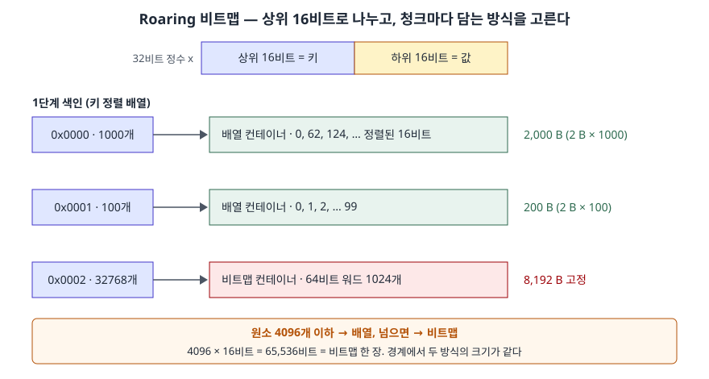

## 들어가며

검색 필터나 통계 화면을 만들다 보면 "조건 A 를 만족하는 사용자 ID 집합"과 "조건 B 를 만족하는 사용자 ID 집합"의 교집합을 자주 구한다. 처음에는 ID 를 정렬된 배열이나 해시 집합으로 들고 있다가, 사용자가 1천만 명을 넘으면 집합 하나가 수십 MB 가 된다. 그래서 ID 를 비트 위치로 쓰는 비트맵으로 바꾸는데, 조건에 맞는 사람이 1천 명뿐인 집합도 1천만 비트(약 1.2 MB)를 차지한다. 원소 하나에 1만 비트를 쓰는 셈이다. 성긴 집합과 빽빽한 집합을 둘 다 싸게 담으려면 한 가지 표현으로는 안 된다.

## 개념

**Roaring 비트맵**은 Chambi·Lemire·Kaser·Godin 이 2016년 논문에서 제안한 정수 집합 압축 방식이다. 32비트 정수의 범위를 2^16 칸짜리 **청크**로 나누고, 청크마다 원소 수를 보고 담는 방식을 따로 고른다.

| 표현 | 원소당 크기 | 약점 |
|---|---|---|
| 단순 비트맵 | 전체 범위 ÷ 원소 수 (비트) | 성기면 대부분이 0 인 비트에 공간을 쓴다 |
| 정렬된 32비트 배열 | 32비트 | 빽빽해도 원소마다 32비트 |
| WAH·Concise 같은 런 길이 압축 | 데이터에 따라 다름 | 논문은 i 번째 비트 확인이 O(n) 이라 임의 접근이 느리다고 짚는다 |
| Roaring | 청크마다 16비트 이하 | 청크가 많고 원소가 적으면 색인 비용이 커진다 |

논문이 런 길이 압축 대신 청크 나누기를 택한 이유가 표의 셋째 줄이다. 한 값을 확인하려고 앞에서부터 압축을 풀지 않아도 된다.

## 구조



> **출처**: [Chambi, Lemire, Kaser, Godin, "Better bitmap performance with Roaring bitmaps" (arXiv:1402.6407) — §2 Roaring Bitmap, Figure 1](https://arxiv.org/abs/1402.6407). 그림의 세 청크와 원소 수·크기는 논문 그림 1의 예시 집합을 실습 [1]로 돌린 결과다.

키가 같은 원소끼리 한 컨테이너에 들어가고, 컨테이너에는 하위 16비트만 저장한다. 1단계 색인은 키 순서로 정렬된 배열이다.

## 동작 원리

논문 2장의 규칙은 한 줄이다. **청크의 원소가 4096개 이하면 정렬된 16비트 배열, 넘으면 2^16비트 비트맵을 쓴다.** 4096 은 두 방식의 크기가 같아지는 점이다. 배열은 원소당 2바이트라 4096개면 8,192바이트이고, 비트맵은 원소 수와 상관없이 65,536비트 = 8,192바이트다. 그래서 배열 컨테이너는 원소당 정확히 16비트, 비트맵 컨테이너는 원소가 4096개를 넘으므로 원소당 16비트 미만이다. 어느 쪽이든 **컨테이너 안에서는 원소당 16비트를 넘지 않는다.**

넣고 뺄 때 종류가 바뀐다(3장). 배열에 넣다가 4096개를 넘으면 비트맵을 새로 만들어 옮기고, 비트맵에서 빼다가 4096개가 되면 배열로 바꾼다.

교집합은 키가 같은 컨테이너끼리만 계산한다(4장). 조합은 세 가지다.

| 조합 | 방법 |
|---|---|
| 비트맵 ∩ 비트맵 | 64비트 워드 1024개를 AND. 논문은 먼저 결과 개수를 세고 4096 을 넘을 때만 비트맵으로 만든다 |
| 배열 ∩ 비트맵 | 배열을 돌며 각 값의 비트를 확인 |
| 배열 ∩ 배열 | 병합. 크기가 64배 넘게 차이 나면 갤로핑 탐색 |

## 실습 예제

전체 소스: [`code/roaring.py`](code/roaring.py)(자료구조) · [`code/experiment.py`](code/experiment.py)(측정) · 수행 기록: [`code/output.txt`](code/output.txt)

**[2] 4096 경계.** 한 청크에 무작위 원소 n 개를 넣었다.

```text
  n      | 배열로 담으면 | 비트맵으로 담으면 | Roaring 이 고른 것
    4095 |        8190 B |            8192 B | array 8190 B
    4096 |        8192 B |            8192 B | array 8192 B
    4097 |        8194 B |            8192 B | bitmap 8192 B
```

4097개부터 배열이 2바이트 더 크다. 경계가 정확히 두 크기가 엇갈리는 자리에 있다.

**[3] 밀도별 원소당 비트.** 0 ~ 2^24-1 범위(청크 256개)에 균등 무작위로 뽑았다. Roaring 칸에는 컨테이너 내용에 더해 키 2바이트·개수 4바이트를 색인 비용으로 넣었다. 이 6바이트는 논문이 정한 값이 아니라 이 구현의 가정이다.

```text
  밀도      | 원소 수   | 단순 비트맵 | 정렬 배열(32비트) | Roaring | 컨테이너(배열/비트맵)
  0.0001    |     1,677 |    10004.30 |             32.00 |   23.33 | 256/0
  0.01      |   167,772 |      100.00 |             32.00 |   16.07 | 256/0
  0.0625    | 1,048,576 |       16.00 |             32.00 |   15.91 | 138/118
  0.07      | 1,174,405 |       14.29 |             32.00 |   14.30 | 0/256
  0.5       | 8,388,608 |        2.00 |             32.00 |    2.00 | 0/256
```

밀도 1/16(0.0625)에서 청크당 평균 원소가 4096 이 되어 배열과 비트맵이 반반 섞였다. 그보다 성기면 Roaring 은 16비트 근처, 빽빽하면 단순 비트맵과 같아진다. 밀도 0.0001 에서 23.33비트로 16비트를 넘은 것은 색인 비용 때문이다. 원소 1,677개에 컨테이너 256개가 붙었다.

**[3-B] 예상보다 컸던 경우.** 원소 1000개를 2^16 간격으로 흩어 청크마다 1개씩 들어가게 했다.

```text
  컨테이너 1000개, 원소당 64.00 비트
```

원소 2바이트에 색인 6바이트가 붙어 원소당 64비트다. **32비트 정렬 배열의 두 배**다. 논문은 밀도가 0.1% 를 넘는다고 가정하고, 그보다 성기면 비트맵이 맞는 자료구조가 아닐 것이라고 적는다. 이 경우가 그 가정 밖이다.

**[4] 경계에서 넣고 빼기.** 원소 4096개 청크에 값 하나를 넣었다 빼기를 10번 했다.

```text
  시작: array, 원소 4096
  끝  : array, 원소 4096, 종류 변환 20번
```

넣을 때마다 8 KB 비트맵을 새로 만들고, 뺄 때마다 비트를 다시 배열로 풀었다. 논문 3장 규칙에는 넣는 기준과 빼는 기준 사이에 여유가 없어서, 원소 수가 4096 근처에서 오르내리는 청크는 바꿀 때마다 변환 비용을 낸다.

**[5] 교집합 연산 횟수.** 비교·워드 AND·비트 확인을 한 번씩 셌다. 결과는 파이썬 `set` 교집합과 모두 일치했다.

```text
  배열 1000 ∩ 배열 1000          연산  1986  결과    13개 → array
  배열 1000 ∩ 비트맵 30000        연산  1000  결과   473개 → array
  비트맵 30000 ∩ 비트맵 30000      연산  1024  결과 13681개 → bitmap
  비트맵 5000 ∩ 비트맵 5000        연산  1024  결과   386개 → array
```

비트맵끼리는 원소 수와 관계없이 워드 1024개를 훑는다. 배열과 비트맵은 배열 길이만큼만 확인한다. 이 구현은 워드를 한 번만 훑었고, 논문 알고리즘 3은 개수를 세는 한 번을 더 돈다.

## 실무에서 주의할 점

1. **값 분포가 청크마다 하나씩 흩어지면 손해다.** [3-B]처럼 ID 가 2^16 이상 간격으로 떨어지면 정렬 배열보다 커진다. 해시값이나 타임스탬프처럼 넓게 퍼진 값을 그대로 넣기 전에 밀도부터 본다.
2. **경계 근처에서 자주 바뀌는 집합은 변환 비용을 낸다.** [4]의 20번은 모두 8 KB 할당과 비트 추출이다. 실시간으로 넣고 빼는 집합이면 변환 횟수를 측정해 둔다.
3. **연산 횟수는 컨테이너 조합에 달려 있다.** 같은 원소 수라도 비트맵끼리는 1024번, 배열과 비트맵은 배열 길이만큼이다. 성능 비교를 원소 수로만 하면 [5]의 차이가 보이지 않는다.
4. **색인 비용 가정을 확인한다.** 이 글의 6바이트는 구현 가정이다. 실제 라이브러리는 직렬화 형식과 객체 머리말이 따로 있으므로, 크기를 비교할 때는 그 라이브러리의 직렬화 크기를 직접 잰다.

## 정리

- Roaring 은 상위 16비트로 청크를 나누고, 청크마다 4096개 이하면 배열, 넘으면 비트맵을 쓴다
- 4096 은 배열(2바이트 × n)과 비트맵(8,192바이트)의 크기가 같아지는 점이라 컨테이너 안에서 원소당 16비트를 넘지 않는다
- 실측에서 밀도 1/16 에서 두 방식이 반반 섞였고, 성긴 쪽은 16비트 근처, 빽빽한 쪽은 단순 비트맵과 같았다
- 청크마다 원소가 1개면 원소당 64비트, 경계에서 넣고 빼기를 반복하면 매번 변환한다

## 참고 자료

- [Chambi, Lemire, Kaser, Godin, "Better bitmap performance with Roaring bitmaps", Software: Practice and Experience 46(5), 2016 (arXiv:1402.6407)](https://arxiv.org/abs/1402.6407) — §1 런 길이 압축의 임의 접근 문제, §2 청크와 두 컨테이너·4096 기준·밀도 0.1% 가정, §3 넣고 뺄 때의 변환, §4 세 가지 교집합 방법과 알고리즘 1~3
