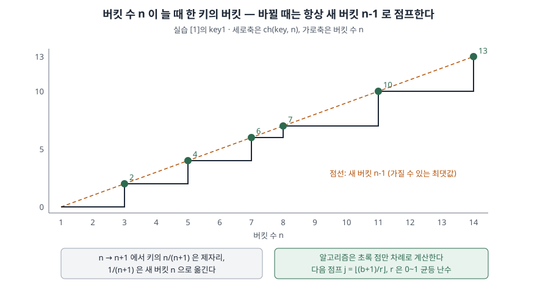

<!-- related:start -->
> **같은 기능을 다른 환경에서 다룬 글** (`consistent-hashing`)
> - [일관 해싱 — 노드를 하나 더했을 때 옮겨지는 키의 비율](../2026-11-07-consistent-hashing-key-movement/index.md) — Python 3.13.5
<!-- related:end -->

## 들어가며

로그 저장소를 샤드(shard, 데이터를 나눠 담는 단위) 10개로 나눠 운영하다 용량이 차서 12개로 늘리기로 했다. 키를 `hash(key) % 10` 으로 나눠 왔으니 `% 12` 로 바꾸면 되는데, 그러면 키 대부분이 다른 샤드로 가야 한다. 실습에서 재 보니 83.3%였다. 그래서 링 방식의 일관 해싱(consistent hashing)을 들이는데, 이번에는 샤드마다 원 위에 점을 수백~수천 개씩 찍어야 키가 고르게 나뉜다. 클라이언트마다 그 표를 메모리에 들고 있어야 하고, 샤드 1000개에 점 1000개면 점이 100만 개다.

## 개념

**Jump 일관 해시**는 Google 의 Lamping·Veach 가 2014년에 발표한 일관 해시 함수다. 64비트 키와 버킷 수 `n` 을 받아 `[0, n)` 사이의 버킷 번호를 돌려준다. 표를 저장하지 않고, 논문 표현으로 "레지스터 몇 개" 외에 메모리를 쓰지 않는다.

논문은 데이터 저장소에 필요한 성질을 둘로 줄인다. **균형**(balance)은 키가 버킷에 고르게 나뉘는 것이고, **단조성**(monotonicity)은 버킷을 늘릴 때 키가 옛 버킷에서 새 버킷으로만 옮겨 가는 것이다. 대신 버킷 이름을 마음대로 붙일 수 없고 0부터 차례로 번호를 매겨야 한다. 그래서 논문은 이 방식이 웹 캐시보다 데이터 저장소에 맞는다고 적는다.

| | 링 해시 (Karger) | Jump 해시 |
|---|---|---|
| 저장하는 것 | 버킷마다 점 k 개 | 없음 |
| 버킷 이름 | 아무 문자열 | 0 ~ n-1 번호 |
| 임의 버킷 제거 | 된다 | 끝 번호만 |
| 계산 | 정렬된 점에서 이진 탐색 | 반복 약 ln n 번 |

같은 키로 링 방식을 다룬 글은 [일관 해싱 — 노드를 하나 더했을 때 옮겨지는 키의 비율](../2026-11-07-consistent-hashing-key-movement/index.md)에 있다.

## 구조



> **출처**: [Lamping·Veach, A Fast, Minimal Memory, Consistent Hash Algorithm (arXiv:1406.2294, 2014) — Explanation of the algorithm](https://arxiv.org/abs/1406.2294) 의 점프 확률 n/(n+1)·1/(n+1) 과 j = floor((b+1)/r) 유도. 계단의 값은 실습 [1]의 key1 을 Python 3.13.5 로 계산한 것이다.

## 동작 원리

버킷이 n 개에서 n+1 개로 늘 때 균형을 지키려면, 새 버킷 n 이 전체 키의 1/(n+1) 을 가져가야 한다. 단조성을 지키려면 나머지는 제자리에 있어야 한다. 그래서 키마다 "n/(n+1) 확률로 그대로, 1/(n+1) 확률로 n 으로 점프"를 1부터 차례로 적용하면 된다. 키를 시드로 쓰는 난수 생성기를 쓰면 같은 키는 늘 같은 결과를 낸다.

이대로면 n 번을 돌아야 한다. 논문은 점프가 드물다는 점을 쓴다. 버킷 b 로 막 점프한 키가 버킷 i 까지 그대로 있을 확률은 (b+1)/i 이므로, 균등 난수 r 하나로 다음 점프 위치를 `j = floor((b+1)/r)` 로 바로 뽑는다. j 가 n 을 넘으면 직전 b 가 답이다. 점프 횟수의 기댓값은 1/2 + 1/3 + … + 1/n 이라 반복은 ln n + 1 회보다 적다. 논문 코드는 이 r 을 64비트 선형 합동 생성기(LCG, `key * 2862933555777941757 + 1`)의 상위 31비트로 만든다.

## 실습 예제

전체 소스: [`code/jump_hash.py`](code/jump_hash.py) · 수행 기록: [`code/output.txt`](code/output.txt)

논문 Figure 1 의 C++ 코드를 그대로 옮겼다. 파이썬 정수는 넘치지 않으므로 곱한 뒤 `& (2**64 - 1)` 로 64비트를 흉내 냈다. 키는 시드를 고정한 64비트 난수 100만 개다.

```python
def jump_hash(key, num_buckets):
    bucket, next_bucket = -1, 0
    while next_bucket < num_buckets:
        bucket = next_bucket
        key = (key * LCG_MULTIPLIER + 1) & MASK_64
        next_bucket = int((bucket + 1) * (float(1 << 31) / float((key >> 33) + 1)))
    return bucket
```

**[2] 옮겨 가는 키는 새 버킷으로만 간다.**

```text
    10 -> 11: 옮긴 키 9.1152% (이론 9.0909%), 행선지 버킷 [10]
    10 -> 12: 옮긴 키 16.6894% (이론 16.6667%), 행선지 버킷 [10, 11]
    비교 — key mod 10 -> mod 12: 옮긴 키 83.2947%
```

10→12 의 1/6 은 논문 서론의 예와 같은 수다.

**[3] 버킷 100개의 편차(σ/μ, 표준편차를 평균으로 나눈 값).**

```text
    jump  키 개수 기준       : 0.0108  (최소 9,758 · 최대 10,220)
    참고: 키 1,000,000개를 완전히 고르게 뿌려도 표본 오차만 약 0.0099
    ring  k=10   키 공간 몫  : 0.3391  · 키 개수 기준 0.3392  (최소 3,093 · 최대 19,034)
    ring  k=1000 키 공간 몫  : 0.0281  · 키 개수 기준 0.0306  (최소 9,397 · 최대 10,701)
```

jump 의 0.0108 은 키를 완벽하게 나눠도 남는 표본 오차 0.0099 와 거의 같다. 편차가 알고리즘이 아니라 키 100만 개라는 표본에서 왔다는 뜻이다. 링은 점 개수 k 에 따라 대략 1/√k 로 줄었고, k=10 이면 가장 큰 버킷이 가장 작은 버킷의 6배를 넘었다.

**[4] 버킷 100→101 에서 키를 내준 기존 버킷.** jump 는 100개 전부가 0.70~1.23% 씩 내줬다. 링 k=10 은 8개만 내줬고 그중 하나는 자기 키의 36.64% 를 내줬다. 논문은 이것을 핫스폿 문제로 든다. 부하를 덜려고 샤드를 더해도 붐비는 샤드가 그 몇 개에 끼지 않으면 효과가 없다.

**[5] 버킷 10→9.** 움직인 키의 원래 버킷은 `[9]` 하나였고, 버킷 3의 키는 100% 그대로 3에 남았다. 버킷 수를 줄이는 것은 **끝 번호를 지우는 것**이고, 가운데 버킷 3을 비우는 방법이 이 함수에는 없다.

**[6] 예상과 달랐던 것 — 파이썬에서는 링이 더 빨랐다.**

```text
    jump n=1,000       평균 반복  7.48회 (ln n + 1 =  7.91) · 한 번   3142 ns
    jump n=1,073,741,824 평균 반복 21.36회 (ln n + 1 = 21.79) · 한 번   8831 ns
    ring n=10    k=1000 점    10,000개 · 남은 메모리    0.6 MiB (최대    1.0) · 한 번    414 ns
    ring n=1000  k=1000 점 1,000,000개 · 남은 메모리   50.6 MiB (최대  111.8) · 한 번   1998 ns
```

평균 반복은 모든 n 에서 ln n + 1 보다 작아 논문의 상한과 맞았다. 그런데 시간은 논문과 반대다. 논문의 C++ 측정은 버킷 1000개에서 jump 가 3~4배 빨랐는데, 여기서는 링이 1.6배 빨랐다. 링의 조회는 C 로 구현된 `bisect` 한 번이고, jump 는 반복마다 파이썬 바이트코드로 곱셈·나눗셈을 한다. 인터프리터에서는 "메모리 접근이 적다"는 이점보다 "명령을 몇 번 해석하느냐"가 시간을 정했다. 메모리 쪽 결론은 그대로다. 점 100만 개짜리 링은 50.6 MiB 를 남겼고 만드는 동안 111.8 MiB 까지 올랐다.

## 실무에서 주의할 점

1. **서버가 죽는 것과 용량을 바꾸는 것을 나눈다.** jump 는 버킷 번호만 준다. 논문은 저장소에서 샤드가 사라지는 일은 복제본이나 빠른 복구로 다루고, 버킷 수는 용량을 바꿀 때만 바꾼다는 전제를 둔다. 서버 장애 때 버킷 수를 줄이면 [5]처럼 엉뚱한 끝 버킷의 데이터가 움직인다. 번호와 실제 서버를 잇는 표는 따로 둔다.
2. **키가 64비트 정수가 아니면 먼저 해시한다.** 논문은 64비트에 안 맞는 키는 64비트 해시를 먼저 구하라고 적는다. 정수 키는 내장 LCG 가 매번 다시 섞으므로 해시하지 않아도 된다.
3. **구현 언어에 따라 속도 결론이 바뀐다.** [6]처럼 인터프리터 언어에서는 C 로 된 이진 탐색이 더 빠를 수 있다. 속도가 이유라면 그 언어로 재 보고, 메모리·편차가 이유라면 그대로 이점이다.
4. **다른 언어 구현과 결과를 맞춘다.** 클라이언트가 여러 언어면 같은 키가 같은 버킷을 내야 한다. 64비트 넘침 처리, `double` 변환, 키를 해시하는 방식이 하나라도 다르면 버킷이 갈린다. 몇 개 키로 교차 검증하는 시험을 둔다.

## 정리

- jump 일관 해시는 저장 공간 없이 키와 버킷 수만으로 `[0, n)` 의 버킷을 낸다
- 버킷을 늘리면 키의 1/(n+1) 만 새 버킷으로 가고, 기존 버킷 전부가 고르게 조금씩 내준다
- 편차는 표본 오차 수준이었고, 같은 편차를 링으로 얻으려면 버킷마다 점 수천 개가 필요하다
- 버킷은 끝 번호만 뺄 수 있어 장애 대응이 아니라 용량 조정에 쓴다
- 파이썬에서는 반복 연산 비용 때문에 C 로 된 이진 탐색을 쓰는 링 조회가 더 빨랐다

## 참고 자료

- [J. Lamping, E. Veach, A Fast, Minimal Memory, Consistent Hash Algorithm, arXiv:1406.2294 (2014)](https://arxiv.org/abs/1406.2294) — Figure 1 코드, Related work 의 균형·단조성, Explanation of the algorithm 의 점프 확률 유도, Performance Analysis 의 ln n + 1 상한, Figure 2 편차표·Figure 4 실행 시간
- [D. Karger et al., Consistent Hashing and Random Trees, STOC 1997](https://doi.org/10.1145/258533.258660) — 링 방식 일관 해싱의 원 논문 (jump 논문의 참고 문헌 [1])
- [Python 3.13 — bisect](https://docs.python.org/3.13/library/bisect.html) — 링 조회에 쓴 이진 탐색
- [Python 3.13 — tracemalloc](https://docs.python.org/3.13/library/tracemalloc.html) — 링 메모리 측정
