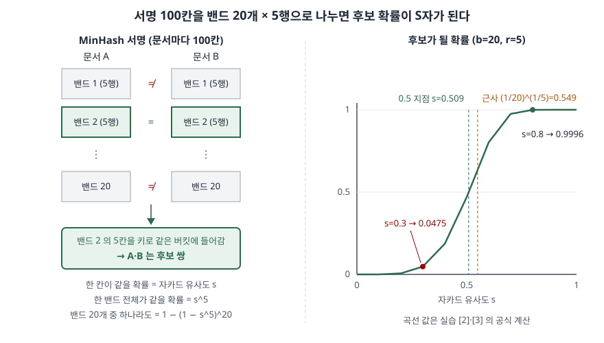

## 들어가며

게시판에 같은 글을 조금씩 바꿔 여러 번 올리는 계정이 생겼다. 비슷한 글을 찾으려고 글마다 단어 집합을 만들어 두 글씩 겹치는 비율을 계산하기 시작하는데, 글이 2,000 개면 쌍이 199만 9천 개다. 글이 2만 개가 되면 쌍은 100배인 2억 개로 늘어난다. 쌍마다 집합 교집합을 계산하는 방식은 글 수의 제곱으로 느려지고, 대부분의 쌍은 전혀 닮지 않았는데도 전부 계산한다.

## 개념

**자카드 유사도**는 두 집합의 교집합 크기를 합집합 크기로 나눈 값이다. 글을 단어(또는 k-글자 조각) 집합으로 보면 0 은 전혀 다름, 1 은 같음이다.

| 문제 | 해법 | 줄어드는 것 |
|---|---|---|
| 집합이 커서 비교가 비싸다 | **MinHash**: 집합을 정수 k 개짜리 서명으로 줄인다 | 쌍 하나의 비교 비용 |
| 쌍 자체가 너무 많다 | **LSH 밴딩**: 서명 일부가 같은 쌍만 후보로 본다 | 비교할 쌍의 수 |

Mining of Massive Datasets(이하 MMDS) 3장은 둘을 묶어 **닮은 쌍은 후보가 될 확률이 높고, 닮지 않은 쌍은 낮게** 만드는 방법으로 설명한다.

## 구조



> **출처**: Rajaraman·Ullman, Mining of Massive Datasets(2010년판) [3.4.1 LSH for Minhash Signatures, 3.4.2 Analysis of the Banding Technique](https://www.cambridge.org/core/books/mining-of-massive-datasets/finding-similar-items/FDDA225F039792324F28D73D26950E89) (p.69-72). 곡선 값은 실습 [2]·[3] 의 공식 계산이다.

## 동작 원리

**MinHash**(MMDS 3.3.2~3.3.5). 원소에 무작위 순서를 매기고 집합에서 가장 앞선 원소를 그 집합의 민해시 값으로 삼는다. 두 집합의 민해시 값이 같으려면 합집합에서 가장 앞선 원소가 교집합에 있어야 하므로, 그 확률이 곧 자카드 유사도다(3.3.3). 순열을 실제로 만드는 대신 해시 함수 `h(x) = (a·x + b) mod p` 를 순서로 쓴다(3.3.5). 함수 k 개로 서명 k 칸을 만들고, 두 서명에서 같은 칸의 비율로 유사도를 추정한다.

칸 하나는 확률 s 로 같은 동전 던지기다. 칸 k 개가 독립이면 같은 칸 수는 이항분포를 따르고, 추정값의 표준편차는 `sqrt(s(1-s)/k)` 다. 오차를 절반으로 줄이려면 k 를 네 배로 늘려야 한다.

**밴딩**(3.4.1~3.4.2). 서명을 r 행짜리 밴드 b 개로 자른다. 밴드마다 r 칸을 키로 버킷에 넣고, 어느 한 밴드에서라도 같은 버킷에 들어간 두 문서를 후보로 본다. 한 밴드 전체가 같을 확률은 `s^r`, 밴드 b 개가 모두 다를 확률은 `(1 - s^r)^b` 이므로 후보가 될 확률은 `1 - (1 - s^r)^b` 다. r 이 클수록 곡선이 오른쪽으로, b 가 클수록 왼쪽으로 옮겨 간다.

## 실습 예제

전체 소스: [`code/minhash_lsh.py`](code/minhash_lsh.py) · 수행 기록: [`code/output.txt`](code/output.txt)

자카드 유사도가 정확히 s 인 집합 쌍을 만들어 쓴다. 공통 원소 `s × 합집합 크기` 개에 각자의 원소를 반씩 붙인다. 시드는 고정했다.

**[1] 서명 길이와 추정 오차** — s=0.5, 쌍 200개.

```text
     k  평균 추정   표준편차   이론 sqrt(s(1-s)/k)   |오차|>0.1 비율
     16    0.4981     0.1362         0.1250           0.445
     64    0.4966     0.0616         0.0625           0.105
    256    0.5012     0.0322         0.0312           0.005
   1024    0.5000     0.0159         0.0156           0.000
```

평균은 k 와 상관없이 0.5 근처였다. 표준편차는 k 가 4배가 될 때마다 절반으로 줄어 이론값을 따랐다. k=16 에서는 쌍의 44.5% 가 0.1 넘게 빗나갔다.

**[2] b=20, r=5 후보 확률** — 유사도마다 쌍 300개.

```text
     s   공식 1-(1-s^5)^20   시뮬레이션
   0.3              0.0475       0.0333
   0.5              0.4701       0.4667
   0.8              0.9996       1.0000
```

MMDS 예제 3.11 이 든 s=0.8 의 0.99965 와 같은 값이 나왔다. 시뮬레이션은 쌍 300개라 0.01 안팎으로 흔들린다.

**[3] 임계값 근사식.** 예상과 다른 결과가 여기서 나왔다. MMDS 는 곡선이 가장 가파르게 오르는 지점을 `(1/b)^(1/r)` 로 근사한다. 이 값을 "절반이 후보가 되는 유사도"로 읽으면 어긋난다.

```text
     b    r   (1/b)^(1/r)   확률이 0.5 가 되는 s   s=0.5 일 때   s=0.8 일 때
    25    4        0.4472                0.4066       0.8008       1.0000
    20    5        0.5493                0.5087       0.4701       0.9996
    10   10        0.7943                0.7631       0.0097       0.6789
```

여섯 가지 나누기 전부에서 근사값이 0.5 지점보다 높았다(차이 0.003~0.041). b=20, r=5 로 "0.55 이상만 잡힌다"고 기대하면, 실제로는 s=0.5 인 쌍의 47% 가 후보로 들어온다. 같은 100칸을 10×10 으로 나누면 s=0.8 쌍의 32% 를 놓친다.

**[4] 문서 2,000 개** — 원소 100 개짜리 무작위 문서에 유사 쌍 30개를 심었다.

```text
  전체 쌍 1,999,000개 → 후보 쌍 25개 (서명·버킷 2.8초)
  심은 유사도 0.9: 10쌍 중 10쌍 후보, 이론 1.0000
  심은 유사도 0.7: 10쌍 중 10쌍 후보, 이론 0.9748
  심은 유사도 0.5: 10쌍 중 5쌍 후보, 이론 0.4701
  심지 않은 후보 0쌍
```

비교할 쌍이 199만 9천 개에서 25개로 줄었다. 거짓 양성이 0 인 것은 무작위 문서끼리 겹치는 원소가 거의 없어서다. 실제 글처럼 흔한 단어를 공유하면 후보가 늘어난다.

## 실무에서 주의할 점

1. **임계값은 근사식이 아니라 곡선으로 고른다.** 실습 [3] 처럼 `(1/b)^(1/r)` 은 0.5 지점보다 높게 나온다. 잡고 싶은 유사도에서 `1 - (1 - s^r)^b` 를 직접 계산해 놓치는 비율을 확인한다.
2. **후보는 반드시 다시 확인한다.** 밴딩은 후보를 고를 뿐이다. MMDS 3.4.3 도 후보 쌍을 서명이나 원본으로 다시 비교하는 단계를 둔다. 거짓 양성은 이 단계에서 걸러지지만 거짓 음성은 되살릴 수 없으므로, 놓치면 안 되는 쪽에 맞춰 b 를 늘린다.
3. **해시의 법(p)은 원소 값보다 커야 한다.** `mod p` 의 p 가 원소 id 보다 작으면 서로 다른 원소가 같은 값으로 접혀 순열 흉내가 깨진다. 예제는 2^61-1 을 썼다.
4. **서명 길이는 오차와 저장 비용의 교환이다.** 표준편차가 1/sqrt(k) 로 줄므로 k 를 늘려도 정확도는 천천히 오른다. 문서마다 k 개 정수를 저장해야 한다.

## 정리

- MinHash 칸 하나가 같을 확률이 자카드 유사도다. 칸 k 개의 일치 비율로 추정한다
- 추정 표준편차는 `sqrt(s(1-s)/k)` 로, 실측도 k=16 에서 0.136, 1024 에서 0.016 이었다
- 밴딩의 후보 확률은 `1 - (1 - s^r)^b`. 근사 임계값 `(1/b)^(1/r)` 은 0.5 지점보다 높다
- 문서 2,000 개에서 비교 쌍이 199만 9천 개에서 25개로 줄었고, 후보는 따로 다시 확인한다

## 참고 자료

- Rajaraman, A., Ullman, J. D. *Mining of Massive Datasets*, 3장 Finding Similar Items — [Cambridge University Press 챕터 페이지](https://www.cambridge.org/core/books/mining-of-massive-datasets/finding-similar-items/FDDA225F039792324F28D73D26950E89). 이 글은 [2010년판 PDF 사본](https://personal.utdallas.edu/~mxk055100/courses/cloud11f_files/large-scale-data-mining.pdf)(제3자 전재)을 읽었다. 3.3.3 민해시와 자카드 유사도(p.64), 3.3.4·3.3.5 서명과 해시 함수로 순열 흉내 내기(p.65), 3.4.1 밴딩(p.69), 3.4.2 밴딩 분석과 예제 3.11(p.71), 3.4.3 기법 결합(p.72). 저자 배포 페이지 infolab.stanford.edu 는 이 글을 쓸 때 접속이 거부됐다
