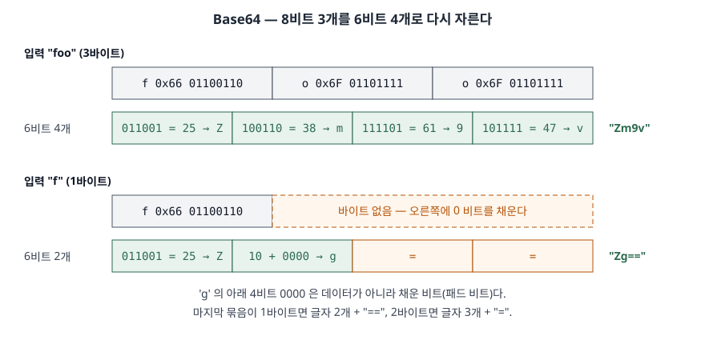

## 들어가며

JWT 의 가운데 토막을 디코딩해 보려고 온라인 도구에 붙였더니 어떤 도구는 내용을 보여 주고, 어떤 도구는 "잘못된 문자열"이라며 거부하고, 파이썬의 `base64.b64decode` 는 에러 없이 이상한 바이트를 내놓는다. 이때 흔히 하는 일은 끝에 `=` 를 하나씩 붙여 보거나 `-` 를 `+` 로 바꿔 보는 것이다. 맞을 때까지 경우를 하나씩 시도하는 셈인데, 패딩 개수 3가지 × 알파벳 2가지만 해도 6번이고, 그중 몇 개는 에러 없이 틀린 값을 낸다. 원인은 Base64 가 하나의 규칙이 아니라 **패딩·알파벳·줄바꿈을 고르는 변형들의 묶음**이라는 데 있다.

## 개념

**Base64** 는 임의의 바이트를 글자 64개(대소문자 52 + 숫자 10 + `+` `/`)만으로 적는 인코딩이다. 이메일·JSON·URL 처럼 글자만 다니는 통로에 바이너리를 실으려고 쓴다. 규칙은 RFC 4648 이 정하고, Base32·Base16 도 같은 문서에 있다.

RFC 4648 이 굳이 "구현 간 차이" 절(§3)을 따로 둔 이유가 이 글의 주제다. 같은 이름 아래 다음 네 가지가 갈린다.

| 갈리는 자리 | RFC 4648 의 기본 | 다르게 쓰는 곳 |
|---|---|---|
| 줄바꿈 (§3.1) | 넣지 않는다 | MIME 은 76자마다, PEM 은 64자마다 |
| 패딩 `=` (§3.2) | 붙인다 | 길이를 따로 아는 곳은 생략할 수 있다 (§5) |
| 알파벳 밖 글자 (§3.3) | 거부한다 | MIME 은 무시하라고 정한다 |
| 62·63번 글자 (§5) | `+` `/` | URL·파일 이름용 base64url 은 `-` `_` |

## 구조



> **출처**: [RFC 4648 §4 Base 64 Encoding](https://www.rfc-editor.org/rfc/rfc4648.html#section-4) — 24비트 묶음, 6비트 4개, 마지막 묶음의 세 경우. 패드 비트는 [§3.5 Canonical Encoding](https://www.rfc-editor.org/rfc/rfc4648.html#section-3.5). 비트 값은 실습 [1] 의 직접 구현으로 검산했다.

## 동작 원리

1. **3바이트씩 묶는다.** 8비트 3개를 이어 24비트를 만든다.
2. **6비트씩 4개로 자른다.** 6비트는 0~63 이므로 글자 64개 중 하나로 바로 대응한다. 0~25 는 `A`~`Z`, 26~51 은 `a`~`z`, 52~61 은 `0`~`9`, 62·63 은 `+` `/` 다.
3. **마지막 묶음이 모자라면** 오른쪽에 0 비트를 채워 6비트 단위를 맞춘다. 1바이트(8비트)는 6비트 2개가 필요하므로 글자 2개 + `==`, 2바이트(16비트)는 글자 3개 + `=` 다.

그래서 출력 길이는 `4 × ⌈n / 3⌉` 이고 크기는 4/3 배가 된다. `=` 는 "마지막 묶음에 바이트가 몇 개였나"를 알려 주는 표시다. 출력 길이가 4 의 배수라는 것을 알면 `=` 개수는 출력 길이에서 계산할 수 있으므로, 길이를 따로 아는 곳에서는 생략해도 정보가 줄지 않는다.

3단계에서 채운 0 비트를 **패드 비트**라 한다. `f`(01100110)는 `011001` + `10`**`0000`** 으로 잘리고, 굵은 4비트는 데이터가 아니다. RFC 는 인코더가 이 비트를 0 으로 두어야 한다(MUST)고 하고, 디코더는 0 이 아니면 거부할 수 있다(MAY)고만 한다.

## 실습 예제

전체 소스: [`code/base64_rfc4648.py`](code/base64_rfc4648.py) · 수행 기록: [`code/output.txt`](code/output.txt)

**[1] 직접 구현이 표준 라이브러리와 같은가.** RFC 4648 §10 의 시험 벡터 7개(`""` ~ `"foobar"`)가 모두 같았고, 0~300바이트 무작위 입력 3,000개에서도 불일치가 0개였다.

**[2] 크기.** 입력 길이별로 보면 Base64 는 3바이트마다, Base32 는 5바이트마다 출력이 한 묶음씩 늘어난다.

```text
  입력 | Base64 | '=' | Base32 | '=' | Base16
     1 |      4 |   2 |      8 |   6 |      2
     2 |      4 |   1 |      8 |   4 |      4
     3 |      4 |   0 |      8 |   3 |      6
     4 |      8 |   2 |      8 |   1 |      8
     5 |      8 |   1 |      8 |   0 |     10
```

(수행 기록 11줄 중 5줄이다.) 1바이트를 Base32 로 적으면 8글자 중 6글자가 `=` 다. 3,000바이트에서는 다음과 같았다.

```text
  Base16 (b16encode)                    6000바이트 · 원본의 2.0000배
  Base32 (b32encode)                    4800바이트 · 원본의 1.6000배
  Base64 (b64encode)                    4000바이트 · 원본의 1.3333배
  Base64 + 76자 줄바꿈 (encodebytes)        4053바이트 · 원본의 1.3510배
```

`encodebytes` 는 MIME(RFC 2045) 방식대로 76글자마다 `\n` 을 넣어 53줄이 됐다. 4000 + 53 = 4053 이다. 이 줄바꿈이 들어간 값을 JSON 이나 HTTP 헤더에 그대로 넣으면 받는 쪽에서 깨진다.

**[3] URL 안전 문자열을 표준 디코더에 넣으면.** 가장 예상과 달랐던 결과다. `fb ff bf` 는 표준으로 `'+/+/'`, URL 안전으로 `'-_-_'` 다.

```text
  b64decode (표준 디코더)                       '-_-_'         → b''
  b64decode(validate=True)                 '-_-_'         → Error: Only base64 data is allowed
  urlsafe_b64decode (URL 안전 디코더)           '-_-_'         → b'\xfb\xff\xbf'
  urlsafe_b64decode 에 표준 문자열               '+/+/'         → b'\xfb\xff\xbf'
```

표준 디코더는 **에러 없이 빈 바이트**를 돌려줬다. 파이썬 문서대로 `validate=False`(기본값)이면 알파벳 밖 글자를 버리는데, `-` `_` 가 전부 알파벳 밖이라 남은 글자가 0개였기 때문이다. 실제 토큰은 `-` `_` 가 몇 글자 섞인 정도라 빈 값 대신 **몇 바이트가 빠지고 어긋난 값**이 나온다. 반대로 `urlsafe_b64decode` 는 표준 문자열 `'+/+/'` 도 받아들였다. 문서에 적힌 동작은 아니고 Python 3.13.5 에서 관찰한 것이다.

**[4] 패딩을 뺀 문자열.** `'Zm9vYg'` 와 `'Zm9vYmE'` 는 `Incorrect padding` 으로 실패했다. `=` 를 `(-길이) % 4` 개 붙이면 `b'foob'`, `b'fooba'` 로 돌아온다. 길이를 4 로 나눈 나머지가 1 이면 붙여도 실패한다. 6비트 하나로는 바이트 하나(8비트)를 만들 수 없기 때문이고, 에러 메시지도 그렇게 말한다.

```text
  길이 % 4 == 1 은 복원 불가                      'Zm9vY==='     → Error: Invalid base64-encoded string: number of data characters (5) cannot be 1 more than a multiple of 4
```

**[5] 알파벳 밖 글자.** 기본 디코더는 줄바꿈·공백·`*` 를 모두 버리고 `b'foobar'` 를 냈다. 중간에 `=` 가 끼어 있는 `'Zm=9vYmFy'` 도 `b'foobar'` 였다. `validate=True` 는 앞의 셋을 `Only base64 data is allowed` 로, 마지막을 `Discontinuous padding not allowed` 로 거부했다. RFC 4648 §3.3 은 참조 명세가 따로 정하지 않으면 거부하라고(MUST) 하므로, 파이썬의 기본값은 MIME 쪽에 맞춰져 있는 셈이다.

**[6] 패드 비트.** 두 번째 글자의 아래 4비트만 다른 네 문자열이 모두 같은 바이트로 읽혔다.

```text
  두 번째 글자 'g' = 100000                     'Zg=='         → b'f'
  두 번째 글자 'h' = 100001                     'Zh=='         → b'f'
  두 번째 글자 'i' = 100010                     'Zi=='         → b'f'
  두 번째 글자 'v' = 101111                     'Zv=='         → b'f'
```

RFC 가 허용한 대로(MAY) Python 3.13.5 는 패드 비트를 검사하지 않는다. 그래서 **인코딩된 문자열끼리 비교해 같은 데이터인지 판단하면 틀린다.** 서명 값이나 캐시 키를 Base64 문자열로 비교한다면 디코딩한 바이트로 비교하거나, 한 번 디코딩·재인코딩해 정규형으로 맞춘 뒤 비교한다.

## 실무에서 주의할 점

1. **알파벳을 짝 맞춘다.** URL·JWT·파일 이름에는 base64url(`-` `_`)을, 그 밖에는 표준(`+` `/`)을 쓰고, 디코더도 같은 쪽을 쓴다. [3] 처럼 엇갈리면 에러 없이 빈 값이나 어긋난 값이 나온다.
2. **입력을 신뢰할 수 없으면 `validate=True` 를 쓴다.** 기본 디코더는 알파벳 밖 글자와 중간의 `=` 를 버리고 읽는다. RFC 4648 §12 는 이렇게 무시하는 동작이 은닉 채널(데이터를 숨겨 실어 나르는 통로)이 될 수 있다고 적는다.
3. **패딩 생략 여부를 명세로 정한다.** 생략한 쪽과 붙인 쪽이 섞이면 [4] 의 `Incorrect padding` 이 난다. 받는 쪽에서 `=` 를 보충하는 코드를 두되, 길이 % 4 == 1 은 복원할 수 없는 잘못된 입력으로 거부한다.
4. **줄바꿈이 붙는 함수를 구분한다.** `encodebytes` 는 76글자마다 줄바꿈을 넣는다. JSON·헤더에는 줄바꿈이 없는 `b64encode` 를 쓴다.
5. **문자열 비교로 같음을 판단하지 않는다.** [6] 처럼 같은 바이트를 가리키는 문자열이 여럿일 수 있다.
6. **크기를 계산할 때 1.33배만 보지 않는다.** 짧은 값은 패딩 때문에 비율이 더 나쁘고(1바이트 → 4글자), 줄바꿈과 Base32 를 고르면 더 커진다.

## 정리

- Base64 는 3바이트(24비트)를 6비트 4개로 잘라 글자 4개로 바꾸고, 모자란 마지막 묶음은 0 비트와 `=` 로 채운다
- 직접 구현은 시험 벡터 7개와 무작위 입력 3,000개에서 표준 라이브러리와 같았고, 크기는 1.3333배(줄바꿈 포함 1.3510배)였다
- URL 안전 문자열을 표준 디코더에 넣으면 에러 없이 빈 바이트가 나왔다. 기본 디코더는 알파벳 밖 글자를 버리기 때문이다
- 패드 비트만 다른 문자열 네 개가 같은 바이트로 읽혔으므로 Base64 문자열끼리 비교하지 않는다

같은 "바이트를 다른 모양으로 적는" 문제를 정수 쪽에서 다룬 글은 [가변 길이 정수 인코딩](../2026-11-14-varint-zigzag-encoding/index.md)이다.

## 참고 자료

- [RFC 4648 — The Base16, Base32, and Base64 Data Encodings](https://www.rfc-editor.org/rfc/rfc4648.html) — 구현 간 차이(§3.1 줄바꿈, §3.2 패딩, §3.3 알파벳 밖 글자, §3.5 정규 인코딩), Base64(§4), base64url(§5), Base32(§6), Base16(§8), 시험 벡터(§10), 보안 고려사항(§12)
- [RFC 2045 §6.8 Base64 Content-Transfer-Encoding](https://www.rfc-editor.org/rfc/rfc2045.html#section-6.8) — MIME 의 76글자 줄 길이
- [Python 3.13 — base64 모듈](https://docs.python.org/3.13/library/base64.html) — `b64decode` 의 `validate` 인자와 알파벳 밖 글자 처리, `urlsafe_b64decode`, `encodebytes` 의 76바이트 줄바꿈
