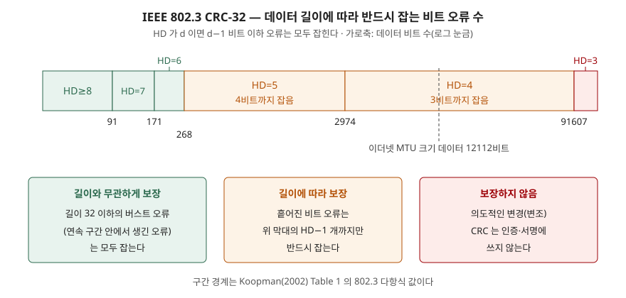

## 들어가며

파일을 내려받거나 백업을 옮긴 뒤 "깨지지 않았나"를 확인할 때, zip·gzip·PNG 가 이미 CRC-32 를 품고 있으니 그걸로 충분하다고 여기기 쉽다. 반대로 불안한 쪽은 원본과 사본을 바이트 단위로 통째 비교하거나, 이유 없이 SHA-256 을 하나 더 계산해 붙인다. 통째 비교는 원본을 옆에 두어야 하니 전송 뒤에는 쓸 수 없고, 해시를 덧붙이는 것은 무엇을 막으려는지 모른 채 비용만 더한다. CRC-32 가 **무엇을 반드시 잡고 무엇을 놓치는지** 숫자로 알면 둘 중 무엇이 필요한지 판단할 수 있다.

## 개념

**CRC**(cyclic redundancy check, 순환 중복 검사)는 데이터를 GF(2)(0과 1만 있고 덧셈이 XOR 인 체계) 위의 다항식으로 보고 **생성 다항식** G(x) 로 나눈 나머지를 검사값으로 붙이는 오류 검출 부호다. CRC-32 는 나머지가 32비트다. 받는 쪽은 같은 계산을 다시 해 붙어 온 값과 비교하고, 다르면 오류로 판단한다.

이 글이 다루는 것은 IEEE 802.3(이더넷)·gzip·zip·PNG 가 쓰는 CRC-32 다. gzip 명세 RFC 1952 는 이 값을 ISO 3309 와 ITU-T V.42 의 CRC-32 로 정의하고, 부록에 표 방식 C 코드를 싣는다.

보장의 크기는 **해밍 거리**(HD)로 잰다. 올바른 코드어(데이터 + CRC)끼리 최소 d 비트가 다르면, d−1 비트 이하가 뒤집힌 오류는 다른 올바른 코드어가 될 수 없으므로 반드시 잡힌다. CRC 의 HD 는 다항식만으로 정해지지 않고 **데이터 길이**에 따라 줄어든다.

| 오류 종류 | CRC-32 의 보장 |
|---|---|
| 길이 32 이하의 버스트(연속 구간 안의 오류) | 길이와 무관하게 전부 검출 |
| 흩어진 k 비트 오류 | 데이터 길이별 HD 가 k 보다 클 때만 전부 검출 |
| 의도적인 변경 | 보장 없음 |

## 구조



> **출처**: 구간 경계와 MTU 기준 길이는 [Koopman, "32-Bit Cyclic Redundancy Codes for Internet Applications", DSN 2002 — §3 Previously known 32-bit CRC polynomials, Table 1](https://users.ece.cmu.edu/~koopman/networks/dsn02/dsn02_koopman.pdf). 버스트 32 이하 검출은 같은 논문 §3. 인증에 쓰지 말라는 경고는 [Python — zlib.crc32](https://docs.python.org/3/library/zlib.html#zlib.crc32).

## 동작 원리

CRC 계산은 나눗셈이고, GF(2) 나눗셈의 나머지는 **선형**이다. 같은 길이의 두 메시지에 대해 `crc(a ^ b) = crc(a) ^ crc(b) ^ crc(0…0)` 이 성립한다. 앞뒤에 붙는 0xFFFFFFFF XOR 은 길이가 같으면 상쇄된다.

이 성질 덕분에 오류를 내용과 떼어 놓고 볼 수 있다. 오류 패턴 e 가 메시지를 `m ^ e` 로 바꿨을 때 CRC 가 바뀌는 양은 m 과 무관하게 e 만으로 정해진다. 이를 **신드롬**이라 한다. 신드롬이 0 이면 CRC 비교가 통과하므로 오류를 놓친다. 그리고 여러 비트가 뒤집힌 오류의 신드롬은 비트 하나씩의 신드롬을 XOR 한 것이다.

그래서 "k 비트 오류를 놓치는 경우가 있는가"는 "비트 위치별 신드롬 표에서 XOR 해 0 이 되는 k 개를 고를 수 있는가"라는 문제가 된다. 2비트는 같은 값이 둘 있는지, 4비트는 XOR 값이 같은 두 쌍이 있는지만 보면 된다. 수십억 개의 오류 패턴을 돌리지 않고 전수 검사가 된다.

놓치는 패턴은 수학적으로 정해져 있다. 오류 다항식이 G(x) 의 배수이면 나머지가 0 이다. 길이 32 이하 버스트는 G(x)(33비트) 의 배수가 될 수 없어 항상 잡히지만, G(x) 의 계수를 그대로 늘어놓은 33비트 버스트는 어느 위치에 놓여도 놓친다.

## 실습 예제

전체 소스: [`code/crc32_errors.py`](code/crc32_errors.py) · 수행 기록: [`code/output.txt`](code/output.txt)

**[1] RFC 1952 구현.** 부록 코드의 표 생성 상수 `0xedb88320` 과 앞뒤 보수를 그대로 옮긴 함수가 네 입력 모두 `zlib.crc32` 와 같았다. `b"123456789"` 는 `cbf43926` 이다.

**[2] 선형성.** 무작위 64바이트 a, b 에서 `crc(a^b)` 와 `crc(a)^crc(b)^crc(0…)` 가 둘 다 `d5e506f7` 이었다.

**[3] 흩어진 비트 오류 — 경계 양옆.** 1500바이트(12000비트)에서 비트 하나씩 뒤집은 12000가지는 전부 잡혔다. 다음은 신드롬 표로 찾은, 놓치는 가장 작은 오류다.

```text
[3-2] HD=6 → 5 경계 (Koopman Table 1: HD=6 은 268비트까지)
  데이터   264비트 ( 33바이트) : 5비트 이하 오류는 전부 잡힌다 → HD ≥ 6  [0.3초]
  데이터   272비트 ( 34바이트) : 5비트 오류를 놓친다 → HD = 5  위치 (0, 145, 183, 211, 300)  [0.0초]

[3-3] HD=5 → 4 경계 (HD=5 는 2974비트까지)
  데이터  2968비트 (371바이트) : 4비트 이하 오류는 전부 잡힌다 → HD ≥ 5  [4.4초]
  데이터  2976비트 (372바이트) : 4비트 오류를 놓친다 → HD = 4  위치 (0, 140, 791, 3006)  [5.7초]
```

Koopman 표의 268비트와 2974비트 경계가 바이트 단위로 잴 수 있는 바로 양옆에서 그대로 나왔다. 단 8비트 차이로 보장이 한 단계 내려간다. 찾은 위치를 실제 무작위 메시지에 적용하자([3-4]) 내용은 바뀌었는데 CRC 비교는 통과했다.

위치 300 과 3006 은 데이터 뒤에 붙은 **CRC 필드 안**이다(272 이상, 2976 이상). HD 는 데이터와 CRC 를 합친 코드어 전체에서 세는 값이라, 저장된 CRC 비트가 함께 뒤집히는 경우까지 포함한다.

**[4] 버스트.** 길이 1~32 의 버스트를 위치·모양 무작위로 20만 개 넣어 하나도 놓치지 않았다. 이어 생성 다항식 모양(33비트, 1이 15개)을 세 위치에 넣었다.

```text
[4-2] 길이 33 버스트 — 생성 다항식 x^32+...+1 의 계수 모양 그대로
  위치     0: 내용 바뀜=True crc a986f03e == 원본 a986f03e → True
  위치  1000: 내용 바뀜=True crc a986f03e == 원본 a986f03e → True
  위치 11000: 내용 바뀜=True crc a986f03e == 원본 a986f03e → True
```

(수행 기록에서 패턴 설명 줄을 뺐다.) 무작위 표본 20만 개로는 33비트 버스트를 놓치는 일이 거의 나오지 않는다. 놓치는 패턴은 드물지만 분명히 있고, 모양을 알면 만들 수 있다.

**[5] 위조.** 선형성은 공격자에게도 쓸모가 있다. 끝 4바이트(32비트)가 CRC 32비트를 결정하는 연립방정식을 풀면 아무 내용에 대해서나 원하는 CRC 를 맞출 수 있다.

```text
  원본  b'PAY 100 TO ALICE'                      crc=525e1910
  위조  b'PAY 900 TO MALLORYO\xb4\xab}'          crc=525e1910
```

GF(2) 가우스 소거 한 번이고 시도를 반복하지 않는다.

**[6] 속도.** 1 MiB 에서 순수 파이썬 표 방식이 169 ms, zlib 이 0.544 ms 로 약 310배 차이였다. 값은 같았다. 측정값은 환경에 따라 흔들린다.

## 실무에서 주의할 점

1. **"CRC 가 맞으면 데이터가 맞다"가 아니다.** 보장은 32 이하 버스트와 길이별 HD−1 비트까지다. 이더넷 MTU 크기(약 12000비트)에서는 3비트까지만 반드시 잡는다. 그보다 많은 비트가 흩어져 뒤집히면 대부분 잡히지만 확률의 문제가 된다.
2. **블록을 크게 잡을수록 보장이 줄어든다.** 경계는 91·171·268·2974·91607 비트다. 91607비트(약 11KB)를 넘으면 HD 는 3 이다(Koopman 은 128K 비트까지 확인했다). 큰 파일 전체에 CRC-32 하나를 붙이면 반드시 잡는 것은 2비트 오류까지다. 저장 계층에서 블록마다 CRC 를 따로 두는 이유가 여기 있다.
3. **변조 방지에는 쓰지 않는다.** [5] 처럼 4바이트로 아무 CRC 나 맞출 수 있다. 상대가 의도를 가질 수 있는 곳에는 HMAC 이나 전자서명을 쓴다. Python 문서도 인증·서명에 쓰지 말라고 적는다.
4. **해시 테이블 키로 쓰지 않는다.** 선형이라 입력의 XOR 관계가 출력에 그대로 드러난다. Python 문서는 일반 해시 용도로도 맞지 않는다고 적는다.
5. **구현을 직접 쓰면 변형을 맞춘다.** 같은 "CRC-32" 라도 초기값·반사(reflected) 순서·마지막 XOR 이 다르면 값이 다르다. 알려진 입력 `123456789` 의 결과로 대조하고, 파이썬에서는 zlib 을 쓴다.

## 정리

- CRC-32 는 GF(2) 다항식 나눗셈의 나머지이고 선형이라, 오류의 영향(신드롬)이 내용과 무관하게 오류 모양만으로 정해진다
- 신드롬 표 전수 검사로 Koopman 표의 경계가 그대로 나왔다 — 264→272비트에서 HD 6→5, 2968→2976비트에서 HD 5→4
- 길이 32 이하 버스트는 표본 20만 개를 다 잡았고, 생성 다항식 모양의 33비트 버스트는 위치와 무관하게 놓쳤다
- 4바이트만 덧붙이면 원하는 CRC 를 만들 수 있으므로 우연한 손상 검출에만 쓴다

같은 "선형 연산으로 빠르게 비교한다"는 발상이 rsync 의 롤링 체크섬에도 있다 — [rsync 롤링 체크섬](../../architecture/2026-11-12-rsync-rolling-checksum-delta-transfer/index.md). 변조까지 막는 쪽은 [HMAC 과 길이 확장 공격](../../../PE/security/2026-11-06-hmac-length-extension-attack/index.md)에서 다뤘다.

## 참고 자료

- [RFC 1952 — GZIP file format specification version 4.3 §2.3.1 Member header and trailer](https://www.rfc-editor.org/rfc/rfc1952.html) — CRC32 필드가 ISO 3309·ITU-T V.42 의 CRC-32 라는 정의
- [RFC 1952 §8 Appendix: Sample CRC Code](https://www.rfc-editor.org/rfc/rfc1952.html#section-8) — 표 생성 상수 `0xedb88320`, 앞뒤 1의 보수를 함수 안에서 하는 `update_crc()`
- [Koopman, P. "32-Bit Cyclic Redundancy Codes for Internet Applications", DSN 2002](https://users.ece.cmu.edu/~koopman/networks/dsn02/dsn02_koopman.pdf) — §2 CRC 를 다항식 나눗셈으로 보는 정의, §3 HD 와 버스트 검출, Table 1 의 802.3 다항식 HD 구간
- [Python — zlib.crc32](https://docs.python.org/3/library/zlib.html#zlib.crc32) — 결과는 부호 없는 32비트, 인증·서명과 일반 해시 용도에 맞지 않는다는 경고
