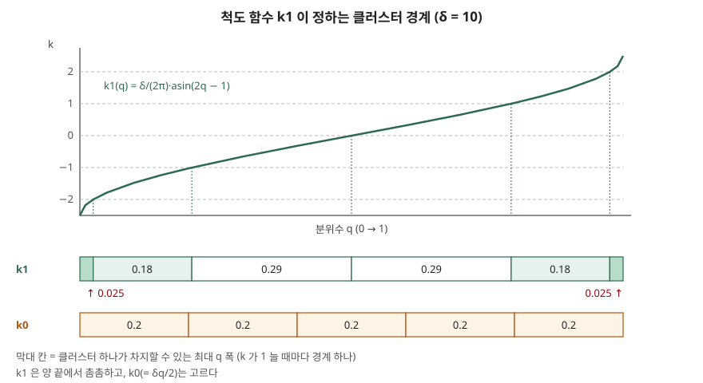

## 들어가며

API 서버의 응답 시간 대시보드를 만들다 보면 평균보다 p99 를 보여 달라는 요청이 꼭 온다. 처음에는 요청마다 응답 시간을 리스트에 쌓아 두었다가 1분마다 정렬해 99번째 백분위를 읽는다. 초당 요청이 수천 건이면 1분에 수십만 개를 붙들고 정렬해야 하고, 서버가 20대면 각자 정렬한 p99 를 합칠 방법이 없다. 서버별 p99 의 평균은 전체의 p99 가 아니기 때문이다. 결국 원본을 한 곳으로 모아 다시 정렬하게 되는데, 그러면 저장과 전송이 표본 수에 비례해 커진다. 메모리가 일정하면서 서로 합칠 수 있는 요약이 필요하다.

## 개념

t-digest 는 표본을 **클러스터**(평균과 개수만 남긴 묶음)로 줄여 들고 있는 분위수 요약 구조다. Dunning·Ertl(2019)는 이 구조가 분위수 q 를 `max(q, 1−q)` 에 비례하는 정확도, 즉 **상대 정확도**로 추정한다는 점을 기존 방법과의 차이로 든다. 대부분의 기존 방법은 q 전 구간에서 같은 절대 오차를 갖는다. p50 에서 0.001 의 순위 오차는 작지만, p99.9 에서 0.001 은 목표 자체가 통째로 틀린 것이다.

핵심은 클러스터 크기를 **자리에 따라 다르게** 제한하는 것이다. 양 끝 근처의 클러스터는 작게, 가운데는 크게 둔다. 이 제한을 정하는 것이 **척도 함수**(scale function) k(q)다. 논문은 다음 두 성질도 함께 보장한다고 적는다.

- 완전히 병합된 t-digest 의 클러스터 수는 표본이 늘어도 ⌈δ⌉ 를 넘지 않는다(δ 는 압축 매개변수)
- 따로 만든 t-digest 들의 클러스터를 합치면 그 자체로 t-digest 가 된다. 그래서 서버별 요약을 합칠 수 있다

## 구조



> **출처**: [Dunning·Ertl, Computing Extremely Accurate Quantiles Using t-Digests (arXiv:1902.04023) — §2.3 The size bound for clusters 식 (3)·(4)와 Fig. 1, §2.4 The effect of a scale function](https://arxiv.org/abs/1902.04023). 막대의 폭은 식 (3)·(6) 에 δ = 10 을 넣어 계산했다.

클러스터 C 가 q_left 에서 q_right 까지를 차지한다고 하자. 논문 식 (4)의 크기 제한은 `k(q_right) − k(q_left) ≤ 1` 이다. 즉 **k 축에서 폭 1** 을 넘지 못한다. k1 은 양 끝에서 기울기가 가팔라서 같은 폭 1 이 q 축에서는 아주 좁아진다. δ = 10 이면 양 끝 클러스터는 q 폭 0.025, 가운데는 0.29 까지 커질 수 있다. 선형인 k0 = δq/2 는 어디서나 0.2 다.

## 동작 원리

논문의 점진 병합 절(§2.6)에 있는 Algorithm 1 이 병합 방식의 전부다. 새 표본은 버퍼에 쌓고, 버퍼가 차면 기존 클러스터와 함께 평균 순으로 정렬한 뒤 왼쪽부터 한 번 훑는다.

1. 현재 클러스터 σ 의 왼쪽 경계 q0 에서 `q_limit = k⁻¹(k(q0) + 1)` 을 계산한다
2. 다음 점을 σ 에 더했을 때의 오른쪽 경계 q 가 q_limit 이하면 합친다(가중 평균)
3. 넘으면 σ 를 확정하고, 그 점으로 새 클러스터를 시작해 1로 돌아간다

k 와 k⁻¹ 는 클러스터를 하나 확정할 때만 부르므로, 점마다 `asin` 을 계산하지 않는다. 논문은 이 최적화를 Algorithm 1 의 특징으로 든다.

분위수를 읽을 때는 정보가 이미 줄어 있으므로 보간한다. 논문 §2.9 는 두 가정을 둔다. (a) 클러스터의 표본 절반은 중심 왼쪽, 절반은 오른쪽에 있다. (b) 두 클러스터 사이의 표본은 균등하게 퍼져 있다. 그러면 각 중심을 "누적 개수 + 자기 개수의 절반" 순위에 놓고 이웃 중심끼리 직선으로 이을 수 있다. 논문은 여기에 단일 표본 클러스터와 양 끝 클러스터를 따로 다루는 보정을 더한다. **이 글의 구현은 가정 (a)·(b)만 쓰고 그 보정은 넣지 않았다.** 양 끝은 실제 최솟값·최댓값까지 직선으로 이었다.

## 실습 예제

전체 소스: [`code/tdigest.py`](code/tdigest.py) · [`code/measure.py`](code/measure.py) · 수행 기록: [`code/output.txt`](code/output.txt)

로그정규 분포(μ = 3, σ = 1)에서 표본 100만 개를 뽑았다. 응답 시간처럼 오른쪽 꼬리가 긴 분포다. δ = 100, 버퍼는 10 × ⌈δ⌉ 이다. 오차는 **순위 오차**로 잰다. 추정값을 정렬된 원본에 넣었을 때의 실제 순위에서 목표 q 를 뺀 값이다.

```python
def k1(q, delta):
    return delta / (2 * math.pi) * math.asin(2 * q - 1)

def k1_inverse(k, delta):
    if k >= delta / 4:          # k1 의 치역은 [-δ/4, δ/4]
        return 1.0
    return (math.sin(2 * math.pi * k / delta) + 1) / 2

# Algorithm 1 의 핵심 — 합칠지 끊을지를 q 비교 한 번으로 정한다
q = q0 + (sigma[1] + point[1]) / total
if q <= q_limit:
    ...                         # 가중 평균으로 합친다
else:
    merged.append(sigma)
    q0 += sigma[1] / total
    q_limit = self.scale_inverse(self.scale(q0, self.delta) + 1, self.delta)
```

**[1] k0 와 k1 — 같은 데이터, 같은 δ.**

```text
[척도 k0] 클러스터 55개 (⌈δ⌉ = 100)
     q        정확값        추정값      순위 오차    오차/min(q,1-q)
 0.001      0.901      0.486  -0.000902           0.9020
   0.5     20.108     20.113  +0.000095           0.0002
  0.99    206.744    238.168  +0.003154           0.3154
 0.999    440.197   2379.425  +0.000998           0.9980

[척도 k1] 클러스터 57개 (⌈δ⌉ = 100)
 0.001      0.901      0.920  +0.000073           0.0730
   0.5     20.108     20.130  +0.000430           0.0009
  0.99    206.744    209.297  +0.000324           0.0324
 0.999    440.197    496.487  +0.000336           0.3360
```

(수행 기록에서 q 네 개만 옮겼다.) k0 의 p99.9 는 정확값 440 대신 **2,379** 를 냈다. 순위 오차는 0.000998 로 숫자만 보면 작지만, 목표 q 에서 1 − q 가 0.001 이니 상대로는 99.8% 가 틀렸다. k0 의 마지막 클러스터에는 표본이 18,005 개 들어 있어서, 상위 0.1% 를 그 클러스터 중심과 최댓값 사이의 직선으로 추정하게 된다. 꼬리가 긴 분포라 최댓값이 멀리 있고, 그 직선이 값을 크게 끌어올렸다. 가운데 p50 은 오히려 k0 가 더 정확했다(0.000095 대 0.000430). 클러스터가 고르게 작은 k0 쪽이 가운데에서 유리한 것이다.

**[2] 클러스터 크기.**

```text
  k0 클러스터 크기: 앞 5개 [10188, 19680, 15105, 19874, 19942]  가운데 17709  뒤 5개 [18580, 18747, 17889, 16253, 18005]
  k1 클러스터 크기: 앞 5개 [315, 1207, 1919, 3106, 4275]  가운데 30342  뒤 5개 [5071, 3703, 2501, 1405, 647]
```

k1 은 양 끝 클러스터가 315 개·647 개, 가운데는 30,342 개로 도식의 막대 모양 그대로 나왔다. 클러스터 수는 두 척도 모두 55~57 개로 ⌈δ⌉ = 100 보다 적었다. 논문은 k1 의 클러스터 수가 대략 ⌊δ/2⌋ 에서 ⌈δ⌉ 사이에 놓인다고 적는데, 하한 쪽에 가까웠다.

예상과 달랐던 것은 **k1 도 꼬리로 갈수록 상대 오차가 커졌다는 점이다.** 오차/min(q, 1−q) 가 q = 0.1 에서 0.0024, 0.99 에서 0.0324, 0.999 에서 0.336 이었다. "상대 정확도"라는 설명만 보고 꼬리에서도 비율이 일정할 줄 알았다. 논문 §2.8 이 이유를 적어 둔다. k1 은 클러스터 크기를 √(q(1−q)) 에 비례하게 제한하고, 더 강한 k2·k3 가 q(1−q)·min(q, 1−q) 에 비례하게 제한한다. 이 글의 구현이 양 끝 보정을 생략한 것도 p99.9 오차에 보탰을 수 있다. p99.9 의 상위 1,000 개는 마지막 두 클러스터(647 개, 1,405 개)에 걸쳐 있기 때문이다.

**[3] 나눠 만들어 합치기.** 표본을 10조각으로 나눠 각자 t-digest 를 만든 뒤 하나로 병합했다. 클러스터 56 개, p99 순위 오차 0.000270, p99.9 0.000272 로 한 번에 만든 것(0.000324, 0.000336)과 같은 수준이었다. 서버별로 요약을 만들어 모으는 쓰임이 그대로 성립한다.

**[4] 정렬된 순서로 넣기.** 오름차순으로 넣었더니 클러스터가 75 개로 늘었다. 무작위 순서일 때 57 개보다 많다. 논문은 증분으로 만든 t-digest 가 완전한 강한 순서(strongly ordered)는 아닐 수 있다고 적는데, 정렬된 입력은 매 병합이 이미 순서대로라 클러스터가 덜 합쳐진 것으로 보인다. 오차는 무작위 순서와 비슷했다.

## 실무에서 주의할 점

1. **순위 오차와 값 오차를 구분한다.** k1 의 p99.9 순위 오차는 0.000336 이었지만 값은 440 대신 496 으로 13% 높았다. 꼬리가 긴 분포에서는 작은 순위 오차가 큰 값 오차가 된다. SLO 판정처럼 값 자체가 중요하면 δ 를 키우거나 꼬리를 더 강하게 제한하는 척도를 쓴다.
2. **척도 함수가 정확도의 모양을 정한다.** k0 는 가운데가, k1 은 양 끝이 정확했다. p50 만 볼 거라면 꼬리용 척도의 이점이 없다. 어떤 분위수를 볼지 먼저 정하고 척도를 고른다.
3. **서버별 p99 를 평균 내지 않는다.** 합칠 수 있는 것은 요약이다. 서버마다 t-digest 를 보내 병합한 뒤 분위수를 읽어야 전체 분위수가 된다.
4. **구현마다 보간 방식이 다르다.** 이 글의 구현처럼 양 끝 보정을 생략하면 극단 분위수가 달라진다. 서로 다른 라이브러리의 결과를 섞어 비교하지 않는다.
5. **입력 순서가 크기를 바꾼다.** 정렬된 입력에서 클러스터가 57 개에서 75 개로 늘었다. 상한 ⌈δ⌉ 안이지만, 메모리를 빠듯하게 잡았다면 이 차이를 고려한다.

## 정리

- t-digest 는 표본을 평균·개수만 남긴 클러스터로 줄이고, 척도 함수로 자리마다 클러스터 크기를 다르게 제한한다
- 크기 제한은 k 축에서 폭 1 이며, k1 은 양 끝에서 q 폭을 좁혀 꼬리 분위수를 정확하게 만든다
- 같은 δ=100 에서 k0 는 p99.9 를 2,379(정확값 440)로, k1 은 496 으로 냈고, p50 은 k0 쪽이 더 정확했다
- k1 도 꼬리로 갈수록 상대 오차가 커졌다. 이는 k1 이 √(q(1−q)) 에 비례하게 제한하기 때문이다
- 10조각을 병합한 요약도 한 번에 만든 것과 오차가 같은 수준이었다

같은 "작은 메모리로 근사하는" 계열은 [HyperLogLog](../2026-11-07-hyperloglog-cardinality-error/index.md)(서로 다른 값의 개수)와 [Count-Min 스케치](../2026-11-08-count-min-sketch-frequency-error-bound/index.md)(빈도)에서 다뤘다. 정확한 중앙값을 SQL 로 구하는 법은 [ROW_NUMBER 와 COUNT 로 중앙값 구하기](../../../Database/sql-basics/2026-11-08-sql-median-row-number-count/index.md)에 있다.

## 참고 자료

- [Ted Dunning, Otmar Ertl, Computing Extremely Accurate Quantiles Using t-Digests, arXiv:1902.04023 (2019-02-11)](https://arxiv.org/abs/1902.04023) — §2.3 크기 제한 식 (3)·(4)와 Fig. 1, §2.4 선형 척도 k0, §2.5 독립 다이제스트 병합, §2.6 Algorithm 1, §2.8 척도 함수 k0~k3 식 (6)~(9), §2.9 분위수 보간
- [같은 논문 PDF](https://arxiv.org/pdf/1902.04023)
