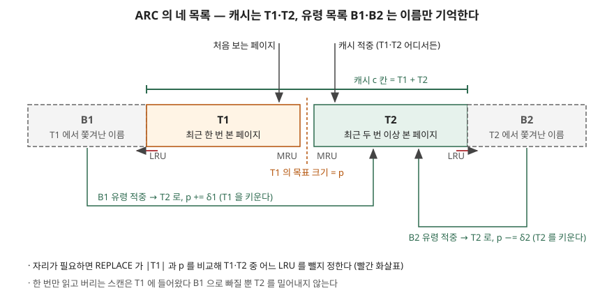

## 들어가며

DB 버퍼나 애플리케이션 캐시를 LRU 로 두고 잘 쓰다가, 야간 배치가 큰 테이블을 한 번 훑고 지나간 다음 날 아침 응답 시간이 튀는 것을 보는 일이 있다. 캐시 적중률 그래프를 보면 배치 시각에 뚝 떨어졌다가 천천히 회복한다. 흔히 캐시 크기를 늘리거나 배치를 피해 캐시를 미리 데워 두는데, 캐시를 두 배로 늘려도 스캔이 두 배로 길면 소용이 없다. 문제는 크기가 아니라 **한 번만 읽히는 페이지가 여러 번 읽히는 페이지를 밀어낸다**는 데 있다.

## 개념

LRU 는 가장 오래 안 쓴 페이지를 내보낸다. 최근성 하나만 보므로 한 번 읽고 버릴 페이지 200개가 지나가면 그 앞에 있던 페이지 100개가 전부 밀려난다. 빈도를 세는 LFU 는 반대로 과거에 많이 쓰였지만 이제 안 쓰는 페이지를 오래 붙든다.

**ARC**(Adaptive Replacement Cache)는 캐시를 두 목록으로 나눈다. **T1** 은 최근 한 번만 본 페이지, **T2** 는 최근 두 번 이상 본 페이지다. 그리고 각 목록에서 쫓겨난 페이지의 **이름만** 같은 수만큼 더 기억한다(유령 목록 **B1**·**B2**). 쫓겨난 페이지가 곧 다시 요청되면 그쪽 목록을 키웠어야 했다는 신호로 읽고, T1 의 목표 크기 **p** 를 그 방향으로 옮긴다. 조정할 파라미터가 없다는 것이 논문이 내세우는 점이다.

## 구조



> **출처**: [Megiddo·Modha, ARC: A Self-Tuning, Low Overhead Replacement Cache, FAST 2003 — §III.A Double Cache(그림 2), §IV.B The Policy, Fig. 4 Algorithm for Adaptive Replacement Cache](https://www.usenix.org/legacy/events/fast03/tech/full_papers/megiddo/megiddo.pdf). 두 목록의 MRU 끝을 가운데로 마주 놓는 배치는 논문 그림 2·3 을 따랐다.

## 동작 원리

논문 그림 4 는 요청 하나를 네 경우로 나눈다.

| 경우 | 요청이 있는 곳 | 하는 일 |
|---|---|---|
| I | T1 또는 T2 (캐시 적중) | T2 의 MRU 로 옮긴다 |
| II | B1 (유령 적중) | p 를 δ1 만큼 올리고, REPLACE 로 자리를 만든 뒤 T2 로 |
| III | B2 (유령 적중) | p 를 δ2 만큼 내리고, REPLACE 로 자리를 만든 뒤 T2 로 |
| IV | 어디에도 없다 | 목록 길이를 맞추고 REPLACE 한 뒤 T1 의 MRU 로 |

**REPLACE** 는 T1 이 목표 p 보다 크면 T1 의 LRU 를 B1 으로, 아니면 T2 의 LRU 를 B2 로 내보낸다. **학습률**은 유령 목록 크기의 비다. B1 에서 적중하면 B1 이 B2 이상일 때 1, 아니면 |B2|/|B1| 만큼 올린다. B2 쪽은 그 반대다. 작은 유령 목록에서 난 적중일수록 크게 움직인다(§IV.C).

**스캔에 강한 이유**(§IV.D)는 경우 IV 에 있다. 처음 보는 페이지는 언제나 T1 으로 들어오고, 다시 요청되지 않으면 T1 에서 B1 으로 빠진다. T2 에 들어가려면 두 번째 요청이 있어야 하므로, 한 번만 읽고 지나가는 스캔은 T2 를 건드릴 수 없다.

## 실습 예제

전체 소스: [`code/arc_vs_lru.py`](code/arc_vs_lru.py) · 수행 기록: [`code/output.txt`](code/output.txt)

그림 4 를 `OrderedDict` 네 개로 그대로 옮겼다. 비교 기준으로 미래 요청을 아는 **벨러디 최적**(OPT, 다음 사용이 가장 먼 페이지를 내보내는 상한선)을 함께 돌렸다. 캐시는 100칸이다.

```text
[1] 캐시 100칸, 적중률 (%) — seed=20031
    workload         requests     LRU     ARC     OPT
    hot_only            20000    99.6    99.6    99.6
    hot_with_scans      24000    78.3    83.1    83.1
    loop_120            20000     0.0     0.0    82.7
    zipf_1000           20000    57.6    63.8    75.2
```

**스캔이 섞인 접근열에서 ARC 가 최적과 같았다.** `hot_with_scans` 는 뜨거운 키 60개를 1,000번 무작위로 읽은 뒤 새 키 200개를 한 번씩 훑는 일을 20번 되풀이한다. 스캔 키 4,000개는 누구도 맞힐 수 없으므로 상한은 83.3% 이고, OPT 는 뜨거운 키의 첫 요청 60건만 더 놓쳐 83.1% 다. ARC 도 83.1% 였다. [2] 를 보면 스캔이 끝난 직후 LRU 캐시에 남은 뜨거운 키는 매번 0개, ARC 는 매번 60개다. LRU 는 스캔이 끝날 때마다 60개를 다시 읽어 들이느라 4.8%p 를 잃었다.

[3] 에서 ARC 상태를 찍어 보면 p 는 끝까지 0 이었다. |T1| 이 p 보다 크니 REPLACE 는 늘 T1 의 LRU 를 내보냈고, 스캔 키는 T1(40칸)을 지나 B1 으로 빠졌다. 이 접근열에서 ARC 를 지킨 것은 학습이 아니라 **T1·T2 의 분리 자체**였다.

**캐시보다 큰 반복에서는 ARC 도 0% 였다.** `loop_120` 은 키 120개를 순서대로 계속 돈다. LRU 는 늘 다음에 쓸 키를 막 내보낸 상태라 하나도 맞히지 못한다. ARC 의 T1·T2 도 LRU 목록이고 REPLACE 는 그 LRU 끝을 내보내므로(그림 4), 다음에 쓸 키가 늘 가장 오래된 자리에 있는 이 접근열에서는 하나도 맞히지 못했다. 같은 접근열에서 OPT 는 82.7% 다. 스캔 저항성은 **한 번만** 읽히는 페이지에 대한 것이지, 크기를 넘는 반복에 대한 것이 아니다.

**Zipf 분포(키 1,000개, k번째 키의 빈도가 1/k)에서는 6.2%p 앞섰다.** [5] 에서 p 의 움직임을 보면 B1 유령 적중이 1,182번, B2 가 238번으로 B1 쪽이 다섯 배 많았는데도 p 는 0~12 사이에 머물렀다.

```text
    (requests, p, |T1|, |T2|, |B1|, |B2|, B1_hits, B2_hits)
    (10000, 11.79, 12, 88, 88, 12, 553, 110)
    (20000, 11.92, 10, 90, 88, 12, 1182, 238)
```

(수행 기록에서 두 줄만 옮겼다.) |B1| 이 88, |B2| 가 12 이므로 B1 적중은 p 를 1씩 올리지만 B2 적중 한 번은 88/12 ≈ 7.3 만큼 내린다. 적중 횟수가 아니라 **목록 크기로 나눈 적중률**을 비교하는 셈이고, 그 결과 캐시의 약 90% 가 T2(자주 쓰는 키)에 배정됐다. 네 접근열 모두에서 매 요청 뒤 불변식(|T1|+|T2| ≤ c, |T1|+|B1| ≤ c, 네 목록 합 ≤ 2c, 0 ≤ p ≤ c)을 검사했고 위반은 0건이었다.

## 실무에서 주의할 점

1. **메타데이터가 LRU 의 두 배다.** B1·B2 가 캐시 크기만큼 이름을 더 들고 있다(§III.B). 페이지가 크면 무시할 만하지만, 값이 작은 키-값 캐시에서는 키 저장 비용이 두 배가 된다.
2. **반복 접근에는 답이 아니다.** 캐시보다 큰 범위를 순서대로 계속 도는 작업은 ARC 에서도 0% 였다. 그런 작업은 캐시를 우회시키는 편이 낫다.
3. **이득은 접근열 모양에 달렸다.** 뜨거운 키만 있는 `hot_only` 에서는 세 정책이 99.6% 로 같았다. 자기 서비스의 접근 기록으로 재 보기 전에는 교체 정책을 바꿀 이유가 없다.
4. **p 가 움직이지 않는다고 고장이 아니다.** 스캔 접근열에서 p 는 0 에 고정돼 있었지만 결과는 최적이었다. 모니터링에서 p 를 볼 때는 유령 적중 수와 함께 봐야 뜻이 있다.
5. **동시성은 논문 범위 밖이다.** 그림 4 는 단일 스레드 알고리즘이다. 적중마다 목록을 옮기므로 여러 스레드가 쓰면 잠금 경합이 LRU 와 같은 자리에서 생긴다.

## 정리

- ARC 는 캐시를 최근 한 번 본 T1 과 두 번 이상 본 T2 로 나누고, 쫓겨난 이름을 B1·B2 에 같은 수만큼 기억한다
- 유령 적중이 난 쪽으로 T1 목표 크기 p 를 옮기며, 움직이는 폭은 유령 목록 크기의 비다
- 스캔이 섞인 접근열에서 ARC 는 뜨거운 키를 하나도 잃지 않아 벨러디 최적과 같은 83.1% 를 냈고, 이때 p 는 0 에 머물렀다
- 캐시보다 큰 반복 접근에서는 ARC 도 LRU 와 같이 0% 였다. 스캔 저항성은 한 번만 읽히는 페이지에 대한 성질이다

## 참고 자료

- [Megiddo·Modha, ARC: A Self-Tuning, Low Overhead Replacement Cache, 2nd USENIX FAST (2003)](https://www.usenix.org/legacy/events/fast03/tech/full_papers/megiddo/megiddo.pdf) — §III DBL 과 정책 군 Π(c), §IV.A FRC, §IV.B ARC 정책, §IV.C 학습률, §IV.D 스캔 저항성, 그림 4 의사코드
- [USENIX FAST '03 — ARC 논문 소개 페이지](https://www.usenix.org/conference/fast-03/arc-self-tuning-low-overhead-replacement-cache) — 초록과 서지 정보
