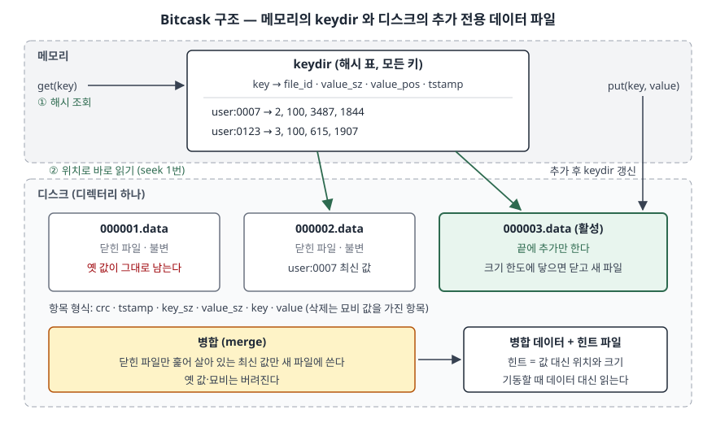

## 들어가며

세션 저장소나 장바구니처럼 키 하나에 값 하나를 넣고 꺼내기만 하는 데이터가 있다. 처음에는 관계형
DB 표 하나로 시작하지만, 쓰기가 몰리면 인덱스 갱신과 페이지 쓰기가 비용이 된다. 그래서 흔히 B-Tree
기반 임베디드 저장소를 그대로 가져다 쓰는데, 무작위 키를 덮어쓸 때마다 디스크의 여기저기를 고쳐 써야
한다. 쓰기가 초당 수천 건 들어오면 그 건수에 쓰기 한 번당 디스크를 찾아가는 횟수가 곱해진다. Riak 팀이 2010년에 내놓은 Bitcask는 이 문제를 "쓰기는 파일 끝에 붙이기만,
읽기는 메모리 해시로 위치를 찾아 한 번에"로 풀었다.

## 개념

Bitcask 논문은 저장소 하나를 **디렉터리 하나**로 정의한다. 그 안에서 쓰기가 일어나는 파일은 항상
하나(활성 파일)이고, 크기 한도에 닿으면 닫히고 새 활성 파일이 생긴다. 한 번 닫힌 파일은 다시는 쓰지 않는다.

| 구성요소 | 위치 | 하는 일 |
|---|---|---|
| 데이터 파일 | 디스크 | 키·값 항목을 쓴 순서대로 이어 붙인 로그 |
| keydir | 메모리 | 모든 키 → 최신 값이 있는 파일·위치·크기 |
| 병합(merge) | 디스크 | 닫힌 파일에서 살아 있는 값만 골라 새 파일로 다시 쓴다 |
| 힌트 파일 | 디스크 | 병합 결과마다 값 대신 위치·크기만 적은 파일 |

B-Tree가 "정렬된 구조를 디스크에 유지"한다면 Bitcask는 정렬을 포기하고 **색인 전체를 메모리에 둔다.**
논문은 이 대가를 명시한다 — keydir는 키 수에 따라 자라고 전부 RAM에 들어가야 한다.
같은 로그 구조 계열인 LSM 트리와 달리 범위 조회를 할 수 없다는 것도 이 선택에서 나온다.

## 구조



> **출처**: [Sheehy·Smith, Bitcask: A Log-Structured Hash Table for Fast Key/Value Data (Basho, 2010) pp.2–4](https://riak.com/assets/bitcask-intro.pdf), [basho/bitcask — src/bitcask_fileops.erl](https://github.com/basho/bitcask/blob/develop/src/bitcask_fileops.erl)

## 동작 원리

**쓰기.** 항목을 활성 파일 끝에 붙인 뒤 keydir의 그 키 칸을 새 위치로 바꾼다. 옛 값은 디스크에
그대로 남는다. 삭제도 쓰기다 — 묘비(tombstone)라는 특수 값을 가진 항목을 붙인다.

항목 형식은 basho/bitcask 소스가 정한다. `crc(32비트) · tstamp(32) · key_sz(16) · value_sz(32) · key · value`
순서이고 헤더는 14바이트, CRC는 tstamp부터 값 끝까지를 덮는다.

**읽기.** keydir에서 파일 번호·위치·크기를 얻어 그 자리를 한 번 읽는다. 논문은 읽기가 디스크 찾아가기를
한 번 넘지 않는다고 적는다.

**병합.** 덮어쓰기가 쌓이면 디스크가 늘기만 한다. 병합은 활성 파일을 뺀 닫힌 파일만 훑어, 키마다 최신
값만 새 파일로 다시 쓰고 옛 파일을 지운다. 이때 항목마다 `tstamp · key_sz · total_sz · offset · key`만 담은
힌트 파일을 함께 만든다(소스 기준 고정부 18바이트).

**기동.** keydir는 메모리에만 있으므로 프로세스가 다시 뜨면 데이터 파일을 처음부터 훑어 다시 만든다.
힌트 파일이 있는 파일은 그것을 대신 읽는다. 데이터 파일이 곧 커밋 로그라서 "재생(replay)" 단계가 따로 없다.

## 실습 예제

전체 소스: [`code/`](code/) · 실행 기록: [`code/output.txt`](code/output.txt)

`bitcask_store.py`에 위 네 가지를 구현하고 `demo.py`로 쟀다. 시각 대신 1씩 오르는 수를 tstamp로 써서
결과가 매번 같다. 먼저 항목 하나의 바이트다.

```text
[1] 데이터 항목 하나 — put(b'user:0001', b'hello')
  헤더 14바이트 + 키 9바이트 + 값 5바이트 = 28바이트
  crc      tstamp   key_sz value_sz key / value
  edc8f63f 00000001 0009   00000005 b'user:0001' / b'hello'
```

### 덮어쓰기와 병합

키 1,000개에 100바이트 값을 20번씩 덮어썼다.

```text
[2] 키 1,000개 x 20번 덮어쓰기, 값 100바이트, 파일 한도 64KiB
  데이터 파일 38개, 힌트 파일 0개
  디스크 사용 2,460,000바이트 / 살아 있는 데이터 123,000바이트 = 20.00배

[3] 무작위 키 1,000번 get
  파일 읽기 호출 1,000번 — get 한 번에 1번

[4] 병합
  디스크 사용 2,460,000 → 141,468바이트 (1.15배)
    000037.data   84,132바이트  병합 결과
    000037.hint   18,468바이트  병합 결과
    000038.data   38,868바이트  활성
  키 위치: 병합 결과 684개, 활성 파일 316개
```

공간 증폭(디스크 사용 ÷ 살아 있는 데이터)이 덮어쓴 횟수와 정확히 같은 20배다. 병합은 이것을 1.15배로
되돌렸는데 1배가 아닌 이유는 두 가지다. 힌트 파일 18,468바이트가 더해지고, 활성 파일은 병합하지 않으므로
그 안의 키 316개가 쓴 값은 그대로 남는다. 파일이 38개로 늘어도 get은 매번 파일 읽기 1번이었다.

### 힌트 파일이 줄이는 것

```text
[5] 다시 열기 — keydir 를 만들려고 읽은 바이트
  힌트 파일이 있는 상태: 57,336바이트, 키 1,000개
  같은 값을 읽는가: True
  힌트 파일을 지운 상태: 123,000바이트, 키 1,000개
```

57,336 = 힌트 18,468 + 활성 파일 38,868이다. 병합 결과 몫만 보면 84,132바이트를 읽던 것이 18,468바이트로
줄었다(약 4.6분의 1). 항목당 값 100바이트를 안 읽기 때문이므로 값이 클수록 차이가 벌어진다.

### 쓰다가 끊긴 꼬리

`order:1=paid`, `order:2=paid`, `order:1=refunded`를 쓴 뒤 파일 끝 5바이트를 잘라 마지막 쓰기가
디스크에 다 닿기 전에 멈춘 상황을 만들었다.

```text
[6] 마지막 항목이 반쯤 쓰이다 끊긴 파일
  파일 79바이트 → 74바이트로 자름
    파일 1 오프셋 50: CRC 불일치 또는 잘린 항목 — 여기서 읽기를 멈춘다
  order:1 = b'paid', order:2 = b'paid'
```

깨진 항목을 버리고 앞 항목까지만 쓰니 `order:1`이 **환불 전 값으로 돌아갔다.** 데이터가 깨지지는 않지만
마지막 쓰기는 사라진다. 논문 API의 `sync_on_put` 선택지가 이 지점을 다룬다.

### 묘비와 keydir 메모리

```text
[7] 삭제 — 묘비 항목
  병합 전 디스크 292바이트, keydir 키 [b'session:b', b'session:c', b'session:d']
  병합 후 디스크 216바이트, keydir 키 [b'session:b', b'session:c', b'session:d']
  다시 열기 — session:a = None, 키 [b'session:b', b'session:c', b'session:d']

[8] keydir 메모리 — 키 100,000개 (키 길이 9바이트)
  22,324,576바이트, 키 하나에 223바이트 (값 크기와 무관)
```

키 하나에 223바이트는 파이썬 dict와 객체의 비용이고, C로 짠 실제 구현의 값이 아니다. 다만 "값 크기와
무관하게 키 수에 비례한다"는 성질은 같다.

## 실무에서 주의할 점

**① 키 수가 메모리를 정한다.** 값이 아무리 커도 keydir는 키 수만큼 자란다. 키가 수억 개로 늘 수 있는
작업(이벤트 ID별 저장 등)에는 맞지 않는다. 논문도 이것을 유일하게 예측 가능한 한계로 적는다.

**② 범위 조회가 없다.** keydir는 정렬되지 않은 해시라 "user:0100부터 0199까지"를 위치로 찾을 수 없다.
전부 훑어야 한다. 범위가 필요하면 LSM 트리 계열이 맞다.

**③ 병합 전까지 디스크는 덮어쓴 횟수만큼 커진다.** 예제의 20배가 그대로 생긴다. 쓰기가 많은 키가
몰려 있다면 병합 주기를 디스크 여유와 함께 정해야 하고, 병합 중에는 옛 파일과 새 파일이 동시에 있어
순간적으로 더 쓴다.

**④ 동기화 정책을 정한다.** 쓰기 뒤 `fsync`를 하지 않으면 [6]처럼 마지막 쓰기를 잃는다. 매번 하면
쓰기 처리량이 떨어진다. 어느 쪽인지 서비스 요구로 정한다.

**⑤ 기동 시간은 힌트 파일 유무에 달렸다.** 병합을 한 번도 안 한 저장소는 다시 뜰 때 모든 데이터 파일을
처음부터 읽는다. 병합이 기동 시간 관리이기도 하다.

## 정리

- Bitcask는 쓰기를 파일 끝에 붙이고, 모든 키의 위치를 메모리 해시(keydir)에 둬 읽기를 파일 읽기 1번으로 끝낸다.
- 덮어쓴 횟수가 곧 공간 증폭 배수다(실측 20배). 병합이 닫힌 파일의 최신 값만 남겨 되돌린다(1.15배).
- 힌트 파일은 값 없이 위치만 담아 기동 때 읽는 양을 줄인다(병합 결과 몫 84,132 → 18,468바이트).
- 대가는 키 수에 비례하는 메모리와 범위 조회 불가다.

## 참고 자료

- [Justin Sheehy, David Smith — Bitcask: A Log-Structured Hash Table for Fast Key/Value Data (Basho Technologies, 2010-04-27)](https://riak.com/assets/bitcask-intro.pdf) — 디렉터리·활성 파일·keydir·병합·힌트 파일, keydir가 RAM에 들어가야 한다는 제약, API(`sync_on_put` 포함)
- [basho/bitcask — src/bitcask_fileops.erl (develop 브랜치)](https://github.com/basho/bitcask/blob/develop/src/bitcask_fileops.erl) — 데이터 항목·힌트 항목의 비트 배치, CRC 범위
- [basho/bitcask — include/bitcask.hrl (develop 브랜치)](https://github.com/basho/bitcask/blob/develop/include/bitcask.hrl) — `HEADER_SIZE` 14, `HINT_RECORD_SZ` 18, 묘비 값 정의
- 같은 저장소: [LSM 트리 쓰기 증폭 — 크기 계층 압축과 레벨 압축을 직접 세어 보기](../../../Database/storage-engine/2026-11-08-lsm-compaction-write-amplification/index.md)
