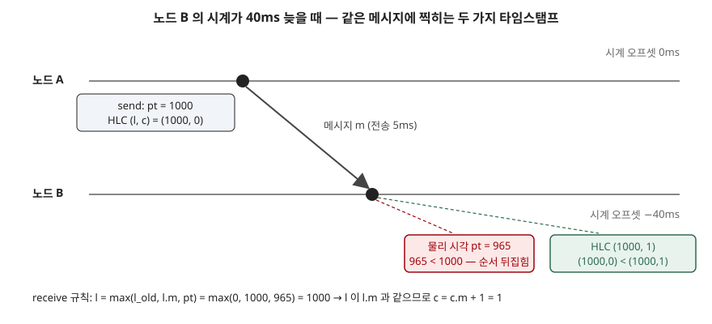

## 들어가며

여러 서버가 같은 키를 고치는 저장소에서 "마지막에 쓴 값이 이긴다(last-writer-wins)"를 서버 시각으로
구현하는 경우가 흔하다. 서버 A가 값을 쓰고 그 사실을 서버 B에 알리면, B는 그것을 보고 값을 다시
고친다. B가 A를 본 뒤 고쳤으니 B의 값이 이겨야 한다. 그런데 B의 시계가 A보다 40ms 늦으면 B의 쓰기
시각이 A보다 앞선 값으로 찍히고, 저장소는 A의 값을 최종값으로 고른다. NTP로 시계를 맞춰도 수십 ms의
오차는 남으므로, 시계를 더 정밀하게 맞추는 것만으로는 이 문제가 없어지지 않는다.

## 개념

타임스탬프를 정하는 방식은 크게 둘이었다. **논리 시계**(Lamport 시계)는 사건마다 카운터를 늘리고
메시지를 받으면 상대 값보다 크게 맞춰서, 사건 e가 f보다 먼저 일어났으면(e → f, happened-before)
e의 값이 f보다 작게 만든다. 대신 값이 실제 시각과 무관해서 "10시 정각의 상태"를 물을 수 없다.
**물리 시각**은 실제 시각에 가깝지만 노드마다 오차가 있어 인과 순서를 보장하지 못한다.

Kulkarni 외(2014)가 제안한 **하이브리드 논리 시계**(HLC)는 이 둘을 합친다. 논문이 세운 요구사항은
4가지다(§3.1).

| 번호 | 요구사항 |
|---|---|
| 1 | e → f 이면 l.e < l.f (논리 시계와 같은 한 방향 인과 보장) |
| 2 | 타임스탬프 하나가 정수 O(1)개 |
| 3 | 값이 제한된 공간에 표현된다 (끝없이 커지지 않는다) |
| 4 | \|l.e − pt.e\| 가 유계, 즉 물리 시각 pt 에서 멀어지지 않는다 |

## 구조

HLC 타임스탬프는 정수 두 개 (l, c)다. **l**은 지금까지 보거나 들은 물리 시각 가운데 가장 큰 값이고,
**c**는 l이 그대로일 때만 늘어나는 카운터다. 비교는 l을 먼저, 같으면 c를 본다(사전식 비교).



> **출처**: [Kulkarni 외, Logical Physical Clocks and Consistent Snapshots in Globally Distributed Databases (2014) §3.3 HLC Algorithm, Figure 5](https://cse.buffalo.edu/tech-reports/2014-04.pdf)

## 동작 원리

Figure 5의 규칙을 그대로 옮긴 코드다. pt는 그 노드가 읽은 물리 시각이다.

```python
def send_or_local(self, pt):
    old_l = self.l
    self.l = max(old_l, pt)
    self.c = self.c + 1 if self.l == old_l else 0
    return (self.l, self.c)

def receive(self, pt, msg_l, msg_c):
    old_l = self.l
    self.l = max(old_l, msg_l, pt)
    if self.l == old_l == msg_l:
        self.c = max(self.c, msg_c) + 1
    elif self.l == old_l:
        self.c += 1
    elif self.l == msg_l:
        self.c = msg_c + 1
    else:
        self.c = 0          # 내 물리 시각이 가장 크면 카운터를 비운다
    return (self.l, self.c)
```

핵심은 마지막 줄이다. 논문은 먼저 l 하나에 `max(l + 1, l.m + 1, pt)`를 담는 단순 알고리즘(Figure 3)을
보이고, 이것이 4번 요구사항을 어긴다는 반례를 든다(§3.2). l 하나에 "들은 최대 물리 시각"과 "사건마다
더한 1"이 섞이면, 늘어난 값이 어디서 왔는지 몰라 되돌릴 자리가 없다. HLC는 둘을 l과 c로 나눠서,
물리 시각이 l을 따라잡는 순간 c를 0으로 되돌린다.

논문이 증명한 성질은 셋이다. e → f 이면 (l.e, c.e) < (l.f, c.f)이고(정리 1), 항상 l ≥ pt이며(정리 2),
시계 동기화 오차를 ε라 하면 l − pt ≤ ε 다(따름정리 1). 64비트 NTP 형식에 맞추려고 l에 상위 48비트,
c에 16비트를 쓰는 배치도 제안한다(§6.2).

## 실습 예제

전체 소스: [`code/`](code/) · 실행 기록: [`code/output.txt`](code/output.txt)

먼저 들어가며의 장면을 그대로 돌렸다.

```text
[1] 메시지 하나 — 노드 A 는 시계가 맞고, 노드 B 는 40ms 늦다 (전송 5ms)
  A 가 x=1 을 쓰고 보냄   물리 시각 1000   HLC (1000, 0)
  B 가 받고 x=2 로 덮어씀 물리 시각 965    HLC (1000, 1)
  물리 시각으로 '나중' 쓰기: x=1  (최종값이 1 로 돌아간다)
  HLC 로 '나중' 쓰기     : x=2
```

다음은 노드 3개가 노드당 2만 개 사건을 만들고 절반을 1~20ms 지연으로 다른 노드에 보내는 시뮬레이션이다.
ε는 가장 빠른 시계와 가장 느린 시계의 차이다. "위반"은 받은 사건의 타임스탬프가 보낸 사건보다 크지
않은 메시지 수다.

```text
[2] 노드 3개, 노드당 20,000 사건, 전송 지연 1~20ms
  시계 오프셋(ms)            ε     메시지     물리 시각 위반   HLC 위반 max(l-pt)  max c
  [0, 0, 0]             0  29,938            0        0         0      4
  [0, -10, 5]          15  29,938        7,367        0        14     17
  [0, -40, 25]         65  29,938       14,823        0        64     29
  [0, -200, 150]      350  29,938       14,823        0       349     30
```

HLC 위반은 어느 경우에도 0이고, 오차가 있는 세 경우의 max(l − pt)는 ε보다 1 작았다. 전송 지연이 최소 1ms라 한 번
건너오는 동안 받는 쪽 물리 시각이 1 늘기 때문이다. 예상과 달랐던 것은 **c**다. 오차가 65ms에서 350ms로
5배 넘게 커졌는데 c의 최댓값은 29에서 30으로 거의 그대로였다. 논문의 상한(따름정리 3) N × (ε + 1)은
ε에 비례하지만, 실제 c는 "l이 같은 채로 이어진 인과 사슬의 길이"이고 이 시뮬레이션에서는 사건 간격
1~3ms가 그 길이를 정했다. 물리 시각 위반은 ε=65에서 이미 메시지의 절반에 이르렀고 더 늘지 않았다.
빠른 시계에서 느린 시계로 가는 메시지가 전부 뒤집힌 상태다.

## 실무에서 주의할 점

**① 사건이 물리 시계의 눈금보다 빠르면 단순 알고리즘은 무너진다.** 시계 오차가 0인 세 노드가
메시지를 돌리게 하고 1ms에 몇 번 건너가는지만 바꿨다.

```text
   1ms 당 홉   진행(ms)   단순 max(l-pt) HLC max(l-pt) HLC max c
         1   10,000              2             0         2
         2    1,000          1,002             0         3
         2   10,000         10,002             0         3
         4   10,000         30,002             0         5
```

1ms에 한 번이면 단순 알고리즘도 2에서 멈췄지만, 두 번이 되자 진행 시간에 비례해 l − pt가 커졌다.
논문이 단순 알고리즘이 맞으려면 사건 사이에 물리 시계가 최소 1 늘어야 한다고 짚은 조건 그대로다(§3.2).
시계 해상도가 ms인 시스템에서 초당 수천 건을 처리하면 이 조건은 쉽게 깨진다.

**② 물리 시계가 뒤로 가도 HLC는 앞으로 간다.** NTP 보정으로 한 노드의 시계가 30ms 되돌아간 경우다.

```text
  pt   : [100, 101, 102, 103, 104, 75, 76, 77, 105, 106]
  HLC  : [(100, 0), (101, 0), (102, 0), (103, 0), (104, 0), (104, 1), (104, 2), (104, 3), (105, 0), (106, 0)]
```

l은 104에 머물고 c가 1씩 늘다가 pt가 105로 따라잡자 c가 0으로 돌아왔다. 다만 이 사이의 HLC 값은
그 노드의 물리 시각보다 최대 29ms 앞서 있다. "l이 지금 시각"이라고 믿고 만료 판정 같은 데 쓰면 그만큼 틀린다.

**③ 64비트 하나로 묶으면 비교가 정수 비교가 된다.** (l << 16) | c 로 묶어 정렬한 순서가 (l, c) 사전식
순서와 2만 개 표본에서 같았다(`순서 일치: True`). 다만 c가 16비트를 넘을 수 없으니 같은 l 안에서
65,536개 넘는 사건이 이어질 수 있는 구조인지 먼저 따진다. 위 시뮬레이션의 c는 30을 넘지 않았다.

**④ HLC는 인과 순서를 지킬 뿐, 동시 사건의 순서를 정해 주지 않는다.** 정리 1은 한 방향이다.
(l.e, c.e) < (l.f, c.f)라고 e → f 인 것은 아니다. 두 쓰기가 서로를 모른 채 일어났는지 알아야 하면
벡터 시계가 필요하다.

## 정리

- HLC는 (l, c) 두 정수로, l은 들은 최대 물리 시각, c는 l이 같을 때만 늘어나는 카운터다.
- 노드 3개·오차 65ms 시뮬레이션에서 물리 시각은 메시지 14,823개의 인과 순서를 뒤집었고 HLC는 0개였다. l − pt는 ε 안에 머물렀다.
- c는 오차가 5배 넘게 커져도 29 → 30으로 거의 그대로였다.
- l과 c를 나누지 않은 단순 알고리즘은 1ms에 사건이 둘 이상이면 l − pt가 진행 시간에 비례해 커졌다.

## 참고 자료

- [Kulkarni, Demirbas, Madappa, Avva & Leone, Logical Physical Clocks and Consistent Snapshots in Globally Distributed Databases, University at Buffalo 기술 보고서 2014-04](https://cse.buffalo.edu/tech-reports/2014-04.pdf) — §3.1 요구사항 4가지, §3.2 단순 알고리즘(Figure 3)과 반례(Figure 4), §3.3 HLC 알고리즘(Figure 5)·정리 1~4·따름정리 1~4, §6.2 48비트 l + 16비트 c 배치
- [Lamport, Time, Clocks, and the Ordering of Events in a Distributed System, Communications of the ACM 21(7), 1978](https://lamport.azurewebsites.net/pubs/time-clocks.pdf) — happened-before 관계와 논리 시계
- 같은 저장소: [논리 시계 — 램포트 시계와 벡터 시계로 사건 순서 정하기](../../../PE/system/2026-11-07-logical-clock-lamport-vector/index.md)
