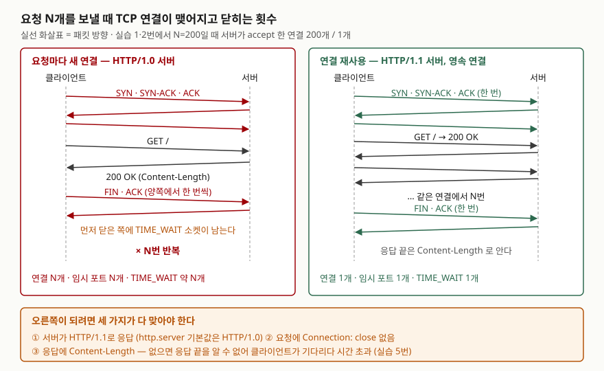

## 들어가며

사내 도구에서 다른 서비스의 API를 반복해서 부르는 스크립트를 짜다 보면, 요청 하나하나는 빠른데 수백 번 돌리면 이상하게
느린 경우가 있다. 흔히 하는 대응은 요청을 스레드로 나눠 동시에 보내는 것이다. 그런데 요청마다 TCP 연결을 새로 맺고
있었다면 동시에 보낼수록 맺고 끊는 연결이 함께 늘고, 끊긴 연결마다 TIME_WAIT 소켓이 남아 임시 포트를 차지한다.
이 글의 실험에서 요청 500개를 연결 하나로 보내면 160ms, 요청마다 새 연결로 보내면 2,445ms가 걸렸다.
같은 클라이언트 코드가 어느 쪽으로 동작하는지는 서버 설정과 헤더 한 줄이 정했다.

## 개념

HTTP/1.1의 **영속 연결**(persistent connection)은 응답 하나를 받은 뒤에도 TCP 연결을 닫지 않고 다음 요청에 다시 쓰는 것이다.
흔히 Keep-Alive라고 부른다. RFC 9112의 영속성 판정 규칙(§9.3)은 순서대로 이렇다.

| 순서 | 조건 | 결과 |
|---|---|---|
| 1 | `Connection: close`가 있다 | 이번 응답 뒤에 닫는다 |
| 2 | 받은 메시지가 HTTP/1.1 이상이다 | 유지한다 (기본값) |
| 3 | HTTP/1.0이고 `keep-alive` 옵션이 있으며 받는 쪽이 그 방식을 지원한다 | 유지한다 |
| 4 | 그 밖 | 닫는다 |

연결을 유지하려면 받는 쪽이 **응답이 어디서 끝나는지** 알아야 한다. `Content-Length`가 없고 청크 전송도 아니면
메시지 길이 규칙(§6.3)에 따라 "서버가 연결을 닫기 전까지 받은 바이트"가 본문이 된다. 연결을 유지하는 한 끝이 오지 않는다.

## 구조



> **출처**: [RFC 9112 HTTP/1.1 §9.3 Persistence](https://www.rfc-editor.org/rfc/rfc9112.html#section-9.3), [§9.6 Tear-down](https://www.rfc-editor.org/rfc/rfc9112.html#section-9.6), [§6.3 Message Body Length](https://www.rfc-editor.org/rfc/rfc9112.html#section-6.3),
> [Python 3.13 — http.server `BaseHTTPRequestHandler.protocol_version`](https://docs.python.org/3.13/library/http.server.html#http.server.BaseHTTPRequestHandler.protocol_version).
> 연결 수와 TIME_WAIT 수는 이 글의 실습 1·2번 결과다.

## 동작 원리

서버 쪽에서 연결 수를 세는 방법은 이렇다. 파이썬 `socketserver`는 요청 처리기 클래스의 인스턴스를 요청마다 만들고,
문서의 TCP 예제는 이를 "연결마다 한 번" 만들어진다고 적는다. 그래서 처리기의 `setup()`이 불린 횟수가 서버가 accept 한 연결 수다.
`do_GET()`이 불린 횟수는 HTTP 요청 수다. 둘을 나란히 세면 연결 하나에 요청이 몇 개 실렸는지 보인다.

연결이 닫힐 때는 **먼저 닫은 쪽**이 TIME_WAIT 상태로 남는다. TCP 명세(RFC 9293)의 연결 종료 절은 이 상태에서
최대 세그먼트 수명(MSL)의 두 배를 머물라고 정한다. 그동안 소켓이 같은 주소·포트 조합을 붙잡고 있으므로, 짧은 연결을 빠르게 많이 만들면 클라이언트의 임시 포트가 줄어든다. 이 PC의 TCP 임시 포트는
49152부터 16,384개였다(`netsh int ipv4 show dynamicport tcp`).

## 실습 예제

전체 소스: [`code/keep_alive_count.py`](code/keep_alive_count.py), 실행 기록: [`code/output.txt`](code/output.txt).
루프백(127.0.0.1)에 `ThreadingHTTPServer`를 띄우고 요청 200개를 보냈다. 클라이언트는 `http.client.HTTPConnection` 하나를
계속 쓰는 코드다.

### 같은 클라이언트, 서버 설정만 바꿨다

```text
-- 1. 서버 기본값(HTTP/1.0) + 연결 하나를 재사용하려는 클라이언트
   서버가 받은 요청      : 200
   서버가 accept 한 연결 : 200
   TIME_WAIT (서버 포트 쪽 / 클라이언트 포트 쪽) : 84 / 120

-- 2. 서버 HTTP/1.1 + 연결 재사용 클라이언트
   서버가 받은 요청      : 200
   서버가 accept 한 연결 : 1
   TIME_WAIT (서버 포트 쪽 / 클라이언트 포트 쪽) : 0 / 1
```

`BaseHTTPRequestHandler.protocol_version` 기본값은 `HTTP/1.0`이다. 문서는 하위 호환 때문이라고 적는다. 서버가 HTTP/1.0으로
응답하면 판정 규칙 4번에 걸려 응답마다 연결이 닫히고, `http.client`는 다음 요청 때 조용히 새 연결을 연다. 클라이언트 코드에는 아무
표시가 없다. TIME_WAIT는 1번에서 양쪽에 나뉘어 남았다. 연결마다 어느 쪽이 먼저 닫았는지가 갈렸다는 뜻이다.

`urllib.request.urlopen`을 요청마다 부른 4번은 서버가 HTTP/1.1인데도 연결 200개였다. 서버가 받은 요청 200개 모두에
`Connection: close`가 실려 있었다. 문서가 밝힌 동작이다.

### 손으로 넣은 Connection: close

예상과 달랐던 것은 3번이다. `http.client`로 요청마다 `Connection: close` 헤더를 붙였더니 두 번째 요청에서 실패했다.

```text
-- 3. 서버 HTTP/1.1 + 요청마다 Connection: close
   서버가 받은 요청      : 1
   서버가 accept 한 연결 : 1
   클라이언트 에러       : ConnectionAbortedError: [WinError 10053] ...

-- 3-1. Connection: close 요청 한 번의 응답
   응답 헤더 이름        : ['Server', 'Date', 'Content-Type', 'Content-Length']
   응답 Connection 헤더  : None
   response.will_close   : False
```

서버는 요청의 `close`를 보고 연결을 닫았지만 응답에 `Connection: close`를 싣지 않았다. RFC 9112의 연결 종료 절(§9.6)은 이때
서버가 응답에 close를 보내야 한다(SHOULD)고 적는다. `http.client`는 응답 헤더만 보고 `will_close`를 False로 판단해
닫힌 소켓에 두 번째 요청을 썼다. 같은 절은 close를 보낸 클라이언트가 그 연결로 더 요청을 보내면 안 된다(MUST NOT)고도 적는다.
양쪽이 한 가지씩 규칙을 지키지 않아 생긴 실패다.

### Content-Length가 없으면

```text
-- 5. 서버 HTTP/1.1 인데 Content-Length 를 안 보내면 (요청 2개, 타임아웃 5초)
   서버가 받은 요청      : 1
   클라이언트 에러       : TimeoutError: timed out
```

서버는 연결을 유지하고 다음 요청을 기다리고, 클라이언트는 본문 끝(연결 종료)을 기다린다. 5초 타임아웃이 없었다면 둘 다 멈춰 있었다.
문서가 HTTP/1.1로 바꿀 때 모든 응답에 정확한 `Content-Length`를 넣으라고 적은 이유다.

### 시간 차이는 핸드셰이크에서 오지 않았다

```text
-- 6. 요청 500개에 걸린 시간, 3회 반복 (루프백)
   연결을 매번 새로    중앙값   2445 ms  [987, 2445, 2808]
   연결 하나 재사용    중앙값    160 ms  [160, 169, 146]
-- 7. HTTP 없이 TCP 연결만 500번 맺고 끊기, 3회 반복
   연결만               중앙값    195 ms  [192, 200, 195]
-- 8. 6번을 스레드 없는 HTTPServer 로, 3회 반복
   연결을 매번 새로    중앙값   1173 ms  [1340, 1173, 1065]
   연결 하나 재사용    중앙값    165 ms  [176, 165, 157]
```

새 연결은 재사용보다 15배 느렸다. 그런데 TCP 연결을 500번 맺고 끊기만 하는 데는 195ms였다. 재사용 160ms에 이것을 더해도
355ms라 2,445ms에 한참 못 미친다. 연결마다 스레드를 만들지 않는 `HTTPServer`로 바꾸자 1,173ms로 절반이 됐다.
루프백에서는 왕복 시간이 거의 없으므로, 남은 차이는 연결마다 서버와 클라이언트가 하는 준비·정리 작업에서 나왔다. 어느 단계가
얼마인지는 이 실험으로 나누지 못했다. 새 연결 쪽은 반복마다 987~2,808ms로 흔들렸고 재사용 쪽은 146~169ms로 안정적이었다.
실제 네트워크에서는 여기에 연결마다 3-way 핸드셰이크의 왕복 시간이 더해진다.

## 실무에서 주의할 점

- **서버의 기본값을 확인한다.** 파이썬 `http.server`는 HTTP/1.0이 기본이라 클라이언트가 무엇을 하든 응답마다 연결이 닫힌다(실습 1번).
  연결 재사용은 클라이언트만으로 켜지지 않는다. 서버 쪽 accept 수를 세어 보는 것이 가장 확실하다.
- **HTTP/1.1로 바꾸면 모든 응답에 길이를 단다.** `Content-Length`가 빠진 응답이 하나라도 있으면 그 연결은 타임아웃까지 멈춘다(실습 5번).
- **`Connection: close`를 직접 넣지 않는다.** 넣었다면 그 연결로 다음 요청을 보내지 말고 새 연결을 연다. 클라이언트 라이브러리는
  응답 헤더로만 판단할 수 있다(실습 3번).
- **짧은 연결을 많이 만들면 TIME_WAIT가 임시 포트를 먹는다.** 실습 하나가 끝났을 때 이 PC 전체의 TIME_WAIT는 245개에서 5,587개로
  늘어 있었다. 이 예제를 처음에 시간 측정 횟수를 두 배 이상으로 잡고, 직전 실행의 TIME_WAIT가 남은 상태에서 몇 분 만에 다시 돌렸을 때는
  `WinError 10048`(주소가 이미 쓰이는 중)로 연결 자체가 실패해 지금의 횟수로 줄였다. 포트 고갈은 처리 속도보다 먼저 한계가 된다.

## 정리

- HTTP/1.1은 연결을 유지하는 것이 기본이고, `Connection: close`나 HTTP/1.0 응답이 끼면 응답마다 닫힌다.
- 같은 클라이언트도 서버가 HTTP/1.0이면 요청 200개에 연결 200개, HTTP/1.1이면 1개였다.
- 연결을 유지하려면 응답 끝을 알 수 있어야 한다. `Content-Length`가 없으면 클라이언트가 멈춘다.
- 루프백에서 새 연결은 15배 느렸지만 TCP 핸드셰이크 자체는 그 일부였다. 끊긴 연결마다 TIME_WAIT가 남아 포트를 차지한다.

> 관련 개념: [TCP 3-way 핸드셰이크와 흐름·혼잡 제어](../../PE/network/2026-09-28-tcp-handshake-flow-congestion-control/index.md)

## 참고 자료

- [RFC 9112 HTTP/1.1](https://www.rfc-editor.org/rfc/rfc9112.html) — [§9.3 Persistence](https://www.rfc-editor.org/rfc/rfc9112.html#section-9.3), [§9.6 Tear-down](https://www.rfc-editor.org/rfc/rfc9112.html#section-9.6), [§6.3 Message Body Length](https://www.rfc-editor.org/rfc/rfc9112.html#section-6.3)
- [RFC 9293 Transmission Control Protocol §3.6 Closing a Connection](https://www.rfc-editor.org/rfc/rfc9293.html#section-3.6) — 먼저 닫은 쪽은 TIME-WAIT에 2×MSL 동안 머문다(§3.6.1)
- [Python 3.13 — http.server](https://docs.python.org/3.13/library/http.server.html#http.server.BaseHTTPRequestHandler.protocol_version) — `protocol_version` 기본값과 Content-Length 요구
- [Python 3.13 — urllib.request.urlopen](https://docs.python.org/3.13/library/urllib.request.html#urllib.request.urlopen) — 요청에 `Connection:close`를 넣는다
- [Python 3.13 — socketserver](https://docs.python.org/3.13/library/socketserver.html#socketserver-tcpserver-example) — 처리기가 연결마다 한 번 만들어진다
