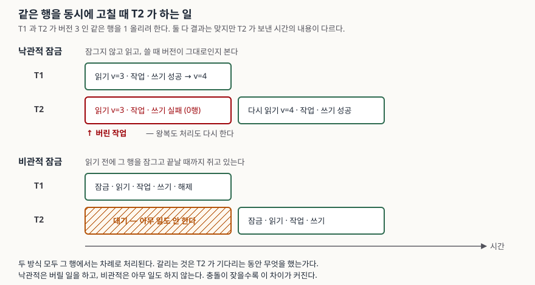

## 들어가며

재고 하나를 여러 요청이 동시에 깎는 화면을 만들어 본 사람은 어느 날 재고가 음수가 되거나,
분명 열 번 팔렸는데 재고는 한 번만 줄어 있는 것을 본다. 그러면 보통 둘 중 하나를 고른다.
행을 미리 잠가 두고 한 명씩 들여보내거나(비관적), 일단 각자 하게 두고 쓸 때 "그 사이
남이 안 고쳤는지"만 확인하는 것(낙관적)이다.

고를 때 흔히 쓰는 기준은 "충돌이 적으면 낙관적, 잦으면 비관적"이다. 그런데 이 기준은
**무엇이 역전되는지를 말하지 않는다.** 충돌률이 올라가면 정확히 무엇이 나빠지는지를 모르면,
운영에서 느려졌을 때 어느 쪽을 의심해야 할지도 모른다. 그래서 충돌률을 0%에서 100%까지
올려 가며 두 방식을 같은 작업량으로 재 봤다.

결과는 예상과 달랐다. **처리 시간은 거의 안 갈렸다.**

## 개념

두 방식 모두 막으려는 것은 하나다. **갱신 유실(lost update)** — 읽은 값을 들고 있는
사이에 남이 먼저 고쳐 놓으면, 내가 쓰는 순간 그 변경이 덮인다.

- **비관적 잠금**은 읽기 전에 그 행을 잠근다. SQL로는 `SELECT ... FOR UPDATE` 다.
  PostgreSQL 문서는 이 구문이 건 잠금에 대해, 같은 행을 건드리려는 다른 트랜잭션은
  현재 트랜잭션이 끝날 때까지 **차단된다**고 적는다.
- **낙관적 잠금**은 잠그지 않는다. 대신 행마다 버전을 두고, 쓸 때
  `UPDATE ... WHERE id = ? AND version = ?` 로 조건을 건다. 그 사이 남이 고쳤으면
  버전이 달라져 **0행이 갱신되고**, 그걸 충돌로 보고 처음부터 다시 한다.
  Jakarta Persistence 명세는 이것을 "엔티티 상태를 읽은 뒤 중간에 다른 트랜잭션이
  그 데이터를 갱신하지 않았을 때만" 갱신이 이뤄지게 하는 것으로 정의하고, 어긋나면
  `OptimisticLockException`을 던진다고 적는다.

낙관적이라는 이름은 1981년 Kung과 Robinson이 붙였다. 잠그는 대신 **일단 하고 나중에
검증한 뒤, 틀렸으면 되돌린다**는 접근이라 그렇게 불렀다.

## 구조



> **출처**: [PostgreSQL 16 Documentation §13.3.2 Row-Level Locks](https://www.postgresql.org/docs/16/explicit-locking.html#LOCKING-ROWS), [Jakarta Persistence 3.1 §3.4.1 Optimistic Locking, §3.4.2 Version Attributes](https://jakarta.ee/specifications/persistence/3.1/jakarta-persistence-spec-3.1.html), [H.T. Kung, J.T. Robinson, "On Optimistic Methods for Concurrency Control", ACM TODS 6(2), 1981](https://www.eecs.harvard.edu/~htk/publication/1981-tods-kung-robinson.pdf)

도식에서 중요한 것은 **T1의 줄이 아니라 T2의 줄**이다. 두 방식 모두 그 행에서는 차례로
처리되므로 T1이 끝나는 시각은 같다. 다른 것은 T2가 그동안 무엇을 했는가다. 비관적
잠금에서 T2는 아무 일도 하지 않고, 낙관적 잠금에서 T2는 **버릴 일을 한다.**

## 동작 원리

이 차이가 숫자로 어떻게 나오는지 재려면 두 가지를 맞춰야 한다. 첫째, **두 방식이 똑같은
작업 목록을 받아야 한다** — 어느 작업자가 몇 번째에 어느 행을 건드리는지를 난수 시드로
고정해 두 번 쓴다. 둘째, **성공해야 하는 갱신 수가 어느 조건에서나 같아야 한다.**
충돌이 잦아진다고 해야 할 일이 줄지는 않기 때문이다.

측정은 작업자 16명이 각자 40회씩, 합쳐 640회의 갱신을 성공시키는 것으로 맞췄다.
핫 로우 비율은 그 640회 중 몇 %가 한 행으로 몰리는지다. 읽기와 쓰기 사이에는 2밀리초를
두어 DB 왕복과 애플리케이션 처리에 해당하는 시간을 만들었다.

> 이 예제는 DB 벤치마크가 아니다. 두 방식의 **비용 구조**만 떼어 내 재는 모형이고,
> 저장소는 프로세스 안의 배열이다. 벽시계 수치는 이 기계의 것이고, 기대야 할 것은
> 재시도 횟수와 헛시도 횟수다.

## 실습 예제

전체 소스: [`code/`](code/) · 실행 기록: [`code/output.txt`](code/output.txt)

먼저 아무것도 안 하면 무엇을 잃는지부터 봤다.

```text
  모든 작업자가 0번 행만 640회 올리도록 시켰다.
  기대한 값 : 640
  실제 값   : 40
  사라진 갱신: 600회
```

640회를 시켜 40회만 남았다. 작업자 16명이 거의 전부 서로를 덮었다. 두 방식은 이걸 막는다.

그다음이 본론이다. 커넥션이 넉넉할 때(풀 = 스레드 수) 충돌률을 올려 봤다.

```text
     핫 로우 |     낙관 초     비관 초 |     총 시도      헛시도 |     한 건 최대
  --------------------------------------------------------------
       0% |     0.12     0.13 |      775      135 |          4
      10% |     0.20     0.19 |     1093      453 |         24
      25% |     0.42     0.42 |     2082     1442 |         80
      50% |     0.77     0.84 |     4240     3600 |        191
      75% |     1.12     1.24 |     6237     5597 |        179
     100% |     1.47     1.67 |     7837     7197 |        213
```

**처리 시간이 역전되지 않는다.** 100% 충돌에서도 낙관적 쪽이 1.47초로 오히려 조금 빠르다.
"충돌이 잦으면 비관적이 낫다"를 벽시계로 확인하려 했는데 안 나온 것이다.

이유는 도식 그대로다. 핫 로우에서는 **두 방식 다 차례로 처리된다.** 비관적 쪽은 잠금이
줄을 세우고, 낙관적 쪽은 16명이 동시에 읽고 일하다가 매번 한 명만 성공한다. 어느 쪽이든
그 행의 갱신은 2밀리초에 하나씩 나오므로 총 시간이 같은 곳으로 수렴한다.

갈리는 것은 같은 줄의 오른쪽에 있다. 100% 충돌에서 낙관적 쪽은 640회를 성공시키려고
**7,837번 읽고 일하고 썼다.** 그중 7,197번은 버렸다. 성공 한 건당 12번을 시도한 셈이다.

꼬리를 보면 더 분명하다.

```text
     핫 로우 |     중앙값     p95      최대 |        비관 대기 중앙값       비관 대기 최대
  --------------------------------------------------------------------
       0% |       1       2       6 |            0.0ms          6.1ms
      10% |       1       6      21 |            0.0ms         25.7ms
      25% |       1      18      58 |            0.0ms         36.9ms
      50% |       1      43     157 |           13.0ms         40.4ms
      75% |       1      51     145 |           36.6ms         41.1ms
     100% |       3      57     251 |           39.3ms         40.6ms
```

낙관적 쪽의 **중앙값은 끝까지 1~3회**다. 대부분의 요청은 한 번에 끝난다. 그런데 p95는
57회, 최대는 251회다. 251회면 이 조건에서 0.5초다. 반면 비관적 쪽의 대기는 충돌률이
올라가도 **최대 41밀리초에서 더 안 올라간다.** 잠금 대기는 앞에 선 사람 수만큼이라
상한이 있고, 재시도는 운이 나쁘면 계속 밀린다.

이것이 두 방식의 진짜 차이다. **평균은 낙관적이 좋고, 꼬리는 비관적이 좋다.**

그러면 벽시계로 역전이 보이는 조건은 없을까. 재시도가 자원을 먹게 하면 보인다.
커넥션 풀을 4로 좁혀 같은 작업을 돌렸다.

```text
     핫 로우 |     낙관 초     비관 초 |     빠른 쪽 |     총 시도
  --------------------------------------------------------
       0% |     0.44     0.42 |       비슷 |      674
      10% |     0.45     0.43 |       비슷 |      704
      25% |     0.54     0.51 |    비관 5% |      833
      50% |     0.91     0.87 |    비관 4% |     1390
      75% |     1.25     1.24 |       비슷 |     1830
     100% |     1.64     1.68 |       비슷 |     2480
```

25~50% 구간에서 비관적 쪽이 4~5% 빠르다. 폭은 작지만 방향이 뒤집힌다. 헛시도가 커넥션을
붙잡고 있으면, 그 커넥션은 **충돌과 무관한 다른 요청이 쓸 수 있었던 것**이다. 역전은
낙관적 잠금이 느려서 생기는 게 아니라 **남의 몫을 먹어서** 생긴다.

## 실무에서 주의할 점

**1. 재시도 횟수에 상한을 둔다.** 측정에서 한 건이 251번까지 밀렸다. 상한이 없으면 그
요청은 사실상 굶는다. 상한에 닿으면 실패로 돌려주고, 그 비율을 지표로 내보낸다. 재시도가
몇 번째에 성공했는지를 분포로 쌓아 두면 충돌률이 언제 올라갔는지가 보인다.

**2. 재시도 사이에 무작위 지연을 넣는다.** 위 측정은 지연 없이 곧바로 다시 시도한다.
그래서 매번 같은 순간에 모두가 몰려 같은 패턴으로 또 충돌한다. 지수 백오프에 지터를
섞으면 총 시도 횟수가 줄지만 **중앙 지연은 늘어난다.** 공짜는 아니다.

**3. 읽고 쓰는 사이가 길면 낙관적 잠금이 불리하다.** 버리는 것은 재시도 횟수가 아니라
**그 사이에 한 일**이다. 외부 API 호출이나 무거운 계산이 끼어 있으면 한 번의 헛시도가
그만큼 비싸진다. 이때는 그 작업을 트랜잭션 밖으로 빼거나 비관적 잠금으로 간다.

**4. 충돌률은 핫 로우만으로 정해지지 않는다.** 행 수 대비 동시 작업자 수로도 올라간다.
위 예제에서 `ROWS`를 8로 줄이면 핫 로우 0% 줄에서도 충돌이 생긴다. "우리는 쏠림이
없으니 괜찮다"는 판단은 전체 행 수를 같이 봐야 한다.

**5. 두 방식을 섞으면 둘 다 못 지킨다.** 같은 행을 어떤 경로는 `FOR UPDATE`로, 어떤
경로는 버전 비교로 고치면 버전 비교 쪽이 잠금을 보지 않으므로 갱신 유실이 돌아온다.
표 하나에는 방식 하나로 통일한다.

## 정리

- 두 방식 모두 막으려는 것은 갱신 유실 하나다. 잠그고 들어가느냐, 하고 나서 확인하느냐가
  다르다.
- **충돌이 잦아져도 처리 시간은 크게 안 갈린다.** 같은 행이면 어느 쪽이든 차례로
  처리되기 때문이다. "충돌이 많으면 비관적이 빠르다"는 이 측정에서는 안 나왔다.
- 갈리는 것은 **버린 일**이다. 100% 충돌에서 640회를 성공시키는 데 7,837번을 시도했고
  7,197번을 버렸다.
- 그리고 **꼬리**다. 낙관적 쪽은 중앙값 1~3회인데 최대 251회까지 밀리고, 비관적 쪽
  대기는 41밀리초에서 상한이 걸린다. 평균을 볼지 p99를 볼지가 선택의 기준이다.
- 벽시계로 역전이 보이려면 **재시도가 자원을 먹어야 한다.** 커넥션 풀을 좁히자 25~50%
  구간에서 비관적 쪽이 4~5% 빨라졌다.

## 참고 자료

- [H.T. Kung, John T. Robinson, "On Optimistic Methods for Concurrency Control", ACM Transactions on Database Systems 6(2), June 1981, pp. 213–226](https://www.eecs.harvard.edu/~htk/publication/1981-tods-kung-robinson.pdf)
- [PostgreSQL 16 Documentation — §13.3 Explicit Locking, §13.3.2 Row-Level Locks](https://www.postgresql.org/docs/16/explicit-locking.html#LOCKING-ROWS)
- [PostgreSQL 16 Documentation — §13.4 Data Consistency Checks at the Application Level](https://www.postgresql.org/docs/16/applevel-consistency.html)
- [Jakarta Persistence 3.1 Specification — §3.4 Optimistic Locking and Concurrency](https://jakarta.ee/specifications/persistence/3.1/jakarta-persistence-spec-3.1.html)
