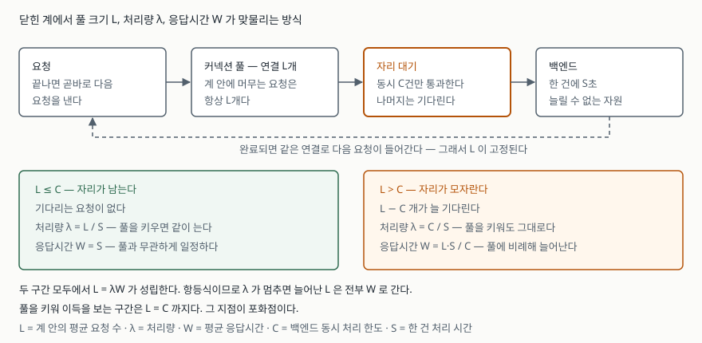
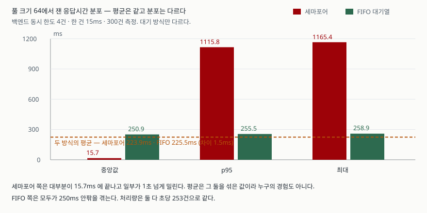

## 들어가며

운영 중인 API가 느려진다는 말이 나왔다. 로그를 보니 DB 조회에서 시간이 쏠린다.
커넥션 풀 설정을 열어 보니 `maximumPoolSize: 10` 이다. 동시 접속자가 수백인데
연결이 열 개뿐이니 여기가 병목이겠거니 싶다. 50으로 올린다.

바뀐 게 없다. 100으로 올린다. 이번엔 응답시간이 더 나빠졌다는 제보가 들어온다.
그래서 다시 내려 보고, 서버를 한 대 늘려 보고, 타임아웃을 조정해 본다.
설정값 하나를 두고 올렸다 내렸다를 반복하는 동안 **몇 이 맞는 값인지 판단할
근거는 한 번도 생기지 않는다.**

근거는 측정하지 않아도 먼저 계산할 수 있다. 1961년에 증명된 공식 하나면 된다.

## 개념

리틀의 법칙은 대기 행렬에 관한 항등식이다. John D. C. Little이 1961년
*Operations Research* 에 실은 증명에서, 계 안에 머무는 단위의 평균 개수는
도착률과 각 단위가 계에 머무는 평균 시간의 곱과 같다는 것이 보여졌다.

$$L = \lambda W$$

- **L** — 계 안에 머무는 평균 요청 수. 커넥션 풀에서는 **사용 중인 연결 수**다
- **λ** — 처리량. 초당 완료되는 요청 수
- **W** — 요청 하나가 계에 머무는 평균 시간. 곧 응답시간이다

중요한 성질이 하나 있다. 이것은 **항등식이지 모델이 아니다.** 어떤 스케줄링을
쓰든, 요청이 어떻게 도착하든 평균들 사이에서 반드시 성립한다. 그래서
**세 값 중 둘을 알면 나머지 하나는 선택의 여지 없이 정해진다.**

여기서 풀 크기 문제의 답이 나온다. 풀을 키운다는 것은 **L을 키우는 것**이다.
그런데 DB가 실제로 동시에 처리할 수 있는 양에는 한계가 있어 λ는 어느 지점부터
더 늘지 않는다. λ가 멈춘 뒤에도 L을 계속 키우면, 항등식이므로 **늘어난 몫은
전부 W로 간다.** 느려지는 것이 부작용이 아니라 등식의 결론이다.

## 구조



> **출처**: Little, J. D. C., [A Proof for the Queuing Formula: L = λW](https://doi.org/10.1287/opre.9.3.383), *Operations Research* 9(3), 1961, pp. 383–387

백엔드가 동시에 C건을 처리하고 한 건에 S초가 걸린다면, 포화 상태의 처리량은
C/S로 고정된다. 풀 크기 L을 그보다 키우면 W = L·S/C 로 늘어난다.
**풀을 키워 이득을 보는 구간은 L = C 까지다.**

## 동작 원리

풀을 키우면 왜 λ가 안 느는지는 한 겹 더 들어가야 보인다. 연결은 **요청을 처리할
권한이 아니라 요청을 제출할 권한**이다. 연결을 100개 열어도 DB 서버의 CPU 코어
수와 디스크 대역은 그대로다. 101번째 쿼리는 100번째가 끝나야 CPU를 받는다.

그래서 풀을 키우면 대기가 **풀 바깥에서 풀 안쪽으로 옮겨 갈 뿐이다.** 풀이 작으면
요청은 "연결을 못 받아서" 애플리케이션 쪽에서 기다린다. 풀이 크면 연결은 즉시
받지만 "DB가 바빠서" DB 쪽에서 기다린다. 어느 쪽이든 기다리는 시간의 총합은
λ가 정해 버린다. **옮겨 간 대기는 줄어든 대기가 아니다.**

## 실습 예제

백엔드가 동시에 4건까지만 처리하도록 막아 두고, 풀 크기만 1에서 64까지 바꿔 가며
같은 300건을 처리시켰다. 한 건은 15ms가 걸리므로 이론상 최대 처리량은 267건/초다.
전체 소스는 [`code/`](code/)에 있고, 아래 출력은 돌린 기록인
[`code/output.txt`](code/output.txt)에서 가져왔다.

```python
CAPACITY = 4              # 백엔드가 실제로 동시에 처리할 수 있는 건수
SERVICE_TIME = 0.015      # 한 건을 처리하는 데 드는 시간(초)
JOBS_PER_RUN = 300
POOL_SIZES = [1, 2, 4, 8, 16, 32, 64]
```

풀 크기만 바꾼 결과다.

```text
  풀 크기 | 처리량(건/초) | 평균(ms) | 중앙값(ms) | p95(ms) | 최대(ms)
  --------------------------------------------------------------------
        1 |          64.0 |     15.6 |       15.6 |    15.9 |     16.2
        2 |         127.2 |     15.7 |       15.6 |    16.2 |     22.1
        4 |         255.9 |     15.6 |       15.6 |    15.9 |     16.8
        8 |         252.7 |     31.1 |       15.6 |    16.4 |   1183.9
       16 |         251.6 |     61.5 |       15.6 |    17.4 |   1187.8
       32 |         252.0 |    119.2 |       15.6 |  1122.1 |   1182.0
       64 |         253.6 |    223.9 |       15.7 |  1115.8 |   1165.4
```

**풀 4에서 이미 끝났다.** 처리량은 256건/초로 올라간 뒤 64까지 가도 그대로고,
평균 응답시간만 15.6ms에서 223.9ms로 14.4배가 됐다. 풀을 16배 키워 얻은 것은
0.99배의 처리량이다.

항등식이 맞는지 검산한다. 워커가 쉬지 않고 요청을 던지는 닫힌 계라서 L은 항상
풀 크기와 같아야 한다.

```text
  풀 크기 | L = λ × W | 풀 크기 대비 오차
  --------------------------------------------
        1 |      1.00 |             -0.3%
        4 |      3.99 |             -0.3%
       16 |     15.48 |             -3.2%
       64 |     56.80 |            -11.3%
```

맞는다. 풀 64에서 오차가 11%까지 벌어지는 것은 측정 구간 양 끝에서 워커가
채워지고 빠지는 동안 L이 잠깐 풀 크기보다 작기 때문이다.

### 예상과 달랐던 것 — 평균이 아무도 겪지 않는 값이었다

표를 다시 보면 이상한 자리가 있다. **풀 8에서 평균은 31.1ms인데 중앙값은
15.6ms고 최대는 1,183.9ms다.** p95(16.4ms)가 평균보다 작다. 평균이 분포의
가운데가 아니라는 뜻이다.

대기 순서를 의심했다. 파이썬의 `threading.Semaphore`는 자리 수만 셀 뿐
**기다리던 것 중 누구를 깨울지 정해 두지 않는다.** 같은 조건에서 대기 방식만
먼저 온 쪽이 먼저 들어가는 FIFO 대기열로 바꿔 다시 쟀다.

```text
  풀 크기 | 평균 차이(ms) | 세마포어 중앙값 | FIFO 중앙값 | 세마포어 최대 | FIFO 최대
  ----------------------------------------------------------------------------------------
        4 |          -0.0 |            15.6 |        15.6 |          16.8 |      16.5
        8 |          +0.0 |            15.6 |        31.3 |        1183.9 |      35.7
       16 |          +0.2 |            15.6 |        62.5 |        1187.8 |      66.6
       64 |          -1.5 |            15.7 |       250.9 |        1165.4 |     258.9
```



> **출처**: 이 글의 실행 기록 [`code/output.txt`](code/output.txt) — 풀 크기 64, 300건 측정

**평균은 1.5ms 안에서 같고 처리량도 같은데, 분포가 전혀 다르다.** 세마포어 쪽은
대부분이 15.7ms에 끝나고 일부가 1초 넘게 밀렸다. FIFO 쪽은 모두가 250ms 안팎을
고르게 겪었다.

리틀의 법칙은 두 경우 모두에서 똑같이 성립한다. 항등식이니 그럴 수밖에 없다.
**법칙이 보장하는 것은 평균뿐이고, 그 평균이 누구의 경험인지는 보장하지 않는다.**
풀을 키울 때 커진 W가 모두에게 조금씩 나뉠지 소수에게 몰릴지는 대기 순서가
정하는 별개의 문제다.

## 실무에서 주의할 점

**풀 크기를 동시 접속자 수에 맞추지 않는다.** 맞춰야 할 것은 백엔드가 실제로
동시에 처리할 수 있는 양이다. 접속자가 1,000명이어도 DB가 동시에 8건을 처리한다면
연결 1,000개는 992개의 대기열을 DB 안에 만드는 것일 뿐이다.

**포화점은 계산보다 측정으로 찾는다.** C(동시 처리 한도)는 코어 수만으로 정해지지
않는다. 디스크, 락 경합, 쿼리 종류가 모두 들어간다. 풀 크기를 2배씩 올리며
처리량을 재고, **처리량이 더 안 늘기 시작하는 첫 지점**을 쓴다. 이 글의 측정에서는
최대 처리량의 95%에 닿은 가장 작은 풀이 곧 백엔드 한도와 같았다.

**평균 응답시간만 보고 판단하지 않는다.** 위 측정에서 평균만 봤다면 두 대기 방식을
구분할 수 없었다. 최소한 중앙값과 p99를 함께 본다. 평균과 중앙값이 벌어져 있으면
그 자체가 **일부 요청이 굶고 있다는 신호**다.

**풀을 작게 잡는 대신 대기 타임아웃을 반드시 건다.** 풀이 작으면 연결을 못 받은
요청이 애플리케이션에서 기다린다. 이때 대기 시간을 무한으로 두면 장애가 났을 때
요청이 쌓여 스레드가 고갈된다. 연결 획득 타임아웃을 짧게 걸고, 초과분은
빨리 실패시키는 쪽이 전체가 멈추는 것보다 낫다.

**읽기와 쓰기를 한 풀에 섞어 쓸 때를 조심한다.** 짧은 조회와 긴 배치가 같은 풀을
쓰면 긴 쪽이 연결을 오래 쥐고 있어 짧은 쪽의 W가 함께 늘어난다. 용도별로 풀을
나누면 한쪽의 지연이 다른 쪽으로 번지지 않는다.

## 정리

- 리틀의 법칙 `L = λW`는 모델이 아니라 항등식이다. 셋 중 둘이 정해지면 나머지는 따라 정해진다.
- 풀을 키우는 것은 L을 키우는 것이다. 백엔드가 포화해 λ가 멈추면 늘어난 L은 전부 W로 간다.
- 측정에서 풀 4가 포화점이었고, 64까지 키웠을 때 처리량은 0.99배, 평균 응답시간은 14.4배가 됐다.
- 같은 평균·같은 처리량에서도 대기 순서에 따라 분포가 갈렸다. 세마포어는 중앙값 15.7ms에 최대 1,165ms, FIFO는 중앙값 250.9ms에 최대 258.9ms였다.
- 평균과 중앙값이 벌어져 있으면 일부 요청이 굶고 있다는 뜻이다. 평균 하나로 풀 크기를 판단하지 않는다.

## 참고 자료

- Little, J. D. C., [A Proof for the Queuing Formula: L = λW](https://doi.org/10.1287/opre.9.3.383), *Operations Research* 9(3), 1961, pp. 383–387
- Little, J. D. C., [Little's Law as Viewed on Its 50th Anniversary](https://doi.org/10.1287/opre.1110.0940), *Operations Research* 59(3), 2011, pp. 536–549
- Python 공식 문서, [`threading.Semaphore`](https://docs.python.org/3/library/threading.html#semaphore-objects)
- Python 공식 문서, [`concurrent.futures.ThreadPoolExecutor`](https://docs.python.org/3/library/concurrent.futures.html#threadpoolexecutor)
