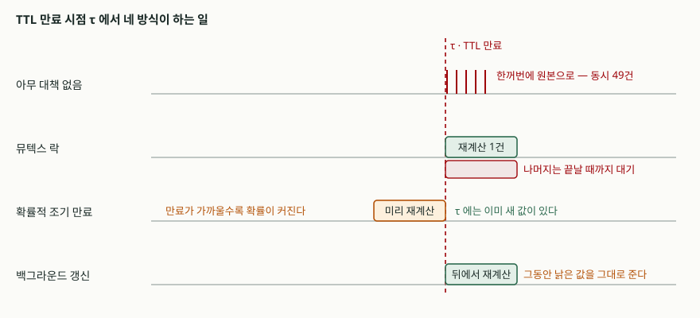

## 들어가며

인기 상품 목록을 10초짜리 TTL 캐시에 올려 두었다. 평소에는 초당 50건이 전부
캐시에서 나가고 원본은 10초에 한 번만 불린다. 그런데 배포 직후나 트래픽이 몰린
시간대에 DB 커넥션 풀이 갑자기 바닥나고, 그래프를 보면 10초마다 뾰족한 봉우리가
선다.

원인은 **TTL이 만료되는 그 한순간**이다. 캐시가 비는 동시에 그 틈으로 들어온 요청이
전부 "없으니 내가 만들자"로 갈라져 원본을 동시에 때린다. 흔한 대응은 TTL을 늘리는
것인데, 이건 봉우리의 간격만 벌릴 뿐 높이는 그대로다. 봉우리를 낮추려면 만료
순간에 무엇이 일어나는지를 손봐야 한다.

## 개념

캐시 스탬피드(cache stampede)는 하나의 캐시 항목이 만료되는 순간, 그 값을 읽으려던
요청들이 동시에 재계산으로 몰리는 현상이다. 재계산에 Δ 밀리초가 걸리고 초당 n건이
들어오면, 그 Δ 동안 들어온 **n×Δ 건이 전부 같은 계산을 중복**한다. 캐시가 없을
때보다 느려지기도 한다. 원본이 그만큼의 동시 접속을 감당해야 하기 때문이다.

막는 방법은 크게 셋이다.

- **뮤텍스 락** — 하나만 재계산하게 하고 나머지는 결과를 기다린다
- **확률적 조기 만료** — 각 요청이 독립적으로 "조금 일찍 다시 만들까"를 확률로 정해,
  만료 시점에 몰리는 것 자체를 흩는다
- **백그라운드 갱신** — 만료돼도 낡은 값을 바로 돌려주고, 갱신은 뒤에서 따로 한다

## 구조



> **출처**: [A. Vattani, F. Chierichetti, K. Lowenstein, "Optimal Probabilistic Cache Stampede Prevention", PVLDB 8(8), 2015 — §5 Implementation Notes, Figure 3](https://www.vldb.org/pvldb/vol8/p886-vattani.pdf), [RFC 5861 §3 The stale-while-revalidate Cache-Control Extension](https://www.rfc-editor.org/rfc/rfc5861.html#section-3)

## 동작 원리

**확률적 조기 만료**의 구현은 한 줄이다. VLDB 2015 논문이 XFetch 라는 이름으로 제시한
판정식은 다음과 같다.

```text
value, Δ, expiry ← CacheRead(key)
if !value or Time() − Δ·β·log(rand()) ≥ expiry then
    재계산
```

`rand()`는 (0,1] 균등난수이므로 `log(rand())`는 음수고, 빼면 **현재 시각을 미래로
밀어 보는 효과**가 난다. 밀어 본 시각이 만료 시각을 넘으면 지금 다시 만든다.
밀어 보는 폭은 지수분포를 따르므로, 만료가 가까울수록 재계산할 확률이 커지되
어느 한 시점에 몰리지 않는다. 폭에 Δ(지난번 재계산에 걸린 시간)가 곱해져 있는 것이
핵심이다. **비싼 항목일수록 더 일찍 손을 댄다.**

논문은 조기 만료를 균등분포로 구현하는 방식(펄의 CHI 모듈 등)과 비교해 지수분포가
스탬피드 크기와 "얼마나 일찍 만료되는가" 양쪽에서 더 낫고, 그 점에서 최적임을
보인다. β는 기본값 1로 두면 되고, 조기 만료가 더 당겨져도 괜찮은 항목이면 키운다.

**백그라운드 갱신**은 HTTP 쪽 규약에 이미 이름이 있다. `stale-while-revalidate`
확장은 캐시가 재검증하는 동안 낡은 응답을 **막지 않고(without blocking)** 계속
제공하도록 한다. 애플리케이션 캐시에서도 같은 모양을 쓸 수 있다.

## 실습 예제

네 방식에 **같은 요청열**을 먹여 비교했다. 2분 동안 평균 20ms 간격(초당 50건)으로
6,062건이 들어오고, TTL은 10초, 재계산은 800ms다. 스레드 경합에 흔들리지 않도록
가상 시계로 도는 이산 사건 모의로 만들었고 시드를 고정했다.

전체 소스: [`code/`](code/) · 실행 기록: [`code/output.txt`](code/output.txt)

```text
방식                                    재계산      최대동시      대기요청      평균대기ms     낡은값     무대기%
-----------------------------------------------------------------------------------------
아무 대책 없음                              444        49       444       800.0       0   92.68%
뮤텍스 락                                  12         1       467       404.4       0   92.30%
확률적 조기 만료 (XFetch)                     16         1        31       430.6       0   99.49%
백그라운드 갱신 (stale-while-revalidate)      12         1         1       800.0     466   99.98%
```

예상과 달랐던 것은 **뮤텍스 락의 대기 요청이 아무 대책 없는 쪽보다 많았다**는
점이다(467건 대 444건). 락은 원본 호출을 444회에서 12회로 줄였으니 분명히 효과가
있다. 그런데 줄어든 것은 **원본의 부하**이지 **사용자가 기다리는 횟수**가 아니다.
락이 없을 때는 각자 800ms를 들여 자기 몫을 계산하고, 락이 있을 때는 한 명이 계산하는
동안 나머지가 줄을 선다. 줄을 서는 사람 수는 오히려 조금 늘었고, 평균 대기만
800ms에서 404ms로 줄었다. 중간에 끼어든 요청은 남은 시간만 기다리면 되기 때문이다.

대기 자체를 줄인 것은 다른 둘이다. **XFetch는 재계산을 12회가 아니라 16회 썼다.**
4회를 더 쓰는 대신 대기 요청이 467건에서 31건으로 줄었다. 만료 전에 미리 만들어
두므로 만료 시점에 기다릴 이유가 없어진다. 원본 호출 4회와 대기 436건을 맞바꾼 셈이다.

**백그라운드 갱신은 대기를 1건(최초 적재)까지 없앴지만, 466건이 낡은 값을 받았다.**
재계산 12회 × 800ms 동안 들어온 요청이 전부 만료된 값을 보고 간 것이다. 공짜로
얻은 것이 아니라 **신선도를 지불한 결과**다.

## 실무에서 주의할 점

**락의 범위를 캐시 키 단위로 잡는다.** 전역 락 하나로 묶으면 서로 다른 키의 재계산이
서로를 기다린다. Redis 라면 `SET key value NX PX <락 TTL>` 처럼 키마다 다른 락을 쓰고,
락 TTL은 재계산 최대 시간보다 넉넉히 잡는다. 짧게 잡으면 계산이 끝나기 전에 락이
풀려 두 번째 스탬피드가 난다.

**기다리는 쪽의 타임아웃을 반드시 둔다.** 락을 쥔 프로세스가 죽으면 나머지는 락
TTL이 끝날 때까지 전부 붙들린다. 위 표에서 평균 대기 404ms가 재계산 시간에 묶여
있는 것처럼, 대기는 곧 스레드 점유다. 대기 상한을 넘기면 원본을 직접 치든 낡은 값을
주든 빠져나갈 길을 만든다.

**조기 만료는 TTL을 야금야금 당긴다.** XFetch가 만료 전에 다시 만들면 새 값의 만료
시각은 그 시점에서 다시 TTL만큼 뒤가 된다. 그대로 두면 재계산 주기가 TTL보다 계속
짧아진다. 논문도 이 점을 짚어 캐시에 쓰기 직전에 `ttl ← ttl + (expiry − Time())`
으로 남은 시간을 되돌려 주라고 적는다. 위 예제는 이 보정을 넣지 않았고, 그래서
재계산 주기가 조금씩 당겨져 12회가 아닌 16회가 나왔다.

**낡은 값을 줘도 되는 항목인지 먼저 가른다.** 상품 목록이나 추천은 몇 초 낡아도
되지만, 재고 수량이나 잔액은 그렇지 않다. 같은 서비스 안에서도 항목마다 답이
다르므로, 캐시 계층에 전역 정책 하나를 깔고 끝내지 않는다.

**Δ를 값과 함께 저장한다.** XFetch 판정식에 들어가는 Δ는 "지난번 재계산이 실제로
걸린 시간"이다. 상수로 박아 두면 원본이 느려졌을 때 그만큼 더 일찍 손대는 성질이
사라진다. 재계산할 때마다 측정해 값과 같이 써 둔다.

## 정리

- 스탬피드의 크기는 요청률 × 재계산 시간이다. 위 조건에서 최대 동시 재계산이 49건까지
  올랐다.
- 뮤텍스 락은 **원본 부하**를 444회에서 12회로 줄이지만 **대기 횟수**는 줄이지 않는다.
  오히려 467건으로 늘었고 평균 대기만 절반이 됐다.
- 확률적 조기 만료는 재계산을 16회 쓰는 값으로 대기를 31건까지 줄였다. 판정식 한 줄로
  끝나고 β 기본값 1이면 별도 조율이 필요 없다.
- 백그라운드 갱신은 대기를 사실상 없애지만 466건이 낡은 값을 받았다. 신선도와 맞바꾼 것이다.
- 세 방식은 배타적이지 않다. 조기 만료로 몰림을 흩고, 그래도 겹치면 락으로 하나만
  통과시키는 조합이 실무에서 흔하다.

## 참고 자료

- [A. Vattani, F. Chierichetti, K. Lowenstein, "Optimal Probabilistic Cache Stampede Prevention", Proceedings of the VLDB Endowment 8(8), 2015](https://www.vldb.org/pvldb/vol8/p886-vattani.pdf)
- [RFC 5861 — HTTP Cache-Control Extensions for Stale Content (M. Nottingham, 2010)](https://www.rfc-editor.org/rfc/rfc5861.html)
- [Redis — SET 명령의 NX·PX 옵션](https://redis.io/docs/latest/commands/set/)
