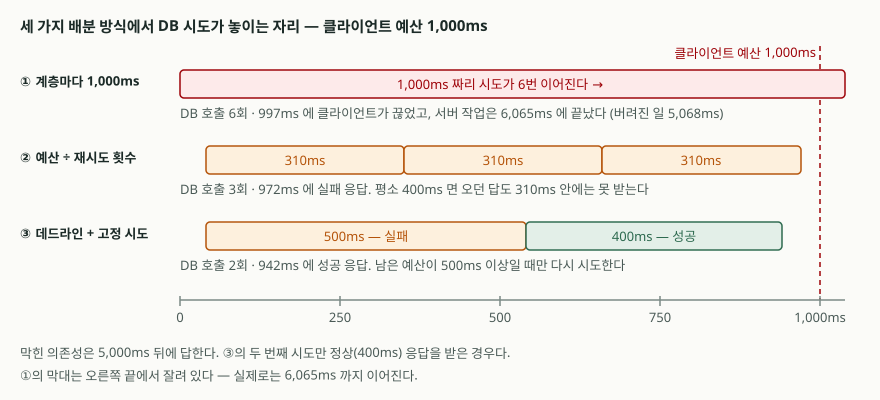

## 들어가며

장애 하나를 복기한다. 결제 조회 API가 느려졌다는 신고가 들어왔고, 클라이언트
로그에는 `read timeout` 한 줄이 1초 간격으로 쌓여 있다. 서버 로그를 열어 보면
에러가 없다. 느린 요청이 있긴 한데 전부 정상 응답으로 끝나 있다.

이럴 때 보통은 타임아웃을 늘린다. 1초가 모자란 것 같으니 3초로 올린다. 그리고
혹시 모르니 재시도도 넣는다. 둘 다 한 줄짜리 수정이고, 둘 다 설정 파일에 있다.

그런데 이 수정은 **부하를 늘린다.** 재시도를 API 계층과 서비스 계층 두 곳에
넣으면 바닥까지 내려가는 호출은 2 × 3 = 6회가 된다. 장애가 난 의존성에 평소의
여섯 배를 보내는 셈이다. 더 나쁜 것은 그 호출의 대부분이 **아무도 기다리지 않는
일**이라는 점인데, 이건 로그만 봐서는 보이지 않는다.

## 개념

**타임아웃 예산**(timeout budget)은 "이 요청 전체에 몇 ms를 쓸 수 있는가"를
맨 바깥에서 한 번 정하고, 그 값을 계층을 따라 내려보내는 방식이다. 각 계층은
자기가 쓴 시간을 빼고 남은 것만 아래로 넘긴다.

타임아웃과 데드라인은 적는 방식이 다르다. **타임아웃은 상대 시간**(`1000ms
기다린다`)이고 **데드라인은 절대 시각**(`23:18:04.120까지`)이다. 계층을 넘어갈 때
의미가 유지되는 쪽은 데드라인이다. 1000ms를 그대로 넘겨주면 받는 쪽은 자기가
1000ms를 새로 쓸 수 있다고 읽는다.

gRPC는 이것을 프로토콜 수준에서 다룬다. 다만 시계가 서버마다 조금씩 다르므로
절대 시각을 그대로 보내지 않고, **이미 지난 시간을 뺀 나머지를 타임아웃으로**
환산해 보낸다.

## 구조



> **출처**: 막대 위치와 숫자는 실행 기록 [`code/output.txt`](code/output.txt) 의 측정값. 데드라인 전파 방식은 [gRPC — Deadlines](https://grpc.io/docs/guides/deadlines/)

## 동작 원리

API → 서비스 → DB 세 계층을 만들고, 의존성 하나가 막힌 상황(응답이 5,000ms 뒤에
온다)을 재현했다. 클라이언트는 1,000ms만 기다린다.

보고 싶은 것은 로그에 안 남는 값이다. 서버 작업을 스레드로 띄우고, 클라이언트가
손을 뗀 시각과 그 작업이 실제로 끝난 시각을 따로 잰다. 둘의 차이가 **버려진
일**이다.

```python
future = pool.submit(server_call, ...)
try:
    future.result(timeout=CLIENT_BUDGET_MS / 1000)
except TimeoutError:
    pass                      # 클라이언트는 여기서 손을 뗀다
client_ms = (time.monotonic() - started) * 1000

future.result()               # 서버 작업은 아직 돌고 있다
server_ms = (time.monotonic() - started) * 1000
```

이 구간이 왜 그냥 사라지지 않느냐면, 클라이언트가 연결을 끊어도 **그 요청을 처리하려고
서버가 띄운 작업을 멈추는 것은 애플리케이션의 몫**이기 때문이다. gRPC 문서도 취소가
전달되는 것과 별개로 이 정리 책임을 서버 쪽에 둔다고 적는다.

## 실습 예제

전체 소스: [`code/`](code/) · 실행 기록: [`code/output.txt`](code/output.txt)

| 배분 방식 | 재시도 | DB 호출 | 클라이언트 | 서버 작업 종료 | 버려진 일 |
|---|---|---:|---|---:|---:|
| 계층마다 1,000ms | API 2 × 서비스 3 | 6회 | 997ms에 끊음 | 6,065ms | 5,068ms |
| 계층마다 1,000ms | 서비스 3 | 3회 | 1,014ms에 끊음 | 3,044ms | 2,031ms |
| 예산 ÷ 재시도 | 서비스 3 (310ms씩) | 3회 | 975ms에 실패 응답 | 975ms | 0ms |
| 예산 ÷ 재시도 | API 2 × 서비스 3 (151ms씩) | 6회 | 973ms에 실패 응답 | 973ms | 0ms |
| 데드라인 + 고정 시도 | 남으면 재시도 (500ms씩) | 2회 | 971ms에 실패 응답 | 971ms | 0ms |

첫 줄이 서두의 상황이다. 클라이언트는 997ms에 끊었는데 서버는 **6,065ms까지**
돌았다. 그 5,068ms 동안 막힌 의존성에 계속 요청을 보낸다. 클라이언트 로그에는
타임아웃 한 줄만 남고, 서버 로그에는 느린 요청 하나가 남는다. 둘 다 사실이지만
둘 다 이 숫자를 보여 주지 않는다.

예산을 쪼개면 **버려진 일이 0이 된다.** 서버가 자기 예산 안에서 스스로 포기하고
실패 응답을 돌려보내기 때문이다. 클라이언트도 "응답 없음"이 아니라 "실패"를 받으므로
재시도 여부를 판단할 근거가 생긴다.

### 예상과 달랐던 것

예산을 재시도 횟수로 나누는 방식이 그대로 답이 되지는 않았다. 의존성이 **멀쩡한**
상태로 같은 설정을 돌려 봤다.

```text
[의존성이 멀쩡할 때 (400ms 면 답이 온다)]
  설정  API 타임아웃 970ms · 재시도 API 2회 × 서비스 3회 · DB 응답 400ms
  클라이언트     975ms — 서버가 돌려준 실패 응답을 받았다
  DB 호출     6회
```

평소 400ms면 오던 응답이 **실패로 떨어졌다.** 970ms를 2회 × 3회로 나누면 한 번
시도에 151ms가 돌아가는데, 400ms짜리 응답이 151ms 안에 올 리가 없다. 재시도를
서비스 한 곳으로 모아 310ms씩 줘도 마찬가지로 실패했다.

예산을 미리 나누면 **장애 대비가 평소 성공률을 깎는다.** 재시도를 늘릴수록 한 번
시도의 몫이 줄고, 그만큼 정상 응답도 잘려 나간다.

그래서 나누는 대신 이렇게 바꿨다. 한 번 시도에 주는 시간은 **평소 걸리는 시간에
여유를 더한 값으로 고정**하고(400 + 100 = 500ms), 남은 예산이 그만큼 있을 때만
다시 시도한다.

```python
while True:
    remaining_ms = int((deadline - time.monotonic()) * 1000)
    if remaining_ms < MIN_ATTEMPT_MS:
        break
    try:
        return inner(min(attempt_ms, remaining_ms))
    except LayerTimeout as exc:
        last = exc
raise LayerTimeout("남은 예산이 없어 포기") from last
```

첫 호출만 막히고 그다음부터 정상인 상황에서 두 방식을 나란히 돌리면 결과가 갈린다.

| 배분 방식 | DB 호출 | 결과 |
|---|---:|---|
| 데드라인 + 고정 500ms | 2회 | 942ms에 **성공 응답** |
| 예산 ÷ 재시도 (310ms씩) | 3회 | 972ms에 실패 응답 |

같은 1,000ms 예산, 같은 의존성인데 한쪽만 성공했다. 310ms씩 세 번 두드리는 것보다
500ms씩 두 번 두드리는 쪽이 **답을 받을 수 있는 시도**였기 때문이다.

## 실무에서 주의할 점

**재시도는 한 계층에서만 한다.** 계층마다 재시도를 넣으면 바닥 호출이 곱으로
늘어난다. 위 측정에서 2회 × 3회는 6회였다. 계층이 넷이면 사람이 암산으로 셀 수
없는 수가 된다. 재시도를 넣을 계층 하나를 정하고 나머지는 받은 실패를 그대로
위로 올린다.

**한 번 시도의 예산은 재시도 횟수가 아니라 정상 응답 시간에서 정한다.** 예산을
`남은 시간 ÷ 재시도 횟수`로 나누면 재시도를 늘릴수록 평소 성공률이 떨어진다.
`p99 응답 시간 + 여유`로 고정하고, 그만큼이 안 남으면 재시도하지 않는 쪽이 맞다.

**예산을 전부 쓰지 않는다.** 서버가 데드라인까지 꽉 채워 쓰면 실패 응답을
돌려보낼 시간이 없어 클라이언트는 결국 "응답 없음"을 본다. 예제에서는 1,000ms
중 30ms를 떼어 두고 970ms로 시작했다. 떼어 두는 만큼이 **실패를 실패로 알릴 수
있는 시간**이다.

**타임아웃이 아니라 데드라인을 넘긴다.** 계층 경계에서 `1000ms` 같은 상대 시간을
그대로 넘기면 받는 쪽은 그 시간을 새로 쓴다. 넘겨야 할 것은 "언제까지"다. 다만
시계가 서버마다 다르므로, gRPC처럼 **지난 시간을 뺀 나머지**를 상대 시간으로
환산해 보내는 방식이 안전하다.

**클라이언트가 끊어도 서버는 안 멈춘다.** 연결이 끊긴 것을 서버가 알아차리고
작업을 접도록 **직접 짜 넣어야** 한다. Go라면 `context.Context`를 I/O 호출까지
내려보내고, 자바라면 각 단계에서 취소 플래그를 확인한다. 이걸 안 하면 위
측정의 5,068ms가 요청마다 그대로 쌓인다.

## 정리

- 계층마다 같은 타임아웃을 주면 클라이언트가 끊은 뒤에도 서버가 계속 돈다.
  측정에서는 997ms에 끊고 6,065ms에 끝났다 — 5,068ms가 버려진 일이다.
- 재시도를 두 계층에 넣으면 바닥 호출이 곱으로 늘어난다(2 × 3 = 6회).
  재시도는 한 계층에서만 한다.
- 예산을 계층마다 쪼개 내려보내면 버려진 일이 0이 되고, 클라이언트는 "응답 없음"
  대신 실패 응답을 받는다.
- 다만 **예산을 재시도 횟수로 나누면 안 된다.** 평소 400ms면 오던 응답이 151ms
  예산에 걸려 실패했다. 한 번 시도의 몫은 정상 응답 시간에서 정한다.
- 예산의 일부는 실패를 알리는 데 남겨 둔다. 그리고 취소를 실제로 전파하는 코드는
  직접 써야 한다.

## 참고 자료

- [gRPC — Deadlines](https://grpc.io/docs/guides/deadlines/)
- [Go — context 패키지](https://pkg.go.dev/context)
- [Google SRE Book — Addressing Cascading Failures](https://sre.google/sre-book/addressing-cascading-failures/)
- [Python — concurrent.futures](https://docs.python.org/3/library/concurrent.futures.html)
