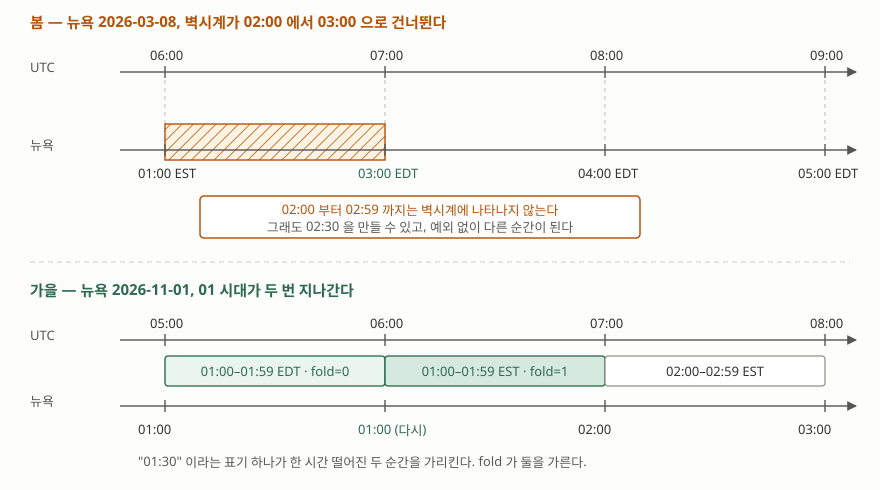

## 들어가며

예약 기능이 있는 서비스를 만들면 시각을 어딘가에 적어 두게 된다. 대개 처음에는
화면에 보이는 그대로 적는다. `2026-11-01 01:30` 같은 문자열이거나, 타임존 없는
`DATETIME` 컬럼이다. 지금 보고 있는 값이 그대로 들어가니 자연스럽고, 조회할 때도
변환 없이 바로 보여줄 수 있다.

그러다 어느 날 미국 사용자가 "예약이 한 시간 당겨졌다"고 알려 온다. 로그를 봐도
코드가 시각을 건드린 흔적이 없고, 재현도 안 된다. 그해 11월 첫째 일요일에만
일어나기 때문이다. 이 글은 그 한 시간이 어디서 생기는지, 그리고 반대쪽 전환에서는
아예 존재하지 않는 시각이 어떻게 조용히 다른 값으로 바뀌는지를 직접 뽑아 본다.

## 개념 — 벽시계 시각은 순간을 가리키지 못할 때가 있다

우리가 "시각"이라 부르는 것에는 두 가지가 섞여 있다. 하나는 **순간**(instant)이다.
지구 어디서 보든 같은 하나의 시점이고, UTC나 유닉스 타임스탬프로 적는다. 다른
하나는 **벽시계 시각**(wall time)이다. 특정 지역의 시계에 적힌 숫자이고,
`2026-11-01 01:30` 이 그것이다.

평소에는 둘이 일대일로 대응한다. 지역의 UTC 오프셋만 알면 어느 쪽으로든 바꿀 수
있다. 그런데 서머타임 전환은 그 오프셋을 **중간에 한 번 바꾼다.** 시계를 앞으로
돌리면 그 사이의 벽시계 시각은 아무 순간도 가리키지 않게 되고, 뒤로 돌리면 같은
벽시계 시각이 서로 다른 두 순간을 가리키게 된다. 파이썬은 전자를 **gap**,
후자를 **fold** 라 부른다.

## 구조



> **출처**: [PEP 495 — Local Time Disambiguation, "The Fold Attribute"](https://peps.python.org/pep-0495/#the-fold-attribute) — "The allowed values for the `fold` attribute will be 0 and 1 with 0 corresponding to the earlier and 1 to the later of the two possible readings of an ambiguous local time." 전환 시각은 IANA tzdata 2026e 의 `America/New_York` 에서 읽었다.

위쪽 UTC 축은 양쪽 모두 끊김 없이 흐른다. 달라지는 것은 아래쪽 벽시계 축이다.
봄에는 UTC 06:00부터 07:00까지의 한 시간이 벽시계에서 `01:00` 다음에 바로
`03:00` 이 오는 모양으로 접혀 사라지고, 가을에는 UTC 05:00~07:00 두 시간이
벽시계 `01` 시대 하나에 겹쳐 들어간다.

## 동작 원리

파이썬 3.9부터 표준 라이브러리에 들어온 `zoneinfo` 는 IANA 타임존 DB 를 읽어
이 전환을 그대로 재현한다. 리눅스·macOS 는 시스템에 DB가 있어 바로 되고,
윈도우는 없으므로 `tzdata` 패키지를 깔아야 한다. 없으면 이렇게 끊긴다.

```text
zoneinfo._common.ZoneInfoNotFoundError: 'No time zone found with key America/New_York'
```

### 사라지는 시각

뉴욕의 2026년 3월 8일은 `02:00` 에 시계가 `03:00` 으로 옮겨 간다. 그 구간의
벽시계 시각을 10분 간격으로 만들어 UTC로 바꿔 보면 이렇다.

```text
    만든 벽시계 시각            약칭     오프셋      UTC 로 바꾸면
    2026-03-08 01:50      EST      -5.0  2026-03-08 06:50 UTC
    2026-03-08 02:00      EST      -5.0  2026-03-08 07:00 UTC
    2026-03-08 02:30      EST      -5.0  2026-03-08 07:30 UTC
    2026-03-08 02:50      EST      -5.0  2026-03-08 07:50 UTC
    2026-03-08 03:00      EDT      -4.0  2026-03-08 07:00 UTC
```

눈여겨볼 곳은 **첫째 줄과 마지막 줄이 아니라 셋째 줄**이다. `02:30` 은 그날
존재하지 않았는데도 값이 만들어졌고, 예외도 경고도 없다. 그리고 `02:00` 과
`03:00` 이 둘 다 UTC `07:00` 으로 나온다 — 앞쪽은 없는 시각을 전환 전 규칙으로
읽은 결과이고, 뒤쪽이 실제로 존재한 시각이다.

없는 시각을 만들면 UTC를 한 번 다녀오는 것만으로 값이 변한다.

```text
    만든 값      2026-03-08 02:30 EST -5:00
    UTC 왕복 후  2026-03-08 03:30 EDT
    같은 값인가  False  (벽시계 표기는 02:30 -> 03:30)
```

`fold` 는 이 구간에서 **중복 구간과 반대 방향으로** 움직인다. PEP 495는 gap 안의
시각에 대해 `fold=0` 이면 전환 **전** 규칙을, `fold=1` 이면 전환 **후** 규칙을
쓰라고 정한다. 그 결과 `fold=1` 쪽이 더 이른 순간이 된다.

```text
    fold=0  EST -5:00  ->  07:30 UTC
    fold=1  EDT -4:00  ->  06:30 UTC
```

### 두 번 오는 시각

가을은 반대다. UTC 쪽에서 10분씩 내려오며 벽시계 시각을 받아 보면 `01` 시대가
두 번 지나간다.

```text
    UTC                  뉴욕 벽시계               약칭     fold
    2026-11-01 05:30      2026-11-01 01:30      EDT    0
    2026-11-01 05:50      2026-11-01 01:50      EDT    0
    2026-11-01 06:00      2026-11-01 01:00      EST    1
    2026-11-01 06:30      2026-11-01 01:30      EST    1
```

UTC가 `05:50` 에서 `06:00` 으로 10분 흐르는 사이 벽시계는 `01:50` 에서
`01:00` 으로 **되돌아갔다.** 같은 `01:30` 두 개가 가리키는 순간은 정확히
한 시간 떨어져 있다.

```text
    fold=0  01:30 EDT  UTC 05:30  timestamp 1793511000
    fold=1  01:30 EST  UTC 06:30  timestamp 1793514600
    두 순간의 간격  3600초
```

### 무엇을 저장했느냐가 갈림길이다

들어가며의 "한 시간 당겨진 예약"이 여기서 나온다. 벽시계 문자열만 저장하면
`fold` 가 함께 적히지 않으므로, 되읽을 때 전부 `fold=0` 으로 해석된다.

```text
  (가) 벽시계 문자열만 저장했을 때
    원래 UTC 05:30  ->  저장 '2026-11-01 01:30'  ->  되읽은 UTC 05:30  (fold 기본값 0)
    원래 UTC 06:30  ->  저장 '2026-11-01 01:30'  ->  되읽은 UTC 05:30  (fold 기본값 0)

  (나) UTC 로 저장했을 때
    원래 UTC 05:30  ->  저장 '2026-11-01T05:30Z'  ->  되읽어 뉴욕 01:30 EDT
    원래 UTC 06:30  ->  저장 '2026-11-01T06:30Z'  ->  되읽어 뉴욕 01:30 EST
```

(가)의 둘째 줄에서 한 시간이 사라졌다. 두 순간이 같은 문자열이 되었으니 되돌릴
방법이 없다. (나)는 저장한 값 자체가 순간이므로 전환과 무관하다.

## 실무에서 주의할 점

**첫째, 전환일에는 하루가 24시간이 아니다.** 직접 재 보면 3월 8일이 23시간,
11월 1일이 25시간이다. "하루 뒤"와 "24시간 뒤"가 갈리는 것도 여기서다.

```text
    2026-03-08 00:00 부터 다음 날 00:00 까지  23:00:00
    2026-11-01 00:00 부터 다음 날 00:00 까지  1 day, 1:00:00

  '하루 뒤'와 '24시간 뒤'가 갈린다 (뉴욕 2026-11-01 00:30 기준)
    + timedelta(days=1)        2026-11-02 00:30 EST
    UTC 로 바꿔 + 24시간        2026-11-01 23:30 EST
```

`timedelta(days=1)` 은 벽시계로 하루를 더하고, UTC에서 24시간을 더하면 경과한
시간이 24시간이다. 알림을 "매일 같은 시각"에 보내려면 앞쪽이 맞고, "24시간마다"
보내려면 뒤쪽이 맞다. 둘 중 무엇을 뜻했는지는 코드가 아니라 기획이 정한다.

**둘째, 없는 시각을 만들어도 예외가 나지 않는다.** 이게 이 문제가 늦게 발견되는
이유다. 사용자가 고른 날짜·시각이 그 지역에서 유효한지 확인하려면 직접 왕복시켜
비교하는 수밖에 없다. 값이 달라지면 그 벽시계 시각은 존재하지 않았던 것이다.

```python
def exists(wall: datetime, zone: ZoneInfo) -> bool:
    aware = wall.replace(tzinfo=zone)
    return aware == aware.astimezone(timezone.utc).astimezone(zone)
```

**셋째, 타임존 규칙은 데이터이지 상수가 아니다.** 각국 정부가 서머타임을
폐지하거나 날짜를 옮기면 IANA DB 가 갱신된다. 그래서 예제의 `requirements.txt` 에
`tzdata` 버전을 고정해 두었다. 운영 중인 서비스라면 반대로 **갱신 경로를 만들어
둬야** 한다. 미래 시각을 벽시계로 저장해 둔 예약은 규칙이 바뀌면 가리키는 순간이
달라지는데, 이건 버그가 아니라 의도된 동작이다 — 사용자가 원한 것은 "그 지역의
그 시각"이기 때문이다.

**넷째, 한국에도 서머타임이 있었다.** 없다고 알고 짠 코드가 과거 데이터를 다룰
때 어긋난다. `Asia/Seoul` 의 오프셋이나 약칭이 바뀌는 지점을 1945년부터 훑으면
**27번**이 나온다. 서머타임은 1987·1988년만이 아니라 세 시기에 걸쳐 있다.

```text
    1948-05-31 15:00 UTC  ->  서울 1948-06-01 01:00 KDT  +10.0
    1951-09-08 14:00 UTC  ->  서울 1951-09-08 23:00 KST  +9.0
    1954-03-20 15:00 UTC  ->  서울 1954-03-20 23:30 KST  +8.5
    1955-05-04 16:00 UTC  ->  서울 1955-05-05 01:30 KDT  +9.5
    1961-08-09 16:00 UTC  ->  서울 1961-08-10 01:00 KST  +9.0
    1987-05-09 17:00 UTC  ->  서울 1987-05-10 03:00 KDT  +10.0
    1988-10-08 17:00 UTC  ->  서울 1988-10-09 02:00 KST  +9.0
```

(전체 27줄은 [`code/output.txt`](code/output.txt) 에 있다.)

여기서 눈에 띄는 것이 가운데 줄들이다. 1954년부터 1961년까지 **표준시 자체가
+08:30** 이었고, 그 시기의 서머타임은 +09:30이었다. 즉 같은 `+09:00` 이라는
오프셋이 시기에 따라 표준시이기도 하고 아니기도 했다. `1987-05-10 02:30` 은
뉴욕의 봄과 똑같이 존재하지 않는 시각이다.

**다섯째, 저장과 표시를 분리한다.** 결론은 단순하다. 데이터베이스에는 순간을
넣고(UTC 또는 `TIMESTAMP WITH TIME ZONE`), 표시할 때 사용자 타임존으로 바꾼다.
다만 **미래의 반복 일정은 예외**다. "매주 화요일 09:00"은 순간이 아니라 벽시계
규칙이므로, 벽시계 시각과 타임존 이름을 같이 저장하고 띄울 때마다 계산한다.

## 정리

- 벽시계 시각과 순간은 다르다. 서머타임 전환 구간에서는 벽시계 시각이 아무 순간도 가리키지 않거나(gap) 두 순간을 가리킨다(fold)
- 존재하지 않는 시각을 만들어도 파이썬은 예외를 내지 않는다. UTC로 왕복시켜 값이 변하는지 보는 것이 유일한 확인법이다
- `fold` 는 중복 구간에서 0이 이른 쪽, 1이 늦은 쪽이다. gap 안에서는 PEP 495가 반대로 규정해 `fold=1` 쪽이 더 이른 순간이 된다
- 벽시계 문자열만 저장하면 `fold` 가 날아가 두 순간이 한 값으로 뭉개진다. 지나간 일은 순간으로, 미래의 반복 일정은 벽시계 시각과 타임존 이름으로 저장한다
- 전환일의 하루는 23시간이거나 25시간이다. "하루 뒤"와 "24시간 뒤" 중 무엇을 뜻했는지 정해야 한다
- 한국도 세 시기에 서머타임을 시행했고, 1954~1961년에는 표준시 자체가 +08:30이었다. 과거 데이터를 다룬다면 남의 일이 아니다

## 참고 자료

- [PEP 495 — Local Time Disambiguation](https://peps.python.org/pep-0495/) — `fold` 의 정의와 gap·fold 처리 규칙
- [Python 표준 라이브러리 — `zoneinfo`](https://docs.python.org/3/library/zoneinfo.html) — IANA DB 를 읽는 `ZoneInfo`, `TZPATH`, `tzdata` 폴백
- [Python 표준 라이브러리 — `datetime.fold`](https://docs.python.org/3/library/datetime.html#datetime.datetime.fold) — "Used to disambiguate wall times during a repeated interval."
- [IANA Time Zone Database](https://www.iana.org/time-zones) — 전환 시각의 1차 자료
- [tzdata on PyPI](https://pypi.org/project/tzdata/) — 윈도우에서 필요한 데이터 패키지
