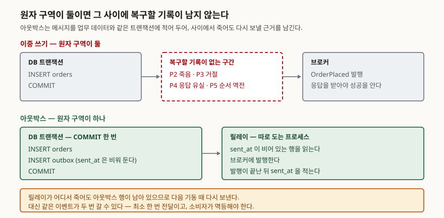

## 들어가며

주문 서비스를 하나 만들어 놓고 나면 곧 다른 팀이 찾아온다. 주문이 들어올 때마다
알림을 보내야 하니 이벤트를 쏴 달라는 요청이다. 가장 먼저 떠오르는 코드는 이렇다.
주문을 DB에 저장하고, 그 다음 줄에서 브로커에 이벤트를 발행한다. 두 줄이고, 테스트도
통과한다.

문제는 이 두 줄이 **서로 다른 시스템에 쓰는 일**이라는 점이다. DB 트랜잭션은 DB 안에서만
원자적이고, 브로커 발행은 브로커 안에서만 원자적이다. 두 줄 사이에서 프로세스가 죽거나
네트워크가 끊기면 한쪽만 남는다. 운영에서 이 문제는 보통 "알림이 안 왔다"는 제보 한 건으로
시작해, 로그를 뒤져도 주문은 멀쩡히 있고 이벤트만 없다는 사실을 확인하는 데서 끝난다.
원인이 확정되지 않으니 같은 일이 또 일어난다.

이 글은 그 사이에서 갈라지는 자리를 다섯 곳으로 나누고, 이중 쓰기와 아웃박스를 같은
다섯 지점에서 돌려 결과를 세어 본다.

## 개념

**이중 쓰기(dual write)** 는 한 요청을 처리하면서 두 개의 저장소에 각각 쓰는 것이다.
둘을 묶는 트랜잭션이 없으므로 중간 상태가 외부에 드러난다.

**아웃박스 패턴**은 브로커에 보낼 메시지를 **업무 데이터와 같은 DB 트랜잭션 안에서**
별도 표에 적어 두고, 따로 도는 프로세스(릴레이)가 그 표를 읽어 발행하는 방식이다.
데비지움 문서는 이 패턴을 서비스 사이에 데이터를 안전하게 주고받는 방법으로 설명하고,
내부 상태와 바깥에 알린 이벤트가 어긋나는 일을 막는 것이 목적이라고 적는다.

원자적 쓰기가 **한 번**으로 줄어드는 것이 핵심이다. 쓰기가 하나면 성공과 실패 두 상태만
있고, 중간이 없다.

## 구조



> **출처**: [Debezium — Outbox Event Router, Basic outbox table](https://debezium.io/documentation/reference/stable/transformations/outbox-event-router.html#basic-outbox-table) · [Debezium FAQ — Why must consuming applications expect duplicate events?](https://debezium.io/documentation/faq/#why_must_consuming_applications_expect_duplicate_events)

## 동작 원리 — 갈라지는 다섯 지점

| 지점 | 무슨 일이 일어나는가 |
|---|---|
| P1 | DB 커밋 직전에 프로세스가 죽는다 |
| P2 | DB 커밋 직후, 발행 직전에 죽는다 |
| P3 | 브로커가 발행을 거절한다 |
| P4 | 발행은 됐는데 응답을 못 받아 다시 보낸다 |
| P5 | 발행을 먼저 하고 DB 커밋이 실패한다 |

P5는 "그럼 발행을 먼저 하면 되지 않나"라는 흔한 대안이다. 순서를 바꾸면 유실은 사라지지만
**주문이 없는 이벤트**가 생긴다. 소비자는 존재하지 않는 주문의 알림을 보낸다.

결과를 세 가지로 나눠 부른다. 주문은 남았는데 이벤트가 없으면 **유실**, 이벤트는 갔는데
주문이 없으면 **유령**, 같은 이벤트가 두 번 가면 **중복**이다.

## 실습 예제

메모리 SQLite를 업무 DB로, 리스트 하나를 브로커로 두고 돌렸다. 장애는 난수가 아니라
인자로 지정하므로 몇 번을 돌려도 같은 표가 나온다. 전체 소스는 [`code/`](code/),
돌린 기록은 [`code/output.txt`](code/output.txt)에 있다.

```
1. 이중 쓰기 — DB 커밋과 발행을 따로 한다
  지점 | 무슨 일이 일어나는가                        | 주문 행 | 발행 건수 | 그 시점의 상태
  ---+------------------------------------+------+-------+------------
  없음 | 정상 경로                              | 있음   | 1     | 일치
  P1 | DB 커밋 직전에 죽는다                      | 없음   | 0     | 일치 (둘 다 없음)
  P2 | DB 커밋 직후, 발행 직전에 죽는다               | 있음   | 0     | 유실
  P3 | 브로커가 발행을 거절한다                      | 있음   | 0     | 유실
  P4 | 발행은 됐는데 응답을 못 받는다 (같은 메시지를 다시 보낸다) | 있음   | 2     | 중복
  P5 | 발행을 먼저 하고 DB 커밋이 실패한다              | 없음   | 1     | 유령
```

여섯 경로 중 **네 곳에서 상태가 갈라졌다.** 정상 경로와 P1만 성한데, P1이 성한 이유는
아무것도 안 일어났기 때문이다.

같은 다섯 지점을 아웃박스로 돌리면 이렇게 나온다.

```
2. 아웃박스 — 한 트랜잭션에 함께 쓰고 릴레이가 보낸다
  지점 | 무슨 일이 일어나는가                        | 주문 행 | 발행 건수 | 미전송 행 | 그 시점의 상태
  ---+------------------------------------+------+-------+-------+------------
  없음 | 정상 경로                              | 있음   | 1     | 0     | 일치
  P1 | DB 커밋 직전에 죽는다                      | 없음   | 0     | 0     | 일치 (둘 다 없음)
  P2 | DB 커밋 직후, 발행 직전에 죽는다               | 있음   | 0     | 1     | 유실
  P3 | 브로커가 발행을 거절한다                      | 있음   | 0     | 1     | 유실
  P4 | 발행은 됐는데 응답을 못 받는다 (같은 메시지를 다시 보낸다) | 있음   | 2     | 0     | 중복
  P5 | 발행을 먼저 하고 DB 커밋이 실패한다              | —    | —     | —     | 해당 없음
```

여기서 짚을 것이 있다. **죽은 그 순간만 보면 아웃박스도 이중 쓰기와 똑같이 보인다.**
P2와 P3에서 주문은 있고 발행은 0건이다. 아웃박스가 유실을 없앤다는 설명을 이 표로
확인하려고 하면 확인되지 않는다.

차이는 오른쪽 **미전송 행** 칸에 있다. 이중 쓰기에는 이 칸 자체가 없다. 프로세스가
죽은 뒤 복구를 시작한 쪽에서 "무엇을 보내다 말았는지" 알아낼 근거가 아무 데도 없다.
아웃박스에는 커밋된 행이 하나 남아 있다. 그래서 릴레이가 다시 뜨면 집어 간다.

```
3. 아웃박스에서 P2·P3 로 멈춘 뒤 릴레이가 다시 뜨면
  지점 | 재가동 전 발행 | 재가동 전 미전송 행 | 재가동 후 발행 | 재가동 후 미전송 행
  ---+----------+-------------+----------+------------
  P2 | 0        | 1           | 1        | 0
  P3 | 0        | 1           | 1        | 0
```

**아웃박스가 바꾸는 것은 "유실이 안 난다"가 아니라 "유실이 영구적이지 않다"이다.**
발행은 여전히 늦어지고 그동안 소비자는 이벤트를 못 본다. 달라진 것은 그 지연이
복구되는 성질을 갖게 됐다는 점이다.

P4의 중복은 아웃박스에서도 그대로 남는다. 발행한 뒤 `sent_at`을 적기 전에 죽으면
릴레이가 다시 보낸다. 데비지움 FAQ도 실패가 나면 소비하는 쪽이 같은 이벤트를 적어도
한 번은 보게 된다고 적고, 중복을 전제로 애플리케이션을 짜라고 요구한다.

## 실무에서 주의할 점

**발행과 `sent_at` 기록의 순서를 바꾸면 중복 대신 유실이 생긴다.** 예제의 릴레이는
발행이 끝난 뒤에 `sent_at`을 적는다. 이 두 줄을 뒤집으면 보낸 표시를 먼저 남기므로
발행 중에 죽었을 때 그 행을 다시 집지 않는다. 중복은 사라지고 유실이 돌아온다.
어느 쪽을 택하느냐가 전달 보장을 정하는 것이고, 대부분은 **중복을 받고 유실을 버린다.**
복구할 수 있는 쪽이 중복이기 때문이다.

**소비자 멱등성은 선택이 아니다.** 아웃박스를 넣어도 중복은 남으므로, 받는 쪽이 같은
메시지를 두 번 처리해도 결과가 같아야 한다. 보통은 이벤트에 고유 식별자를 싣고
소비자가 처리한 식별자를 기록해 두는 방식을 쓴다. 이 장치가 없으면 아웃박스를 넣은
대가로 중복 알림을 얻게 된다.

**순서 보장은 따로 설계한다.** 릴레이가 아웃박스를 읽는 순서는 보장할 수 있지만,
여러 릴레이 인스턴스를 띄우거나 파티션이 갈리면 소비자가 보는 순서는 달라질 수 있다.
한 주문에 대한 이벤트가 순서대로 와야 한다면 주문 식별자를 파티션 키로 삼는 식의
결정이 추가로 필요하다.

**아웃박스 표를 비우는 일을 잊지 않는다.** 보낸 행을 그대로 두면 표가 계속 자란다.
주문 테이블과 같은 DB에 있으므로 업무 질의의 I/O까지 나눠 쓴다. 보낸 행을 주기적으로
지우거나, 일정 기간이 지난 행을 다른 보관소로 옮기는 작업이 운영 항목으로 들어간다.

**분산 트랜잭션은 다른 선택지다.** DB와 브로커를 2단계 커밋으로 묶는 방법도 있다.
다만 두 시스템이 모두 XA를 지원해야 하고, 조정자가 멈추면 참가자가 잠긴 채 기다린다.
아웃박스는 이 비용을 치르지 않는 대신 중복을 받아들이는 쪽이다.

## 정리

- DB 커밋과 메시지 발행은 서로 다른 원자 구역이라 그 사이에서 상태가 갈라진다.
  갈라지는 자리를 다섯 곳으로 나눠 돌려 보니 여섯 경로 중 네 곳이 어긋났다.
- 발행을 먼저 하는 순서 교체는 유실을 유령으로 바꿀 뿐이다.
- 아웃박스는 원자적 쓰기를 한 번으로 줄인다. 다만 **죽은 그 순간에는 이중 쓰기와
  구분되지 않는다.** 차이는 커밋된 아웃박스 행이 남아 복구가 가능하다는 점이다.
- 중복은 아웃박스로도 사라지지 않는다. 최소 한 번 전달이고, 소비자 멱등성이 전제다.
- 발행과 보낸 표시의 순서가 전달 보장을 정한다. 발행을 먼저 하면 중복, 표시를 먼저
  하면 유실이다.

## 참고 자료

- [Debezium — Outbox Event Router](https://debezium.io/documentation/reference/stable/transformations/outbox-event-router.html) — 아웃박스 표 구조와 라우팅 설정
- [Debezium FAQ — What happens when an application stops or crashes?](https://debezium.io/documentation/faq/#what_happens_when_an_application_stops_or_crashes)
- [Debezium FAQ — Why must consuming applications expect duplicate events?](https://debezium.io/documentation/faq/#why_must_consuming_applications_expect_duplicate_events)
