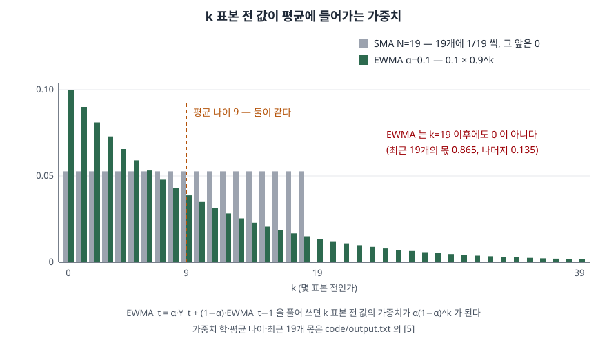

## 들어가며

서비스 대시보드에 API 응답 시간을 그려 놓으면 선이 위아래로 크게 흔들린다. 요청 하나하나의 응답 시간이 그대로 찍히니 평균이 올랐는지 우연히 튄 것인지 눈으로는 가를 수 없다. 그래서 대부분 "최근 N개 평균"을 그리고 거기에 경보를 건다. 그런데 N을 작게 하면 경보가 하루에 수십 번 울리고, 크게 하면 진짜 장애를 한참 늦게 알린다. 보통은 N을 바꿔 가며 몇 주 동안 경보 기록을 보고 맞추는데, 한 번 바꿀 때마다 일주일씩 기다려야 한다. 그 사이의 관계는 몇 줄의 식과 시뮬레이션으로 미리 잴 수 있다.

## 개념

**단순 이동평균**(SMA, simple moving average)은 최근 N개 값을 똑같이 1/N씩 더한다. **지수가중 이동평균**(EWMA, exponentially weighted moving average)은 새 값이 올 때마다 이전 평균과 섞는다.

```text
EWMA_t = α · Y_t + (1 − α) · EWMA_t−1        (0 < α ≤ 1)
```

NIST 통계 핸드북의 EWMA 관리도 절은 같은 식을 λ로 쓰고, λ가 **기억의 깊이**를 정한다고 설명한다. λ가 1에 가까우면 최근 값에, 0에 가까우면 오래된 값에 무게가 실린다. λ=1이면 평활 없이 원래 값 그대로다.

두 방식의 차이는 저장하는 것에서 먼저 드러난다. SMA는 최근 N개를 버퍼에 들고 있어야 하고, EWMA는 직전 평균 하나만 있으면 된다.

## 구조



> **출처**: EWMA 정의식은 [NIST/SEMATECH e-Handbook §6.3.2.4 EWMA Control Charts](https://www.itl.nist.gov/div898/handbook/pmc/section3/pmc324.htm), SMA 가 과거 값에 같은 가중치 1/N 을, 지수 평활이 지수적으로 줄어드는 가중치를 준다는 설명은 [§6.4.3 What is Exponential Smoothing?](https://www.itl.nist.gov/div898/handbook/pmc/section4/pmc43.htm). 막대 높이는 α(1−α)^k 를 계산한 값이다.

## 동작 원리

점화식을 계속 펼치면 k 표본 전 값 Y_t−k 의 가중치가 **α(1−α)^k** 가 된다. α=0.1이면 0.1, 0.09, 0.081 … 로 매번 10%씩 줄어든다. 가중치를 모두 더하면 1이므로 EWMA도 평균이다.

**언제 두 평균이 "같은 길이"인가.** 가중치의 평균 나이(가중치로 평균 낸 k)를 비교하면 된다. SMA N은 (N−1)/2, EWMA는 (1−α)/α 다. 둘을 같게 놓으면 **α = 2/(N+1)** 이 나온다. 이 대응은 흔들림에서도 맞아떨어진다. 잡음의 표준편차가 σ일 때 SMA의 표준편차는 σ/√N 이고, NIST 핸드북은 EWMA 통계량의 분산을 t가 충분히 클 때 근사적으로 **λ/(2−λ)·σ²** 로 적는다. α=2/(N+1)을 넣으면 α/(2−α) = 1/N 이 되어 둘이 같아진다.

그렇다면 무엇이 다른가. 모양이다. 위 도식에서 SMA는 19개를 평평하게 보고 그 앞은 버린다. EWMA는 바로 앞 값에 0.1이라는 큰 가중치를 주고, 대신 19개보다 오래된 값에도 합계 0.135를 남긴다. 평균 나이와 흔들림이 같아도 변화에 반응하는 모양이 다르다.

## 실습 예제

전체 소스: [`code/ewma_vs_sma.py`](code/ewma_vs_sma.py) · 수행 기록: [`code/output.txt`](code/output.txt)

평균 100ms, 표준편차 20ms 의 정규분포 응답 시간 4,000개를 만들고, 2,000번째부터 평균을 130ms 로 올렸다. 시드는 20261119 로 고정했다.

**[1] 흔들림이 같은가.** 시드 하나로 잰 표준편차는 SMA 4.041, EWMA 4.069 로 이론값 4.588 보다 12% 낮게 나왔다. 처음에는 식이 틀렸나 했다.

```text
    SMA  N=19       측정 4.041  이론 sigma/sqrt(N)        4.588
    EWMA alpha=0.1  측정 4.069  이론 sigma*sqrt(a/(2-a)) 4.588
    시드 100개 평균 — SMA sqrt(평균 분산) 4.593  EWMA 4.591
    시드별 SMA 표준편차 범위 3.923 ~ 5.250
```

시드 100개로 분산을 평균 내니 4.593·4.591 로 이론값과 맞았다. 평활한 값은 이웃끼리 닮아서, 표본 1,800개라도 서로 독립인 정보는 그보다 훨씬 적다. 그래서 한 구간에서 잰 표준편차는 3.9~5.3 사이를 오간다. 경보 임계값을 정상 구간 한 번의 표준편차로 정하면 이만큼 흔들린다.

**[2] 계단에 얼마나 빨리 닿는가.** 잡음 없는 0→1 계단을 넣고 50%·90%·95% 에 닿는 표본 수를 셌다.

```text
    SMA  N=19       (10, 18, 19)
    EWMA alpha=0.1  (7, 22, 29)
```

EWMA는 50% 에 7표본으로 SMA(10)보다 먼저 닿고, 95% 에는 29표본으로 SMA(19)보다 10표본 늦다. SMA는 19표본이 지나면 옛 값이 창에서 완전히 빠지지만, EWMA는 옛 값을 매번 0.9배씩만 줄이므로 끝까지 조금씩 남는다. EWMA 쪽 값은 ⌈ln(1−p)/ln 0.9⌉ 로 계산한 7·22·29 와 같다.

**[3] α를 바꿔 가며.** 임계값 110ms 를 두고, 정상 구간에서 넘은 표본 수(오경보)와 계단 뒤 처음 넘은 표본까지의 거리를 쟀다.

```text
    alpha   유효N  표준편차(측정/이론)   계단 반응        오경보  계단 후 첫 경보
    0.02       99    1.558 /   2.010   (35, 114, 149)       0  21
    0.05       39    2.631 /   3.203   (14, 45, 59)         4  9
    0.1        19    4.069 /   4.588   (7, 22, 29)         26  6
    0.2         9    6.248 /   6.667   (4, 11, 14)         96  3
    0.5         3   11.216 /  11.547   (1, 4, 5)          325  2
```

(수행 기록의 7줄 중 5줄이다.) α를 0.1에서 0.05로 내리면 오경보가 26개에서 4개로 줄고 첫 경보는 6표본에서 9표본으로 늦어진다. 0.02에서는 오경보가 0개지만 21표본을 기다린다. 이 숫자는 30ms 계단 하나에서 잰 것이라, 놓치면 안 되는 변화의 크기가 다르면 `STEP_MS` 를 바꿔 다시 재야 한다. NIST 핸드북은 λ를 보통 0.2~0.3 사이로 둔다고 적지만, 그 선택이 다소 임의적이라는 단서도 함께 단다. 이 표처럼 자기 서비스의 잡음과 놓치면 안 되는 변화 크기로 고르는 편이 낫다.

**[4] 초깃값.** α=0.05 에서 시작값을 셋으로 바꿨다.

```text
    0 으로 시작      초깃값    0.000  -> 87번째, 10번째 값  41.233
    첫 표본         초깃값  108.549  -> 30번째, 10번째 값 106.225
    처음 5개 평균     초깃값   96.764  -> 8번째, 10번째 값  99.169
    0 으로 시작 + 1-(1-a)^t 로 나눈 보정  10번째 값 102.758
```

0 으로 시작하면 87번째 표본에서야 100ms 의 ±2ms 안에 든다. 그 전까지는 응답 시간이 실제보다 훨씬 짧게 그려지고, 반대 방향 임계값(너무 빠름)을 걸어 두었다면 그동안 계속 울린다. NIST 핸드북의 지수 평활 절은 시작값으로 첫 관측값, 목표값, 처음 4~5개 관측값의 평균을 들고, α가 작을수록 시작값 선택이 중요하다고 적는다. 0 으로 시작할 수밖에 없다면 1−(1−α)^t 로 나눠 편향을 지울 수 있다.

## 실무에서 주의할 점

1. **α=2/(N+1)은 평균 나이와 흔들림만 맞춘다.** 계단 반응의 모양은 다르다. "SMA 19개를 EWMA로 바꿨는데 같겠지"라고 하면, 장애가 풀린 뒤 경보가 꺼지는 시점이 10표본가량 늦어진다(실습 [2]의 95% 도달).
2. **α는 표본 하나당 비율이다.** 응답이 올 때마다 갱신하면 트래픽이 많은 시간대에는 같은 α가 더 짧은 시간을 본다. 시간 기준으로 맞추려면 고정 간격으로 모은 값(예: 10초 평균)에 EWMA를 건다.
3. **초깃값을 0 으로 두지 않는다.** 처음 몇 개의 평균이나 목표값으로 시작한다. 재시작할 때마다 대시보드가 0 근처에서 기어오르는 그래프를 보이면 이 문제다.
4. **임계값은 한 구간의 표준편차로 정하지 않는다.** 평활한 값의 표준편차는 구간마다 크게 흔들린다(실습 [1]의 3.9~5.3). 여러 날의 값을 모으거나 σ·√(α/(2−α)) 로 계산한다.
5. **SMA가 필요한 경우도 있다.** "최근 1분 동안의 평균"처럼 정의가 창으로 정해진 지표는 SMA가 맞다. EWMA의 값에는 오래된 표본이 조금씩 섞여 있어 "몇 분 평균"이라고 부를 수 없다.

## 정리

- EWMA 는 직전 평균 하나만 들고 α·새 값 + (1−α)·이전 평균 으로 갱신하며, k 표본 전 값의 가중치는 α(1−α)^k 다
- α = 2/(N+1) 이면 SMA N 과 평균 나이·표준편차가 같다(α=0.1, N=19 에서 둘 다 약 4.59)
- 같아도 반응 모양이 달라, 계단의 50% 에는 EWMA 가 먼저(7 대 10), 95% 에는 늦게(29 대 19) 닿았다
- α 를 내리면 오경보가 줄고 첫 경보가 늦어진다. 초깃값은 0 이 아니라 처음 몇 개의 평균으로 둔다

## 참고 자료

- [NIST/SEMATECH e-Handbook of Statistical Methods §6.3.2.4 EWMA Control Charts](https://www.itl.nist.gov/div898/handbook/pmc/section3/pmc324.htm) — EWMA 정의식, λ 의 의미, 분산 λ/(2−λ)·s² 근사, 시작값을 과거 데이터 평균(목표값)으로 두는 것, λ 를 보통 0.2~0.3 으로 둔다는 서술
- [NIST/SEMATECH e-Handbook §6.4.3 What is Exponential Smoothing?](https://www.itl.nist.gov/div898/handbook/pmc/section4/pmc43.htm) — 이동평균은 과거 값에 같은 가중치를, 지수 평활은 지수적으로 줄어드는 가중치를 준다는 설명
- [NIST/SEMATECH e-Handbook §6.4.3.1 Single Exponential Smoothing](https://www.itl.nist.gov/div898/handbook/pmc/section4/pmc431.htm) — 시작값을 고르는 세 가지 방법과 α 가 작을수록 시작값이 중요하다는 서술
