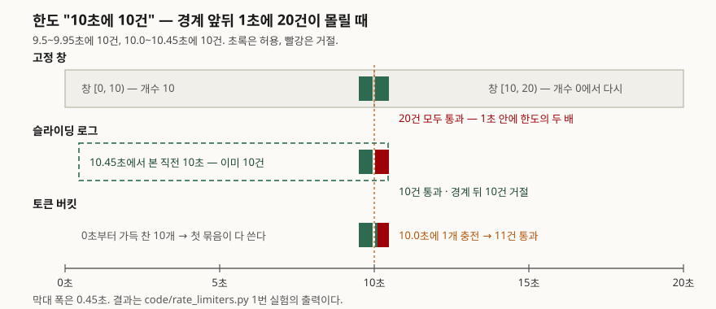

## 들어가며

외부에 공개한 API에 어느 날 한 클라이언트가 초당 수백 건을 보내 DB 연결이 바닥난다. 급히 "키마다 10초에 10건"을
걸기로 하고, 가장 쉬운 방법으로 `분:초`를 10초 단위로 잘라 키를 만들고 카운터를 하나씩 올린다. 이 구현은 한 줄이지만
9.9초에 10건, 10.0초에 10건을 보내면 0.2초 사이에 20건이 통과한다. 한도를 두 배로 넘긴 것인데, 로그를 보면 두 창 모두
정확히 10건이라 아무 경고도 남지 않는다. 처리율 제한 알고리즘마다 **"10초에 10건"이 실제로 무엇을 보장하는지**가 다르다.

## 개념

처리율 제한(rate limiting)은 정해진 시간 안에 받아 주는 요청 수를 막는 일이다. HTTP에서 거절은 보통
`429 Too Many Requests`로 돌려준다. RFC 6585는 이 코드를 "주어진 시간 안에 너무 많은 요청을 보냈다"는 뜻으로 정의하고,
응답에 `Retry-After`를 실어도 된다고 적는다. 어떤 알고리즘으로 세는지는 정하지 않는다.

이 글에서 비교하는 방식은 셋 갈래다.

| 갈래 | 방식 | 무엇을 센다 |
|---|---|---|
| 창 | 고정 창 | 달력처럼 잘린 구간마다 개수 |
| 창 | 슬라이딩 로그 | 지금부터 거슬러 정확히 10초 안의 요청 시각 전부 |
| 창 | 슬라이딩 카운터 | 직전 창 개수 × 겹친 비율 + 현재 창 개수 (근사) |
| 버킷 | 토큰 버킷 | 일정 속도로 차는 토큰. 요청마다 하나 쓴다 |
| 버킷 | 누출 버킷 | 일정 속도로 비는 대기열. 넘치면 버린다 |

제목의 "네 가지"는 버킷 둘과 창 둘(고정·슬라이딩)이고, 슬라이딩 창을 정확한 로그와 근사 카운터로 나눠 다섯을 구현했다.

## 구조

고정 창과 슬라이딩 창이 갈리는 곳은 창의 **경계**다. 들어가며의 장면을 그대로 돌린 결과다.



> **출처**: 고정 창·슬라이딩 창·누출 버킷의 구분은 [Cloudflare Blog, How we built rate limiting capable of scaling to millions of domains (2017-06-07)](https://blog.cloudflare.com/counting-things-a-lot-of-different-things/), 토큰 버킷 규칙은 [RFC 2697 §3 Metering](https://www.rfc-editor.org/rfc/rfc2697#section-3). 허용·거절 결과는 `code/rate_limiters.py` 실행 출력이다.

## 동작 원리

**고정 창**은 시각을 창 길이로 나눈 몫을 키로 쓴다. 창이 바뀌면 개수가 0으로 돌아가므로, 앞 창의 끝과 뒤 창의 시작이
붙어 있으면 둘을 합친 짧은 구간에 한도의 두 배까지 들어간다.

**슬라이딩 로그**는 허용한 요청의 시각을 전부 들고 있다가, 새 요청이 오면 10초보다 오래된 시각을 버리고 남은 개수를
센다. 어느 순간에 봐도 직전 10초에 10건을 넘지 않는다. 대신 키마다 최대 한도만큼의 시각을 저장한다.

**슬라이딩 카운터**는 로그 대신 창 두 개의 개수만 들고 근사한다. Cloudflare 글의 예에서 한도가 분당 50건이고 현재 창이
15초 지났으면 `42 × (60 − 15)/60 + 18 = 49.5`로 직전 1분을 추정한다. 직전 창의 요청이 **고르게 퍼져 있었다고 가정**하는
식이다. 이 구현은 "추정치 + 1이 한도 이하이면 허용"으로 판정했다.

**토큰 버킷**은 RFC 2697의 C 버킷과 같다. 버킷 크기(CBS)만큼 가득 찬 채 시작하고, 초당 CIR번 토큰 수를 1씩 늘리되 CBS를
넘기지 않으며, 요청이 쓴 만큼 줄인다. 여기서는 크기 10, 1초에 1개다. 평균 속도는 초당 1건이지만 **버킷에 쌓인 10개는
한꺼번에 쓸 수 있다.** Stripe가 2017년 글에서 API 처리율 제한에 이 방식을 쓴다고 밝혔다.

**누출 버킷**은 받아 준 요청을 대기열에 넣고 일정 속도(1초에 1건)로 내보낸다. 대기열이 차면 거절한다. 백엔드에 닿는
속도가 일정해지는 대신, 받아 준 요청이 **늦게** 나간다. Cloudflare 글은 NGINX의 `limit_req` 모듈이 이 방식이라고 적는다.

## 실습 예제

실제 시계 대신 정수 밀리초 요청열을 넣어 몇 번을 돌려도 같은 결과가 나오게 했다. 전체 소스: [`code/`](code/) ·
돌린 기록: [`code/output.txt`](code/output.txt)

```python
class SlidingLog:
    def allow(self, now):
        while self.log and self.log[0] <= now - WINDOW_MS:
            self.log.popleft()
        if len(self.log) < LIMIT:
            self.log.append(now)
            return True
        return False
```

### 1. 경계 앞뒤에 10건씩

```text
  고정 창     허용 20  (경계 앞 10 / 뒤 10)  1초 안에 통과한 최대 = 20
  슬라이딩 로그  허용 10  (경계 앞 10 / 뒤  0)  1초 안에 통과한 최대 = 10
  슬라이딩 카운터 허용 10  (경계 앞 10 / 뒤  0)  1초 안에 통과한 최대 = 10
  토큰 버킷    허용 11  (경계 앞 10 / 뒤  1)  1초 안에 통과한 최대 = 11
  누출 버킷    허용 11  (경계 앞 10 / 뒤  1)  1초 안에 통과한 최대 = 11
```

고정 창만 20건이다. 슬라이딩 카운터는 10.0초 시점에 직전 창 비율이 1.0이라 추정치가 10이 되어 막았다.

### 2. 한도의 두 배로 고르게 들어올 때

초당 2건을 60초 동안 보냈다. "어느 10초든 최대"는 백엔드에 실제로 닿은 시각으로 셌다. 누출 버킷은 내보낸 시각이다.

```text
  고정 창     허용  60  어느 10초든 최대 10건
  슬라이딩 로그  허용  60  어느 10초든 최대 10건
  슬라이딩 카운터 허용  55  어느 10초든 최대 10건
  토큰 버킷    허용  69  어느 10초든 최대 19건
  누출 버킷    허용  70  어느 10초든 최대 10건  지연 최대 9.5초
```

**예상과 달랐던 것은 토큰 버킷이다.** 경계 문제가 없는 방식으로 알려져 있지만, 시작할 때 가득 차 있던 10개에 더해
그 사이 충전된 토큰까지 써서 어느 10초 구간에 19건을 내보냈다. 버킷 크기 + 창 길이 × 충전 속도 = 10 + 10 = 20이 이론 상한이다.
토큰 버킷이 보장하는 것은 "평균 초당 1건, 순간 몰림은 10건까지"이지 "어느 10초든 10건"이 아니다.
누출 버킷은 70건을 받아 주고도 10초에 10건을 넘기지 않았는데, 그 대가로 마지막 요청은 9.5초를 기다렸다.

### 3. 무작위 도착 — 근사는 얼마나 틀리나

시드를 고정한 지수 분포로 1시간 분량을 만들었다. 슬라이딩 카운터는 자기가 허용한 시각을 따로 기록해 두고,
같은 이력으로 정확히 셌을 때와 판정이 갈린 횟수를 셌다.

```text
### 3. 무작위 도착 (시드 42, 평균 초당 0.8건, 1시간)
  슬라이딩 카운터 허용 2505  어느 10초든 최대 14건
           근사 오판: 한도를 넘었는데 허용 126건, 한도 안인데 거절 208건 (전체 요청의 11.72%)
### 3. 무작위 도착 (시드 42, 평균 초당 1.5건, 1시간)
  슬라이딩 카운터 허용 3074  어느 10초든 최대 13건
           근사 오판: 한도를 넘었는데 허용 212건, 한도 안인데 거절 1611건 (전체 요청의 33.74%)
```

Cloudflare 글은 4억 건에서 잘못 허용·제한한 비율을 0.003%로 보고했다. 이 실험의 수치가 훨씬 큰 것은 **트래픽이 늘
한도 근처에 있기 때문이다.** 평균 초당 0.8건이면 10초에 8건 안팎이라 무작위 몰림만으로 한도에 자주 닿고, 근사의 오차는
정확히 그 자리에서만 판정을 뒤집는다. 대부분의 클라이언트가 한도보다 한참 아래에 있는 실서비스와는 분포가 다르다.
근사가 쓸 만한지는 **한도 근처에 머무는 클라이언트가 얼마나 많은가**로 판단해야 한다는 뜻이다.

## 실무에서 주의할 점

**1. 한도의 뜻을 먼저 정한다.** "10초에 10건"이 "어느 10초든 10건"이면 슬라이딩 로그나 누출 버킷이 맞고,
"평균 초당 1건, 순간 몰림은 봐준다"면 토큰 버킷이 맞다. 고정 창은 둘 다 아니다. 2번 실험에서 같은 한도 이름으로
55건부터 70건까지 갈렸다. 문서에 한도를 적을 때 알고리즘까지 적어야 클라이언트가 재시도를 맞춰 짤 수 있다.

**2. 토큰 버킷의 크기는 한도와 따로 정한다.** 크기를 한도와 같게 두면 이 글처럼 한 창에 두 배 가까이 나간다.
백엔드가 버티는 순간 최대치로 크기를 잡고, 평균은 충전 속도로 맞춘다. RFC 2697도 속도(CIR)와 크기(CBS)를 별개의
매개변수로 둔다.

**3. 누출 버킷의 지연은 클라이언트 시간 초과와 부딪힌다.** 대기열 10에 1초 1건이면 최대 지연이 10초 가까이 된다.
클라이언트 시간 초과가 5초면 받아 준 요청이 응답 전에 끊기고, 클라이언트는 재시도해서 대기열을 다시 채운다.
대기열 길이 × 송출 간격을 클라이언트 시간 초과보다 짧게 잡는다.

**4. 슬라이딩 로그는 메모리가 한도에 비례한다.** 다른 방식은 키마다 값 1~3개지만, 로그는 허용한 시각을 한도만큼 들고 있다.
"하루 10만 건" 같은 한도에 로그를 쓰면 키 하나가 10만 개의 시각을 저장한다. 긴 창에는 카운터 근사나 토큰 버킷을 쓴다.

```text
  고정 창        : 창 시작 시각, 개수                    -> 값 2개
  슬라이딩 카운터: 창 시작 시각, 현재 개수, 직전 개수     -> 값 3개
  토큰 버킷      : 토큰 수, 마지막 충전 시각              -> 값 2개
  누출 버킷      : 다음 송출 가능 시각                    -> 값 1개
  슬라이딩 로그  : 허용한 요청 시각 전부                 -> 지금 10개 (한도만큼 늘어난다)
```

**5. 남은 양을 알려 준다.** IETF httpapi 작업반의 `RateLimit`·`RateLimit-Policy` 헤더 초안(draft-11, 2026-05-23)은
정책(한도와 창)과 남은 양을 응답에 싣는 형식을 정한다. 아직 RFC가 아니므로 쓸 때 판 번호를 고정한다. 초안도 특정
알고리즘을 강제하지 않는다고 밝히므로, 1번에서 정한 뜻을 헤더 값과 맞춰야 한다.

## 정리

- 고정 창은 경계 앞뒤에서 한도의 두 배까지 통과시킨다. 1초 사이에 20건이 나갔다.
- 토큰 버킷은 평균은 지키지만 어느 10초 구간에서 버킷 크기 + 충전량(최대 20건)까지 내보낸다.
- 슬라이딩 로그와 누출 버킷만 "어느 10초든 10건"을 지켰다. 로그는 메모리를, 누출 버킷은 최대 9.5초의 지연을 냈다.
- 슬라이딩 카운터 근사는 직전 창이 고르게 퍼졌다고 가정하므로, 한도 근처 트래픽에서는 판정이 12~34% 갈렸다.
- 알고리즘을 고르기 전에 한도가 "어느 구간이든"인지 "평균"인지를 먼저 정한다.

## 참고 자료

- [RFC 6585 §4 429 Too Many Requests](https://www.rfc-editor.org/rfc/rfc6585#section-4) — 429 상태 코드 정의, `Retry-After`
- [RFC 2697 §3 Metering — A Single Rate Three Color Marker](https://www.rfc-editor.org/rfc/rfc2697#section-3) — 토큰 버킷 C의 초기값 CBS, 초당 CIR번 1씩 충전
- [IETF draft-ietf-httpapi-ratelimit-headers (draft-11, 2026-05-23)](https://datatracker.ietf.org/doc/draft-ietf-httpapi-ratelimit-headers/) — `RateLimit`·`RateLimit-Policy` 헤더 필드
- [Cloudflare Blog, How we built rate limiting capable of scaling to millions of domains (2017-06-07)](https://blog.cloudflare.com/counting-things-a-lot-of-different-things/) — 슬라이딩 창 근사 식과 오차 측정, 누출 버킷과 NGINX `limit_req`
- [Stripe Blog, rate limiters (Paul Tarjan, 2017-03-30)](https://stripe.com/blog/rate-limiters) — 토큰 버킷 사용
