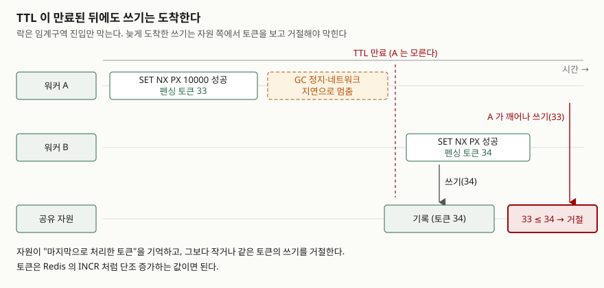

## 들어가며

배치 서버를 두 대로 늘리는 날이 온다. 한 대로는 야간 정산이 새벽까지 안 끝나서,
같은 코드를 한 대 더 띄운다. 그러자 같은 청구서가 두 번 발행된다.

여기서 거의 모두가 같은 곳으로 간다. Redis가 이미 떠 있으니 `SETNX`로 락을 만드는
것이다. 키가 없으면 1, 있으면 0을 돌려주니 상호 배제가 되는 것처럼 보인다. 잘 돈다.
한 달쯤.

그러다 배포 중에 한 대가 죽고, 락 키가 영원히 남는다. 그래서 `EXPIRE`를 붙인다.
그다음엔 작업이 TTL보다 길어져 두 대가 동시에 들어간다. TTL을 10초에서 60초로
올린다. 그다음엔 먼저 끝난 쪽이 나중 쪽의 락을 지운다. 고칠 때마다 다음 함정이
나오는데, 함정이 몇 개이고 어디서 끝나는지를 모른 채 하나씩 밟는다.

이 글은 그 함정을 순서대로 깔아 놓고 하나씩 돌려 본다.

## 개념

분산 락이 보장해야 하는 성질을 Redis 공식 문서는 셋으로 정리한다.

| # | 성질 | 내용 |
|---|---|---|
| 1 | **안전성 (상호 배제)** | 어느 시점에도 한 클라이언트만 락을 쥔다 |
| 2 | **활성 A (교착 없음)** | 락을 쥔 쪽이 죽거나 끊겨도 결국 누군가는 락을 얻을 수 있다 |
| 3 | **활성 B (장애 내성)** | Redis 노드의 과반이 살아 있으면 획득·해제가 된다 |

`SETNX` 하나로는 1번만 된다. 2번을 얻으려고 TTL을 붙이는 순간 1번이 흔들리고,
3번은 단일 인스턴스로는 아예 얻을 수 없다. 함정은 대부분 **1번과 2번을 동시에
만족시키려는 자리**에서 나온다.

## 구조



> **출처**: [Redis — Distributed Locks with Redis, "Disclaimer about consistency"](https://redis.io/docs/latest/develop/clients/patterns/distributed-locks/#disclaimer-about-consistency) (펜싱 토큰 권고) 및 [Martin Kleppmann, "How to do distributed locking" (2016-02-08)](https://martin.kleppmann.com/2016/02/08/how-to-do-distributed-locking.html)

이 그림이 글 전체의 결론이다. **락은 임계구역에 들어가는 것만 막는다.** 들어간
뒤에 보낸 쓰기가 언제 도착하는지는 락이 관여하지 않는다.

## 동작 원리

### 획득은 한 문장이어야 한다

`SETNX` 뒤에 `EXPIRE`를 치는 두 문장 사이에서 프로세스가 죽으면, 만료 시각 없는
키가 남는다. 그래서 공식 문서는 획득을 한 문장으로 못 박는다.

```
SET resource_name my_random_value NX PX 30000
```

값이 `my_random_value`인 것이 중요하다. 문서는 이 값이 "모든 클라이언트와 모든
락 요청에 걸쳐 유일해야 한다"고 적는다. 해제할 때 자기 락인지 확인하는 데 쓰기
때문이다.

### 해제는 값을 보고 해야 한다

`DEL`만 쓰면 남의 락을 지운다. 문서의 설명이 정확하다. 클라이언트가 락을 얻고,
락 유효 시간보다 오래 걸리는 작업에 묶여 있다가, 나중에 락을 지우는데 그 락은
이미 다른 클라이언트가 얻은 것일 수 있다.

Redis 8.4부터는 `DELEX key IFEQ my_random_value` 한 명령으로 되고, 그 이전
버전에서는 Lua 스크립트를 쓴다.

```lua
if redis.call("get", KEYS[1]) == ARGV[1] then
    return redis.call("del", KEYS[1])
else
    return 0
end
```

`GET`으로 확인한 뒤 `DEL`을 치는 것으로는 부족하다. 두 명령 사이에 키가 만료되고
다른 클라이언트가 같은 키를 잡을 수 있다. 원자적으로 해야 한다.

### 그래도 남는 것

여기까지 하면 "내가 락을 쥐고 있는 동안 다른 쪽이 못 들어온다"가 보장된다.
보장되지 않는 것은 **내가 락을 놓친 뒤에 내가 보낸 쓰기가 도착하지 않는 것**이다.

TTL이 만료되는 순간 Redis는 키를 지운다. 락을 쥐고 있던 프로세스에는 아무 통지도
가지 않는다. 그 프로세스가 GC 정지에서 깨어나거나 멈췄던 네트워크가 풀리면,
자기는 여전히 락 주인이라고 믿은 채로 쓰기를 보낸다.

공식 문서도 이 점을 적는다. 일관성이 걱정된다면 펜싱 토큰을 구현해야 하고,
이는 시간이 오래 걸리는 처리에서 특히 중요하며 모든 분산 락 시스템에 해당한다는
것이다. 덧붙여 Redis의 TTL 만료가 단조 시계를 쓰지 않아 벽시계가 틀어지면 둘 이상의
프로세스가 락을 얻을 수 있다고도 적는다.

## 실습 예제

Redis 서버가 없는 환경이라 `fakeredis`로 돌렸다. `redis-py`와 같은 명령 API를 쓰므로
`SET NX PX`·`TTL`·`EVAL`의 동작은 그대로 보이지만, **네트워크 지연과 복제·페일오버는
재현되지 않는다.** 그 부분은 뒤에서 따로 다룬다.

전체 소스: [`code/lock_pitfalls.py`](code/lock_pitfalls.py) ·
돌린 기록: [`code/output.txt`](code/output.txt)

### 두 문장으로 나눴을 때

```text
[1] SETNX 와 EXPIRE 를 따로 치면 — 사이에서 죽었을 때
  SETNX lock:invoice:4821 worker-a  -> True
  여기서 프로세스가 죽었다고 치고 EXPIRE 를 치지 않는다
  TTL lock:invoice:4821  -> -1   (-1 은 만료 시각이 없다는 뜻)
  다른 워커의 SETNX -> False  (영원히 못 잡는다)
```

`TTL`이 `-1`이다. 키는 있는데 만료 시각이 없다는 뜻이고, 사람이 지우기 전까지
그 락은 아무도 못 얻는다. 활성 A가 깨진다.

### 작업이 TTL보다 길어졌을 때

```text
[3] 작업이 TTL 보다 길어지면 — 두 워커가 같이 들어간다
  A: 락 획득 (TTL 300ms). 이제 A 가 0.45초 걸리는 작업을 한다
  0.45초 뒤 TTL -> -2  (-2 는 키가 없다는 뜻)
  B: SET ... NX PX 2000 -> True
  A 는 아직 자기가 락을 쥐고 있다고 믿는다 — 이 순간 둘 다 임계구역 안이다

[4] DEL 로 해제하면 — 남의 락을 지운다
  A 가 작업을 끝내고 DEL lock:invoice:4821 -> 1
  B 의 락이 남아 있는가 -> False
  B 는 아직 작업 중인데 락이 사라졌다. 이제 C 가 들어올 수 있다
```

`DEL`이 `1`을 돌려준다. A는 성공적으로 해제했다고 기록하고 넘어간다. 지운 것이
B의 락이라는 사실은 어느 쪽 로그에도 남지 않는다. 이것이 이 함정이 오래 숨는
이유다 — 에러가 나지 않는다.

### 값을 보고 지우면

```text
[5] 값이 내 것일 때만 지우면
  A 가 자기 토큰으로 해제 시도 -> 지운 키 수 0
  B 의 락이 남아 있는가 -> True
  B 가 자기 토큰으로 해제 -> 지운 키 수 1
```

같은 상황에서 Lua 스크립트를 쓰면 A의 해제가 `0`을 돌려준다. 여기서 중요한 것은
**`0`이 정상 동작이라는 점**이다. 라이브러리가 이 반환값을 버리면, 내 락이 이미
만료됐다는 신호가 버려진다. `0`이 나오면 그 작업의 결과를 커밋해도 되는지 다시
따져야 한다.

### 펜싱 토큰

```text
[6] 그래도 남는 것 — 펜싱 토큰
  A: 락 획득, 펜싱 토큰 1. 작업 중 0.45초 멈춘다
  B: 락 획득, 펜싱 토큰 2
  B 가 먼저 쓴다 -> 기록 (토큰 2)
  A 가 깨어나 쓴다 -> 거절 (토큰 1 ≤ 이미 처리한 2)
  자원에 남은 내용 -> B 가 계산한 값
```

락 획득 때 `INCR`로 단조 증가하는 번호를 같이 받고, 자원에 쓸 때 그 번호를 같이
보낸다. 자원은 마지막으로 처리한 번호를 기억했다가 그보다 작거나 같은 번호의
쓰기를 거절한다. A의 늦은 쓰기가 여기서 막힌다.

핵심은 **막는 주체가 Redis가 아니라 자원 쪽**이라는 것이다. 락 구현을 아무리
정교하게 해도 이 거절은 자원이 해 줘야 한다. 데이터베이스라면 `WHERE
last_token < :fence` 같은 조건부 갱신이 그 역할을 한다.

## 실무에서 주의할 점

1. **TTL을 늘려서 해결하지 않는다.** TTL은 "이 시간 안에 끝난다"는 약속이 아니라
   "이 시간이 지나면 남이 들어온다"는 선언이다. 늘리면 겹칠 확률이 줄 뿐 사라지지
   않고, 대신 쥔 쪽이 죽었을 때 복구가 그만큼 늦어진다. 활성 A와 안전성을 TTL 하나로
   맞바꾸는 셈이다. 작업이 길면 TTL을 늘리는 대신 연장(lock extension)을 넣는다.

2. **해제의 반환값을 버리지 않는다.** 위 [5]에서 본 `0`은 "내가 쥔 줄 알았던 락이
   이미 내 것이 아니었다"는 신호다. 많은 래퍼가 `unlock()`을 `void`로 두는데,
   그러면 유일한 탐지 지점이 사라진다.

3. **복제본을 붙여 가용성을 올리면 안전성이 깨진다.** 공식 문서가 드는 경쟁 조건은
   이렇다. A가 마스터에서 락을 얻는다 → 복제본에 전달되기 전에 마스터가 죽는다 →
   복제본이 마스터로 승격한다 → B가 같은 락을 얻는다. Redis 복제가 비동기라서
   생기는 일이고, 설정으로는 막히지 않는다. 가끔 둘이 같이 들어가도 괜찮은
   작업이면 그대로 써도 되지만, 그 판단을 먼저 하고 들어가야 한다.

4. **긴 작업에는 펜싱 토큰을 넣는다.** 공식 문서의 권고다. 특히 외부 API 호출이나
   파일 쓰기처럼 중간에 멈출 수 있는 구간이 있으면 락만으로는 부족하다.

5. **락이 정말 필요한지 먼저 본다.** 작업이 멱등이면 락 없이 두 번 돌아도 되고,
   데이터베이스에 유니크 제약이나 조건부 갱신을 걸 수 있으면 그쪽이 분산 락보다
   훨씬 단순하다. 위에 쓴 함정은 전부 "락을 쓰기로 했을 때"부터 생긴다.

## 정리

- 획득은 `SET key value NX PX ttl` 한 문장으로 한다. `SETNX` + `EXPIRE`는 그 사이에서
  죽으면 TTL `-1`인 키를 남긴다.
- 해제는 값이 내 것일 때만 한다. `DEL`만 쓰면 남의 락을 지우고, 그때 반환값은 `1`이라
  아무 에러도 나지 않는다.
- 값 비교와 삭제는 원자적이어야 한다. Redis 8.4부터는 `DELEX ... IFEQ`, 그 이전은 Lua.
- 해제가 `0`을 돌려주면 내 락이 이미 만료된 것이다. 이 신호를 버리지 않는다.
- 여기까지 해도 TTL 만료 뒤 도착하는 쓰기는 막히지 않는다. 자원 쪽에서 펜싱 토큰을
  보고 거절해야 막힌다.

## 참고 자료

- [Redis — Distributed Locks with Redis](https://redis.io/docs/latest/develop/clients/patterns/distributed-locks/) — 안전성·활성 3성질, 단일 인스턴스 구현, Redlock, 펜싱 토큰 권고
- [Redis — SET 명령](https://redis.io/docs/latest/commands/set/) — `NX`·`PX` 옵션
- [Martin Kleppmann, "How to do distributed locking" (2016-02-08)](https://martin.kleppmann.com/2016/02/08/how-to-do-distributed-locking.html) — 펜싱 토큰 논증
- [antirez, "Is Redlock safe?" (2016)](http://antirez.com/news/101) — 위 글에 대한 반론
- [fakeredis 문서](https://fakeredis.readthedocs.io/) — 이 글의 예제를 돌린 구현
