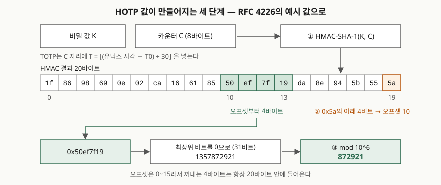

## 들어가며

관리자 페이지에 2단계 인증을 붙이는 일은 대개 라이브러리 한 줄로 끝난다. QR 코드를 띄우고,
인증 앱이 보여 주는 6자리를 서버가 맞춰 본다. 문제는 그다음에 온다. "코드가 안 맞는다"는 문의가
들어오고, 원인은 대부분 기기 시계다. 이때 가장 흔한 대응은 허용 창(앞뒤로 몇 스텝까지 받아 줄지)을
넉넉히 넓히는 것이다. 문의는 사라지지만, ±10 스텝으로 넓힌 서버는 한 시점에 코드 21개를 정답으로
받고 코드 하나를 10분 30초 동안 받아 준다. 코드가 어떻게 만들어지는지 모르면 이 숫자가 보이지 않는다.

## 개념

TOTP(Time-Based One-Time Password)는 따로 떨어진 알고리즘이 아니다. RFC 6238은 TOTP를
`TOTP = HOTP(K, T)`로 정의한다. HOTP(RFC 4226)는 비밀 값 `K`와 카운터 `C`로 일회용 코드를 만드는
알고리즘이고, TOTP는 카운터 자리에 **시간 스텝 번호** `T`를 넣은 것이다.

```text
T = floor((현재 유닉스 시각 - T0) / X)      기본값 T0 = 0, X = 30초
```

HOTP는 버튼을 누를 때마다 카운터가 올라가므로 서버와 기기의 카운터가 어긋날 수 있다. TOTP는 양쪽이
시계만 맞으면 같은 `T`를 얻는다. 어긋나는 대상이 카운터에서 시계로 바뀐 것이다.

## 구조



> **출처**: [RFC 4226 §5.3 Generating an HOTP Value](https://www.rfc-editor.org/rfc/rfc4226#section-5.3), [§5.4 Example of HOTP Computation for Digit = 6](https://www.rfc-editor.org/rfc/rfc4226#section-5.4) — 세 단계와 예시 바이트 값 · [RFC 6238 §4.2 Description](https://www.rfc-editor.org/rfc/rfc6238#section-4.2) — T의 정의

## 동작 원리

HOTP 생성 절(§5.3)은 세 단계를 정한다.

1. **HMAC-SHA-1(K, C)** 로 20바이트를 만든다. 카운터는 8바이트 빅엔디언이다.
2. **동적 절단**(dynamic truncation)으로 31비트를 뽑는다. 마지막 바이트의 아래 4비트를 오프셋으로
   삼아 그 자리부터 4바이트를 꺼내고, 최상위 비트를 지운다.
3. 그 수를 **10^자릿수로 나눈 나머지**가 코드다.

최상위 비트를 지우는 이유를 RFC는 부호 있는 나머지 연산과 부호 없는 나머지 연산이 처리기마다
다르게 동작해 생기는 혼동을 피하기 위해서라고 적는다. 오프셋을 고정하지 않고 결과의 마지막
바이트에서 얻는 것이 "동적"이라는 이름의 뜻이다.

예시 절(§5.4)의 값으로 [1]에서 한 단계씩 따라갔다. 마지막 바이트 `0x5a`의 아래 4비트가 10이고,
바이트 10~13이 `0x50ef7f19`, 십진수로 1357872921, 나머지가 872921이다. RFC가 적은 값과 같다.

**나머지 연산은 코드를 완전히 고르게 만들지 못한다.** 2^31은 10^6의 배수가 아니다. [5]에서 세어 보면
코드 000000~483647은 31비트 값 2,148개가 대응하고 나머지 코드는 2,147개가 대응한다. 가장 흔한
코드의 확률은 10^-6의 1.00024045배다. RFC 4226 부록 A의 수치와 같고, RFC는 이 치우침을 무시할
만하다고 본다.

## 실습 예제

전체 소스: [`code/`](code/) · 실행 기록: [`code/output.txt`](code/output.txt)

```python
def dynamic_truncate(mac):
    offset = mac[-1] & 0x0F
    return struct.unpack(">I", mac[offset:offset + 4])[0] & 0x7FFFFFFF


def hotp(secret, counter, digits=6, algorithm="sha1"):
    mac = hmac.new(secret, struct.pack(">Q", counter), algorithm).digest()
    return str(dynamic_truncate(mac) % 10 ** digits).zfill(digits)


def totp(secret, unix_time, digits=6, algorithm="sha1", step=30, t0=0):
    return hotp(secret, (unix_time - t0) // step, digits, algorithm)
```

RFC 4226 부록 D의 10건과 RFC 6238 부록 B의 18건이 모두 맞았다([2]·[3]). 맞추는 과정에서 예상과
달랐던 것이 하나 있다. 부록 B 본문은 시험용 비밀 값을 ASCII 문자열 `12345678901234567890`이라고만
적는다. 이 20바이트를 세 해시에 그대로 넣으면 이렇게 나온다([4]).

```text
('mode', 'match_with_20_byte_secret')
('sha1', '6/6')
('sha256', '0/6')
('sha512', '0/6')
```

부록 A의 참조 코드는 SHA-256에 32바이트, SHA-512에 64바이트 비밀 값을 쓴다. `1234567890`을 반복해
그 길이로 자른 값이다. 이 불일치는 RFC 정오표 2866번(Verified)에 올라 있다. 구현을 검증할 때
본문만 보고 벡터가 안 맞는다고 코드를 고치기 시작하면 멀쩡한 구현을 망가뜨린다.

허용 창을 넓히면 무엇이 달라지는지는 [6]에서 셌다. 임의의 비밀 값 2,000개에 대해, 현재 스텝
앞뒤 `w` 스텝의 코드 가운데 서로 다른 것이 평균 몇 개인지다.

| 허용 창 | 맞춰 보는 스텝 수 | 통과하는 코드 수(평균) | 코드 하나가 통과하는 시간 |
|---|---|---|---|
| ±0 | 1 | 1.0 | 30초 |
| ±1 | 3 | 3.0 | 90초 |
| ±2 | 5 | 5.0 | 150초 |
| ±5 | 11 | 11.0 | 330초 |
| ±10 | 21 | 20.9995 | 630초 |

추측 한 번이 맞을 확률이 통과하는 코드 수만큼 곱해진다. ±10에서 21에 조금 못 미치는 것은 21개
가운데 두 코드가 우연히 같은 비밀 값이 2,000개 중 하나 있었기 때문이다.

RFC 4226의 보안 고려 절(§6)은 무차별 추측의 성공 확률을 `sv / 10^Digit`로 적는다. `s`는 서버가
받아 주는 값의 개수, `v`는 허용하는 시도 횟수다. TOTP의 허용 스텝 수를 `s` 자리에 넣어 읽고,
4자리 코드·시도 5회로 줄여 계정 40,000개에 모의 공격을 했다([7]). 6자리로는 성공이 너무 드물어
횟수를 셀 수 없어서 자릿수를 줄였다.

| 허용 창 | 모의 실험 | sv / 10^4 |
|---|---|---|
| ±0 | 0.00028 | 0.0005 |
| ±1 | 0.00140 | 0.0015 |
| ±2 | 0.00265 | 0.0025 |
| ±5 | 0.00502 | 0.0055 |

창에 비례해 늘어나는 경향은 식과 같다. ±0은 기대 20건에 11건이 나와 식보다 낮은데, 이 정도 건수에서는
표본 오차로 설명되는 차이다. 시드를 바꾸면 위아래로 움직인다.

[8]은 시계가 40초 늦은 기기다. 창 ±0에서는 거부되고 ±1에서는 서버 스텝보다 하나 앞선 스텝(-1)에서
맞는다. 같은 코드를 5초 뒤 다시 내면, 마지막으로 통과한 스텝을 기록하지 않은 서버는 또 받아 준다.

## 실무에서 주의할 점

- **허용 창은 문의 건수가 아니라 확률로 정한다.** RFC 6238의 검증 절(§5.2)은 전송 지연으로 허용하는
  스텝을 많아야 1개로 권고한다. 창을 넓히는 만큼 추측 성공 확률과 탈취된 코드의 수명이 함께 늘어난다.
- **시도 횟수 제한이 없으면 자릿수는 의미가 없다.** 식의 `v`에 제한이 없으면 성공 확률은
  시도 횟수에 비례해 계속 오른다. RFC 4226의 서버 제한 절(§7.3)은 잠금이나 지연이 로그인 세션을 넘어 적용돼야 한다고 적는다.
- **통과한 스텝 번호를 저장한다.** RFC 6238의 같은 검증 절(§5.2)은 검증에 성공한 OTP의 두 번째
  시도를 받지 말라고 요구한다(MUST NOT). 코드가 아니라 스텝 번호를 저장해 그 이하를 거부하면 창 안의 옛 코드도 함께 막힌다.
- **창을 넓히는 대신 어긋난 스텝 수를 기록한다.** 재동기화 절(§6)은 검증에 성공했을 때 감지한
  어긋남을 스텝 단위로 기록해 다음 검증에 반영하는 방법을 든다. 느린 시계를 가진 기기 하나 때문에
  전체 창을 넓히지 않아도 된다.
- **해시를 바꾸면 비밀 값 길이와 앱 지원을 함께 본다.** RFC 6238은 SHA-256·SHA-512를 허용하지만,
  시험 벡터의 비밀 값 길이가 해시마다 다르다는 점에서 보듯 구현 간 차이가 생기기 쉬운 자리다.
  이 글은 인증 앱별 지원 여부를 확인하지 않았다.
- **코드 비교는 `hmac.compare_digest`로 한다.** 파이썬 문서는 이 함수를 타이밍 분석을 막도록 만든
  비교 함수로 소개하고, 검증 루틴에서 `==` 대신 쓰라고 적는다.

## 정리

- TOTP는 HOTP의 카운터 자리에 `floor(유닉스 시각 / 30)`을 넣은 것이다.
- HOTP는 HMAC 20바이트에서 마지막 바이트가 가리키는 4바이트를 꺼내 31비트로 만들고 10^6으로 나눈다.
- RFC 6238 시험 벡터는 해시별로 비밀 값 길이가 20·32·64바이트다. 본문만 보면 SHA-256·512가 맞지 않는다.
- 허용 창 ±w는 통과하는 코드를 2w+1개로 늘린다. 추측 성공 확률과 코드의 수명이 같은 배수로 늘어난다.
- 창을 넓히기 전에 시도 횟수 제한, 스텝 번호 기록, 어긋남 기록을 먼저 둔다.

## 참고 자료

- [RFC 4226 — HOTP: An HMAC-Based One-Time Password Algorithm §5.3 Generating an HOTP Value](https://www.rfc-editor.org/rfc/rfc4226#section-5.3) — 세 단계와 동적 절단
- [RFC 4226 §6 Security Considerations](https://www.rfc-editor.org/rfc/rfc4226#section-6) — `Sec = sv/10^Digit`
- [RFC 4226 §7.3 Throttling at the Server](https://www.rfc-editor.org/rfc/rfc4226#section-7.3) — 시도 횟수 제한과 지연
- [RFC 4226 전문](https://www.rfc-editor.org/rfc/rfc4226) — 부록 A "HOTP Algorithm Security: Detailed Analysis"(나머지 연산의 치우침), 부록 D "HOTP Algorithm: Test Values"(시험 벡터). 이 문서의 부록에는 앵커가 없어 문서 머리로 링크했다
- [RFC 6238 — TOTP: Time-Based One-Time Password Algorithm §4.2 Description](https://www.rfc-editor.org/rfc/rfc6238#section-4.2) · [§5.2 Validation and Time-Step Size](https://www.rfc-editor.org/rfc/rfc6238#section-5.2) · [§6 Resynchronization](https://www.rfc-editor.org/rfc/rfc6238#section-6) · [Appendix B Test Vectors](https://www.rfc-editor.org/rfc/rfc6238#appendix-B)
- [Python 3.13 문서 — hmac.compare_digest](https://docs.python.org/3.13/library/hmac.html#hmac.compare_digest) — 타이밍 분석을 막는 비교
- [RFC Errata — RFC 6238, Errata ID 2866](https://www.rfc-editor.org/errata/eid2866) — 부록 B 비밀 값이 해시별로 다르다는 정정(Verified)
