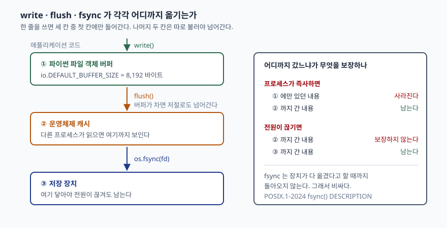

## 들어가며

주문 처리 서버에 로그를 남기는 코드를 짠다. `handle.write(...)` 한 줄이면 끝이라고 생각하고
넘어간다. 며칠 뒤 서버가 비정상 종료했는데, 마지막 몇 초치 로그가 통째로 없다.
장애 직전에 무슨 일이 있었는지를 보려고 남긴 로그인데 하필 그 구간이 비어 있다.

이쯤에서 흔히 택하는 방법이 줄마다 `flush()` 를 부르는 것이고, 조금 더 걱정이 많으면
`os.fsync()` 까지 붙인다. 그리고 처리량이 떨어지면 어디가 느린지 찾느라 시간을 쓴다.
아래에서 재 보면 줄마다 `fsync` 를 부른 쪽이 **967배** 느렸다. 세 가지가 각각 무엇을
보장하는지 모르고 하나를 고르면, 안 쓰는 보장을 1,000배 가까운 값을 치르고 사게 된다.

## 개념

파일에 한 줄을 쓸 때 그 줄은 세 칸을 차례로 지난다.

| 칸 | 어디 | 무엇으로 넘기나 |
|---|---|---|
| ① | 파이썬 파일 객체의 버퍼 (프로세스 메모리) | `write()` 가 여기까지만 한다 |
| ② | 운영체제 캐시 | `flush()` |
| ③ | 저장 장치 | `os.fsync(fd)` |

`write()` 는 **디스크에 쓰라는 명령이 아니다.** 프로세스 안 버퍼에 복사하라는 명령이다.
버퍼가 차면 운영체제로 넘어가지만, 그 시점을 정하는 것은 코드가 아니라 버퍼 크기다.

`flush()` 는 ① 에 모인 것을 ② 로 넘긴다. 여기까지 가면 프로세스가 죽어도 내용이 남는다.
파일이 운영체제 쪽에 있으므로 프로세스와 운명을 같이하지 않기 때문이다.

`os.fsync(fd)` 는 ② 에 있는 것을 ③ 으로 옮긴다. POSIX 명세는 fsync 가
"열린 파일 기술자에 대한 모든 데이터를 전송하도록 요청한다"고 적고,
**시스템이 그 작업을 끝내거나 오류를 만날 때까지 돌아오지 않는다**고 덧붙인다
([POSIX.1-2024 fsync() DESCRIPTION](https://pubs.opengroup.org/onlinepubs/9799919799/functions/fsync.html)).
느린 이유가 이 한 문장에 들어 있다.

## 구조



> **출처**: [POSIX.1-2024 fsync() DESCRIPTION](https://pubs.opengroup.org/onlinepubs/9799919799/functions/fsync.html), [Python 3.13 — os.fsync](https://docs.python.org/3/library/os.html#os.fsync), [Python 3.13 — io.DEFAULT_BUFFER_SIZE](https://docs.python.org/3/library/io.html#io.DEFAULT_BUFFER_SIZE)

## 동작 원리

파이썬 쪽 버퍼 크기는 `io.DEFAULT_BUFFER_SIZE` 다. 이 환경에서는 8,192바이트였다.
텍스트 모드 파일은 이 버퍼를 거쳐 나간다.

`os.fsync` 문서는 "유닉스에서는 네이티브 `fsync()`, 윈도우에서는 MS `_commit()`
함수를 부른다"고 적고, 이어서 **버퍼를 쓰는 파이썬 파일 객체라면 먼저 `f.flush()`
를 한 뒤 `os.fsync(f.fileno())` 를 하라**고 명시한다
([Python 3.13 — os.fsync](https://docs.python.org/3/library/os.html#os.fsync)).
순서가 뒤집히면 ① 에 남은 것이 ③ 으로 가지 않는다. `fsync` 는 파일 기술자를 받으므로
파이썬 버퍼의 존재를 모른다.

그래서 보장의 경계가 둘이다. **프로세스가 죽는 경계**는 ① 과 ② 사이에 있고,
**전원이 끊기는 경계**는 ② 와 ③ 사이에 있다. 둘은 다른 사고이고, 막는 수단도 다르다.

## 실습 예제

전체 소스는 [`code/write_durability.py`](code/write_durability.py), 돌린 기록은
[`code/output.txt`](code/output.txt)에 있다. 52자짜리 로그 한 줄을 10,000번 쓴다.

먼저 `write()` 직후 파일을 다른 핸들로 열어 읽어 본다.

```text
1. write 직후 파일에는 무엇이 있는가
  write 한 줄 직후      다른 핸들로 읽히는 바이트        0
  flush 한 뒤           다른 핸들로 읽히는 바이트       69
  10,000줄을 더 쓴 뒤    다른 핸들로 읽히는 바이트  689,793
  버퍼가 가득 차면 쓰라고 하지 않아도 넘어간다. 경계는 내가 정하지 않는다.
```

한 줄을 쓴 직후에는 **0바이트**다. 파일은 만들어졌지만 비어 있다. `flush()` 한 뒤에
69바이트(한글이 섞인 52자의 UTF-8 길이)가 보인다. 10,000줄을 더 쓰고 나면
689,793바이트가 보이는데, 이때까지 쓴 690,069바이트 중 276바이트가 아직 버퍼에 남아 있다.
**버퍼가 차면 저절로 넘어가므로, `flush` 를 안 불렀다고 아무것도 안 넘어가는 것도 아니다.**
어디까지 갔는지가 실행할 때마다 달라진다는 뜻이다.

네 가지 방식의 시간이다.

```text
2. 같은 10,000줄을 네 가지로 쓰며 시간을 잰다
  버퍼만 — 닫을 때 한 번              0.006초   파일 690,000 바이트
  마지막에 fsync 한 번              0.007초   파일 690,000 바이트
  줄마다 flush                   0.033초   파일 690,000 바이트
  줄마다 flush + fsync           5.945초   파일 690,000 바이트

  버퍼만 대비                         배수
  마지막에 fsync 한 번               1.2배
  줄마다 flush                    5.3배
  줄마다 flush + fsync          967.8배
```

**예상과 달랐던 것은 `flush` 쪽이 생각보다 싸다는 점이다.** 줄마다 불러도 5.3배였다.
반면 `fsync` 는 같은 줄 수에 967.8배가 들었다. 둘을 "둘 다 디스크에 쓰는 것"으로 묶어
생각하면 이 격차를 설명할 수 없다. `flush` 는 메모리 사이의 복사이고,
`fsync` 는 장치가 끝냈다고 할 때까지 기다리는 호출이다.

프로세스를 즉사시켜 경계를 확인했다. 자식 프로세스가 500줄을 쓰고 `close()` 없이
`os._exit(1)` 로 끝난다. 파이썬의 정리 절차가 돌지 않으므로 버퍼는 그대로 사라진다.

```text
3. 프로세스가 죽으면 버퍼는 같이 사라진다
  자식 프로세스가 500줄을 쓰고 close 없이 os._exit(1) 로 즉사한다.
  flush 없이     종료코드 1  남은 바이트       0  남은 줄    0 / 500
  줄마다 flush    종료코드 1  남은 바이트   5,500  남은 줄  500 / 500
```

`flush` 없이 쓴 쪽은 **500줄이 전부 사라졌다.** 5,500바이트는 8,192바이트 버퍼에
들어가고도 남아서 한 번도 넘어가지 않았기 때문이다. `flush` 를 넣은 쪽은 500줄이 전부
남았다. 여기서 `fsync` 는 한 번도 부르지 않았다. **프로세스 사고를 막는 데는 `flush` 면 된다.**

마지막으로 `fsync` 를 몇 줄마다 부르느냐로 시간을 갈랐다.

```text
4. fsync 를 모아서 부르면 얼마나 싸지는가
     1줄마다 fsync   호출 10,001회     5.950초
    10줄마다 fsync   호출  1,001회     0.594초
   100줄마다 fsync   호출    101회     0.061초
  1000줄마다 fsync   호출     11회     0.010초
```

호출 횟수에 거의 그대로 비례한다. 10배로 모으면 10분의 1이다. **비싼 것은 옮기는 바이트
수가 아니라 호출 자체다.** 같은 690,000바이트를 옮기는데 호출을 11번으로 줄이면
0.010초, 10,001번으로 나누면 5.950초다.

## 실무에서 주의할 점

- **막으려는 사고를 먼저 정한다.** 프로세스가 죽는 것까지만 막으면 `flush` 로 충분하다.
  전원이 끊기는 것까지 막아야 하면 `fsync` 가 필요하다. 전자에 후자를 쓰면
  위 측정의 967배를 그냥 낸다.
- **`fsync` 를 모아서 부른다.** 100줄마다로만 모아도 0.061초다. 로그라면
  "최근 N건은 잃어도 된다"는 선을 정하고 그 단위로 묶는다.
- **`flush` 없이 `fsync` 만 부르지 않는다.** `fsync` 는 파일 기술자만 보므로 파이썬
  버퍼에 남은 것을 모른다. 문서가 `f.flush()` 를 먼저 하라고 적은 이유다.
- **"파일에 썼다"를 테스트 통과 기준으로 삼지 않는다.** 같은 프로세스에서 다시 읽으면
  버퍼에 있어도 읽힌다. 1절처럼 **다른 핸들로 열어** 읽어야 ② 까지 갔는지 보인다.
- **버퍼 크기에 기대지 않는다.** 위에서 276바이트가 버퍼에 남은 것처럼, 어디까지 넘어갔는지는
  줄 길이와 버퍼 크기에 따라 매번 달라진다. 경계를 정하고 싶으면 명시적으로 부른다.
- **디렉터리도 따로 `fsync` 해야 할 때가 있다.** 파일을 새로 만든 경우, 파일 내용이
  장치에 닿아도 그 파일이 디렉터리에 등록된 사실은 별개다. 이 글의 측정 범위 밖이므로
  필요하면 대상 플랫폼 문서를 확인한다.

## 정리

- `write()` 는 프로세스 버퍼까지만 옮긴다. 디스크와는 아직 무관하다.
- `flush()` 는 운영체제까지 옮긴다. 프로세스가 죽어도 남는다 — 측정에서 500줄 중 500줄.
- `os.fsync()` 는 저장 장치까지 옮긴다. 장치가 끝낼 때까지 돌아오지 않아서 비싸다.
- 같은 10,000줄에서 줄마다 `flush` 는 5.3배, 줄마다 `fsync` 는 967.8배였다.
- `fsync` 비용은 옮긴 바이트가 아니라 호출 횟수에 붙는다. 1000줄로 모으면 0.010초다.

## 참고 자료

- [POSIX.1-2024 fsync() — The Open Group Base Specifications Issue 8](https://pubs.opengroup.org/onlinepubs/9799919799/functions/fsync.html)
- [Python 3.13 — os.fsync](https://docs.python.org/3/library/os.html#os.fsync)
- [Python 3.13 — io.DEFAULT_BUFFER_SIZE](https://docs.python.org/3/library/io.html#io.DEFAULT_BUFFER_SIZE)
- [Python 3.13 — io.IOBase.flush](https://docs.python.org/3/library/io.html#io.IOBase.flush)
- [Python 3.13 — os._exit](https://docs.python.org/3/library/os.html#os._exit)
