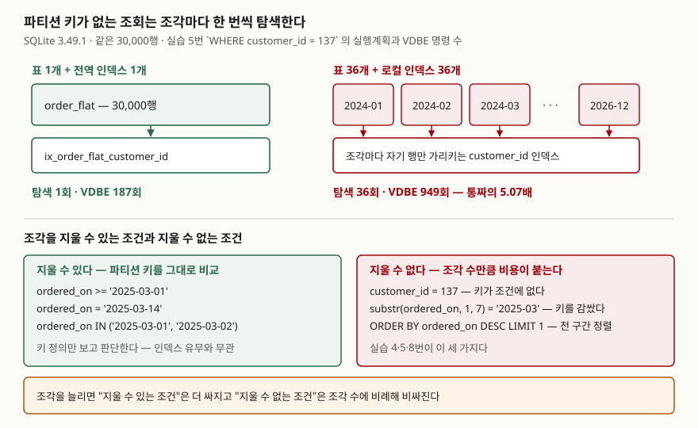

<!-- related:start -->
> **같은 기능을 다른 환경에서 다룬 글** (`table-partitioning`)
> - [Tibero 7 파티션 테이블 — 종류별로 언제 쓰는가](../tibero/2026-09-23-tibero7-partition-table-types/index.md) — Tibero 7
<!-- related:end -->

## 들어가며

주문 테이블이 3천만 행을 넘기면 배치가 밤새 돌기 시작한다. 이때 가장 먼저 나오는 제안이 "연도별로 파티션을
나누자"다. 실제로 월별 마감 배치는 빨라진다. 그런데 몇 주 뒤 고객센터에서 "특정 고객의 전체 주문 내역"을
여는 화면이 느려졌다는 말이 나온다. 같은 인덱스를 똑같이 걸었는데 그렇다. 여기서 보통은 인덱스를 더 만들거나
힌트를 붙여 넘기는데, 늘어난 쪽의 원인은 인덱스가 아니라 **조각 수** 자체다.

파티션이 비용을 줄이는 방식은 하나뿐이다. **읽지 않아도 되는 조각을 통째로 건너뛰는 것**(파티션 프루닝)이다.
이 전제가 깨지면 나뉜 것은 그대로 비용이 된다. 그 비용이 얼마나 되는지를 숫자로 보자.

## 개념

PostgreSQL 문서는 파티션 프루닝을 이렇게 정의한다. 플래너가 각 파티션의 정의를 살펴 그 파티션이
`WHERE` 절을 만족하는 행을 가질 수 없음을 **증명**하면 그 파티션을 계획에서 제외한다. 그리고 바로 다음 문장이
이 글의 핵심이다.

> 프루닝은 파티션 키가 암묵적으로 정의하는 제약만으로 판단되며, 인덱스의 존재 여부로 판단되지 않는다.
> — PostgreSQL 16 문서, [파티션 프루닝 절(§5.11.4)](https://www.postgresql.org/docs/16/ddl-partitioning.html#DDL-PARTITION-PRUNING)

즉 프루닝은 **질의에 파티션 키가 비교 가능한 모양으로 들어 있을 때만** 작동한다. 키가 조건에 없거나,
키를 함수로 감쌌거나, 전 구간을 훑어야 하는 정렬이면 플래너는 어떤 조각도 지우지 못한다.
그러면 질의는 조각 하나하나를 따로 열어야 한다.

## 구조



> **출처**: [PostgreSQL 16 — 파티션 프루닝 절(§5.11.4)](https://www.postgresql.org/docs/16/ddl-partitioning.html#DDL-PARTITION-PRUNING)(프루닝이 파티션 키 정의로만 판단된다는 규칙),
> [PostgreSQL 16 — 선언적 파티셔닝 모범 사례 절(§5.11.6)](https://www.postgresql.org/docs/16/ddl-partitioning.html#DDL-PARTITIONING-DECLARATIVE-BEST-PRACTICES)(프루닝 후 남는 파티션이 많으면 계획 시간과 메모리가 늘어난다).
> 탐색 횟수와 VDBE 명령 수는 실습 5번의 실행 결과다.

## 동작 원리

### 측정을 무엇으로 하는가

SQLite에는 네이티브 파티션이 없다. 대신 파티션 테이블의 원형인 **`UNION ALL` 파티션 뷰**를 세운다.
같은 30,000행을 세 가지 모양으로 넣었다.

| 이름 | 모양 | 인덱스 |
|---|---|---|
| `order_flat` | 표 1개 | 전역 인덱스 2개 (`ordered_on`, `customer_id`) |
| `order_y` | 연 단위 표 3개를 `UNION ALL` | 표마다 같은 모양의 인덱스 2개 |
| `order_m` | 월 단위 표 36개를 `UNION ALL` | 표마다 같은 모양의 인덱스 2개 |

일의 양은 시간이 아니라 **VDBE 명령 실행 횟수**로 쟀다. `sqlite3.Connection.set_progress_handler`를 간격 1로
걸면 가상 머신 명령마다 콜백이 불린다. 같은 입력이면 몇 번을 돌려도 같은 수가 나와서, 벽시계 시간과 달리
다른 프로세스에 흔들리지 않는다.

### CHECK 제약은 조각을 지워 주지 않는다

각 조각 표에는 연도를 못 박는 `CHECK (ordered_on >= '2026-01-01' AND ordered_on < '2027-01-01')`를 걸어 뒀다.
2026년만 묻는 질의라면 2024·2025 조각은 열 필요가 없다. 그런데 실행계획에는 셋이 다 나온다(실습 1번).

```text
CO-ROUTINE order_y
COMPOUND QUERY
LEFT-MOST SUBQUERY
SEARCH order_y2024 USING INDEX ix_order_y2024_ordered_on (ordered_on>? AND ordered_on<?)
UNION ALL
SEARCH order_y2025 USING INDEX ix_order_y2025_ordered_on (ordered_on>? AND ordered_on<?)
UNION ALL
SEARCH order_y2026 USING INDEX ix_order_y2026_ordered_on (ordered_on>? AND ordered_on<?)
SCAN order_y
```

SQLite는 조건을 각 가지로 밀어 넣어 **인덱스 탐색까지는 해 준다.** 하지만 `CHECK` 제약을 보고 가지를 지우지는
않는다. 그래서 2024 조각도 열어서 "없다"를 확인하고 나온다. 이 글의 파티션 뷰는 **프루닝이 없는 파티션**이고,
그래서 "프루닝이 깨졌을 때 남는 비용"을 그대로 보여준다.

### 파티션 키로 물어도 조각 수만큼 연다

```text
-- 3. 2025년 3월 한 달 — 조각 하나에만 들어 있다
   SELECT COUNT(*) FROM <표> WHERE ordered_on >= '2025-03-01' AND ordered_on < '2025-04-01'
   [통짜  1조각] 결과 (810,) · VDBE     2,449회 · 통짜의    1.00배 · 계획 SEARCH 1 / SCAN 0
   [연  단위 3조각] 결과 (810,) · VDBE    12,194회 · 통짜의    4.98배 · 계획 SEARCH 3 / SCAN 1
   [월 단위 36조각] 결과 (810,) · VDBE    12,498회 · 통짜의    5.10배 · 계획 SEARCH 36 / SCAN 1
```

810행은 36조각 중 **딱 한 조각**에만 들어 있다. 그런데 36번 탐색했다. 프루닝이 있었다면 36조각 쪽이
가장 쌌을 자리다. 프루닝이 없으니 조각이 많을수록 손해다.

여기서 눈여겨볼 것은 3조각과 36조각의 차이가 2.5%밖에 안 된다는 점이다(12,194 → 12,498).
**빈 조각을 여는 고정 비용은 조각당 10회 안팎**이고, 진짜 비용은 결과 810행을 뷰 밖으로 나르는 쪽에 있다.
조각 수가 세 자리로 가면 이 고정 비용이 보이기 시작한다. PostgreSQL 문서도 프루닝 후 남는 파티션이 많으면
계획 시간과 메모리 사용량이 늘어난다고 적어 둔다.

### 키를 함수로 감싸면 인덱스까지 같이 잃는다

```text
-- 4. 같은 3월을 substr() 로 — 키를 함수로 감쌌다
   SELECT COUNT(*) FROM <표> WHERE substr(ordered_on, 1, 7) = '2025-03'
   [통짜  1조각] 결과 (810,) · VDBE   120,825회 · 통짜의    1.00배 · 계획 SEARCH 0 / SCAN 1
   [연  단위 3조각] 결과 (810,) · VDBE   128,941회 · 통짜의    1.07배 · 계획 SEARCH 0 / SCAN 4
   [월 단위 36조각] 결과 (810,) · VDBE   129,107회 · 통짜의    1.07배 · 계획 SEARCH 0 / SCAN 37
```

3번과 같은 810행을 뽑는데 통짜 기준으로 **49배**가 들었다(2,449 → 120,825). `SEARCH`가 전부 `SCAN`으로
바뀌었다. 파티션이 아니어도 일어나는 일이지만, 파티션 환경에서는 손실이 두 겹이다. 인덱스를 잃고,
프루닝도 같이 잃는다. 날짜를 문자열로 잘라 비교하는 습관이 가장 흔한 원인이다.

### 파티션 키가 없는 조회 — 전역 인덱스와 로컬 인덱스의 갈림길

```text
-- 5. 고객 137번의 주문 건수 (연도 조건 없음)
   SELECT COUNT(*) FROM <표> WHERE customer_id = 137
   [통짜  1조각] 결과 (58,) · VDBE       187회 · 통짜의    1.00배 · 계획 SEARCH 1 / SCAN 0
   [연  단위 3조각] 결과 (58,) · VDBE       783회 · 통짜의    4.19배 · 계획 SEARCH 3 / SCAN 1
   [월 단위 36조각] 결과 (58,) · VDBE       949회 · 통짜의    5.07배 · 계획 SEARCH 36 / SCAN 1
```

58행을 찾는 데 통짜는 B-트리를 한 번 내려가고 끝난다. 36조각은 36번 내려간다. 조건에 파티션 키가 없으니
어느 조각에 있는지 알 길이 없기 때문이다. 이것이 **로컬 인덱스만 두었을 때의 비용**이고,
상용 엔진에서 이 비용을 없애려고 두는 것이 **전역 인덱스**다. Tibero 7 관리자 안내서는 로컬 파티션 인덱스를
"테이블의 한 파티션과 1:1로 대응"하는 것으로, 글로벌 파티션 인덱스를 "테이블의 어느 파티션에 있는 로우라도
가리킬 수 있는" 것으로 정의한다. 전역 인덱스를 두면 이 조회는 한 번의 탐색으로 끝나지만,
그 대신 파티션 하나를 떼어낼 때 전역 인덱스 전체가 영향을 받는다.

조건을 좁혀도 탐색 횟수는 줄지 않았다. 실습 6번에서 `customer_id = 137`에 2025년 3월 조건을 더했을 때
36조각은 여전히 `SEARCH` 36개였다(그 고객은 그달 주문이 없어 결과는 0건이다). VDBE는 857회로,
좁히지 않은 949회에서 10%밖에 줄지 않았다.

### 예상과 달랐던 것 — 전 구간 정렬에서 38,000배가 났다

```text
-- 8. 가장 최근 주문 1건
   SELECT order_id FROM <표> ORDER BY ordered_on DESC, order_id DESC LIMIT 1
   [통짜  1조각] 결과 (29859,) · VDBE        11회 · 통짜의    1.00배 · 계획 SEARCH 0 / SCAN 1
       통짜 계획: SCAN order_flat USING COVERING INDEX ix_order_flat_ordered_on
   [연  단위 3조각] 결과 (29859,) · VDBE   420,407회 · 통짜의 38218.82배 · 계획 SEARCH 0 / SCAN 4
   [월 단위 36조각] 결과 (29859,) · VDBE   423,771회 · 통짜의 38524.64배 · 계획 SEARCH 0 / SCAN 37
```

통짜 쪽은 **11회**다. `ordered_on` 인덱스를 거꾸로 한 칸 읽고 끝냈다. `order_id`가
`INTEGER PRIMARY KEY`라 인덱스 항목이 `(ordered_on, order_id)`가 되고, 그래서 `ORDER BY ordered_on DESC,
order_id DESC`가 인덱스의 역순과 정확히 같다. 조각 쪽은 42만 회가 넘는다. 조각마다 임시 B-트리를 만들어
정렬한 뒤 합쳐야 해서, 30,000행을 전부 거친다.

이 차이가 다른 항목들보다 두 자릿수 더 큰 이유가 있다. 다른 질의는 조각 수에 **비례해서** 늘었지만,
이것은 통짜 쪽의 비용이 `LIMIT 1` 덕분에 **상수로 떨어져** 있던 자리다. 상수와 전체 훑기의 차이라
배수가 3조각에서 이미 38,218배이고 36조각이라고 더 커지지 않는다(38,524배). 배수가 큰 것은
조각이 많아서가 아니라 **통짜 쪽이 거의 공짜였기 때문**이다.

대시보드의 "최근 주문", 관리 화면의 "마지막 로그인" 같은 질의가 정확히 이 모양이다.
파티션을 나눈 뒤 이런 화면이 느려지면 조각 수를 의심하기 전에 **상수 비용이던 질의가 전 구간 훑기로
바뀌지 않았는지**를 먼저 본다.

## 실습 예제

전체 소스: [`code/partition_pruning_cost.py`](code/partition_pruning_cost.py), 실행 기록: [`code/output.txt`](code/output.txt).
난수 시드는 42로 고정했고 고객은 500명이다. 전 구간 집계(실습 7번)는 통짜 90,010회 대 조각 300,018회로
3.33배였다 — 어느 조각도 지울 수 없으니 뷰를 거치는 비용만 더 붙는다.

## 다른 환경에서는

같은 기능을 Tibero 7에서 다룬 글이 [Tibero 7 파티션 테이블 — 종류별로 언제 쓰는가](../tibero/2026-09-23-tibero7-partition-table-types/index.md)에 있다.
문법과 지원 범위가 환경마다 다르다.

| 항목 | SQLite 3.49.1 | PostgreSQL 16 | Tibero 7.2 |
|---|---|---|---|
| 네이티브 파티션 | 없다 (`UNION ALL` 뷰로 흉내 낸다) | 선언적 파티셔닝 | RANGE·LIST·HASH·INTERVAL·복합 |
| 파티션 프루닝 | 없다 — `CHECK`를 보고 가지를 지우지 않는다 | 계획 시점·실행 시점 모두 | 지원 (매뉴얼은 "1/N의 정보만 검색") |
| 전역 인덱스 | 해당 없음 | 없다 (인덱스는 파티션마다 붙는다) | 글로벌 파티션 인덱스 |
| 최대 파티션 수 | 제한 규정 없음 | 문서는 수천 개까지를 권장 범위로 든다 | 10,000개 |
| 유니크 제약 | 해당 없음 | 파티션 키 컬럼을 전부 포함해야 한다 | 글로벌 인덱스로 해결 가능 |

어느 쪽이 낫다는 이야기가 아니다. PostgreSQL은 전역 인덱스를 두지 않는 대신 유니크 제약에 파티션 키를
포함하도록 요구해 **조각 사이의 중복을 파티션 구조 자체로 막는다**. Tibero는 글로벌 인덱스를 두는 대신
파티션을 떼어낼 때 그 인덱스를 어떻게 할지를 쓰는 쪽이 정하게 한다. 설계 선택이 다르다.

## 실무에서 주의할 점

- **파티션 키를 쓰지 않는 조회가 전체의 몇 %인지 먼저 센다.** 그 비율이 높으면 나누기 전에 느려질 질의
  목록부터 만들어야 한다. 실습 5번처럼 단건 조회가 조각 수만큼 탐색으로 바뀐다.
- **날짜 파티션 키를 함수로 감싸지 않는다.** `substr(ordered_on, 1, 7) = '2025-03'`은 인덱스와 프루닝을
  동시에 잃는다(실습 4번, 49배). 범위 비교로 바꾼다.
- **`ORDER BY ... LIMIT n`이 붙은 화면을 따로 점검한다.** 통짜에서 상수 비용이던 질의가 전 구간 정렬로
  바뀌면 배수가 네 자리로 뛴다(실습 8번). 정렬 키가 파티션 키와 같으면 엔진이 조각을 순서대로 읽을 수
  있는지 실행계획으로 확인한다.
- **조각을 잘게 쪼갤수록 좋아지는 것은 프루닝되는 질의뿐이다.** 3조각과 36조각의 차이가 질의마다 달랐다 —
  프루닝 없는 범위 조회는 2.5%, 단건 조회는 21%, 좁힌 조회는 117% 늘었다. 조각 수는 **관리 단위**로 정하고
  (한 번에 지우거나 옮길 단위), 성능으로 정하지 않는다.
- **유니크 제약과 파티션 키의 관계를 먼저 확인한다.** PostgreSQL은 유니크 제약의 컬럼이 파티션 키 컬럼을
  전부 포함해야 한다. 기존 유니크 키가 이 조건을 못 맞추면 파티션 설계를 다시 해야 한다.

## 정리

- 파티션이 비용을 줄이는 방법은 조각을 통째로 건너뛰는 프루닝 하나뿐이고, 프루닝은 **파티션 키가 조건에
  비교 가능한 모양으로 있을 때만** 작동한다. 인덱스 유무와는 무관하다.
- 프루닝이 안 되면 조각 수만큼 인덱스를 뒤진다. 36조각에서 단건 조회가 통짜의 5.07배였다.
- 키를 함수로 감싸면 인덱스와 프루닝을 같이 잃는다. 같은 810행을 뽑는 데 49배가 들었다.
- 전 구간 정렬은 피해가 가장 크다. `LIMIT 1`로 상수였던 질의가 전체 훑기가 되어 38,000배가 났다.
- 조각 수는 지우고 옮기는 관리 단위로 정한다. 잘게 쪼개서 이득을 보는 것은 프루닝되는 질의뿐이다.

## 참고 자료

- [PostgreSQL 16 — Table Partitioning §5.11.4 Partition Pruning](https://www.postgresql.org/docs/16/ddl-partitioning.html#DDL-PARTITION-PRUNING) — 프루닝의 정의, 파티션 키 정의로만 판단한다는 규칙, 계획 시점·실행 시점 프루닝
- [PostgreSQL 16 — §5.11.2.3 Limitations](https://www.postgresql.org/docs/16/ddl-partitioning.html#DDL-PARTITIONING-DECLARATIVE-LIMITATIONS) — 유니크·기본키 제약이 파티션 키 컬럼을 전부 포함해야 하는 이유
- [PostgreSQL 16 — §5.11.6 Declarative Partitioning Best Practices](https://www.postgresql.org/docs/16/ddl-partitioning.html#DDL-PARTITIONING-DECLARATIVE-BEST-PRACTICES) — 파티션 수가 많을 때의 계획 시간·메모리 증가
- [SQLite — EXPLAIN QUERY PLAN §1.1 Table and Index Scans](https://www.sqlite.org/eqp.html#table_and_index_scans) — SEARCH·SCAN 구분
- [SQLite — C API: sqlite3_progress_handler()](https://www.sqlite.org/c3ref/progress_handler.html) — VDBE 명령 간격으로 콜백을 거는 인터페이스
- [Tibero 7.2.6 관리자 안내서 — 스키마 객체 관리](https://docs.tibero.com/tibero-manuals/7.2.6.manuals/administrator-guide/schema-object-management.md) — 로컬·글로벌 파티션 인덱스의 정의, 최대 파티션 개수
