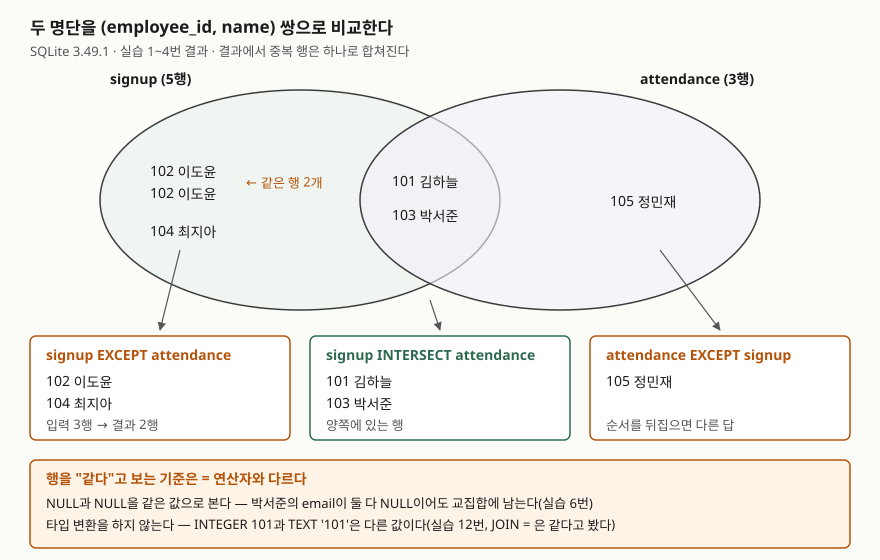

## 들어가며

사내 교육을 운영하다 보면 신청 명단과 출석 명단이 따로 생긴다. 교육이 끝나면 "신청하고 안 온 사람"과
"신청 없이 온 사람"을 뽑아 달라는 요청이 온다. 흔히 엑셀 두 장을 나란히 띄우고 이름을 하나씩 찾아 표시하는데,
신청자가 200명이고 출석자가 180명이면 신청자 한 명마다 출석 명단을 훑어야 하므로 최악의 경우 3만 6천 번을
보게 된다. SQL로 옮겨도 `JOIN`이나 `NOT IN`으로 짜다 보면 조건이 길어지고, NULL이 섞이면 결과가 조용히 틀린다.
두 결과를 **행 단위로 통째로 비교하는** 연산자가 따로 있다.

## 개념

`INTERSECT`와 `EXCEPT`는 **집합 연산자**다. 두 `SELECT`의 결과를 하나로 합치는 `UNION`과 같은 무리에 속한다.
이렇게 `SELECT` 여러 개를 연산자로 이은 문장을 SQLite 문서는 **복합 SELECT(compound SELECT)** 라고 부른다.

| 연산자 | 결과 | 집합 기호 |
|---|---|---|
| `A UNION B` | A나 B에 있는 행 | A ∪ B |
| `A INTERSECT B` | A와 B 모두에 있는 행 | A ∩ B |
| `A EXCEPT B` | A에는 있고 B에는 없는 행 | A − B |

`JOIN`은 **조건에 맞는 행끼리 옆으로 붙이는** 연산이다. 집합 연산자는 **행 전체를 한 덩어리로 보고** 위아래로
비교한다. 그래서 "어느 컬럼끼리 같아야 하는가"를 적지 않는다. 같은 자리의 컬럼이 전부 같으면 같은 행이다.
## 구조



> **출처**: [SQLite — SELECT: Compound Select Statements](https://www.sqlite.org/lang_select.html#compound_select_statements)(연산자별 결과, 중복 제거, NULL 처리),
> [SQLite — Datatypes §6 Sorting, Grouping and Compound SELECTs](https://www.sqlite.org/datatype3.html#sorting_grouping_and_compound_selects)(비교에 친화도를 적용하지 않음).
> 이름과 행 수는 실습 1~4번의 실행 결과다.

## 동작 원리

SQLite 문서가 정한 규칙은 다섯 가지다. 실습이 이 규칙을 하나씩 확인한다.

1. **양쪽 `SELECT`의 컬럼 수가 같아야 한다.** 이름이나 뜻은 보지 않는다. 자리 순서로 맞춘다.
2. **`INTERSECT`와 `EXCEPT`의 결과에서는 중복 행이 빠진다.** 입력에 같은 행이 두 번 있어도 결과에는 한 번 나온다.
3. **행이 같은지 볼 때 NULL끼리는 같은 값으로 본다.** `WHERE a = b`에서 `NULL = NULL`이 참이 아닌 것과 다르다.
4. **값을 비교할 때 타입 친화도(affinity)를 적용하지 않는다.** 친화도는 SQLite가 컬럼 타입에 맞춰 값을 바꿔 보는 규칙이다.
   `=` 비교는 정수 컬럼과 문자열 컬럼을 비교할 때 문자열 쪽을 숫자로 바꿔 보지만, 집합 연산자는 값을 있는 그대로 비교한다.
5. **연산자 셋 이상을 이으면 왼쪽부터 차례로 묶는다.** `A op B op C`는 `(A op B) op C`다.

5번은 SQL 표준과 다르다. 표준은 `INTERSECT`를 `UNION`·`EXCEPT`보다 먼저 묶는다. SQLite의 엔진 간 차이를 모은
sqllogictest 문서도 SQLite가 셋을 같은 우선순위로 다룬다는 점을 표준과의 차이로 적어 두었다.

## 실습 예제

전체 소스: [`code/intersect_except_rosters.py`](code/intersect_except_rosters.py), 실행 기록: [`code/output.txt`](code/output.txt).
신청 명단 `signup` 5행에는 **이도윤이 두 번** 들어가 있고, **박서준은 두 명단 모두 email이 NULL**이다.

```text
[attendance]  3행
  employee_id | name   | email
  ------------+--------+-------------------
          101 | 김하늘 | sky@example.com
          103 | 박서준 | NULL
          105 | 정민재 | minjae@example.com

[signup]  5행
  employee_id | name   | email
  ------------+--------+------------------
          101 | 김하늘 | sky@example.com
          102 | 이도윤 | doyun@example.com
          102 | 이도윤 | doyun@example.com
          103 | 박서준 | NULL
          104 | 최지아 | jia@example.com
```

출석부를 엑셀에서 옮기다 사번이 문자열이 된 `attendance_sheet`(101 김하늘, 105 정민재, 사번 TEXT)도 하나 더 둔다.

### 교집합과 차집합, 그리고 방향

```text
-- 1. 신청도 하고 출석도 한 사람 — INTERSECT
   => employee_id | name
      101 | 김하늘
      103 | 박서준
-- 2. 신청만 하고 안 온 사람 — EXCEPT
   => employee_id | name
      102 | 이도윤
      104 | 최지아
-- 3. 신청 없이 온 사람 — 순서를 뒤집은 EXCEPT
   => employee_id | name
      105 | 정민재
```

`EXCEPT`는 순서를 바꾸면 답이 바뀐다. 2번은 "신청만 한 사람", 3번은 "신청 없이 온 사람"이다.
2번에서 이도윤은 입력에 두 번 있었지만 결과에는 한 번 나왔다. 4번에서 행 수를 세어 보면 입력 5행, 결과 2행이다.
SQLite 3.49.1은 중복을 살리는 `INTERSECT ALL`을 받지 않는다(5번, `near "ALL": syntax error`).

### NULL — 집합 연산자는 같다고 본다

```text
-- 6. NULL 이 든 행 — INTERSECT 는 NULL 끼리 같다고 본다
   => employee_id | name | email
      101 | 김하늘 | sky@example.com
      103 | 박서준 | None
   (2행)
-- 7. 같은 일을 JOIN 으로 — email 까지 = 로 비교하면
   => employee_id | name | email
      101 | 김하늘 | sky@example.com
   (1행)
```

박서준은 집합 연산에서는 교집합에 남았고, `=`로 조인하면 빠졌다. 차집합도 같은 차이가 난다. 출석 명단의 email에
NULL이 하나 있으니 `NOT IN (SELECT email FROM attendance)`는 **0행**을 돌려줬다(8번). 같은 질문을 `EXCEPT`로 하면
doyun과 jia 두 주소가 나온다(9번). `NOT IN`이 NULL 때문에 비는 이유는 [IN·EXISTS·NOT IN 글](../2026-09-28-in-exists-not-in-null/index.md)에 있다.

### 예상과 달랐던 것 — 타입이 다르면 같은 값이 아니다

```text
-- 12. 타입이 다른 컬럼 — INTEGER 101 과 TEXT '101'
   => employee_id | name
   (0행)
-- 13. 같은 비교를 JOIN = 로 하면
   => employee_id | name
      101 | 김하늘
   (1행)
-- 14. CAST 로 타입을 맞춘 INTERSECT
   => employee_id | name
      101 | 김하늘
   (1행)
```

눈으로 보면 101 김하늘은 두 표에 다 있다. 그런데 `INTERSECT`는 0행이었다. `JOIN`의 `=`는 정수 컬럼과 문자열 컬럼을
비교할 때 문자열 `'101'`을 숫자로 바꿔 보므로 같다고 판정한다. 집합 연산자는 이 변환을 하지 않아 정수 101과 문자열
'101'을 다른 값으로 본다. 에러는 나지 않는다. `CAST`로 한쪽 타입을 맞추자 한 행이 나왔다.

### 섞어 쓰면 왼쪽부터 묶인다

```text
-- 15. 섞어 쓰면 — signup EXCEPT attendance INTERSECT attendance_sheet
   => employee_id
   (0행)
-- 16. 괄호로 오른쪽을 먼저 묶으려 하면
   에러: near "(": syntax error
-- 17. 하위 질의로 오른쪽을 먼저 계산한다
   => employee_id
      102
      103
      104
   (3행)
```

15번은 `(signup EXCEPT attendance) INTERSECT sheet`로 계산됐다. {102, 104}와 {101, 105}의 교집합이라 비었다.
표준대로 `INTERSECT`를 먼저 묶었다면 `signup EXCEPT {101, 105}`라 102·103·104가 나와야 한다.
SQLite는 복합 SELECT의 구성원을 괄호로 묶는 문법을 받지 않으므로(16번), 17번처럼 하위 질의로 감싸야 그 순서가 된다.

### ORDER BY는 맨 끝에 한 번

개별 `SELECT`에 `ORDER BY`를 붙이면 `ORDER BY clause should come after EXCEPT not before`가 난다(18번).
맨 끝의 `ORDER BY`는 합친 결과 전체를 정렬한다(19번).

## 실무에서 주의할 점

- **컬럼 순서가 틀려도 에러가 나지 않는다.** 11번은 `(employee_id, name)`과 `(name, employee_id)`를 비교해
  0행을 냈다. "겹치는 사람이 없다"로 읽히기 쉽다. 결과가 비면 양쪽 `SELECT`의 컬럼 순서부터 본다.
  같은 함정을 [INSERT … SELECT 글](../2026-09-29-insert-single-multi-select/index.md)에서도 다뤘다.
- **타입이 섞인 데이터를 비교할 때는 `CAST`로 맞춘다.** 외부 파일에서 들어온 표는 숫자가 문자열로 들어오기 쉽다.
  `=`로는 같던 값이 집합 연산에서는 다른 값이 된다(12·13번).
- **중복 개수가 의미 있으면 집합 연산자를 쓰지 않는다.** 결과는 항상 중복 없는 집합이다. "신청을 두 번 한 사람"을
  찾으려면 `GROUP BY … HAVING COUNT(*) > 1`이 맞다.
- **NULL을 다르게 다루는 두 방식을 섞지 않는다.** 차집합을 `NOT IN`으로 짜면 NULL 하나에 결과가 빈다(8번).
  NULL이 들어올 수 있는 컬럼이면 `EXCEPT`나 `NOT EXISTS`를 쓴다.
- **연산자를 섞으면 하위 질의로 순서를 적는다.** SQLite는 왼쪽부터 묶고, 표준을 따르는 DB는 `INTERSECT`를 먼저
  묶는다. 같은 문장이 DB마다 다른 답을 낸다(15·17번).

## 정리

- `INTERSECT`는 양쪽에 있는 행, `EXCEPT`는 왼쪽에만 있는 행을 돌려준다. `EXCEPT`는 순서를 바꾸면 답이 바뀐다.
- 컬럼 수만 맞으면 이름은 보지 않고 자리 순서로 비교한다. 결과에서 중복 행은 빠진다.
- NULL끼리는 같은 값으로 보고, 타입 친화도는 적용하지 않는다. 그래서 INTEGER 101과 TEXT '101'은 다른 값이다.
- SQLite 3.49.1은 연산자를 왼쪽부터 묶고 괄호 묶기를 받지 않는다. 먼저 계산할 쪽은 하위 질의로 감싼다.

## 참고 자료

- [SQLite — SELECT: Compound Select Statements](https://www.sqlite.org/lang_select.html#compound_select_statements) — 연산자 정의, 중복 제거, NULL 처리, 왼쪽부터 묶는 규칙, ORDER BY 위치
- [SQLite — Datatypes §6 Sorting, Grouping and Compound SELECTs](https://www.sqlite.org/datatype3.html#sorting_grouping_and_compound_selects) — 집합 연산 비교에 친화도를 적용하지 않음
- [SQLite — Datatypes §4.2 Type Conversions Prior To Comparison](https://www.sqlite.org/datatype3.html#type_conversions_prior_to_comparison) — `=` 비교에서 TEXT 쪽에 NUMERIC 친화도를 적용하는 규칙
- [sqllogictest — Differences Between Engines](https://sqlite.org/sqllogictest/wiki?name=Differences+Between+Engines) — 집합 연산자 우선순위가 표준과 다르다는 기록
