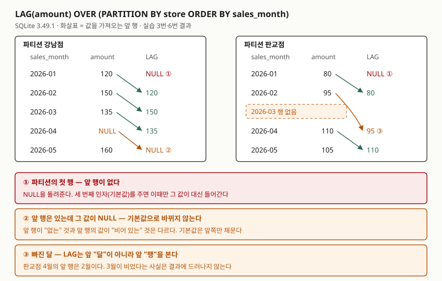

<!-- related:start -->
> **같은 기능을 다른 환경에서 다룬 글** (`window-function`)
> - [윈도우 함수 입문 — ROW_NUMBER로 그룹별 1등 뽑기](../2026-10-03-window-function-row-number-top-per-group/index.md) — SQLite 3.49.1, Python 3.13.5, Windows 11
> - [RANK와 DENSE_RANK — 동점을 어떻게 셀까](../2026-10-06-rank-dense-rank-ties/index.md) — SQLite 3.49.1, Python 3.13.5, Windows 11
> - [누적합과 이동평균 — SUM OVER의 프레임](../2026-10-06-sum-over-frame-rows-range/index.md) — SQLite 3.49.1, Python 3.13.5, Windows 11
> - [FIRST_VALUE와 LAST_VALUE — 구간의 처음과 끝](../2026-10-16-first-value-last-value-window-frame/index.md) — SQLite 3.49.1, Python 3.13.5
> - [Tibero 7 분석 함수의 윈도우 절 — ROWS와 RANGE는 어디서 갈리는가](../../tibero/2026-09-23-tibero7-window-clause/index.md) — Tibero 7
<!-- related:end -->

## 들어가며

가게 매출을 월별로 정리하는 작은 대시보드를 만든다고 하자. "지난달보다 얼마나 늘었나" 칸을 넣으려면 이번 달
행 옆에 지난달 매출이 있어야 한다. 흔히 택하는 방법은 같은 표를 한 번 더 붙이는 자기 조인이다. 그런데
"지난달"을 조건으로 적으려면 달 문자열을 계산하거나 "나보다 앞선 달 가운데 가장 늦은 달"을 찾는 하위 질의를
행마다 돌려야 한다. 매장이 여럿이면 매장 조건이 또 붙는다. 실습 12번의 자기 조인은 하위 질의를 포함해
10줄이 됐고, 같은 결과를 `LAG` 한 줄이 냈다.

## 개념

`LAG`와 `LEAD`는 윈도우 함수다. 윈도우 함수는 행 수를 줄이지 않고, 계산한 값을 각 행 옆에 컬럼으로 붙인다.
`LAG`는 **정한 순서에서 앞 행**의 값을, `LEAD`는 **뒤 행**의 값을 가져온다.

```sql
LAG(amount)        OVER (PARTITION BY store ORDER BY sales_month)
LAG(amount, 2)     OVER (...)   -- 두 행 앞
LAG(amount, 1, 0)  OVER (...)   -- 앞 행이 없으면 0
```

| 인자 | 뜻 | 생략하면 |
|---|---|---|
| 첫째 `expr` | 가져올 값 | 생략 불가 |
| 둘째 `offset` | 몇 행 앞(뒤)인가. 문서는 0 이상의 정수여야 한다고 적는다 | 1 |
| 셋째 `default` | 그 위치에 **행이 없을 때** 돌려줄 값 | NULL |

`OVER` 안의 `ORDER BY`가 "앞"의 기준이고, `PARTITION BY`는 그 순서를 따로 매길 묶음(파티션)을 정한다.

## 구조



> **출처**: [SQLite — Window Functions §3 Built-in Window Functions](https://www.sqlite.org/windowfunctions.html#built_in_window_functions)(`lag()`·`lead()`의 세 가지 형태와 기본값 정의).
> 표의 값은 실습 3번과 6번의 실행 결과다.

## 동작 원리

SQLite는 먼저 `PARTITION BY` 값으로 행을 나누고, 파티션마다 `ORDER BY` 순서로 줄을 세운다. 그다음 각 행에서
"이 파티션 안에서 offset만큼 앞(뒤)에 있는 행"을 찾아 그 행에서 `expr`을 계산한다. 찾을 행이 파티션 밖으로
나가면 행이 없는 것이므로 `default`(없으면 NULL)를 준다.

여기서 두 가지가 정해진다. 첫째, "앞"은 **행의 위치**다. 달이 비어 있어도 LAG는 알 수 없다. 둘째, 기본값은 **행이
없을 때만** 쓰인다. 앞 행이 있고 그 행의 값이 NULL이면 그 NULL을 그대로 가져온다.

문서는 `lag()`·`lead()`가 프레임 지정(`ROWS BETWEEN …`)을 무시한다고 적는다. 프레임을 현재 행 하나로 좁힌
실습 11번에서도 LAG는 앞 행의 값을 가져왔다. 같은 프레임에서 `FIRST_VALUE`는 자기 값을 냈다.

## 실습 예제

전체 소스: [`code/lag_lead_month_over_month.py`](code/lag_lead_month_over_month.py), 실행 기록: [`code/output.txt`](code/output.txt).
두 매장의 월 매출 9행이다. **강남점 4월은 값이 NULL**이고 **판교점은 3월 행이 없다.**

```text
  store  | sales_month | amount
  -------+-------------+-------
  강남점 | 2026-01     |    120
  강남점 | 2026-02     |    150
  강남점 | 2026-03     |    135
  강남점 | 2026-04     |   NULL
  강남점 | 2026-05     |    160
  판교점 | 2026-01     |     80
  판교점 | 2026-02     |     95
  판교점 | 2026-04     |    110
  판교점 | 2026-05     |    105
```

### PARTITION BY를 빼면 다른 매장 값이 들어온다

```text
-- 2. PARTITION BY 없이 두 매장을 한꺼번에
   => store | sales_month | amount | prev_amount
      강남점 | 2026-05 | 160 | None
      판교점 | 2026-01 | 80 | 160
```

판교점 1월의 "전월"이 강남점 5월 매출 160이 됐다. 에러가 나지 않으므로 숫자만 봐서는 틀린 줄 모른다.
3번처럼 `PARTITION BY store`를 넣으면 매장이 바뀌는 행에서 NULL이 된다.

### 기본값은 앞 행이 없을 때만

```text
-- 4. 기본값 인자 LAG(amount, 1, 0)
   => store | sales_month | amount | prev_or_zero | diff
      강남점 | 2026-01 | 120 | 0 | 120
      ...
      강남점 | 2026-04 | None | 135 | None
      강남점 | 2026-05 | 160 | None | None
```

1월은 앞 행이 없으니 0이 들어갔다. 5월은 앞 행(4월)이 있고 그 값이 NULL이라 0이 아니라 NULL이다.
그리고 1월의 증감이 120이 됐다. "첫 달은 전월 0원에서 120원 늘었다"는 뜻이 되므로 증감에는 기본값을 주지 않는 편이 맞다.

### 빠진 달

```text
-- 6. 빠진 달 — 앞 행의 달도 같이 꺼내 본다
   => store | sales_month | amount | prev_month | prev_amount
      판교점 | 2026-04 | 110 | 2026-02 | 95
```

4월의 "전월 매출"로 2월 값 95가 들어갔다. 7번처럼 재귀 CTE로 달력을 만들어 `LEFT JOIN`한 뒤 LAG를 걸면 3월이
NULL 행으로 들어오고, 4월의 앞 행 값도 NULL이 된다.

### 음수 offset은 에러가 나지 않았다

예상과 달랐던 것은 10번이다. 문서는 offset이 0 이상의 정수여야 한다고 적는데, `LAG(amount, -1)`은 에러 없이 돌았다.

```text
-- 10. offset 에 음수를 주면
   => sales_month | prev_amount
      2026-01 | 95
      2026-02 | 110
      2026-04 | 105
      2026-05 | None
```

결과는 1번의 `LEAD(amount)`와 같다. 문서가 정하지 않은 동작이므로 판이 바뀌면 달라질 수 있다. 뒤 행이 필요하면 `LEAD`를 쓴다.

## 실무에서 주의할 점

- **매장·고객처럼 묶음이 있으면 `PARTITION BY`를 반드시 적는다.** 빼도 에러가 없고, 묶음 경계에서 옆 묶음의 값을 가져온다(실습 2번).
- **LAG는 앞 "행"을 본다.** 달이 빠질 수 있는 데이터면 `LAG(sales_month)`를 같이 꺼내 간격을 확인하거나, 달력을 먼저 깔고 조인한다(실습 6·7번).
- **기본값 인자로 NULL을 다 막을 수 없다.** 앞 행의 값 자체가 NULL이면 기본값이 쓰이지 않는다. 값의 NULL은 `COALESCE`로 따로 다룬다(실습 4번).
- **`WHERE`에 LAG를 바로 쓸 수 없다.** 8번에서 `misuse of window function LAG()`가 났다. 문서는 윈도우 함수를 결과 컬럼과
  `ORDER BY`에만 쓸 수 있다고 적는다. 9번처럼 서브쿼리로 감싸 바깥에서 거른다.

## 다른 환경에서는

같은 `window-function` 키로 쓴 [Tibero 7 윈도우 절 글](../../tibero/2026-09-23-tibero7-window-clause/index.md)은 Tibero 7.2에서
`LEAD`·`LAG`에 `ROWS …` 윈도우 절을 붙이면 `TBR-8004: Syntax error.`가 난다고 확인했다. SQLite 3.49.1은 같은
자리에서 프레임을 받아들이고 무시한다(실습 11번). 프레임이 의미 없는 함수에 프레임을 적었을 때 하나는 문법 단계에서
막고, 하나는 문서에 적힌 대로 무시하는 선택이다. 두 DB를 같이 쓰는 코드라면 LAG·LEAD에는 프레임을 적지 않는다.

## 정리

- `LAG`는 앞 행, `LEAD`는 뒤 행의 값을 같은 줄에 붙인다. 둘째 인자는 몇 행인지, 셋째 인자는 행이 없을 때의 값이다.
- "앞"은 `OVER (PARTITION BY … ORDER BY …)` 안에서의 행 위치다. 빠진 달은 알지 못한다.
- 기본값은 행이 없을 때만 쓰이고, 앞 행의 NULL 값은 그대로 온다.
- 결과로 거르려면 서브쿼리로 감싼다. 음수 offset은 SQLite 3.49.1에서 LEAD처럼 돌았지만 문서 밖 동작이다.

## 참고 자료

- [SQLite — Window Functions §3 Built-in Window Functions](https://www.sqlite.org/windowfunctions.html#built_in_window_functions) — `lag()`·`lead()` 정의, 프레임을 무시하는 함수
- [SQLite — Window Functions](https://www.sqlite.org/windowfunctions.html) — PARTITION BY와 ORDER BY
- [SQLite — Date And Time Functions](https://www.sqlite.org/lang_datefunc.html) — 달력을 만들 때 쓴 `strftime`·`'+1 month'`
