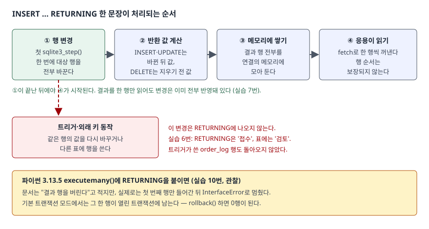

## 들어가며

주문 화면에서 "주문하기"를 누르면 주문 표에 한 행을 넣고, 화면에는 방금 매겨진 주문 번호를 보여 줘야 한다.
대개는 `INSERT`를 한 번 날리고, 드라이버가 주는 마지막 행 번호(`lastrowid`)를 받은 뒤, 그 번호로 `SELECT`를 한 번 더 해서
상태 칸에 기본값이 무엇으로 들어갔는지까지 읽어 온다. 한 건에 문장이 두 번 오가고, 장바구니 상품 세 개를 한 문장으로 넣으면
`lastrowid`는 마지막 번호 하나만 주므로 나머지 둘은 따로 찾아야 한다. 넣은 결과를 넣는 문장이 그대로 돌려주게 하는 절이 있다.

## 개념

`RETURNING`은 `INSERT`·`UPDATE`·`DELETE` 문장 끝에 붙이는 절이다. 붙이면 그 문장이 **넣거나 바꾸거나 지운 행마다 결과 한 행**을 돌려준다.
돌려줄 내용은 `SELECT` 목록처럼 적는다. 컬럼 이름, `*`, 식, 별칭(`AS`)을 쓸 수 있다.

```sql
INSERT INTO order_item (customer, amount) VALUES ('최노을', 9000)
RETURNING order_id, status;
```

이 한 문장이 행을 넣고, 자동으로 매겨진 `order_id`와 기본값으로 채워진 `status`를 함께 돌려준다.
SQL 표준에는 없는 확장이고, SQLite는 3.35.0(2021-03-12)부터 지원한다. 그보다 오래된 SQLite에서는 문법 오류다.
PostgreSQL이 먼저 같은 문법을 썼고, SQLite 문서도 PostgreSQL을 본떴다고 적는다.

돌려받는 값이 무엇인지는 문장 종류마다 다르다.

| 문장 | RETURNING이 보는 값 |
|---|---|
| `INSERT` | 넣은 뒤 값. 기본값·자동 키가 채워진 상태 |
| `UPDATE` | 바꾼 뒤 값 |
| `DELETE` | 지우기 전 값 |

## 구조



> **출처**: [SQLite — The RETURNING Clause §2.1 Processing Order](https://www.sqlite.org/lang_returning.html#processing_order)(첫 step에서 변경을 끝내고 결과를 메모리에 모은다),
> [§3 Limitations And Caveats](https://www.sqlite.org/lang_returning.html#limitations_and_caveats)(행 순서 보장 없음, 트리거가 바꾼 값은 반영 안 됨).
> 아래 파이썬 칸은 실습 10번의 실행 결과다.

## 동작 원리

**변경이 먼저 전부 끝나고, 결과는 그다음에 읽힌다.** SQLite 문서는 모든 변경이 첫 `sqlite3_step()` 호출에서 일어나고
RETURNING 결과는 메모리에 쌓아 둔다고 적는다. 응용이 결과를 한 행만 읽고 멈춰도 표는 이미 다 바뀌어 있다.
결과가 많거나 큰 문자열을 돌려주면 그만큼 임시 메모리를 쓴다.

**RETURNING은 그 문장이 직접 건드린 행만 본다.** 트리거가 같은 행을 다시 고치거나 다른 표에 행을 써도,
외래 키의 `ON DELETE CASCADE`가 다른 표 행을 지워도 RETURNING에는 나오지 않는다.
문서는 반환 값을 "최상위 문장이 본 값"이라고 정의한다.

**행 순서는 정해지지 않는다.** 문서는 변경이 모두 끝난 뒤 결과가 나온다는 것만 보장하고, 결과 행의 순서는 스키마·SQLite 판·실행마다
달라질 수 있다고 적는다. `ORDER BY`로 정할 방법도 없다. 순서가 필요하면 받은 뒤 응용에서 정렬한다.

**쓸 수 없는 자리가 있다.** 최상위 문장에서만 쓰므로 트리거 안의 문장에는 붙일 수 없고, 결과를 하위 질의로 다시 감쌀 수도 없다.
최상위에 `count()` 같은 집계 함수나 창 함수를 쓸 수 없고, 바뀌는 표 말고 다른 표는 참조할 수 없다(`UPDATE … FROM`의 보조 표 포함).

## 실습 예제

전체 소스: [`code/returning_basics.py`](code/returning_basics.py), 실행 기록: [`code/output.txt`](code/output.txt).
주문 표 `order_item`은 `order_id`가 `INTEGER PRIMARY KEY`(자동으로 번호가 매겨진다), `status`의 기본값이 `'접수'`다.
10만 원 이상 주문이 들어오면 트리거 `trg_order_review`가 상태를 `'검토'`로 바꾸고 `order_log`에 기록을 남긴다.
시작할 때 `order_item`에는 2행, `daily_total`에는 1행이 들어 있다.

### 다시 조회하지 않고 키와 기본값 받기

```text
-- 1. RETURNING 없이 — 넣고 나서 lastrowid 로 키를 얻고 다시 조회
   cursor.lastrowid = 3
   SELECT order_id, status FROM order_item WHERE order_id = 3
      3 | '접수'

-- 2. RETURNING — 키와 기본값을 한 문장으로
   INSERT INTO order_item (customer, amount) VALUES ('최노을', 9000) RETURNING order_id, status
      4 | '접수'

-- 3. 여러 행을 한 번에 넣으면 — lastrowid 는 마지막 하나뿐
   cursor.lastrowid = 7
   INSERT INTO order_item (customer, amount) VALUES ('한별', 1000), ('한별', 2000), ('한별', 3000) RETURNING order_id
      8
      9
      10
```

1번은 문장이 두 번 오갔고 2번은 한 번이다. 3번의 앞쪽 문장은 세 행(5·6·7번)을 넣었는데 `lastrowid`는 7 하나만 알려 준다.
같은 모양의 문장에 RETURNING을 붙이자 세 번호가 다 돌아왔다.

### UPDATE는 바뀐 뒤, DELETE는 지우기 전

```text
-- 5. UPDATE 는 바뀐 뒤 값, DELETE 는 지우기 전 값을 돌려준다
   UPDATE order_item SET amount = amount + 500 WHERE customer = '정새벽' RETURNING order_id, amount
      5 | 3500
      6 | 4500
      7 | 5500
   DELETE FROM order_item WHERE customer = '한별' RETURNING order_id, amount
      8 | 1000
      9 | 2000
      10 | 3000
   UPDATE order_item SET status = '취소' WHERE customer = '없는사람' RETURNING order_id
   (0행)
```

3000원이던 5번 주문은 500원을 더한 3500으로 돌아왔다. `DELETE`는 지운 행의 값을 돌려주므로, 지우기 전에 무엇을 지울지 따로 조회해 둘 필요가 없다.
조건에 맞는 행이 없으면 에러가 아니라 0행이 돌아온다.

### 예상과 달랐던 결과 1 — 트리거가 바꾼 값은 안 보인다

```text
-- 6. 트리거가 바꾼 값은 RETURNING 에 나오지 않는다
   INSERT INTO order_item (customer, amount) VALUES ('강바람', 150000) RETURNING order_id, status
      13 | '접수'
   SELECT order_id, status FROM order_item WHERE customer = '강바람'
      13 | '검토'
   SELECT log_id, order_id, note FROM order_log
      1 | 13 | '고액 주문 검토'
```

RETURNING은 `'접수'`를 돌려줬지만 표에 실제로 남은 값은 `'검토'`다. 트리거가 넣은 `order_log` 행도 결과에 없다.
"RETURNING이 돌려준 값 = 표에 저장된 값"이라고 믿고 화면에 띄우면, 트리거가 있는 표에서는 틀린 상태를 보여 주게 된다.

### 결과를 다 읽지 않아도 변경은 끝나 있다

```text
-- 7. 결과를 한 행만 읽어도 변경은 이미 전부 끝나 있다
   읽은 첫 행 = (14,), 넣기 전 10행 -> 한 행만 읽은 뒤 13행
   남은 결과 = [(15,), (16,)]

-- 11. rowcount 는 결과를 다 읽어야 바뀐다
   읽기 전 rowcount = 0
   fetchall() 3행 읽은 뒤 rowcount = 3
```

세 행을 넣고 첫 결과만 읽었는데 표는 이미 13행이다. 문서의 처리 순서 그대로다. 반대로 파이썬의 `rowcount`는
"문장이 끝까지 돌았을 때" 갱신된다고 문서에 적혀 있어서, 결과를 다 읽기 전에는 0이었다. 바뀐 행 수가 필요하면 결과를 다 읽은 뒤에 본다.

### 안 되는 것

```text
-- 9. 안 되는 것 — 집계 함수, 하위 질의로 쓰기, 다른 표 참조
   UPDATE order_item SET status = '배송' WHERE customer = '정새벽' RETURNING count(*)
   에러: OperationalError: misuse of aggregate function count()
   SELECT * FROM (INSERT INTO order_item (customer, amount) VALUES ('오류', 1) RETURNING order_id)
   에러: OperationalError: near "INSERT": syntax error
   UPDATE order_item SET status = '배송' FROM daily_total d WHERE order_item.customer = d.customer RETURNING d.total
   에러: OperationalError: no such column: d.total
```

바뀐 행 수를 `count(*)`로 받고 싶으면 결과 행을 응용에서 센다. UPSERT(`INSERT … ON CONFLICT DO UPDATE`)에 붙이면
새로 넣은 행과 갱신한 행이 함께 돌아온다(실습 8번: `김하늘`은 12000에 3000을 더한 15000, `윤솔`은 새 행 22000).

### 예상과 달랐던 결과 2 — executemany는 첫 행만 넣고 멈춘다

```text
-- 10. 파이썬 executemany 에는 RETURNING 을 쓸 수 없다
   에러: InterfaceError: bad parameter or other API misuse
   SELECT order_id, customer, amount FROM order_item WHERE customer = '문가람'
      17 | '문가람' | 10

-- 10-2. 기본 트랜잭션 모드에서 같은 executemany — 에러 뒤 트랜잭션 상태
   에러: InterfaceError: bad parameter or other API misuse
   in_transaction = True, 표의 행 수 = 1
   rollback() 뒤 행 수 = 0
```

파이썬 3.13 문서의 `executemany()` 항목은 RETURNING이 붙은 문장이라도 "결과 행은 버린다"고 적는다. 그래서 두 행이 다 들어가고 결과만 사라질 것이라 예상했다.
실제 3.13.5에서는 **첫 번째 행만 들어간 뒤 `InterfaceError`가 났다.** 문장마다 바로 반영하는 `autocommit=True` 연결(10번)에서는 그 한 행이 그대로 남았고,
파이썬 기본 트랜잭션 모드(10-2번)에서는 트랜잭션이 열린 채 1행이 들어 있다가 `rollback()`으로 사라졌다.
에러를 잡고 넘어가는 코드라면 일부만 들어간 상태로 커밋될 수 있다.

## 실무에서 주의할 점

- **트리거가 있는 표에서는 RETURNING 값을 저장된 값으로 믿지 않는다.** 트리거가 같은 행을 고쳐도 RETURNING은 고치기 전 값을 준다(실습 6번).
  화면에 최종 상태를 보여 줘야 하면 다시 조회하거나, 트리거가 하던 계산을 문장 안으로 옮긴다.
- **결과 순서에 기대지 않는다.** 실습에서는 넣은 순서대로 번호가 돌아왔지만 문서는 순서를 보장하지 않는다.
  입력 목록과 짝을 맞춰야 하면 번호만 받지 말고 짝을 지을 수 있는 컬럼(예: 입력 순번 컬럼)을 함께 돌려받는다.
- **파이썬 `executemany()`에 RETURNING을 붙이지 않는다.** 3.13.5에서는 첫 행만 들어간 뒤 에러가 났다(실습 10번).
  여러 행의 키가 필요하면 `VALUES (…), (…)` 여러 행을 한 문장으로 `execute()`하거나, 한 행씩 `execute()`를 반복한다.
- **`rowcount`는 결과를 다 읽은 뒤에 본다.** 읽기 전에는 0이었다(실습 11번).
- **SQLite 판을 확인한다.** 3.35.0보다 오래된 SQLite에서는 문법 오류다. 파이썬에 들어 있는 SQLite 판은 `sqlite3.sqlite_version`으로 본다.
- **결과가 큰 문장에 붙이지 않는다.** 결과 전체를 메모리에 모아 두므로, 수십만 행을 고치는 `UPDATE`에 `RETURNING *`를 붙이면 그만큼 메모리를 쓴다.

## 정리

- `RETURNING`은 `INSERT`·`UPDATE`·`DELETE`가 건드린 행마다 결과 한 행을 돌려준다. SQLite는 3.35.0부터 지원한다.
- `INSERT`·`UPDATE`는 바뀐 뒤 값, `DELETE`는 지우기 전 값을 돌려주며, 자동 키와 기본값을 다시 조회하지 않고 받을 수 있다.
- 변경은 결과를 읽기 전에 전부 끝나고, 결과 순서는 보장되지 않는다.
- 트리거·외래 키가 일으킨 변경은 돌아오지 않는다. 파이썬 `executemany()`와는 함께 쓰지 않는다.

## 참고 자료

- [SQLite — The RETURNING Clause](https://www.sqlite.org/lang_returning.html) — 3.35.0 지원, 문장별 반환 값, PostgreSQL 문법을 본뜬 확장
- [SQLite — The RETURNING Clause §2.1 Processing Order](https://www.sqlite.org/lang_returning.html#processing_order) — 첫 step에서 모든 변경, 결과를 메모리에 쌓음
- [SQLite — The RETURNING Clause §3 Limitations And Caveats](https://www.sqlite.org/lang_returning.html#limitations_and_caveats) — 순서 보장 없음, 트리거 값 미반영, 집계·하위 질의·다른 표 참조 불가
- [Python 3.13 — sqlite3.Cursor.executemany](https://docs.python.org/3.13/library/sqlite3.html#sqlite3.Cursor.executemany) — "결과 행은 버린다"는 설명(실측과 다름)
- [Python 3.13 — sqlite3.Cursor.lastrowid](https://docs.python.org/3.13/library/sqlite3.html#sqlite3.Cursor.lastrowid), [sqlite3.Cursor.rowcount](https://docs.python.org/3.13/library/sqlite3.html#sqlite3.Cursor.rowcount) — 마지막 행 번호, 문장이 끝까지 돌아야 갱신되는 행 수
