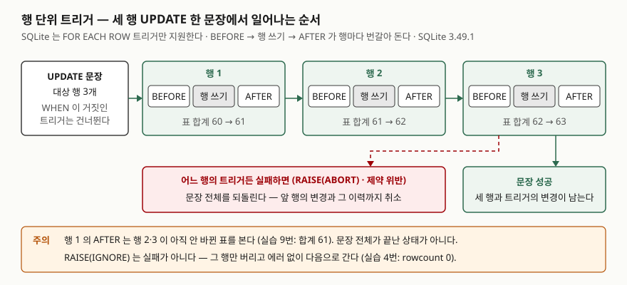

## 들어가며

계좌 잔액이 언제 얼마에서 얼마로 바뀌었는지 남겨 달라는 요청을 받으면, 보통은 응용 코드에서
`UPDATE` 바로 뒤에 이력 `INSERT`를 하나 더 붙인다. 처음에는 출금 화면 한 곳이었는데, 입금·이자·
관리자 보정·일괄 정산 배치까지 잔액을 고치는 곳이 다섯 군데로 늘어난다. 그중 배치 하나가 이력을
빠뜨리면 잔액과 이력의 합이 맞지 않고, 어디서 빠졌는지는 코드 다섯 곳을 다 읽어야 안다.
이력을 남기는 일을 잔액을 고치는 쪽이 아니라 **표 쪽에 한 번만** 적어 두는 방법이 트리거다.

## 개념

**트리거**(trigger)는 표에 `INSERT`·`UPDATE`·`DELETE`가 일어날 때 DB가 **자동으로 실행하는 SQL 묶음**이다.
누가 어떤 경로로 표를 고치든 같은 SQL이 돈다. 응용 코드가 몇 군데든 이력 규칙은 한 곳에 있다.

```sql
CREATE TRIGGER tr_account_update AFTER UPDATE OF balance ON account
WHEN OLD.balance IS NOT NEW.balance
BEGIN
    INSERT INTO account_history (account_id, action, old_balance, new_balance)
    VALUES (NEW.account_id, 'UPDATE', OLD.balance, NEW.balance);
END;
```

- **`BEFORE` / `AFTER`** — 행을 쓰기 **전에** 돌지, **뒤에** 돌지
- **`UPDATE OF balance`** — `SET` 절에 `balance`가 있을 때만 돈다
- **`WHEN`** — 이 조건이 참인 행에서만 본문을 실행한다
- **`NEW` / `OLD`** — 바뀐 뒤의 행과 바뀌기 전의 행. `INSERT`에는 `NEW`만, `DELETE`에는 `OLD`만,
  `UPDATE`에는 둘 다 있다

## 구조



> **출처**: [SQLite — CREATE TRIGGER §2 Description](https://www.sqlite.org/lang_createtrigger.html#description)(FOR EACH ROW만 지원, NEW·OLD, WHEN),
> [§6 The RAISE() function](https://www.sqlite.org/lang_createtrigger.html#the_raise_function),
> [SQLite — ON CONFLICT clause](https://www.sqlite.org/lang_conflict.html)(ABORT는 그 문장의 변경을 되돌린다).
> 행마다 번갈아 도는 순서와 합계 값은 아래 실습 9번의 실행 결과다.

## 동작 원리

SQLite 문서는 **`FOR EACH ROW` 트리거만 지원하고 문장 단위 트리거는 없다**고 적는다. 세 행을 고치는
`UPDATE` 한 문장이면 트리거도 세 번 돈다. 실습 9번에서 순서를 기록했더니 행 1의 BEFORE·쓰기·AFTER가
끝난 뒤에 행 2로 넘어갔다. 모든 행의 BEFORE가 먼저 몰려서 도는 것이 아니다.

트리거 본문은 **원래 문장의 일부**로 실행된다. 트리거가 에러를 내면 원래 문장이 에러를 낸 것과 같고,
기본 충돌 처리인 `ABORT`가 **그 문장이 한 변경을 전부 되돌린다.** 트리거가 넣은 이력 행도 함께
되돌아간다.

`RAISE()`는 트리거 안에서 일부러 에러를 내는 함수다. `RAISE(ABORT, '메시지')`는 문장을 실패시키고,
`RAISE(IGNORE)`는 **에러 없이** 그 행에 대한 처리만 버린다.

## 실습 예제

전체 소스: [`code/trigger_basics.py`](code/trigger_basics.py), 실행 기록: [`code/output.txt`](code/output.txt).
계좌 3행과 빈 이력 표에서 시작한다.

```text
  account_id | owner  | balance
  -----------+--------+--------
           1 | 김하나 |   50000
           2 | 이두리 |  120000
           3 | 박세미 |    8000
```

### 이력이 저절로 쌓인다

새 계좌, 출금, 세 행 이자, 잔액이 그대로인 `UPDATE`, 이름만 바꾸는 `UPDATE`, 해지를 차례로 했다.

```text
history_id | account_id | action | old_balance | new_balance
1 | 4 | INSERT | NULL | 30000
2 | 1 | UPDATE | 50000 | 40000
3 | 1 | UPDATE | 40000 | 40100
4 | 2 | UPDATE | 120000 | 120100
5 | 3 | UPDATE | 8000 | 8100
6 | 4 | DELETE | 30000 | NULL
```

이자 `UPDATE` 한 문장이 이력 3행(3~5번)을 만들었다. 잔액이 그대로인 `UPDATE`(1-D)는 `WHEN`에,
이름만 바꾼 `UPDATE`(1-E)는 `UPDATE OF balance`에 걸려 이력을 남기지 않았다.

### 트리거가 실패하면 원래 문장도 실패한다

`BEFORE UPDATE` 트리거로 잔액이 음수가 되는 변경을 막았다. 세 행 중 3번 계좌만 음수가 되는 `UPDATE`를 하자
에러가 났고, **1·2번 계좌도 바뀌지 않았다**(2-B). 3번 행에서만 실패하는 AFTER 트리거를 걸어 봐도 같았다(3-A).

```text
-- 3-A. 세 행 UPDATE — 트리거가 3번 행에서 PK 충돌
   UPDATE account SET balance = balance + 1 WHERE account_id IN (1, 2, 3)
   에러: UNIQUE constraint failed: audit_lock.account_id
   [계좌 — 실행 뒤]
      account_id | balance
      1 | 40100
      2 | 120100
      3 | 8100
   [이력 행 수] 전 6 → 후 6
```

실행 전 잔액도 40100·120100·8100이었다. 1·2번 행에서는 이력 트리거가 이미 이력을 넣은 뒤였는데,
그 이력도 남지 않았다(6 → 6).

### 예상과 달랐던 것 — 틀린 컬럼 이름이 통과한다

`UPDATE OF balanse`처럼 컬럼 이름을 틀리게 쓴 트리거가 **에러 없이 만들어졌다**(5-A). 그리고 `balance`를
바꿔도 **한 번도 돌지 않았다**(5-C, `typo_rows` 0). 문서는 `UPDATE OF`의 모르는 컬럼 이름을 조용히 무시하고,
옛 응용과의 호환 때문에 고치지 않는다고 적는다. 이력 트리거가 "있는데 안 도는" 상태가 될 수 있다.

### rowcount는 트리거의 변경을 세지 않는다

```text
UPDATE ... WHERE account_id IN (1, 2)
rowcount=2, total_changes 증가분=4
```

파이썬의 `rowcount`는 문장이 직접 바꾼 행만 센다. 트리거가 넣은 이력 2행은 `total_changes`에만 잡혔다.
`RAISE(IGNORE)`로 버린 `INSERT`는 에러 없이 `rowcount=0`이었다(4-A).

### 숨은 비용 — 10만 행

```text
트리거 없음       6.2 ms
트리거 있음      36.3 ms   (5.9배)
```

같은 `UPDATE`에 이력 트리거 하나를 걸자 5.9배가 됐다. 행마다 이력 `INSERT`가 하나씩 더 돌기 때문이다.
절대값은 환경마다 다르므로 배율만 본다.

## 실무에서 주의할 점

- **트리거는 질의에 안 보인다.** `UPDATE` 문장만 읽어서는 5.9배의 이유를 알 수 없다. 느린 쓰기를 볼 때는
  `SELECT name FROM sqlite_master WHERE type = 'trigger'`(7-A)로 걸린 트리거부터 확인한다.
- **`UPDATE OF`의 컬럼 이름은 만들 때 검사되지 않는다.** 트리거를 만든 뒤 실제로 그 컬럼을 바꿔 보고
  이력이 생기는지 확인한다(5번).
- **AFTER 트리거는 문장이 끝난 표를 보지 않는다.** 행 1의 AFTER는 행 2·3이 아직 안 바뀐 표를 봤다(9번, 합계 61).
  트리거 안에서 표 전체 합계를 검사하면 행 순서에 따라 결과가 달라진다.
- **`RAISE(IGNORE)`는 조용하다.** 에러가 없으니 호출한 쪽은 행이 버려진 것을 `rowcount`로만 알 수 있다.
  거부 사실을 알려야 하는 규칙이면 `RAISE(ABORT, ...)`를 쓴다.
- **BEFORE 트리거에서 대상 행을 고치지 않는다.** 문서는 BEFORE 트리거가 곧 바뀔 행을 고치거나 지우면 그 뒤
  결과가 정의되지 않는다고 적고, AFTER 트리거를 쓰라고 권한다. 막는 용도(`RAISE`)로만 쓴다.

## 정리

- 트리거는 표가 바뀔 때 DB가 자동으로 실행하는 SQL이다. 경로가 몇 개든 규칙이 한 곳에 있다.
- SQLite는 행 단위 트리거만 있고, 세 행이면 BEFORE·쓰기·AFTER가 행마다 번갈아 돈다.
- 트리거가 실패하면 원래 문장의 변경이 전부 되돌아간다. `RAISE(IGNORE)`만 에러 없이 행을 버린다.
- 틀린 `UPDATE OF` 컬럼 이름은 통과하고, `rowcount`는 트리거의 변경을 세지 않으며, 10만 행에서 이력 트리거가 5.9배를 더했다.

## 참고 자료

- [SQLite — CREATE TRIGGER](https://www.sqlite.org/lang_createtrigger.html) — [§2 Description](https://www.sqlite.org/lang_createtrigger.html#description), [§5 Cautions On The Use Of BEFORE triggers](https://www.sqlite.org/lang_createtrigger.html#cautions_on_the_use_of_before_triggers), [§6 The RAISE() function](https://www.sqlite.org/lang_createtrigger.html#the_raise_function)
- [SQLite — ON CONFLICT clause](https://www.sqlite.org/lang_conflict.html) — ROLLBACK·ABORT·FAIL·IGNORE의 차이, 기본값 ABORT
- [SQLite — PRAGMA recursive_triggers](https://www.sqlite.org/pragma.html#pragma_recursive_triggers)
