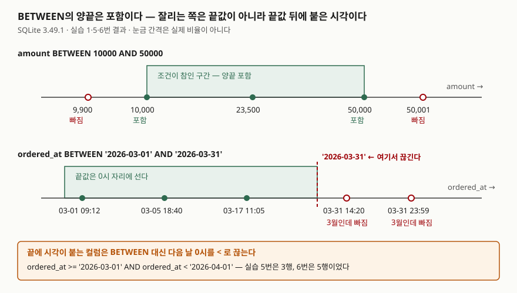

## 들어가며

주문 관리 화면을 만들다 보면 "3월 주문 중에 1만 원에서 5만 원 사이인 것만 보여 달라"는 요청이 온다.
조건을 `amount >= 10000 AND amount <= 50000 AND ordered_at >= '2026-03-01' AND ordered_at <= '2026-03-31'`로
길게 늘여 쓰면 컬럼 이름이 네 번 나오고, 조건을 하나 고칠 때마다 두 자리를 맞춰 고쳐야 한다.
상태 필터까지 붙으면 `status = 'paid' OR status = 'shipped' OR status = 'pending'`이 이어 붙어 괄호를 어디에
쳐야 하는지부터 헷갈린다. 범위를 쓰는 `BETWEEN`과 목록을 쓰는 `IN`은 이 두 모양을 짧게 줄이려고 있는 연산자다.
짧아지는 만큼 **경계가 어디까지인지가 눈에 덜 띄는 것**이 이 둘의 함정이다.

## 개념

둘 다 다른 연산자들로 똑같이 쓸 수 있는 **축약형**이다. SQLite 문서는 각각을 이렇게 정의한다.

| 쓰는 모양 | 같은 뜻 | 줄어드는 것 |
|---|---|---|
| `x BETWEEN y AND z` | `x >= y AND x <= z` | `x`를 한 번만 적는다 |
| `x IN (a, b, c)` | `x = a OR x = b OR x = c` | `x`와 `=`를 한 번만 적는다 |
| `x NOT BETWEEN y AND z` | `NOT (x >= y AND x <= z)` | |
| `x NOT IN (a, b, c)` | `NOT (x = a OR x = b OR x = c)` | |

여기서 바로 읽히는 것이 **`BETWEEN`은 양끝을 포함한다**는 점이다. `>=`와 `<=`로 풀리기 때문이다.
덜 읽히는 것이 두 가지 더 있다. `IN`의 오른쪽은 괄호 안의 값 목록일 수도 있고 `SELECT` 하나일 수도 있다는 것,
그리고 **둘 다 NULL을 만나면 참도 거짓도 아닌 NULL이 된다**는 것이다.

## 구조



> **출처**: [SQLite — Expressions §6 The BETWEEN operator](https://www.sqlite.org/lang_expr.html#the_between_operator)(`x>=y AND x<=z`와 같다는 정의),
> [SQLite — Datatypes §4.1 Sort Order](https://www.sqlite.org/datatype3.html#sort_order) · [§7 Collating Sequences](https://www.sqlite.org/datatype3.html#collating_sequences)(TEXT는 조합 순서로 비교하고 기본값 BINARY는 `memcmp()`다).
> 들어가고 빠진 행은 실습 1·5·6번의 실행 결과다.

## 동작 원리

### 양끝은 포함이다

실습 1번 `amount BETWEEN 10000 AND 50000`과 2번 `amount >= 10000 AND amount <= 50000`은 똑같이 3행을 냈다.
금액이 정확히 10000인 주문과 정확히 50000인 주문이 둘 다 들어 있다. 9,900과 50,001만 빠졌다.

양끝을 뒤집어 `BETWEEN 50000 AND 10000`이라고 쓰면 **에러가 나지 않고 0행이 나온다**(3번).
`amount >= 50000 AND amount <= 10000`으로 풀리니 만족하는 값이 없을 뿐이다. 범위를 변수로 받아 조립하는
코드에서 두 값의 순서가 바뀌면 결과가 그냥 비는데, DB는 아무 말도 하지 않는다.

### 날짜는 양끝이 아니라 끝값 뒤가 문제다

`ordered_at BETWEEN '2026-03-01' AND '2026-03-31'`은 3행만 돌려줬다(5번). 3월 31일 주문이 두 건 있는데도
빠졌다. `ordered_at`은 `'2026-03-31 14:20:00'`처럼 시각까지 들어 있는 TEXT이고, TEXT끼리는 조합 순서로
비교하는데 기본값인 BINARY가 `memcmp()`, 즉 바이트 순서이기 때문이다.
`'2026-03-31 14:20:00' <= '2026-03-31'`을 직접 물어보면 0이 나온다(7번).
앞 10자가 같은 상태에서 왼쪽에는 공백이 더 붙어 있으니 왼쪽이 더 크다.

**끝값 `'2026-03-31'`은 그날 0시 자리에 선다.** 그래서 그날 0시 이후에 들어온 주문은 전부 범위 밖이다.
고치는 방법은 두 가지인데 성격이 다르다.

- **다음 날 0시를 `<`로 끊는다**(6번) — `ordered_at >= '2026-03-01' AND ordered_at < '2026-04-01'`. 5행이 나왔다.
- **컬럼을 `date()`로 감싼다**(8번) — `date(ordered_at) BETWEEN '2026-03-01' AND '2026-03-31'`. 역시 5행이다.

결과는 같지만 두 번째는 인덱스를 못 쓴다. 아래 실행계획 절에서 다시 본다.

### IN은 목록도 되고 하위 질의도 된다

`status IN ('paid', 'shipped')`와 `status = 'paid' OR status = 'shipped'`는 같은 4행을 냈다(9·10번).
괄호 안을 `SELECT`로 바꾸면 하위 질의가 된다. 환불 요청이 있는 주문은 `order_id IN (SELECT order_id FROM
refund_request)`로 2행이 나왔다(12번).

빈 목록 `status IN ()`은 SQLite에서 **문법 에러가 아니라 0행**이다(11번). SQLite 문서는 이것이 표준에 없는
자신의 확장이며 다른 엔진 대부분은 목록에 값이 최소 하나 있기를 요구한다고 적어 둔다. 질의를 문자열로 조립하는
코드가 빈 배열을 받아 `IN ()`을 만들면, SQLite에서만 조용히 넘어가고 옮겨 붙인 DB에서 터진다.

### NOT IN은 NULL 하나에 전부 빈다

13번이 이 글에서 가장 조심할 자리다. `order_id NOT IN (SELECT order_id FROM refund_request)`가 **0행**을 냈다.
환불 요청이 없는 주문이 분명히 네 건 있는데도 그렇다. 하위 질의가 돌려준 세 값 중 하나가 NULL이기 때문이다.

`1 NOT IN (3, NULL, 5)`는 `1 <> 3 AND 1 <> NULL AND 1 <> 5`로 풀린다. 가운데가 NULL이므로 전체가 NULL이고,
`WHERE`는 NULL을 참으로 치지 않는다. 16번에서 직접 확인하면 `2 IN (1, 3, NULL)`도 `2 NOT IN (1, 3, NULL)`도
둘 다 NULL이다. 반면 **찾는 값이 목록에 있으면** NULL이 섞여 있어도 참이다 — `3 IN (1, 3, NULL)`은 1이었다.

고치는 방법은 하위 질의에 `WHERE order_id IS NOT NULL`을 붙이거나(14번) `NOT EXISTS`로 바꾸는 것이다(15번).
둘 다 같은 4행을 냈다. `NOT EXISTS`는 행이 있는지만 보므로 NULL에 영향받지 않는다.

`NOT BETWEEN`도 NULL에는 같다. 금액이 NULL인 6번 주문은 `BETWEEN`에도 `NOT BETWEEN`에도 들어가지 않았다(1·4번).

### 왼쪽 식은 한 번만 계산된다

정의에 붙은 단서가 하나 있다. `x BETWEEN y AND z`는 `x >= y AND x <= z`와 같되 **`x`를 한 번만 계산한다**는 것이다.
호출 횟수를 세는 함수 `bump()`를 만들어 확인하면 그대로다.

```text
-- 17. bump() BETWEEN 1 AND 5        → bump() 호출 1회
-- 18. bump() >= 1 AND bump() <= 5   → bump() 호출 2회
```

왼쪽이 그냥 컬럼이면 차이가 없다. 함수 호출이나 하위 질의처럼 비싼 식이면 `BETWEEN`이 그 식을 한 번만 돌린다.

## 실습 예제

전체 소스: [`code/between_in_orders.py`](code/between_in_orders.py), 실행 기록: [`code/output.txt`](code/output.txt).

```text
[order_log]  6행
  order_id | customer_name | amount | ordered_at          | status
  ---------+---------------+--------+---------------------+----------
         1 | 김하늘        |   9900 | 2026-03-01 09:12:30 | paid
         2 | 이도윤        |  10000 | 2026-03-05 18:40:00 | paid
         3 | 박서준        |  23500 | 2026-03-17 11:05:12 | shipped
         4 | 최지아        |  50000 | 2026-03-31 14:20:00 | paid
         5 | 정민재        |  50001 | 2026-03-31 23:59:59 | cancelled
         6 | 한소윤        |   NULL | 2026-04-02 08:00:00 | pending
```

환불 요청 `refund_request` 3행 중 하나(`RF-002`)는 `order_id`가 NULL이다.

### 예상과 달랐던 것 — 실행계획의 부등호는 포함 여부가 아니다

`amount`와 `status`에 인덱스를 만들고 `ANALYZE`를 돌린 뒤 `EXPLAIN QUERY PLAN`을 찍으면 이렇게 나온다.
아래는 그 출력의 `detail` 칸 원문이다.

```text
-- 19. SELECT order_id FROM order_log WHERE amount BETWEEN 10000 AND 50000
SEARCH order_log USING COVERING INDEX ix_order_log_amount (amount>? AND amount<?)

-- 20. SELECT order_id FROM order_log WHERE status IN ('paid','shipped','pending')
SEARCH order_log USING COVERING INDEX ix_order_log_status (status=?)

-- 21. SELECT order_id FROM order_log WHERE abs(amount) BETWEEN 10000 AND 50000
SCAN order_log USING COVERING INDEX ix_order_log_amount
```

19번의 괄호 안이 `amount>? AND amount<?`다. 부등호에 등호가 없어서 끝값이 빠진 것처럼 읽히는데,
1번 질의는 10,000과 50,000을 둘 다 돌려줬다. 괄호 안은 조건의 참·거짓 규칙이 아니라 **인덱스 탐색에 쓰인
WHERE 절의 항목**을 적는 자리다. SQLite 문서도 이 괄호를 "인덱싱에 사용된 WHERE 절의 항목"으로만 설명한다.
포함 여부는 실행계획이 아니라 질의 결과로 확인해야 한다.

20번은 값이 세 개인 `IN`인데 `status=?`가 하나만 적혀 있다. 인덱스 탐색을 값마다 한 번씩 되풀이하므로
탐색 모양은 하나로 적힌다. 21번은 컬럼을 `abs()`로 감싸자 `SEARCH`가 `SCAN`으로 바뀌었다 —
인덱스는 `amount` 값으로 정렬돼 있지 `abs(amount)` 값으로 정렬돼 있지 않기 때문이다.
앞에서 본 `date(ordered_at) BETWEEN ...`이 같은 모양이다.

## 실무에서 주의할 점

- **시각이 붙는 컬럼에 `BETWEEN`을 쓰지 않는다.** 날짜만 쓰는 컬럼이면 `BETWEEN`이 읽기 좋지만,
  시각이 섞이면 마지막 날이 통째로 빠진다(5번). `>= 시작 AND < 다음날`로 쓰면 컬럼 타입이 바뀌어도 안전하다.
- **`NOT IN`의 오른쪽에 NULL이 올 수 있으면 `NOT EXISTS`로 바꾼다.** 하위 질의가 보는 컬럼에 `NOT NULL`이
  없으면 언제든 0행이 될 수 있다(13번). 같은 함정을 [IN·EXISTS·NOT IN 글](../2026-09-28-in-exists-not-in-null/index.md)에서 더 자세히 다뤘다.
- **범위를 코드로 조립하면 양끝 순서를 확인한다.** 뒤집힌 `BETWEEN`은 에러 없이 0행이다(3번).
  "데이터가 없네요"로 보고되면 원인을 찾는 데 한참 걸린다.
- **컬럼을 함수로 감싸면 인덱스 탐색이 전체 훑기로 바뀐다**(21번). `date(ordered_at)`이나 `upper(status)`처럼
  편해 보이는 변환이 여기에 해당한다. 변환은 비교할 **상수 쪽**에 적용한다.
- **`IN ()`은 SQLite에서만 통한다.** 목록을 코드로 만들 때 빈 배열이면 질의를 보내지 말고 빈 결과를 바로 돌려준다.

## 정리

- `BETWEEN`은 `>=`와 `<=`로 풀리므로 양끝을 포함한다. 뒤집어 쓰면 에러 없이 0행이다.
- 날짜 컬럼에 시각이 붙어 있으면 끝값이 그날 0시 자리에 서서 마지막 날이 빠진다. 다음 날을 `<`로 끊는다.
- `IN`은 `=`의 OR 묶음, `NOT IN`은 `<>`의 AND 묶음이다. 그래서 오른쪽에 NULL이 하나만 있어도 `NOT IN`은 비어 버린다.
- `BETWEEN`은 왼쪽 식을 한 번만 계산한다. 실행계획의 `amount>? AND amount<?`는 포함 여부가 아니라 인덱스에 쓰인 조건을 적은 것이다.

## 참고 자료

- [SQLite — Expressions §6 The BETWEEN operator](https://www.sqlite.org/lang_expr.html#the_between_operator) — `x>=y AND x<=z`와 같고 `x`를 한 번만 계산한다는 정의
- [SQLite — Expressions §8 The IN and NOT IN operators](https://www.sqlite.org/lang_expr.html#the_in_and_not_in_operators) — 빈 목록 확장, NULL이 섞였을 때의 결과표
- [SQLite — Datatypes §4.1 Sort Order](https://www.sqlite.org/datatype3.html#sort_order) — TEXT끼리는 조합 순서(collating sequence)로 비교한다
- [SQLite — Datatypes §7 Collating Sequences](https://www.sqlite.org/datatype3.html#collating_sequences) — 기본 조합 순서 BINARY는 `memcmp()`로 비교한다
- [SQLite — EXPLAIN QUERY PLAN §1.1 Table and Index Scans](https://www.sqlite.org/eqp.html#table_and_index_scans) — SEARCH·SCAN 구분과 괄호 안 항목의 뜻
