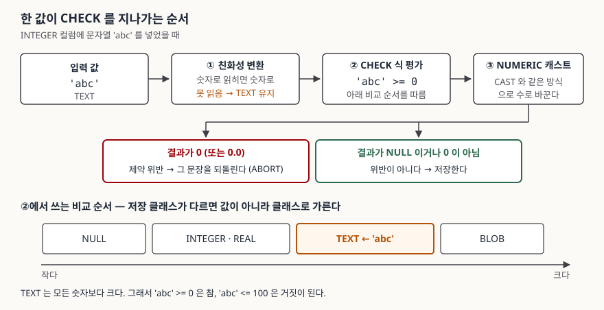

## 들어가며

쇼핑몰이든 사내 재고 관리든, 상품 표에 할인가 컬럼을 하나 두고 나면 꼭 겪는 일이 있다.
어느 날 목록 화면에 가격이 `-11,000원`으로 찍힌 상품이 뜬다. 할인가가 정가보다 크게
들어간 것이다. 등록 화면에는 분명 검사 코드가 있는데도 그렇다.

그래서 보통은 검사하는 곳을 하나 더 늘린다. 등록 화면에 있던 검사를 수정 화면에도
붙이고, 엑셀 일괄 등록에도 붙이고, 외부 연동 배치에도 붙인다. 들어오는 길이 네 군데면
같은 조건을 네 번 쓰는 것이고, 조건이 바뀌면 네 군데를 같이 고쳐야 한다. 한 군데를
빼먹으면 그 길로 들어온 행만 조용히 어긋난 채 쌓인다. 다섯 번째 길이 생기면 다시
처음부터다.

값의 범위를 정하는 일은 길마다 할 것이 아니라 표가 한 번 할 일이다. 그걸 하는 것이
CHECK 제약이다.

## 개념

CHECK 제약은 **행이 만족해야 하는 조건식**을 표 정의에 적어 두는 것이다. 조건을 어긴
행은 저장 자체가 되지 않는다. 길이 몇 개든 마지막에 거쳐야 하는 문은 하나다.

```sql
CREATE TABLE product (
    id        INTEGER PRIMARY KEY,
    name      TEXT    NOT NULL,
    price     INTEGER NOT NULL CHECK (price >= 0),
    discount  INTEGER NOT NULL DEFAULT 0,
    CONSTRAINT discount_within_price CHECK (discount BETWEEN 0 AND price)
);
```

쓰는 자리는 두 군데다. `price` 처럼 **컬럼 정의 뒤에 붙이는 것**과, `discount_within_price`
처럼 **컬럼 목록 다음에 따로 적는 것**이다. SQLite 문서는 두 방식에 대해 "실제로는
차이가 없다"고 적는다. 다만 컬럼 두 개를 함께 보는 조건은 컬럼 정의 안에 넣을 자리가
마땅치 않으므로 표 수준으로 적게 된다.

`CONSTRAINT <이름>` 으로 이름을 붙여 두는 쪽을 권한다. 이름이 없으면 위반했을 때
에러 메시지에 조건식 원문이 그대로 나오고, 이름이 있으면 그 이름이 나온다.

```
IntegrityError: CHECK constraint failed: price >= 0
IntegrityError: CHECK constraint failed: discount_within_price
```

조건식이 길어지면 앞의 형태는 로그에서 읽기 어렵다.

## 구조



> **출처**: [SQLite — CREATE TABLE §3.7 CHECK constraints](https://www.sqlite.org/lang_createtable.html#check_constraints), [SQLite — Datatypes §3 Type Affinity](https://www.sqlite.org/datatype3.html#type_affinity), [SQLite — Datatypes §4.1 Sort Order](https://www.sqlite.org/datatype3.html#sort_order)

## 동작 원리

순서가 세 단계라는 점이 중요하다.

**① 컬럼의 타입 친화성이 값을 먼저 바꾼다.** INTEGER로 선언한 컬럼에 문자열 `'50'`이
들어오면 CHECK가 보기 전에 이미 정수 `50`이 되어 있다. 숫자로 읽을 수 없는 `'abc'`는
TEXT인 채로 남는다.

**② 조건식을 평가한다.** 이때 양쪽 타입이 다르면 SQLite는 값이 아니라 **저장 클래스
순서**로 비교한다. 문서가 정한 순서는 `NULL < INTEGER·REAL < TEXT < BLOB` 이다.
숫자와 문자열을 비교하면 내용과 무관하게 **문자열이 항상 크다.**

**③ 결과를 수로 바꿔 판정한다.** 문서는 결과를 "CAST 식과 같은 방식으로 NUMERIC 값으로
변환"한다고 적는다. 그 값이 `0`이면 위반이고, **NULL이거나 0이 아닌 다른 값이면
위반이 아니다.**

③의 NULL 처리가 자주 걸린다. `score INTEGER CHECK (score BETWEEN 0 AND 100)` 인
컬럼에 NULL을 넣으면 조건식이 NULL이 되고, NULL은 0이 아니므로 **통과한다.** 값이
반드시 있어야 하면 `NOT NULL`을 따로 붙여야 한다. CHECK는 "값이 있다면 이 범위"만
말한다.

그리고 ②가 만드는 함정이 하나 더 있다.

## 실습 예제

전체 소스: [`code/`](code/) · 실행 기록: [`code/output.txt`](code/output.txt)

한쪽만 막은 CHECK와 양쪽을 막은 CHECK에 같은 문자열을 넣어 본다.

```python
conn.executescript("""
CREATE TABLE one_sided (v INTEGER CHECK (v >= 0));
CREATE TABLE two_sided (v INTEGER CHECK (v BETWEEN 0 AND 100));
""")
attempt(conn, "one_sided 에 'abc'", "INSERT INTO one_sided VALUES (?)", "abc")
attempt(conn, "two_sided 에 'abc'", "INSERT INTO two_sided VALUES (?)", "abc")
```

```text
  [통과] one_sided 에 'abc'
  [거부] two_sided 에 'abc'
         IntegrityError: CHECK constraint failed: v BETWEEN 0 AND 100
  one_sided 에 저장된 것: [('abc', 'text')]

  왜 통과하나 — 비교 결과를 직접 본다
    'abc' >= 0               -> 1
    'abc' <= 100             -> 0
    'abc' BETWEEN 0 AND 100  -> 0
```

`v >= 0` 하나만 걸어 둔 컬럼에 `'abc'`가 들어갔고, `typeof`로 확인하면 **TEXT 그대로**
저장되어 있다. 아래쪽만 막았기 때문이다. TEXT는 모든 숫자보다 크므로 `'abc' >= 0`은
참이 된다. 위쪽도 함께 막은 `BETWEEN`에서는 `'abc' <= 100`이 거짓이라 걸린다.

**아래 범위만 제한하는 CHECK는 타입 방어가 되지 않는다.** 값이 음수가 아닌지만 보려고
`CHECK (qty >= 0)`을 걸어 두면 문자열은 그대로 들어온다.

타입까지 막으려면 두 가지 방법이 있다.

```sql
-- 1) 조건에 typeof() 를 더한다
CREATE TABLE typed_check (
    v INTEGER CHECK (typeof(v) = 'integer' AND v BETWEEN 0 AND 100)
);
-- 2) STRICT 표로 만든다
CREATE TABLE strict_table (v INTEGER CHECK (v BETWEEN 0 AND 100)) STRICT;
```

```text
  typeof() 를 넣은 CHECK
  [통과]   50
  [거부]   'abc'
         IntegrityError: CHECK constraint failed: typeof(v) = 'integer' AND v BETWEEN 0 AND 100
  [거부]   NULL
  STRICT 표
  [통과]   50
  [거부]   'abc'
         IntegrityError: cannot store TEXT value in INTEGER column strict_table.v
  [통과]   NULL
```

둘이 같지 않다. `typeof(v) = 'integer'` 는 NULL도 함께 막는다 — `typeof(NULL)`은
`'null'` 이라 조건이 거짓이 되기 때문이다. NULL을 허용하면서 타입만 막고 싶으면
`typeof(v) IN ('integer', 'null')` 로 적거나 STRICT 표를 쓴다. 에러 메시지도 STRICT
쪽이 어느 컬럼인지까지 알려 준다.

## 실무에서 주의할 점

**1. `INSERT OR IGNORE`는 CHECK 위반을 말없이 버린다.**

```text
  [거부] 3행 중 2번째가 위반 (그냥 INSERT)
         IntegrityError: CHECK constraint failed: v > 0
  batch 내용: []
  [통과] 같은 3행을 INSERT OR IGNORE 로
  batch 내용: [(1,), (3,)]
```

그냥 `INSERT`면 한 행이 어긋나도 문장 전체가 되돌아가 아무것도 안 들어간다. `OR IGNORE`를
붙이면 **위반한 행만 빠지고 나머지는 들어간다.** 성공으로 끝나므로 호출한 쪽은 세 행이
모두 들어간 줄 안다. 일괄 적재에 `OR IGNORE`를 습관처럼 붙여 두면 CHECK를 걸어 둔 의미가
사라진다. 넣기 전 행 수와 넣은 뒤 행 수를 비교하거나, `OR IGNORE`를 빼고 실패를 그대로
받는 편이 낫다.

**2. `PRAGMA ignore_check_constraints`로 들어간 값은 끈 뒤에도 남는다.**

```text
  [통과] PRAGMA 를 켠 채 -99 삽입
  PRAGMA 를 끈 뒤 batch 내용: [(1,), (3,), (-99,)]
```

CHECK는 **쓸 때만** 검사하고 읽을 때는 검사하지 않는다. 그래서 잠깐 꺼 두고 넣은
값은 다시 켜도 걸러지지 않는다. 대량 적재를 빠르게 하려고 이 PRAGMA를 쓰는 경우가
있는데, 그렇게 했으면 끈 뒤에 같은 조건을 `SELECT`로 직접 돌려 확인해야 한다.

**3. 표 수준 CHECK에 붙인 `ON CONFLICT`는 받아들여지지만 아무 일도 하지 않는다.**

```text
  [통과] CREATE (표 수준 + ON CONFLICT IGNORE)
  [거부] legacy 에 -1 삽입
         IntegrityError: CHECK constraint failed: v > 0
  [거부] CREATE (컬럼 수준 + ON CONFLICT IGNORE)
         OperationalError: near "ON": syntax error
```

컬럼 수준에 쓰면 문법 오류로 바로 막히지만, 표 수준에 쓰면 `CREATE TABLE`이 성공한다.
SQLite 문서가 "과거 호환을 위해 허용하되 아무 효과가 없다"고 적어 둔 자리다. 효과가
있다고 믿고 넘어가기 쉬우므로 쓰지 않는 편이 낫다.

**4. 이미 어긴 데이터가 있으면 제약을 붙일 수 없다.** SQLite에는 `ALTER TABLE ... ADD
CONSTRAINT`가 없어서 표를 새로 만들어 옮겨야 하는데, 한 행만 어겨도 `INSERT SELECT`
전체가 멈춘다.

```text
  붙이기 전에 어긴 행부터 센다
    NOT (v BETWEEN 0 AND 100) 만: [(2,), (3,)]
    IS NULL 을 더하면: [(2,), (3,), (4,)]
```

여기서도 NULL이 숨는다. `WHERE NOT (v BETWEEN 0 AND 100)` 는 `v`가 NULL인 행을 집지
않는다. 조건이 NULL이 되고 WHERE는 참인 행만 고르기 때문이다. 옮길 표에 `NOT NULL`을
함께 걸 생각이라면 `v IS NULL OR ...` 를 더해 세야 실제로 막힐 행이 다 나온다.

## 정리

- CHECK 제약은 값의 범위를 표 정의 한 곳에 적어 두는 것이다. 들어오는 길이 몇 개든
  검사는 한 번만 쓴다.
- 평가 순서는 **컬럼 친화성 변환 → 조건식 평가 → NUMERIC 캐스트**다. 결과가 0이면
  위반이고 NULL은 위반이 아니다.
- 타입이 다르면 저장 클래스 순서로 비교하므로 TEXT가 모든 숫자보다 크다. **아래쪽만
  막은 CHECK는 문자열을 통과시킨다.**
- 타입까지 막으려면 `typeof()`를 조건에 넣거나 STRICT 표를 쓴다. 전자는 NULL도 함께
  막히므로 의도한 것인지 확인한다.
- `INSERT OR IGNORE`와 `PRAGMA ignore_check_constraints`는 제약을 조용히 건너뛴다.

## 참고 자료

- [SQLite — CREATE TABLE §3.7 CHECK constraints](https://www.sqlite.org/lang_createtable.html#check_constraints)
- [SQLite — Datatypes In SQLite §3 Type Affinity](https://www.sqlite.org/datatype3.html#type_affinity)
- [SQLite — Datatypes In SQLite §4.1 Sort Order](https://www.sqlite.org/datatype3.html#sort_order)
- [SQLite — ON CONFLICT clause](https://www.sqlite.org/lang_conflict.html)
- [SQLite — STRICT Tables](https://www.sqlite.org/stricttables.html)
- [SQLite — PRAGMA ignore_check_constraints](https://www.sqlite.org/pragma.html#pragma_ignore_check_constraints)
