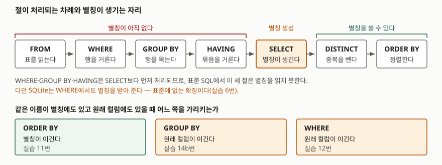

## 들어가며

사원 목록 화면에 연봉을 보여 달라는 요청이 와서 `SELECT emp_name, base_salary * 12 AS annual_pay FROM employee`라고 쓴다.
다음 줄에 정렬을 붙이려는데 손이 멈춘다. `ORDER BY base_salary * 12 DESC`라고 또 적어야 하나, 아니면 방금 지은
`annual_pay`를 그냥 써도 되나. 일단 식을 한 번 더 적어 두고 넘어간다. 그 다음에는 "연봉 4,800만 원 이상만"이라는
조건이 붙어서 `WHERE`에도 `base_salary * 12 > 48000000`을 적는다. 식 하나가 세 군데에 똑같이 들어갔고,
수당을 더하라는 말이 나오면 세 군데를 다 고쳐야 한다. 한 군데를 빼먹으면 목록과 정렬이 어긋나는데,
화면에서는 그냥 "순서가 이상한데" 정도로만 보인다.

어디에 별칭을 쓸 수 있고 어디에는 못 쓰는지는 외우는 규칙이 아니라 **절이 처리되는 차례**에서 나온다.

## 개념

별칭(alias)은 `SELECT` 목록의 한 칸에 붙이는 이름이다. `base_salary * 12 AS annual_pay`라고 쓰면
결과의 두 번째 컬럼 이름이 `annual_pay`가 된다. 이 이름은 표에 있는 것이 아니라 **질의가 결과를 만들면서 생긴다.**

그래서 이름을 쓸 수 있는지는 "그 절이 `SELECT`보다 먼저 처리되는가"로 갈린다. PostgreSQL 문서는 이 규칙을
한 문장으로 적어 둔다 — 출력 컬럼 이름은 `ORDER BY`와 `GROUP BY`에서 쓸 수 있지만 `WHERE`나 `HAVING`에서는
쓸 수 없고, 거기서는 식을 그대로 적어야 한다.

`ORDER BY`가 받는 것은 세 가지다.

| 쓰는 모양 | 뜻 | 예 |
|---|---|---|
| 이름 | 결과 컬럼의 별칭, 없으면 입력 컬럼 | `ORDER BY annual_pay` |
| 정수 상수 | 몇 번째 결과 컬럼인지 (1부터) | `ORDER BY 2 DESC` |
| 임의의 식 | 입력 컬럼으로 만든 식. 결과에 없어도 된다 | `ORDER BY base_salary * (1 + bonus_rate)` |

## 구조



> **출처**: [PostgreSQL 16 — SELECT §Description](https://www.postgresql.org/docs/16/sql-select.html)(WITH → FROM → WHERE → GROUP BY → HAVING → 출력 식 → DISTINCT → UNION → ORDER BY → LIMIT 순서를 번호로 적어 둔다),
> [§SELECT List](https://www.postgresql.org/docs/16/sql-select.html#SQL-SELECT-LIST)(출력 컬럼 이름은 `ORDER BY`·`GROUP BY`에서만 쓸 수 있다),
> [§ORDER BY Clause](https://www.postgresql.org/docs/16/sql-select.html#SQL-ORDERBY)(이름이 겹치면 `ORDER BY`는 출력 컬럼으로 읽고, 이는 `GROUP BY`의 선택과 반대다).
> 아래 세 칸의 우선순위는 SQLite 3.49.1에서 실습 11·12·14b번으로 확인한 결과다.

## 동작 원리

### ORDER BY는 별칭을 읽는다

실습 1·2·3번은 전부 같은 다섯 줄을 냈다. 별칭 `annual_pay`로 정렬하든, 식 `base_salary * 12`를 다시 적든,
자리 번호 `2`를 쓰든 결과가 같다. 셋 중 별칭이 가장 읽기 좋고, 식을 고칠 때 한 군데만 고치면 된다.

자리 번호에는 함정이 하나 있다. **정수 상수일 때만 자리 번호다.** `ORDER BY 2 + 0 DESC`라고 쓰면 번호가 아니라
값이 항상 2인 상수식이 되어 모든 행의 정렬 키가 같아진다. 실습 5번의 출력이 1·2·3·4·5번 사원 순서, 즉 정렬이
아예 일어나지 않은 모양인 이유다. 범위를 벗어난 번호는 에러로 잡힌다.

```text
-- 4. SELECT emp_name, base_salary FROM employee ORDER BY 3
[OperationalError] 1st ORDER BY term out of range - should be between 1 and 2
```

자리 번호는 `SELECT` 목록의 순서가 바뀌면 조용히 다른 컬럼을 가리키게 되므로, 손으로 쓰는 질의에는 별칭이 낫다.

### WHERE에서는 — SQLite가 예외다

실습 6번 `WHERE annual_pay > 48000000`은 **에러 없이 두 행을 냈다.** 식을 그대로 적은 7번과 같은 결과다.
표준 SQL에도 없고 PostgreSQL·MySQL도 받지 않는 동작인데, SQLite는 받아 준다. SQLite의 이름 해석 코드에는
`WHERE`에서 다른 후보를 찾지 못했을 때에 한해 결과 컬럼의 별칭을 쓰는 길이 열려 있다.

편해 보이지만 여기에 기대면 그 질의는 **SQLite에서만 도는 질의**가 된다. 옮겨 붙일 일이 있으면
식을 그대로 적거나(7번), 하위 질의로 한 겹 감싸는 편이 낫다(8번). 하위 질의 쪽은 안쪽 `SELECT`가
먼저 끝나 `annual_pay`가 진짜 컬럼이 되므로 어느 엔진에서나 통한다.

`GROUP BY`와 `HAVING`은 사정이 다르다. 9번의 `GROUP BY team`과 10번의 `HAVING head_count >= 2`는
둘 다 돌았고, `GROUP BY`의 별칭은 표준에서도 허용된다.

### 예상과 달랐던 것 — 이름이 겹치면 절마다 고르는 쪽이 다르다

여기가 이 글에서 가장 조심할 자리다. 표에 이미 `bonus_rate`라는 컬럼이 있는데, 전혀 다른 식에
같은 이름의 별칭을 붙여 보면 절마다 다른 것을 가리킨다.

```text
-- 11. SELECT emp_name, base_salary * 2 AS bonus_rate FROM employee ORDER BY bonus_rate
   ('정민재', 6400000)   ← 6,400,000 … 9,000,000 오름차순. 별칭(급여×2)으로 정렬했다
   ...
-- 12. SELECT emp_name, base_salary * 2 AS bonus_rate FROM employee WHERE bonus_rate < 1
   5행 전부            ← 별칭 값은 수백만인데도 다 통과했다. 원래 컬럼(0.1~0.3)을 봤다
-- 14b. SELECT dept AS bonus_rate, COUNT(*) AS n FROM employee GROUP BY bonus_rate
   ('영업', 1) ('개발', 1) ('개발', 1) ('운영', 1) ('영업', 1)
                       ← 부서로 묶였으면 3줄이어야 한다. 5줄이니 원래 컬럼으로 묶은 것이다
```

`ORDER BY`는 별칭을, `WHERE`와 `GROUP BY`는 원래 컬럼을 골랐다. PostgreSQL 문서가 적어 둔
"`ORDER BY`는 출력 컬럼으로 읽으며 이는 `GROUP BY`의 선택과 반대다"가 SQLite에서도 그대로 나타난다.

실무에서 무서운 것은 **12번과 14b번이 에러를 내지 않는다**는 점이다. 질의는 돌고, 행 수만 틀린다.
컬럼 이름과 같은 별칭을 쓰지 않는 것이 유일하게 확실한 예방책이다.

### 정렬 키는 결과에 없어도 된다

`ORDER BY`는 입력 컬럼으로 만든 임의의 식을 받으므로, 정렬 기준을 결과에 노출하지 않을 수 있다.
20번은 `base_salary * (1 + bonus_rate)` 순으로 이름만 다섯 줄 냈다. 다만 독자가 보기에 순서의 근거가
사라지므로, 21번처럼 별칭을 붙여 키를 같이 보여 주는 쪽이 보통 낫다.

이 자유는 `DISTINCT`가 붙으면 성립하지 않는다. 15번 `SELECT DISTINCT dept FROM employee ORDER BY base_salary`는
SQLite에서 에러 없이 돌았지만, 결과의 세 줄은 각각 여러 행이 뭉친 것이고 그 안의 `base_salary`가 서로 다르다.

```text
-- 15b. 부서별 base_salary의 최소·최대
   ('개발', 3800000, 4200000)
   ('영업', 3500000, 4500000)
   ('운영', 3200000, 3200000)
```

개발 부서를 3,800,000으로 볼지 4,200,000으로 볼지를 질의가 말해 주지 않는다. 엔진이 하나를 고를 뿐이다.
`DISTINCT`를 쓸 때는 정렬 키를 결과 컬럼 중에서 고른다(16번).

### UNION이 붙으면 이름과 번호만 남는다

합집합 질의의 `ORDER BY`는 전체 결과에 붙는다. 어느 쪽 `SELECT`의 컬럼인지 말할 수 없으므로,
받을 수 있는 것이 **결과 컬럼 이름과 자리 번호뿐**이다. 별칭으로 쓴 17번과 번호로 쓴 19번은 돌았고,
식을 쓴 18번은 막혔다.

```text
-- 18. ... UNION ALL ... ORDER BY amount * -1
[OperationalError] 1st ORDER BY term does not match any column in the result set
```

### 실행계획에서 갈리는 지점

별칭 자체는 공짜다. 비용은 **별칭이 가리키는 것이 컬럼이냐 계산식이냐**에서 생긴다.
`base_salary`에 인덱스를 만들고 `ANALYZE`를 돌린 뒤 `EXPLAIN QUERY PLAN`을 찍으면 이렇게 나온다.
아래는 그 출력의 `detail` 칸 원문이다.

```text
-- 23. SELECT base_salary AS pay FROM employee ORDER BY pay
SCAN employee USING COVERING INDEX ix_employee_salary

-- 24. SELECT base_salary * 12 AS pay FROM employee ORDER BY pay
SCAN employee USING COVERING INDEX ix_employee_salary
USE TEMP B-TREE FOR ORDER BY
```

23번은 인덱스가 이미 `base_salary` 순으로 정렬돼 있으니 읽는 순서가 곧 정렬이다.
24번은 `* 12`를 거친 값으로 정렬해야 하는데 그 순서로 정렬된 인덱스가 없어서 임시 B-트리를 만든다.
단조 증가하는 변환이라 순서가 같을 것 같지만, 엔진은 식의 단조성을 따지지 않는다.

## 실습 예제

전체 소스: [`code/order_by_alias.py`](code/order_by_alias.py), 실행 기록: [`code/output.txt`](code/output.txt).

```text
[employee]  5행
  emp_id | emp_name | dept | base_salary | bonus_rate
  -------+----------+------+-------------+-----------
       1 | 김하늘   | 개발 |     4200000 |       0.15
       2 | 이도윤   | 개발 |     3800000 |        0.2
       3 | 박서준   | 영업 |     3500000 |        0.3
       4 | 최지아   | 영업 |     4500000 |        0.1
       5 | 정민재   | 운영 |     3200000 |       0.25
```

## 실무에서 주의할 점

- **컬럼 이름과 같은 별칭을 쓰지 않는다.** 겹치면 `ORDER BY`는 별칭을, `WHERE`·`GROUP BY`는 원래 컬럼을
  가리킨다(11·12·14b번). 에러가 나지 않으므로 행 수가 틀린 채로 배포된다.
- **`WHERE`의 별칭에 기대지 않는다.** SQLite는 받아 주지만 표준에 없다(6번). 식을 그대로 적거나
  하위 질의·CTE로 한 겹 감싼다(8번). 식이 길면 감싸는 쪽이 중복도 없앤다.
- **자리 번호는 손으로 쓰는 질의에 쓰지 않는다.** `SELECT` 목록에 컬럼을 하나 끼워 넣는 순간
  `ORDER BY 2`가 다른 컬럼을 가리킨다. 번호를 식으로 감싸면 상수가 되어 정렬이 사라진다(5번).
- **`DISTINCT`에는 결과 컬럼으로만 정렬한다.** 결과에 없는 컬럼으로 정렬하면 어느 값이 키인지
  질의가 정하지 않는다(15·15b번).
- **별칭이 계산식이면 인덱스 정렬이 깨진다.** `ORDER BY pay`가 `USE TEMP B-TREE FOR ORDER BY`를
  부르는지 실행계획으로 확인한다(24번). 정렬이 자주 쓰이면 식을 담는 생성 컬럼에 인덱스를 거는 편이 낫다.

## 정리

- 별칭은 `SELECT`가 결과를 만들 때 생긴다. 그보다 먼저 처리되는 `WHERE`·`GROUP BY`·`HAVING`이 별칭을 못 읽는 이유다.
- `ORDER BY`는 `SELECT` 뒤에 오므로 별칭·자리 번호·임의의 식을 모두 받는다. 정수 상수일 때만 자리 번호다.
- SQLite는 `WHERE`에서도 별칭을 받아 주지만 표준에 없는 확장이다. 옮겨 붙일 질의면 하위 질의로 감싼다.
- 이름이 겹치면 `ORDER BY`는 별칭을, `WHERE`·`GROUP BY`는 원래 컬럼을 고른다. 에러가 없으니 겹치는 이름을 아예 만들지 않는다.
- 별칭이 계산식을 가리키면 인덱스 순서를 쓰지 못하고 임시 B-트리가 생긴다.

## 참고 자료

- [PostgreSQL 16 — SELECT](https://www.postgresql.org/docs/16/sql-select.html) — 절이 처리되는 차례를 번호로 적어 둔 Description 절
- [PostgreSQL 16 — SELECT §SELECT List](https://www.postgresql.org/docs/16/sql-select.html#SQL-SELECT-LIST) — 출력 컬럼 이름은 `ORDER BY`·`GROUP BY`에서만 쓸 수 있다
- [PostgreSQL 16 — SELECT §ORDER BY Clause](https://www.postgresql.org/docs/16/sql-select.html#SQL-ORDERBY) — 이름이 겹칠 때 `ORDER BY`와 `GROUP BY`가 반대로 고른다
- [SQLite — SELECT §4 The ORDER BY clause](https://www.sqlite.org/lang_select.html#the_order_by_clause) — 정렬 항목의 문법과 합집합 질의에서의 제약
- [SQLite — EXPLAIN QUERY PLAN §2 Temporary Sorting B-Trees](https://www.sqlite.org/eqp.html#temporary_sorting_b_trees) — `USE TEMP B-TREE FOR ORDER BY`가 나오는 조건
