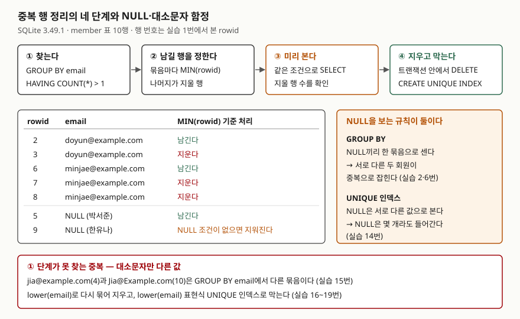

## 들어가며

회원 가입 화면을 만들어 운영하다 보면 어느 날 같은 이메일로 가입한 회원이 둘씩 보인다. 가입 버튼을 두 번 누르는 사이
요청이 두 번 들어갔고, 표에는 이메일 중복을 막는 장치가 없었다. 이때 흔히 회원 목록을 이메일 순으로 정렬해 내려받고,
엑셀에서 위아래 행을 눈으로 비교해 지울 번호를 적는다. 회원이 1만 명이면 9,999쌍의 이웃 행을 봐야 하고, 지울 행을
고른 뒤에도 `DELETE` 문을 한 줄씩 만들어야 한다. 이 작업은 SQL 몇 문장으로 끝나고, 끝난 뒤 다시 생기지 않게 막는
것까지 한 번에 할 수 있다.

## 개념

**중복 행**은 "같아야 할 값이 같은 행이 둘 이상 있는 것"이다. 무엇이 같아야 중복인지는 업무가 정한다. 회원이면 이메일,
주문이면 주문 번호다. 이 글에서는 이메일이 같으면 같은 회원으로 본다.

정리에는 SQL 기능 세 가지를 쓴다.

| 기능 | 하는 일 |
|---|---|
| `GROUP BY email` | 이메일이 같은 행을 한 묶음(그룹)으로 모은다 |
| `HAVING COUNT(*) > 1` | 묶음 가운데 행이 2개 이상인 것만 남긴다. `WHERE`가 행을 거른다면 `HAVING`은 묶음을 거른다 |
| `rowid` | SQLite가 모든 행에 붙이는 64비트 정수 번호. 표에 컬럼으로 적지 않아도 `SELECT rowid`로 꺼낼 수 있다 |

`rowid`가 필요한 이유는 간단하다. 완전히 같은 행 두 개(실습의 2번·3번 행)는 컬럼 값만으로는 하나를 가리킬 수 없다.
`WHERE email = 'doyun@example.com'`은 둘 다 고른다. 행마다 다른 번호가 있어야 "이 행은 남기고 저 행은 지운다"를
적을 수 있다.

## 구조



> **출처**: [SQLite — SELECT: Generation of the set of result rows](https://www.sqlite.org/lang_select.html#resultset)(GROUP BY에서 NULL끼리 같은 값),
> [SQLite — CREATE TABLE: ROWIDs and the INTEGER PRIMARY KEY](https://www.sqlite.org/lang_createtable.html#rowids_and_the_integer_primary_key),
> [SQLite — CREATE TABLE: UNIQUE constraints](https://www.sqlite.org/lang_createtable.html#unique_constraints)(UNIQUE에서 NULL은 서로 다른 값).
> 행 번호와 처리 결과는 실습 1·6·10번의 실행 결과다.

## 동작 원리

순서는 네 단계다. **찾기 → 남길 행 정하기 → 미리 보기 → 지우고 막기.**

1. **찾는다.** `GROUP BY email`로 묶고 `HAVING COUNT(*) > 1`로 두 행 이상인 묶음만 본다.
2. **남길 행을 정한다.** 묶음마다 `MIN(rowid)`, 곧 가장 먼저 들어온 행 하나를 남긴다. 그 밖의 행이 지울 대상이다.
3. **미리 본다.** `DELETE`에 쓸 조건을 그대로 `SELECT`에 붙여 지울 행을 눈으로 확인한다.
4. **지우고 막는다.** 트랜잭션 안에서 지우고, 같은 컬럼에 `UNIQUE` 인덱스를 만든다. 인덱스가 생기면 같은 값이
   다시 들어올 때 DB가 거절한다.

이 과정에서 NULL을 다루는 규칙이 두 군데에서 다르게 작동한다. SQLite 문서는 **묶음을 만들 때는 NULL끼리 같은 값으로**
본다고 적고, **UNIQUE 제약에서는 NULL이 다른 모든 값, 다른 NULL과도 다르다**고 적는다. `NULL = NULL`이 참이 아닌
비교 연산과도 또 다르다. 이메일을 비워 둔 회원이 둘 있으면 1단계는 이 둘을 중복으로 잡고, 4단계의 인덱스는 이 둘을
문제 삼지 않는다. 1단계 결과를 그대로 2·3단계에 넘기면 서로 다른 회원 한 명이 지워진다. NULL이 비교·묶음·UNIQUE·집계에서
각각 어떻게 다뤄지는지는 [NULL 동작 비교 글](../../2026-10-03-null-index-group-unique-distinct/index.md)에서 한 표로 정리했다.

## 실습 예제

전체 소스: [`code/dedupe_member_email.py`](code/dedupe_member_email.py), 실행 기록: [`code/output.txt`](code/output.txt).
`member` 표 10행에는 이도윤이 두 번, 정민재가 세 번 들어가 있다. 박서준과 한유나는 이메일이 NULL인 **서로 다른 회원**이고,
최지아는 `jia@example.com`과 `Jia@Example.com`으로 두 번 가입했다.

```text
-- 1. 표에 보이지 않는 rowid
   => rowid | email | name
      1 | sky@example.com | 김하늘
      2 | doyun@example.com | 이도윤
      3 | doyun@example.com | 이도윤
      4 | jia@example.com | 최지아
      5 | None | 박서준
      6 | minjae@example.com | 정민재
      7 | minjae@example.com | 정민재
      8 | minjae@example.com | 정민재
      9 | None | 한유나
      10 | Jia@Example.com | 최지아
```

표를 만들 때 `rowid` 컬럼을 적지 않았는데도 1부터 번호가 붙어 있다. 출력의 `None`은 파이썬이 NULL을 찍는 모양이다.

### 찾기 — NULL이 중복으로 잡힌다

```text
-- 2. 같은 이메일이 두 번 이상인 것 — GROUP BY + HAVING
   => email | dup_count
      None | 2
      doyun@example.com | 2
      minjae@example.com | 3
-- 3. NULL 을 빼고 다시 센다
   => email | dup_count
      doyun@example.com | 2
      minjae@example.com | 3
```

2번에 `None | 2`가 있다. 박서준과 한유나는 다른 사람인데 이메일이 비었다는 이유로 한 묶음이 됐다. 3번처럼
`WHERE email IS NOT NULL`을 먼저 걸어야 진짜 중복만 남는다. `WHERE`는 묶기 전에 행을 거르므로 NULL 행은 묶음에
들어가지도 않는다.

### 남길 행과 지울 행 — 미리 보기에서 사고를 잡는다

```text
-- 6. 지울 행 미리 보기 — NULL 조건을 빠뜨린 판
   WHERE rowid NOT IN (SELECT MIN(rowid) FROM member GROUP BY email)
   => rowid | email | name
      3 | doyun@example.com | 이도윤
      7 | minjae@example.com | 정민재
      8 | minjae@example.com | 정민재
      9 | None | 한유나
-- 7. 지울 행 미리 보기 — NULL 은 대상에서 뺀 판
   => rowid | email | name
      3 | doyun@example.com | 이도윤
      7 | minjae@example.com | 정민재
      8 | minjae@example.com | 정민재
```

하위 질의 `SELECT MIN(rowid) … GROUP BY email`은 묶음마다 남길 번호 하나를 돌려준다(5번에서 2, 6, 5, 1, 4, 10).
그 목록에 없는 행이 지울 대상이다. 6번처럼 NULL 조건을 빠뜨리면 NULL 묶음의 두 번째 행인 **한유나(9번)가 지울 목록에
들어간다.** `DELETE`를 바로 돌렸다면 회원 한 명이 사라졌다. 7번처럼 `email IS NOT NULL`을 붙이면 3행만 남는다.

"먼저 들어온 행"이 아니라 "가장 최근 행"을 남기고 싶으면 8번처럼 `ROW_NUMBER()`로 묶음 안에서 순번을 매기고
`rn = 1`만 남긴다. 이도윤의 두 행은 가입 시각까지 같아서 `ORDER BY joined_at DESC` 만으로는 순서가 정해지지 않는다.
그래서 `rowid DESC`를 두 번째 정렬 키로 붙였다. 동점을 깨는 키가 없으면 어느 행이 1번이 될지 문장만 보고는 알 수 없다.

### 지우고 막기 — 순서가 정해져 있다

```text
-- 9. 지우기 전에 UNIQUE 인덱스부터 만들면
   에러: UNIQUE constraint failed: member.email
-- 10. 트랜잭션 안에서 지운다 (7번 조건 그대로)
   (바뀐 행 3)
-- 11. 지운 뒤 다시 센다
   (0행)
-- 13. 같은 이메일을 다시 넣으면
   에러: UNIQUE constraint failed: member.email
-- 14. NULL 이메일은 몇 개라도 들어간다
   (바뀐 행 1)
```

중복이 남아 있으면 `UNIQUE` 인덱스를 만들 수 없다(9번). 지운 행 수 3은 7번 미리 보기의 행 수와 같다. 미리 본 수와 지운
수가 다르면 그 자리에서 `ROLLBACK`한다. 인덱스를 만든 뒤에는 같은 이메일이 거절되고(13번), NULL은 세 번째도
들어갔다(14번). 2번에서 NULL을 한 묶음으로 센 것과 정반대다.

### 예상과 달랐던 것 — 대소문자만 다른 이메일은 남는다

```text
-- 15. 대소문자만 다른 이메일 — 아직 남아 있다
   => rowid | email | name
      4 | jia@example.com | 최지아
      10 | Jia@Example.com | 최지아
-- 16. lower() 로 묶으면 중복이 보인다
   => email_key | dup_count
      jia@example.com | 2
-- 19. 대문자로 다시 넣으면
   에러: UNIQUE constraint failed: index 'ux_member_email_lower'
```

중복을 다 지우고 `UNIQUE` 인덱스까지 걸었는데 최지아는 여전히 두 명이다. `GROUP BY email`은 글자를 그대로 비교하므로
`J`와 `j`를 다른 값으로 본다. 사람 눈에는 같은 주소지만 DB에는 다른 값이다. `lower(email)`로 묶자 중복이 나왔고(16번),
같은 기준으로 한 번 더 지운 뒤 `lower(email)`에 표현식 `UNIQUE` 인덱스를 걸자 `SKY@example.com`도 거절됐다(19번).
업무가 대소문자를 구분하지 않는다면 **찾는 기준과 막는 기준을 둘 다 `lower()`로 맞춰야** 한다.

### rowid는 언제까지 믿을 수 있나

SQLite 문서는 `INTEGER PRIMARY KEY`가 없는 표의 rowid를 `VACUUM`이 바꿀 수 있다고 적는다. 이번 실행에서는
`VACUUM` 뒤에도 1, 2, 4, 5, 6, 9, 11이 그대로였다(22번). 그렇다고 바뀌지 않는다고 기대할 근거는 되지 않는다. 문서가
허용한 동작이므로 rowid는 **한 번의 정리 작업 안에서만** 쓰고, 번호를 적어 두었다가 나중에 지우는 식으로 쓰지 않는다.
`WITHOUT ROWID`로 만든 표에는 rowid가 아예 없다(23번, `no such column: rowid`). 이런 표는 기본 키로 행을 가리킨다.

## 실무에서 주의할 점

- **찾기 결과에서 NULL 묶음을 먼저 확인한다.** `GROUP BY`는 NULL을 한 묶음으로 센다. 이메일을 안 받은 회원이 많으면
  가장 큰 "중복 묶음"이 NULL일 수 있고, 그대로 지우면 서로 다른 회원이 사라진다(6번).
- **`DELETE` 전에 같은 조건의 `SELECT`로 행 수를 센다.** 그리고 트랜잭션 안에서 지운 뒤 바뀐 행 수가 같은지 본다.
  다르면 `ROLLBACK`한다. 조건 한 줄 차이로 한 명이 더 지워지는 것은 결과 행 수로만 드러난다.
- **완전히 같은 행이 아니면 남길 행을 업무 기준으로 고른다.** `MIN(rowid)`는 "먼저 들어온 행"일 뿐이다. 나중 행에만
  주소나 전화번호가 채워져 있을 수 있다. 그때는 `ROW_NUMBER()`에 업무 기준을 정렬 키로 주고, 동점을 깨는 키를 끝에 붙인다.
- **이 표를 가리키는 다른 표를 먼저 본다.** 주문 표가 지울 회원의 번호를 들고 있으면 지운 뒤 주문이 주인 없는 행이 된다.
  지우기 전에 참조를 남길 행으로 옮겨야 한다. 이 글의 예제는 참조하는 표가 없는 경우다.
- **지운 다음에는 반드시 막는다.** `UNIQUE` 인덱스 없이 지우기만 하면 같은 버그가 같은 중복을 다시 만든다. 대소문자를
  구분하지 않는 값이면 `lower()` 표현식 인덱스로 막는다(18·19번).

## 정리

- 중복 행 정리는 `GROUP BY … HAVING COUNT(*) > 1`로 찾고, `MIN(rowid)`로 남길 행을 정하고, 같은 조건의 `SELECT`로
  미리 보고, 트랜잭션 안에서 지운 뒤 `UNIQUE` 인덱스로 막는 네 단계다.
- `GROUP BY`는 NULL끼리 같은 묶음으로 보고, `UNIQUE` 인덱스는 NULL을 서로 다른 값으로 본다. 찾을 때는 `IS NOT NULL`을 건다.
- 대소문자만 다른 값은 `GROUP BY email`에 잡히지 않는다. 찾기와 막기 모두 `lower()` 기준으로 맞춘다.
- rowid는 정리 작업 하나 안에서만 쓴다. `VACUUM`이 바꿀 수 있고 `WITHOUT ROWID` 표에는 없다.

## 참고 자료

- [SQLite — SELECT: Generation of the set of result rows](https://www.sqlite.org/lang_select.html#resultset) — GROUP BY로 묶을 때 NULL끼리 같은 값으로 본다
- [SQLite — CREATE TABLE: ROWIDs and the INTEGER PRIMARY KEY](https://www.sqlite.org/lang_createtable.html#rowids_and_the_integer_primary_key) — rowid의 정의, `oid`·`_rowid_` 별칭, WITHOUT ROWID 표에는 없음
- [SQLite — CREATE TABLE: UNIQUE constraints](https://www.sqlite.org/lang_createtable.html#unique_constraints) — UNIQUE 제약에서 NULL은 다른 NULL과도 다른 값
- [SQLite — NULL Handling in SQLite Versus Other Database Engines](https://www.sqlite.org/nulls.html) — UNIQUE·DISTINCT·UNION에서 NULL을 같게 보는지 엔진별 비교
- [SQLite — VACUUM: How VACUUM works](https://www.sqlite.org/lang_vacuum.html#how_vacuum_works) — INTEGER PRIMARY KEY가 없는 표의 rowid를 바꿀 수 있다
- [SQLite — Indexes On Expressions](https://www.sqlite.org/expridx.html) — `lower(email)` 같은 표현식 인덱스
