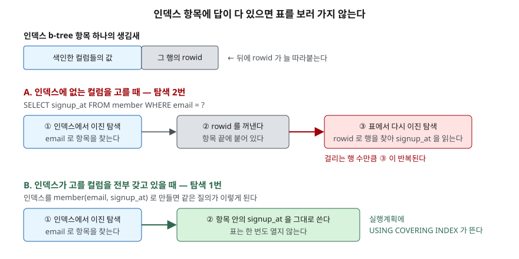

## 들어가며

회원 가입 추이를 보여 주는 관리 화면을 만든다. 특정 이메일 구간의 회원 수와 가입일
최솟값·최댓값을 뽑는 질의인데, 회원이 10만 명쯤 되니 화면이 뜨는 데 체감될 만큼
걸린다.

```sql
SELECT COUNT(*), MIN(signup_at), MAX(signup_at)
  FROM member
 WHERE email BETWEEN ? AND ?;
```

이때 보통 하는 일은 `email`에 인덱스를 거는 것이다. 실제로 빨라진다. 50ms가 28ms가
된다. 여기서 대부분 멈춘다 — 인덱스를 걸었으니 할 일은 다 했다고 보는 것이다.

그런데 이 질의는 `signup_at`도 읽는다. 인덱스에는 `email`밖에 없으니, 조건에 걸린
4만 건마다 **표를 한 번씩 더 찾아가야 한다.** 그 4만 번이 남은 28ms의 대부분이다.

## 개념 — 커버링 인덱스란

SQLite 문서는 이렇게 정의한다. **인덱스가 질의에 필요한 데이터를 전부 갖고 있어
원래 표를 한 번도 볼 필요가 없을 때, 그 인덱스를 커버링 인덱스라고 부른다.**

"커버링 인덱스"라는 별도의 문법이 있는 것이 아니다. `CREATE INDEX`로 만드는 보통의
인덱스이고, **질의가 고르는 컬럼이 그 인덱스 안에 전부 있으면** 그때 커버링으로
쓰이는 것뿐이다. 같은 인덱스가 어떤 질의에는 커버링이고 어떤 질의에는 아니다.

## 구조 — 인덱스 항목에 무엇이 들어 있는가



> **출처**: [SQLite Database File Format §2.5 Representation Of SQL Indices](https://www.sqlite.org/fileformat2.html#representation_of_sql_indices) · [SQLite Query Optimizer Overview §9 Covering Indexes](https://www.sqlite.org/optoverview.html#covering_indexes)

파일 포맷 명세는 인덱스 b-tree의 키를 이렇게 적는다. **색인하는 컬럼들의 값 뒤에
그 행의 키가 따라붙는다.** 보통 표에서 그 키는 rowid다.

그래서 인덱스로 행을 찾는 일은 원래 **이진 탐색 두 번**이다. 인덱스에서 한 번 찾아
rowid를 꺼내고, 그 rowid로 표에서 한 번 더 찾는다. 질의가 고르는 컬럼이 인덱스
안에 다 있으면 두 번째 탐색이 통째로 사라진다.

## 동작 원리 — 어디서 COVERING이 사라지는가

`member(email)` 인덱스 하나만 두고 질의만 바꿔 실행계획을 찍었다.

```text
SELECT email FROM member WHERE email = ?
  (인덱스에 있는 컬럼만 고른다)
QUERY PLAN
`--SEARCH member USING COVERING INDEX idx_email (email=?)

SELECT id, email FROM member WHERE email = ?
  (id 는 INTEGER PRIMARY KEY — 인덱스 항목이 이미 갖고 있다)
QUERY PLAN
`--SEARCH member USING COVERING INDEX idx_email (email=?)

SELECT signup_at FROM member WHERE email = ?
  (인덱스에 없는 컬럼을 하나 더했다)
QUERY PLAN
`--SEARCH member USING INDEX idx_email (email=?)

SELECT COUNT(*) FROM member WHERE email BETWEEN ? AND ?
  (세기만 한다 — 표를 볼 일이 없다)
QUERY PLAN
`--SEARCH member USING COVERING INDEX idx_email (email>? AND email<?)
```

세 가지를 읽을 수 있다.

- `USING INDEX`와 `USING COVERING INDEX`는 **같은 인덱스를 쓰면서 하는 일이 다르다.**
  `COVERING`이 붙었으면 표를 안 본다는 뜻이다.
- **`id`를 같이 골라도 커버링이 유지된다.** `id`가 `INTEGER PRIMARY KEY`라 rowid의
  다른 이름이고, 인덱스 항목이 rowid를 이미 갖고 있기 때문이다. 공짜로 딸려 오는
  컬럼이 하나 있는 셈이다.
- **`SELECT`에 컬럼 하나만 더해도 커버링이 깨진다.** `signup_at` 하나 때문에
  `COVERING`이 떨어졌다. `SELECT *`를 쓰면 거의 항상 깨진다.

## 실습 — 10만 행에서 잰 결과

10만 행짜리 `member` 표(자기소개 본문이 긴 넓은 표)를 파일 DB로 만들고, 인덱스
구성만 바꿔 가며 같은 집계 질의를 7회 돌린 중앙값을 쟀다. 코드는
[`code/covering_index.py`](code/covering_index.py), 실행 기록은
[`code/output.txt`](code/output.txt)에 있다.

```text
인덱스 없는 상태의 DB 페이지 수: 11,141  (43.5 MB)

인덱스                           소요      늘어난 페이지  실행계획
--------------------------------------------------------------------------------------------------------
(없음)                      50.39ms          0쪽  SCAN member
member(email)               28.02ms        782쪽  SEARCH member USING INDEX idx_e (email>? AND email<?)
member(email, signup_at)     3.15ms      1,048쪽  SEARCH member USING COVERING INDEX idx_es (email>? AND email<?)

세 경우의 결과 행이 모두 같은가: True
결과: [(40001, '2024-01-01', '2024-12-28')]
```

`email`만 색인했을 때와 `signup_at`까지 넣었을 때의 차이가 **28.02ms 대 3.15ms**다.
인덱스를 거는 것(50 → 28ms)보다 **커버링으로 만드는 것(28 → 3ms)이 더 크게 줄였다.**

페이지 수도 같이 봐야 한다. 컬럼 하나를 더 넣자 인덱스가 **782쪽에서 1,048쪽**,
약 34% 커졌다. 페이지 크기가 4KB이므로 3.1MB가 4.1MB가 된 것이다. 표 자체가
43.5MB이므로 전체로는 2% 남짓이지만, 인덱스만 놓고 보면 결코 작은 증가가 아니다.

## 실무에서 주의할 점

- **`SELECT *`를 쓰면 커버링은 거의 불가능하다.** 모든 컬럼을 인덱스에 넣을 수는
  없다. 커버링을 노린다면 고르는 컬럼을 먼저 줄인다. 반대로 말하면, 꼭 필요한
  컬럼만 고르는 습관이 그대로 커버링 기회가 된다.
- **컬럼 순서는 여전히 중요하다.** `member(email, signup_at)`은 `email`로 거르는
  질의에 쓰이지만, `signup_at`만으로 거르는 질의에는 쓰이지 않는다. 커버링을
  만들겠다고 뒤에 붙인 컬럼이 **검색 조건 역할을 하지는 않는다.**
- **쓰기가 느려지고 디스크를 더 쓴다.** 인덱스에 들어간 컬럼이 바뀌면 인덱스도 같이
  갱신된다. 위 예제에서 34% 커진 만큼 `INSERT`·`UPDATE` 비용도 늘어난다. 자주
  바뀌는 컬럼을 커버링용으로 끼워 넣는 것은 보통 손해다.
- **`USING COVERING INDEX`가 떴다고 항상 빠른 것은 아니다.** 커버링이어도 훑는
  범위가 넓으면 느리다. 위 결과에서 커버링 인덱스가 빠른 것은 `email` 조건으로
  범위가 먼저 좁혀지기 때문이다. 계획 문자열만 보지 말고 시간을 같이 잰다.
- **인덱스를 늘리기 전에 질의를 고칠 수 있는지 본다.** 화면에 안 쓰는 컬럼을
  고르고 있었다면 그 컬럼을 빼는 것만으로 기존 인덱스가 커버링이 된다. 디스크도
  쓰기 비용도 늘지 않는다.

## 정리

- 커버링 인덱스는 별도 문법이 아니다. **질의가 고르는 컬럼이 인덱스 안에 전부
  있을 때** 보통의 인덱스가 커버링으로 쓰인다.
- 인덱스 항목은 색인 컬럼 값 뒤에 rowid를 달고 있다. 그래서 보통의 인덱스 조회는
  이진 탐색 두 번이고, 커버링이면 **두 번째가 사라진다.**
- 실행계획에서 `USING INDEX`가 `USING COVERING INDEX`로 바뀌는 것이 신호다.
- 10만 행 집계에서 `member(email)`은 28.02ms, `member(email, signup_at)`은
  3.15ms였다. 대신 인덱스가 782쪽에서 1,048쪽으로 34% 커졌다.
- `INTEGER PRIMARY KEY` 컬럼은 같이 골라도 커버링이 깨지지 않는다.
  인덱스가 rowid를 이미 들고 있기 때문이다.

## 참고 자료

- [SQLite — Query Optimizer Overview §9 Covering Indexes](https://www.sqlite.org/optoverview.html#covering_indexes)
- [SQLite — Database File Format §2.5 Representation Of SQL Indices](https://www.sqlite.org/fileformat2.html#representation_of_sql_indices)
- [SQLite — Database File Format §2.3 Representation Of SQL Tables](https://www.sqlite.org/fileformat2.html#representation_of_sql_tables)
- [SQLite — EXPLAIN QUERY PLAN](https://www.sqlite.org/eqp.html)
- [SQLite — PRAGMA page_count](https://www.sqlite.org/pragma.html#pragma_page_count)
