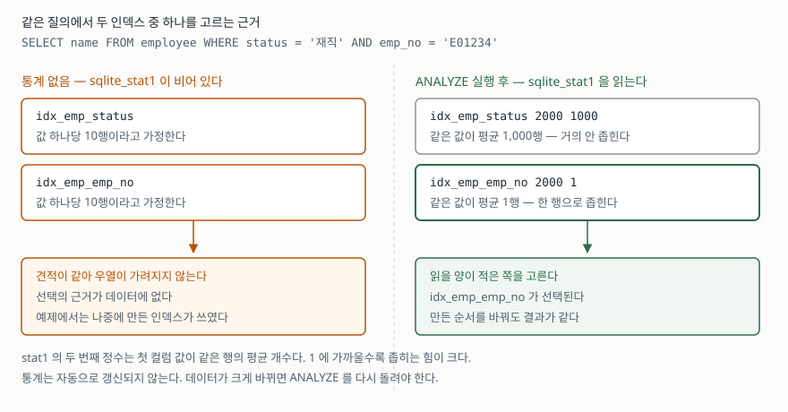

## 들어가며

사원 테이블에서 사번으로 한 명을 찾는 화면을 만든다고 하자. 조건은 보통 둘이 된다.
재직 중인 사람 중에서 이 사번인 사람. `WHERE status = '재직' AND emp_no = 'E01234'` 이다.

인덱스는 이미 있다. 누군가 `status` 로 목록을 뽑느라 하나 만들어 뒀고, 사번 조회가
느리다는 말이 나와서 `emp_no` 로도 하나 만들었다. 조건이 둘, 인덱스가 둘이니
둘 다 쓰이겠거니 하고 넘어가기 쉽다.

그런데 조회가 느리다. 2,000행짜리 표에서 사번 하나를 찾는데 1,980행을 읽고 있다.
인덱스를 더 만들어 보고, 순서를 바꿔 써 보고, 쿼리를 다시 짜 본다. 원인은 그중
어디에도 없다. DB가 **둘 중 하나만 고르는데, 고를 근거를 아직 못 받았기 때문**이다.

## 개념

SQLite 공식 문서의 여러 인덱스 중 고르기 절(§8)은 규칙을 이렇게 적는다.
FROM 절의 각 테이블은 **인덱스를 최대 하나만** 쓴다. 둘 이상의 선택지가 있으면
각각으로 질의를 수행할 때 드는 일의 양을 견적해 가장 적은 쪽을 고른다.

여기서 "일의 양"은 결국 **읽어야 하는 행 수**다. `emp_no` 인덱스로 들어가면 1행만
보면 되고, `status` 인덱스로 들어가면 재직자 1,980행을 전부 꺼내 사번을 하나씩
맞춰 봐야 한다. 차이가 1,000배 가까이 난다.

문제는 DB가 이 1,980 이라는 숫자를 **모른다**는 데 있다. 표에 어떤 값이 몇 개씩
들어 있는지는 데이터를 세어 봐야 아는 것이고, 질의를 계획하는 시점에 세고 있을
수는 없다. 그래서 DB는 미리 세어 둔 요약을 본다. 그 요약을 만드는 명령이 `ANALYZE` 다.

## 구조



> **출처**: [SQLite Query Optimizer Overview §8 Choosing Between Multiple Indexes](https://www.sqlite.org/optoverview.html#choosing_between_multiple_indexes) · [§6 Skip-scan 의 기본 가정](https://www.sqlite.org/optoverview.html#skipscan) · [SQLite File Format §2.6.1 The sqlite_stat1 table](https://www.sqlite.org/fileformat2.html#the_sqlite_stat1_table)

## 동작 원리

`ANALYZE` 를 돌리면 SQLite가 `sqlite_stat1` 이라는 내부 표를 채운다. 파일 포맷 명세의
sqlite_stat1 항목(§2.6.1)에 따르면 이 표의 `stat` 칸은 정수 목록이고, **첫 정수는
인덱스에 든 행 수**, **두 번째 정수는 인덱스 첫 컬럼의 값이 같은 행의 평균 개수**다.
K개 컬럼짜리 인덱스면 정수가 K+1개 들어가고, 유일한 인덱스면 마지막 정수가 1이다.

예제를 돌리면 이렇게 들어간다.

```text
idx_emp_emp_no   2000 1
idx_emp_status   2000 1000
```

읽는 법은 간단하다. `emp_no` 로 찾으면 평균 1행이 나오고, `status` 로 찾으면 평균
1,000행이 나온다. 어느 쪽이 적게 읽는지가 숫자 하나로 드러난다.

그러면 `ANALYZE` 를 안 돌렸을 때는 무엇을 보는가. 같은 문서의 스킵 스캔 절(§6)이
그 가정을 밝혀 둔다. 통계가 없으면 SQLite는 데이터의 생김새를 추측해야 하고,
**기본 추측은 인덱스 첫 컬럼의 값 하나당 평균 10행이 있다는 것**이다.

이 문장이 이 글의 핵심이다. 기본 추측은 **모든 인덱스에 똑같이** 적용된다. `emp_no`
도 10행, `status` 도 10행. 견적이 같아지니 우열이 가려지지 않고, 선택은 데이터와
무관한 무언가로 갈린다.

## 실습 예제

같은 2,000행과 같은 두 인덱스를 담은 DB를 두 판 만든다. **차이는 인덱스를 만든
순서 하나뿐이다.** 전체 소스는 [`code/`](code/)에 있고, 아래 출력은 전부
돌린 기록인 [`code/output.txt`](code/output.txt)에서 가져왔다.

```python
BUILD_ORDERS = {
    "A": ["emp_no", "status"],
    "B": ["status", "emp_no"],
}

QUERY = "SELECT name FROM employee WHERE status = '재직' AND emp_no = ?"
```

데이터는 `emp_no` 가 2,000개 전부 다른 값이고, `status` 는 `재직`·`휴직` 두 가지다.
각 조건이 실제로 몇 행을 남기는지 먼저 세어 봤다.

```text
    status = '재직'          -> 1980행으로 좁혀진다
    emp_no = 'E01234'      ->    1행으로 좁혀진다
```

통계가 없는 상태의 실행계획이다.

```text
  [A판] 인덱스 만든 순서: emp_no -> status
  QUERY PLAN
  `--SEARCH employee USING INDEX idx_emp_status (status=?)

  [B판] 인덱스 만든 순서: status -> emp_no
  QUERY PLAN
  `--SEARCH employee USING INDEX idx_emp_emp_no (emp_no=?)
```

데이터도 질의도 인덱스 정의도 같은데 **계획이 갈렸다.** A판은 1,980행을 훑는 쪽을
골랐고 B판은 1행으로 끝나는 쪽을 골랐다. 두 판에서 모두 나중에 만든 인덱스가 쓰였다.
이 동작은 문서에 적힌 규칙이 아니므로 믿고 기댈 것이 못 된다. 여기서 읽을 것은
"나중에 만든 것이 이긴다"가 아니라 **"고를 근거가 데이터에 없으면 이렇게 갈린다"** 이다.

`ANALYZE` 한 줄을 돌린 뒤 같은 질의를 다시 계획시킨다.

```text
  [A판] 인덱스 만든 순서: emp_no -> status
  QUERY PLAN
  `--SEARCH employee USING INDEX idx_emp_emp_no (emp_no=?)

  [B판] 인덱스 만든 순서: status -> emp_no
  QUERY PLAN
  `--SEARCH employee USING INDEX idx_emp_emp_no (emp_no=?)
```

두 판이 같은 곳으로 모였다. 인덱스를 만든 순서는 그대로인데 결과가 달라졌으니,
바뀐 것은 선택을 가르던 기준 쪽이다.

## 실무에서 주의할 점

**통계는 저절로 갱신되지 않는다.** `ANALYZE` 는 돌린 그 시점의 데이터를 요약할 뿐이다.
표가 비어 있을 때 돌려 두면 "모든 인덱스가 0행"이라는 요약이 남아 오히려 해롭다.
데이터를 적재한 뒤에 돌리고, 분포가 크게 바뀌면 다시 돌린다. SQLite는 `PRAGMA optimize`
로 필요할 때만 갱신하는 길을 따로 둔다.

**평균은 쏠림을 담지 못한다.** `stat1` 의 두 번째 정수는 값 하나당 **평균** 행 수다.
부서가 넷인데 한 부서에 95%가 몰려 있어도 통계에는 "평균 500행"으로만 남는다.
그래서 쏠린 값을 조건으로 줄 때와 드문 값을 줄 때가 같은 계획을 받는다.
값마다 분포를 보려면 히스토그램이 필요한데, 같은 문서의 범위 질의 절(§8.2)은 그것이
`SQLITE_ENABLE_STAT4` 같은 빌드 옵션에 달려 있다고 적는다. 쓰는 판에 그 기능이
들어 있는지 먼저 확인해야 한다.

**인덱스를 더 만드는 것이 답이 아닐 때가 많다.** 조건이 둘인데 인덱스가 둘이면
하나는 반드시 놀고, 고르기만 어려워진다. 두 조건을 한 번에 좁혀야 한다면 인덱스
두 개가 아니라 **두 컬럼을 묶은 인덱스 하나**가 맞는 모양이다. 이때는 좁히는 힘이
큰 컬럼을 앞에 둔다.

**느린 질의를 만나면 실행계획부터 본다.** `EXPLAIN QUERY PLAN` 앞에 질의를 그대로
붙이면 어떤 인덱스가 쓰였는지 한 줄로 나온다. 어느 인덱스가 쓰일지 머리로 짐작하는
시간보다 이 한 줄이 짧다.

## 정리

- 테이블 하나당 인덱스는 하나만 쓰인다. 조건이 둘이어도 DB는 둘 중 하나를 고른다.
- 고르는 기준은 읽어야 할 행 수의 견적이고, 그 견적은 `ANALYZE` 가 채운 `sqlite_stat1` 에서 나온다.
- 통계가 없으면 SQLite는 값 하나당 10행을 가정한다. 모든 인덱스에 같은 가정이 적용되므로 견적이 같아진다.
- 같은 데이터·같은 인덱스에서 인덱스를 만든 순서만 달라도 계획이 갈리는 것을 확인했고, `ANALYZE` 뒤에는 둘 다 같은 인덱스로 모였다.
- `stat1` 이 담는 것은 평균이다. 값이 한쪽으로 쏠린 컬럼은 평균만으로 설명되지 않는다.

## 참고 자료

- [SQLite Query Optimizer Overview — §8 Choosing Between Multiple Indexes](https://www.sqlite.org/optoverview.html#choosing_between_multiple_indexes)
- [SQLite Query Optimizer Overview — §6 Skip-scan](https://www.sqlite.org/optoverview.html#skipscan)
- [SQLite File Format — §2.6.1 The sqlite_stat1 table](https://www.sqlite.org/fileformat2.html#the_sqlite_stat1_table)
- [SQLite — ANALYZE](https://www.sqlite.org/lang_analyze.html)
- [SQLite — EXPLAIN QUERY PLAN](https://www.sqlite.org/eqp.html)
