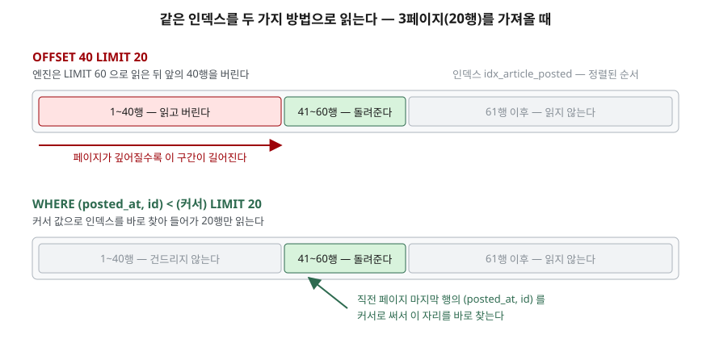

## 들어가며

게시판 목록 API를 만든다. 페이지 번호를 받아 그 페이지의 20건을 돌려주는, 어디에나
있는 그 기능이다. 쿼리는 자연스럽게 이렇게 나온다.

```sql
SELECT * FROM article ORDER BY posted_at DESC LIMIT 20 OFFSET 40;
```

잘 돈다. 그런데 글이 20만 건쯤 쌓인 뒤 누군가 "마지막 페이지" 버튼을 누르면 응답이
눈에 띄게 늦어진다. 1페이지는 즉시 나오는데 1만 페이지는 한참 걸린다. 같은 20건을
돌려주는데 왜 다를까. 인덱스를 더 붙여 보지만 달라지지 않는다. 인덱스가 없어서가
아니라, **`OFFSET`이 건너뛰는 행을 공짜로 건너뛰지 않기 때문이다.**

## OFFSET이 하는 일

SQLite 문서는 이 동작을 숨기지 않고 적어 둔다. `LIMIT x OFFSET y`는 내부적으로
`LIMIT x+y`로 계산한 뒤 앞의 `y`건을 **애플리케이션에 돌려주지 않고 버리는** 것이다.
버린다는 말은 읽지 않는다는 뜻이 아니다. 읽어서 정렬 순서에 맞게 꺼낸 다음 버린다.

그러니 `OFFSET 100000`은 10만 건을 꺼냈다가 버리는 일이다. 페이지 번호가 커질수록
버리는 양이 커지고, 그만큼 시간이 늘어난다.

## 구조 — 인덱스를 어디서부터 읽는가



> **출처**: [SQLite Row Values §3.1 Scrolling Window Queries](https://www.sqlite.org/rowvalue.html#scrolling_window_queries)

키셋 방식은 "몇 번째부터"가 아니라 **"어떤 값보다 뒤에서부터"**를 묻는다. 직전
페이지의 마지막 행이 `('2026-10-08 07:45', 9)`였다면, 다음 페이지는 그 값보다 작은
것 중 20건이다. 정렬 순서대로 만들어진 인덱스에서 그 값의 자리는 한 번에 찾을 수
있으므로, 앞쪽 10만 건은 아예 건드리지 않는다.

```sql
SELECT id, posted_at, title
  FROM article
 WHERE (posted_at, id) < (?, ?)     -- 직전 페이지 마지막 행의 값
 ORDER BY posted_at DESC, id DESC
 LIMIT 20;
```

`(posted_at, id)` 처럼 괄호로 묶은 비교를 **행 값 비교**라고 한다. SQLite는 3.15부터
지원한다. 사전 순서로 비교하므로, `posted_at`이 같으면 그다음 `id`로 넘어가 비교한다.

## 동작 원리 — 정렬키에 유일한 컬럼을 보태는 이유

`id`를 왜 끼워 넣는지는 정렬키가 겹치는 데이터에서 드러난다. 예제 표에는
`2026-10-01 09:00`에 올라온 글이 두 건(`id` 1, 2) 있다. 커서를 `posted_at` 하나로만
잡으면 둘 중 어느 쪽에서 끊겼는지 알 수 없다.

```text
posted_at <  '2026-10-01 09:00' → []
posted_at <= '2026-10-01 09:00' → [(2, '2026-10-01 09:00'), (1, '2026-10-01 09:00')]
```

`<`로 잡으면 같은 시각의 두 건이 통째로 **사라지고**, `<=`로 잡으면 이미 본 행이
**다시 나온다**. 어느 쪽도 맞지 않는다. `(posted_at, id)`로 잡으면 커서가 가리키는
자리가 한 군데로 정해지므로 둘 다 생기지 않는다.

```text
(posted_at, id) < ('2026-10-01 09:00', 2) → [(1, '2026-10-01 09:00')]
```

정렬키 뒤에 유일한 컬럼(보통 기본키)을 붙이는 것은 성능 때문이 아니라 **커서가
가리키는 자리를 하나로 정하기 위해서**다. 인덱스도 같은 순서로 만들어야 한다.

## 실습 — 20만 행에서 재 본 시간

20만 행짜리 표에 `(posted_at DESC, id DESC)` 인덱스를 걸고, 한 페이지 20건을
깊이별로 읽어 7회 중앙값을 쟀다. 전체 코드는 [`code/keyset_pagination.py`](code/keyset_pagination.py)에,
아래 출력을 포함한 실행 기록 전체는 [`code/output.txt`](code/output.txt)에 있다.

```text
  건너뛴 행 |    OFFSET | 키셋(행 값) |  키셋(OR) | 세 결과가 같은가
  ----------+-----------+-------------+-----------+-----------------
          0 |    0.02ms |      0.02ms |   0.02ms | True
      1,000 |    0.03ms |      0.02ms |   0.07ms | True
     10,000 |    0.16ms |      0.02ms |   0.46ms | True
     50,000 |    0.75ms |      0.02ms |   2.26ms | True
    100,000 |    1.39ms |      0.02ms |   4.37ms | True
    199,980 |    2.88ms |      0.03ms |   9.28ms | True
```

`OFFSET`은 건너뛰는 행 수에 거의 비례해 늘어난다. 키셋은 어느 깊이에서도 0.02ms로
붙어 있다. 읽는 양이 항상 20건이므로 당연한 결과다.

세 번째 칸이 뜻밖이었다. **`OR`로 풀어 쓴 키셋이 `OFFSET`보다 3배 넘게 느리다.**
행 값 비교를 지원하지 않는 DB를 위해 흔히 쓰는 재작성인데, 이 환경에서는 가장 느렸다.

```sql
-- 결과는 행 값 비교와 똑같지만 읽는 방식이 다르다
 WHERE posted_at < ?  OR (posted_at = ? AND id < ?)
```

실행계획을 보면 이유가 보인다.

```text
OFFSET 방식
QUERY PLAN
`--SCAN article USING INDEX idx_article_posted

키셋 방식 (행 값 비교)
QUERY PLAN
`--SEARCH article USING INDEX idx_article_posted (posted_at<?)

키셋 방식 (OR 로 풀어 쓴 것)
QUERY PLAN
`--SCAN article USING INDEX idx_article_posted
```

행 값 비교만 `SEARCH`다. 인덱스에서 그 값의 자리를 찾아 들어간다는 뜻이다. 나머지
둘은 `SCAN`, 즉 인덱스를 처음부터 훑는다. `OR` 쪽이 `OFFSET`보다 더 느린 것은 훑는
양이 같은 데다 행마다 `OR` 조건을 한 번씩 더 따져야 하기 때문으로 보인다.

SQLite는 `OR`로 묶인 조건을 쪼개 인덱스를 따로 쓰는 최적화를 갖고 있지만, 문서는
그 최적화가 **쓸 수 있다고 해서 반드시 쓰이는 것은 아니라고** 못 박는다. 여기서는
`ORDER BY`를 정렬 없이 만족시키는 쪽이 더 싸다고 판단해 인덱스를 순서대로 훑는 길을
골랐다.

## 페이지가 흔들리는 문제

키셋을 쓰는 이유가 속도만은 아니다. 1페이지를 읽은 뒤 2페이지를 읽기 전에 새 글이
목록 맨 앞에 올라오면, `OFFSET`은 모든 행을 한 칸씩 밀어 버린다.

```text
1페이지를 읽은 직후 — 독자가 본 id: [12, 11, 10, 9]
그 사이 id=99 가 목록 맨 앞에 들어왔다.

2페이지 — OFFSET 4: [9, 8, 7, 6]
           1페이지와 겹치는 id: [9]
2페이지 — 키셋          : [8, 7, 6, 5]
           1페이지와 겹치는 id: []
```

`OFFSET`으로 읽은 2페이지에 1페이지의 마지막 글이 다시 나왔다. 반대로 맨 앞의 글이
지워지면 한 건이 통째로 **건너뛰어진다**. 키셋은 "41번째"가 아니라 "이 값보다 뒤"를
묻기 때문에 앞쪽이 어떻게 변해도 영향을 받지 않는다.

## 실무에서 주의할 점

- **임의 페이지로 점프할 수 없다.** 키셋은 "다음"과 "이전"만 된다. 1부터 1만까지
  번호를 늘어놓는 UI는 애초에 키셋으로 만들 수 없다. 무한 스크롤이나 "더 보기"
  방식이면 그대로 맞고, 페이지 번호가 꼭 필요하면 `OFFSET`을 남기되 **번호 범위에
  상한을 두는** 편이 낫다.
- **인덱스 순서와 `ORDER BY` 순서가 어긋나면 이점이 사라진다.** 키셋이 빠른 것은
  `WHERE` 절 때문이 아니라 인덱스가 이미 그 순서로 정렬돼 있기 때문이다. 예제에서
  `CREATE INDEX` 줄만 지우면 키셋도 `SCAN`으로 떨어진다.
- **커서를 클라이언트에 그대로 노출하지 않는다.** `posted_at`과 `id`를 쿼리스트링에
  날것으로 실으면 내부 키가 밖으로 나가고, 값을 바꿔 보내면 엉뚱한 범위를 읽는다.
  두 값을 묶어 인코딩한 불투명한 문자열로 주고받는다.
- **정렬 기준을 바꾸면 커서도 무효가 된다.** 조회수 순으로 정렬을 바꾸면 커서는
  `(views, id)`가 돼야 하고, 그에 맞는 인덱스도 따로 필요하다. 정렬 옵션이 다섯 개면
  인덱스도 다섯 개다.
- **`OR` 재작성은 측정하고 쓴다.** 행 값 비교를 지원하지 않는 DB에서는 `OR` 재작성밖에
  길이 없지만, 그 DB에서 `SEARCH`로 풀리는지는 직접 실행계획을 봐야 한다. 이 환경에서는
  `OFFSET`보다 느렸다.

## 정리

- `LIMIT x OFFSET y`는 `x+y`건을 읽은 뒤 앞의 `y`건을 버린다. 페이지가 깊어질수록 비싸진다.
- 키셋은 직전 페이지 마지막 행의 값을 커서로 써서 인덱스의 그 자리를 바로 찾는다.
  20만 행에서 마지막 페이지를 읽을 때 `OFFSET`은 2.88ms, 키셋은 0.03ms였다.
- 커서에는 정렬키와 함께 **유일한 컬럼**을 넣는다. 안 넣으면 같은 값 구간에서 행이
  사라지거나 중복된다.
- 앞쪽에 행이 끼어들어도 키셋은 흔들리지 않는다. `OFFSET`은 같은 글을 두 번 보여 준다.
- `OR`로 풀어 쓴 키셋은 이 환경에서 `SCAN`으로 떨어져 `OFFSET`보다도 느렸다.
  재작성 형태만 바꾸는 것으로는 이점이 따라오지 않는다.

## 참고 자료

- [SQLite — Row Values §3.1 Scrolling Window Queries](https://www.sqlite.org/rowvalue.html#scrolling_window_queries)
- [SQLite — Row Values §2.1 Row Value Comparisons](https://www.sqlite.org/rowvalue.html#row_value_comparisons)
- [SQLite — Query Optimizer Overview §4 OR Optimizations](https://www.sqlite.org/optoverview.html#or_optimizations)
- [SQLite — Query Optimizer Overview §10 ORDER BY Optimizations](https://www.sqlite.org/optoverview.html#order_by_optimizations)
- [SQLite — EXPLAIN QUERY PLAN](https://www.sqlite.org/eqp.html)
