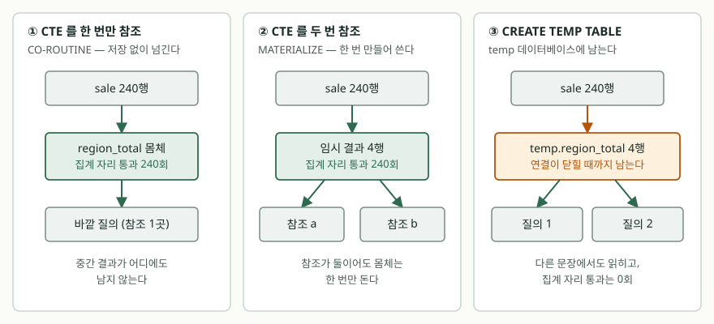

<!-- related:start -->
> **같은 기능을 다른 환경에서 다룬 글** (`cte`)
> - [CTE — WITH 절로 질의에 이름 붙이기](../2026-10-07-cte-with-clause/index.md) — SQLite 3.49.1, Python 3.13.5, Windows 11
> - [Tibero 7 WITH 절 — 이름 붙인 부질의와 재귀 질의, SEARCH·CYCLE 절](../../tibero/2026-10-07-tibero7-with-clause-recursive-cte/index.md) — Tibero 7
<!-- related:end -->

## 들어가며

월별 매출 보고서를 만든다. 지역별 합계를 구해 놓고, 그 옆 칸에 서울 합계를 같이
보여 달라는 요구가 붙는다. 지역별 합계를 내는 질의는 이미 썼으니, 자연스럽게
그것을 복사해 한 번 더 붙여 넣게 된다. 같은 `SELECT ... GROUP BY region` 이
한 질의 안에 두 번 들어간다.

이게 왜 비싼지는 눈에 잘 안 보인다. 표가 240행이면 240행을 두 번 읽어 480행을
지나가는 것 같은데, 실행 시간은 체감되지 않으니 그대로 둔다. 몇 달 뒤 표가
2,400만 행이 되면 그제야 느려진다. 이 중복을 없애는 방법이 둘 있다. `WITH` 절로
이름을 붙이는 CTE, 그리고 결과를 아예 표로 만들어 두는 임시 테이블이다.

## 개념

**CTE**(Common Table Expression)는 `WITH 이름 AS (질의)` 로 부질의에 이름을 붙이는
문법이다. 이름은 **그 한 문장 안에서만** 산다. 세미콜론을 찍고 다음 질의로 넘어가면
사라진다.

**임시 테이블**은 `CREATE TEMP TABLE 이름 AS 질의` 로 만든다. SQLite 는 이것을
`main` 이 아니라 **temp 데이터베이스**에 만든다. 이름은 연결이 닫힐 때까지 살아
있으므로 다음 질의, 그다음 질의에서도 그대로 읽을 수 있다.

둘의 차이는 "이름이 얼마나 오래 사는가" 하나로 보이지만, 실제로 갈리는 것은
**몸체가 몇 번 도는가**다.

## 구조



> **출처**: [SQLite — The WITH Clause §4 Materialization Hints](https://www.sqlite.org/lang_with.html#materialization_hints), [SQLite — Temporary Files §2.6 TEMP Databases](https://www.sqlite.org/tempfiles.html#temp_databases)

## 동작 원리

CTE 를 몇 번 참조하느냐에 따라 SQLite 가 고르는 전략이 달라진다. 실행계획에
그 이름이 그대로 찍힌다.

- **`CO-ROUTINE`** — 몸체가 만든 행을 저장하지 않고 바깥 질의로 바로 넘긴다.
  중간 결과가 어디에도 쌓이지 않는다.
- **`MATERIALIZE`** — 몸체를 한 번 돌려 결과를 임시 공간에 모아 두고, 참조하는
  자리마다 그것을 읽는다.

문제는 이 둘을 눈으로 구분해도 **몸체가 실제로 몇 번 돌았는지는 모른다**는 점이다.
그래서 집계 함수 안쪽에 호출 횟수를 세는 함수 `tally()` 를 끼워 넣었다.

```sql
WITH region_total AS (
    SELECT region, SUM(tally(amount)) AS total FROM sale GROUP BY region
)
SELECT a.region, a.total, b.total
  FROM region_total a JOIN region_total b ON b.region = '서울'
 ORDER BY a.region
```

`sale` 이 240행이므로, 몸체가 한 번 돌면 `tally()` 는 240회 불린다. 두 번 돌면
480회다. 세어 보면 어느 쪽인지 바로 나온다.

## 실습 예제

전체 소스: [`code/`](code/) · 실행 기록: [`code/output.txt`](code/output.txt)

표와 데이터는 기록 앞머리에 그대로 찍혀 있다. 아래는 그중 호출 횟수만 모은 것이다.

| 쓴 방식 | `tally()` 호출 | 실행계획 첫 줄 |
|---|---:|---|
| CTE 1회 참조 | 240회 | `CO-ROUTINE region_total` |
| CTE 2회 참조 | 240회 | `MATERIALIZE region_total` |
| CTE 2회 참조 + `NOT MATERIALIZED` | 240회 | `MATERIALIZE region_total` |
| CTE 2회 참조 + `MATERIALIZED` | 240회 | `MATERIALIZE region_total` |
| 같은 서브쿼리를 두 번 적음 | 300회 | `CO-ROUTINE a` |
| 임시 테이블 — 만들 때 | 240회 | — |
| 임시 테이블 — 두 번 참조 | 0회 | `SCAN a` |
| 임시 테이블 — 다음 질의에서 또 참조 | 0회 | `SCAN region_total` |

표의 실행계획 칸은 `EXPLAIN QUERY PLAN` 이 돌려준 `detail` 원문이다.

**참조가 둘이어도 CTE 몸체는 한 번만 돌았다.** 240회 그대로다. 복사해 붙여 넣는
대신 이름을 한 번 붙이면 그만큼이 그대로 절약된다.

예상과 달랐던 것은 **서브쿼리를 두 번 적은 쪽이 480회가 아니라 300회**였다는
점이다. 실행계획을 보면 같은 몸체인데도 한쪽은 `CO-ROUTINE a`, 다른 한쪽은
`MATERIALIZE b` 로 서로 다르게 계획했다.

```text
QUERY PLAN
|--CO-ROUTINE a
|--SCAN sale
|--USE TEMP B-TREE FOR GROUP BY
|--MATERIALIZE b
|--SCAN sale
```

`ON b.region = '서울'` 의 상수 조건이 `b` 쪽 몸체 안으로 들어가, `b` 는 서울
60행만 집계한 것이다. 240 + 60 = 300이다. 확인하려고 그 조건을 상수에서
`b.region = a.region` 으로 바꿔 다시 돌렸더니 **480회**가 나왔다. 조건이
상수일 때만 안으로 밀려 들어간다는 뜻이다.

여기서 갈림길이 생긴다. **CTE 는 한 벌을 만들어 나눠 쓰므로 쓰이는 자리마다
다르게 깎을 수 없다.** 서브쿼리를 따로 적으면 각 자리의 조건에 맞춰 깎이지만,
깎을 조건이 없으면 두 벌을 통째로 돌린다.

## 실무에서 주의할 점

**`MATERIALIZED` 와 `NOT MATERIALIZED` 는 명령이 아니다.** 이 환경에서는 네 가지
조합이 전부 `MATERIALIZE` 로 같은 계획을 냈다. 공식 문서도 두 키워드를
"구속력 없는 힌트"라고 적고, `NOT MATERIALIZED` 에 대해서는 이름과 달리
구체화를 금지하지 않는다고 못 박는다. 힌트를 붙여 놓고 계획이 바뀌었다고
믿지 말고, 붙인 뒤에 `EXPLAIN QUERY PLAN` 을 찍어 확인한다.

**임시 테이블은 지워 주기 전까지 남는다.** 연결이 닫힐 때 temp 데이터베이스가
통째로 지워지지만, 커넥션 풀에서 빌려 쓴 연결이라면 그 연결은 한참 뒤에나 닫힌다.
같은 이름으로 다시 만들려다 `table region_total already exists` 를 맞는다.
쓰고 나면 `DROP TABLE` 로 닫아 준다.

**임시 테이블은 만든 연결에서만 보인다.** 다른 연결에서 조회하면 없는 표다.
한 요청을 여러 연결로 나눠 처리하는 구조라면 임시 테이블로 중간 결과를 넘길 수 없다.

**이름이 겹치면 CTE 가 이긴다.** `sale` 이라는 실제 표가 있는데 `WITH sale AS (...)`
를 쓰면, 그 문장 안에서 `sale` 은 CTE 를 가리킨다. 실수로 겹치면 질의가 에러 없이
다른 데이터를 본다.

**한 문장에서 끝나면 CTE, 여러 문장에서 다시 쓰면 임시 테이블이다.** 임시 테이블은
만드는 비용(240회)을 한 번 치르고 이후 참조가 0회지만, 그 비용은 CTE 도 한 번은
치른다. 갈리는 지점은 성능이 아니라 **다음 문장에서 또 쓰느냐**다.

## 정리

- CTE 를 한 번 참조하면 `CO-ROUTINE`, 두 번 이상 참조하면 `MATERIALIZE` 로 계획됐고,
  **어느 쪽이든 몸체는 240회 한 벌만 돌았다.**
- 같은 서브쿼리를 두 번 적으면 몸체도 두 벌이 된다. 다만 상수 조건이 안으로 밀려
  들어가 한쪽이 깎이면서 480회가 아닌 300회가 나왔다.
- `MATERIALIZED` · `NOT MATERIALIZED` 는 구속력 없는 힌트다. 이 환경에서는 계획을
  바꾸지 못했다.
- 임시 테이블은 temp 데이터베이스에 남아 다음 질의에서 0회로 읽히지만, 만든 연결
  밖에서는 보이지 않고 직접 지워야 한다.
- 한 문장 안에서 끝나면 CTE, 문장을 넘어가면 임시 테이블이다.

## 참고 자료

- [SQLite — The WITH Clause §4 Materialization Hints](https://www.sqlite.org/lang_with.html#materialization_hints)
- [SQLite — Temporary Files §2.6 TEMP Databases](https://www.sqlite.org/tempfiles.html#temp_databases)
- [SQLite — CREATE TABLE §2 The CREATE TABLE command](https://www.sqlite.org/lang_createtable.html#the_create_table_command)
- [SQLite — EXPLAIN QUERY PLAN](https://www.sqlite.org/eqp.html)
